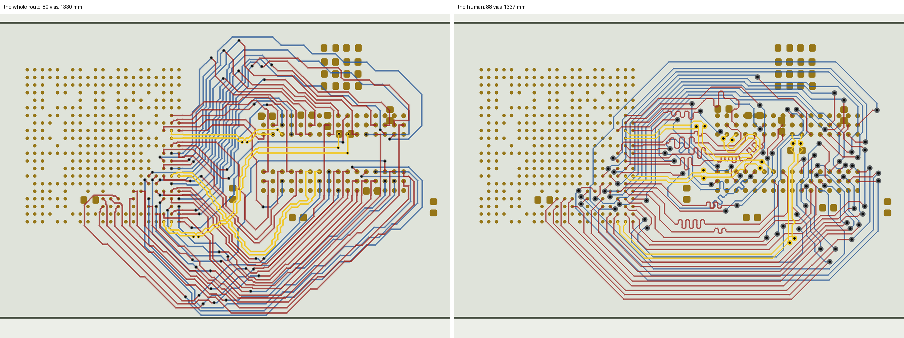
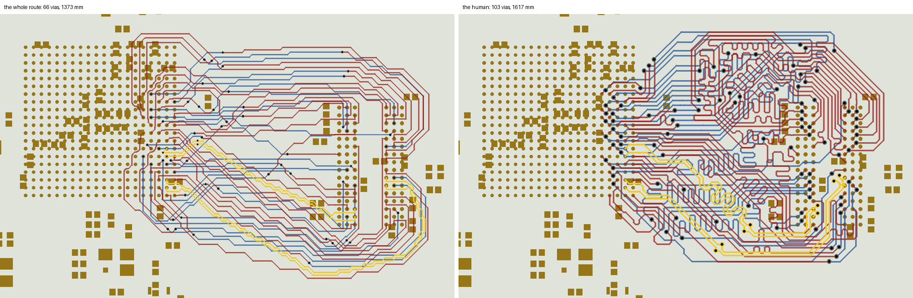
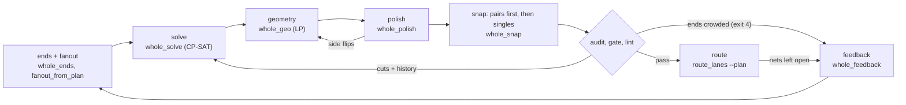

# awx -- topological routing of a BGA-to-BGA bus (#622)

awx routes a fanned-out bus between two BGAs -- an SoC and its DDR3, say --
as one problem: where each net escapes each array, where each lane crosses
the others, and where each changes layer. It holds two routers:

| | how it works | status |
|---|---|---|
| **The whole route**<br>`whole_route.py`, `whole_*.py`, `route_bus.py` | Chooses every net's ends, then plans every lane's **whole path before anything is routed** -- crossings, layer changes, geometry on the router's grid -- checks the plan against the router's own rules, and routes every lane in its band at once. | **The current router.** Every rung of both benches routes connected and DRC-clean on a Mac, with fewer vias and less copper than the human. |
| The braid chain<br>`chain_k.sh`, `braid.py`, `evolve.py` | A CP-SAT plan of both ends, a corridor braid routed stage by stage, then a population of routed boards improved by probes the real router judges. | The earlier router. The whole route reuses its fanout, router, benches and audits. |

Two rules both keep:

- **It is general.** No net, face, board or part name anywhere in the code;
  every rule is geometric.
- **It is an autorouter.** The human's boards are tests, never seeds.

**Contents**

1. [The whole route](#the-whole-route) -- [results](#results), [running it](#running-it), [the bus step](#the-bus-step-on-a-real-board), [how it works](#how-it-works), [the same answer on each machine](#each-machine-the-same-answer); its two solvers explained: [CP-SAT and HiGHS in the whole route](https://drandyhaas.github.io/KiCadRoutingTools/solvers/)
2. [The braid chain](#the-braid-chain)
3. [Shared pieces](#shared-pieces) -- grading, `rules.py`, measuring honestly, the tools, what this adds to `py_router`
4. [TODO](#todo)

<details>
<summary><b>Words this README uses</b></summary>

| | |
|---|---|
| **bench** | a board prepared for the problem: the two arrays, the bus nets, everything else as obstacles. `fb_t2q_pairs` is an H3 BGA `U1` to a DDR3 `DU1`; the zynq **article** is `zynq_ad9364` from the stress corpus, built by `make_bench.py` |
| **K, rung, ladder** | "K51" is a checkpoint on the coherent ladder (`coherent_nets.py`: whole rivers, tightest first). K51 on `fb_t2q_pairs` is 51 nets -- 45 singles and 3 pairs, so 48 lanes |
| **tooth / berth** | a net's escape at the source array / at the destination array: the end of the fanout's stub, where the lane starts / ends |
| **lane, single, pair, legs** | a net's routed copper between its tooth and berth; a single-ended net; a differential pair, one lane of two legs (P and N) |
| **dive, layer change** | a via along a lane; a pair's dive is two barrels |
| **tie via** | a ball's via to a pad of its own net straight under it on the other layer |
| **bar** | the least centre-to-centre distance two neighbouring lanes may have (0.232 mm here) |
| **island** | a piece of static copper -- a part's pads -- that a lane must pass on one side |
| **the human** | the original board's hand-routed copper on the same nets: a benchmark to approach, not a pose to match |
| **v** | vias, in the tables |
| **open, DRC** | nets not connected; DRC violations at the routed 0.1 mm floor |

</details>

---

## The whole route

The whole route decides every lane's whole path first, checks it against the
router's own rules, and only then routes it.

### Results

Both benches route on **our own ends**: the fanout chooses every net's tooth
and berth with the whole route's ends model, and the whole route plans and
routes on them, every lane in its band at once. Each cell counts every via
and millimetre of the run's nets on the board; the human's are counted the
same way. Every cell is connected and DRC-clean.

H3 to DDR3 (`fb_t2q_pairs`):

| | K15 | K28 | K35 | K41 | K51 |
|---|---|---|---|---|---|
| **the whole route** | **12 v, 194 mm** | **32 v, 543 mm** | **42 v, 759 mm** | **54 v, 967 mm** | **80 v, 1254 mm** |
| human | 22 v, 232 mm | 48 v, 678 mm | 60 v, 889 mm | 70 v, 1081 mm | 88 v, 1337 mm |

Zynq to DDR3 (the article's first build, 44 lanes in the ladder; see
[Building the zynq article](#building-the-zynq-article). The human's copper
carries its length-matching meanders):

| | K18 | K26 | K32 | K38 | K42 | K44 |
|---|---|---|---|---|---|---|
| **the whole route** | **14 v, 435 mm** | **28 v, 702 mm** | **42 v, 919 mm** | **48 v, 1173 mm** | **64 v, 1256 mm** | **62 v, 1421 mm** |
| human | 45 v, 662 mm | 57 v, 923 mm | 74 v, 1166 mm | 86 v, 1373 mm | 97 v, 1534 mm | 103 v, 1617 mm |

Reading the tables:

- **Rounds.** Every rung routes in its first fanout round.
- **Machines.** The tables are the Mac's. Linux (`modal_whole.py`, a
  container a rung) can keep a different plan among a solve's equal optima,
  and the ends model's exact ranking can part on them too, so a rung's vias
  and millimetres can differ there.
- **Time.** The Mac ran three rungs at a time: zynq K44 took 12 min, K51 10,
  K41 and zynq K42 8, zynq K38 7, the rest under 5.
- **Generated cases.** `synth_handoff.py` routes 108 generated buses whole --
  lanes handed to a ring on either side of the destination, parts at its
  corner and in the lanes' way (passives and rows of them, PTH headers,
  mounting holes, rows of via barrels), the bus arriving at an angle, lanes
  crossing, pairs; a part in front of a source tooth, a facing berth or a ring
  berth at every distance from none to past the ends model's reach, between
  and off the stub rows and the router's grid, turned, of every kind, on
  either layer, at both ends of a lane; and walls of parts no lane threads,
  in front of the teeth and the berths and across the channel, the lanes
  going round their ends or, where there is no room, under them -- and grades
  each on the route and on the handoff. All 117 pass.
- **More routing layers.** `synth_layers.py` routes generated buses on two to
  six routing layers and grades each against its optimum on that many layers
  (`synth_bus.truth_layers`): reversed, blocked, interleaved, riffled and
  shuffled orders with the arrays' interiors closed, short 3 mm channels, and
  every escape a via (`ESCAPE_VIAS=both`); with them, open interiors, walls
  in the channel, rings, pairs, and lanes ending on the destination's far
  face (`truth_wind`). On three, four and six layers all 48 graded runs are at
  the optimum, and all 87 runs connected and DRC-clean. Two cases wind lanes
  round the destination (`wind_rot16_g3`, and with every escape a via): one
  cut on its south face reaches every berth with no via, a cut on its far face
  pays four, and [the winding cut](#the-ends-whole_endspy) routes both in two
  on three, four and six layers. The short channels and
  the all-via cases are what more layers buy: on two layers they leave nets
  open or lay up to 34 vias where 14 is the optimum (see the TODO).



*K51: left, our fanout's ends and the whole route on them; right, the
human's board. The pairs are yellow. (`whole_compare.py`.)*



*The zynq article at K44 (both DQS pairs yellow), in our frame -- the human's
board turned the same quarter turn: left, the whole route on our own ends;
right, the human, much of its copper length-matching meanders.*

### Running it

One rung, end to end -- the fanout on our own ends, the solve, the loop, the
route and the checks, with up to `ROUNDS` fanout rounds (default 3):

```bash
cd awx
python3 whole_route.py 51 OUTDIR                                       # the H3 bench (BASE=fb_t2q_pairs.kicad_pcb DEST=DU1)
BASE=tmp/zynq/zynqF.kicad_pcb DEST=U2 python3 whole_route.py 9 OUTDIR   # the zynq article (build it first, below), any rung of its ladder
```

It never ends with nothing while a plan for some of the lanes can be laid
(see [the rounds, and never nothing](#the-rounds-and-never-nothing-whole_routepy)).
Every round's result is graded, and the best -- the fewest open nets, then
the fewest vias -- is written to `OUTDIR/best.kicad_pcb` (beside its own
round's `rN/seq.kicad_pcb`). Its last line is that result's grade:

```
WHOLE K=.. round=.. lanes=../.. vias=.. copper=..mm connected=0|1 drc=0|1 secs=.. open=..
```

It exits 0 when that board is connected and DRC-clean, 1 when nets are left
open or a violation stands, and 2 when nothing could be laid at all (no
fanout board, or no plan even for half the lanes).

Each stage runs as a process of its own. `--inproc` runs every stage in the
driver's own process instead, as a routing call inside KiCad's process will:
the same outputs, file for file, in less wall time. In one process no stage
reads or writes the environment: every awx module reads its settings through
`awx_settings`, which the driver gives each stage.

The ladders on this machine, three rungs at a time, each stopped at an hour
with every stage it started, one grade line per rung (`OUT/ladder.txt`):

```bash
python3 whole_ladder.py OUT                          # both benches (zynq: build it first)
python3 whole_ladder.py OUT --bench h3 --ks 41,51 --jobs 2 --cap 3600
```

The ladder on Linux, one container per rung: `modal run awx/modal_whole.py::main
--ks 15,28,35,41,51 --out DIR` (from the repo root; the zynq article with
`--env "BASE=tmp/zynq/zynqF.kicad_pcb;DEST=U2" --ins
tmp/zynq/zynqF.kicad_pcb,tmp/zynq/zynqF.kicad_pro,tmp/zynq/zynqF.ladder.txt
--ks 18,26,32,38,42,44`). Each rung is stopped at `--cap` seconds (3 h by
default, the cloud's cores being slower), its log and best board still
returned. `modal_whole.py::stage` replays one command in the cloud on the
laptop's files at their own paths.

The generated cases (`synth_handoff.py`, see [Results](#results)) on this
machine, or on Linux one container per case from an app deployed off this
tree -- stopped once every case is in (`--keep-app` keeps it; `--collect`
gathers a run whose client went away):

```bash
python3 synth_handoff.py --jobs 4 [--only TAG,..]                     # in awx/
modal deploy --name APP awx/modal_whole.py                            # from the repo root, then in awx/:
python3 synth_handoff.py --modal APP --outdir DIR
```

The generated buses on more routing layers (see [more routing layers than
two](#more-routing-layers-than-two-route_layerspy-relayerpy)), each case drawn
layer by layer, `--sheet` every case on one image per layer count:

```bash
python3 synth_layers.py --layers 3,4,6 --sheet [--only TAG,..] [--outdir DIR]   # in awx/; 2 the two-layer reference
```

When two runs part -- two machines, or a run before and after a change --
these find where, and the last what stands between a bus pair's teeth:

```bash
python3 fanout_logdiff.py RUN_A/r1/fo.log RUN_B/r1/fo.log    # the first decision the two fanouts made differently
python3 resolve_round.py RUN/r1 OUT [--dest U2]              # a round's first solve again, on that round's own board
python3 synth_ab.py OUT_A OUT_B                              # two runs of the generated cases, case by case
python3 pair_teeth.py RUN/r1/fo.kicad_pcb RUN/r1/nets.lines U1 U2   # another net between a bus pair's two teeth
```

<details>
<summary><b>The same, stage by stage</b></summary>

**1. A bench** -- the human's ends, or our own:

```bash
NETS=$(python3 coherent_nets.py 51 --board=fb_t2q_pairs.kicad_pcb)
# the human's ends ...
python3 human_ends_bench.py fb_t2q_human.kicad_pcb tmp/hp/HHe_k51.kicad_pcb "$NETS" \
    --others bench:fb_t2q_pairs.kicad_pcb --ladder fb_t2q_pairs.ladder.txt --sidecar --marker
# ... or our own (the fanout's plan environment: PLAN_PAGES=1 BRAID_PAIRS=1 PLAN_PAIRS=1)
mkdir -p tmp/e tmp/e2
PLAN_JUDGE=ends python3 fanout_from_plan.py tmp/e/fo.kicad_pcb 51 --board=fb_t2q_pairs.kicad_pcb
export BENCH=tmp/hp/HHe_k51.kicad_pcb NETS DEST=DU1   # (or tmp/e/fo.kicad_pcb) the bench every whole_* tool reads
```

**2. The plan:**

```bash
python3 whole_solve.py SOLVE.json                  # crossings and layer changes
python3 whole_route.py --loop SOLVE.json OUTDIR   # geometry -> polish -> audit -> pairs -> singles -> snap
python3 whole_render.py OUTDIR/plan.json OUT.png   # look at it (AUDIT=FILE marks the audit's findings)
```

`whole_route.py --loop` exits 0 with `OUTDIR/plan.json` the snapped plan that
passed, 1 when no round got there, 3 when it stopped not converging, and 4
when it stopped at crowded ends.

**3. Route and check** -- a lane the router reports routed is not proof its
net connects:

```bash
python3 route_lanes.py all --plan OUTDIR/plan.json --board $BENCH --nets "$NETS" --dest DU1 \
    --mode seq --write ROUTED.kicad_pcb            # the router on the plan, each lane in its band
python3 ../py_router/check_connected.py ROUTED.kicad_pcb   # and check_drc.py
```

**4. Feedback to the fanout** (on our own ends):

```bash
python3 whole_gate.py OUTDIR/p1.json OUTDIR/p1.audit --hot HOT.json
python3 whole_feedback.py tmp/e/fo.plan.json FEEDBACK.json HOT.json          # the audits' crowded ends
python3 whole_feedback.py --name tmp/e/fo.plan.json FEEDBACK.json [NET ...]  # or: lanes to move, by name
FEEDBACK=FEEDBACK.json INCREMENTAL=tmp/e/fo.plan.json PLAN_JUDGE=ends \
    python3 fanout_from_plan.py tmp/e2/fo.kicad_pcb 51 --board=tmp/e/SOURCE_BOARD   # the 'source board:' its log names
```

</details>

### The bus step on a real board

`route_bus.py` is the step the production chain will call. It takes a board
as the chain hands it on and two arrays, and writes the board back with the
bus laid, in the board's own frame:

- the bus is every net between the two arrays that the ladder admits, and
  their copper, if any, is stripped. Refused and named, for the rest of the
  chain: a pair through a termination part between the arrays (the zynq's CK
  through R20: the whole route lays no waypoint yet); a net whose name's last
  part is another net's too (the zynq's `ENABLE` and `TEST/ENABLE`: the whole
  route names a net by it, and the router's net patterns would take both);
  and a pair leg whose partner is refused or is no lane between the arrays
  (the zynq's `FB_CLK_P`, its `FB_CLK_N` pulled to RFGND by RX22) -- a pair
  is laid whole or not at all;
- the source array is fanned out for them, and the board is turned into the
  flow frame;
- the whole route runs on the ladder's nets (`--k K` for its first K). A
  pair's two legs stand in one river of the ladder, side by side, so no
  checkpoint runs a leg alone as a single (the zynq LVDS bus had RX_D3_N in
  its second river and RX_D3_P in its fourth); and a K that falls between
  two legs leaves the first out with its partner, so the run is a net short
  of K rather than a pair run as one leg (`coherent_nets.whole_pairs`);
- the routed board is turned back.

It is graded where it is written:
- every bus net connected;
- no DRC violation on a bus net;
- the whole board no worse than it came.

The rows of the board's `.kicad_dru` length and skew rules are named (the log,
the BUS line's `length rows`, the summary's `length_rows`) and not counted:
the bus is laid untuned, and an unrouted net is never measured, so the board
as it came would always read cleaner than any bus. Tuning the lanes to those
rules is #1363.

It hands on what it laid connected, never nothing for the sake of a few nets:
a net the whole route left open, and a bus net the grade finds open on the
board or named in a violation of the bus's (or of the board's, when the board
came out worse), goes back as it came -- its own copper, if it had any -- and
the rest are graded again. Another net's copper the step laid -- a shared
array's other nets, fanned with the bus -- in such a violation goes back
first (`changed_nets`; never a plane's net, whose drops the step lays by the
dozen), as the bus is what the step is for (summary `others_put_back`). The
nets put back are named in the summary's `refused`, for the rest of the chain
to route. The bus is handed on whenever its own nets come out connected and
clean; a violation the board still has more of than it came with, on no bus
net, is named (`board_violations_added`), never a reason to throw the bus
away: sdi_mipi_conv's SDI bus on four layers, 14 nets laid clean, had been
refused whole for one cap pad on a via of the joint field's.

A board with inner copper layers is taken as it is. The lanes run on F.Cu
and B.Cu, and the inner layers' copper meets the through vias only. The nets
handed on are protected in the board's project (#521), with those it came
with protected -- an earlier bus's among them -- and their lanes are
**locked**: KiCad's `(locked yes)` on every track and via the step hands on
(`route_bus.lock_lanes`; `BUS_LOCK=0` protects them only). A later step lifts
a project's protection by naming the net exactly; nothing lifts a lock
(#1261), so the rest of the chain routes round the lanes and connects to
them, never strips them. On sdi_mipi_conv the route step after the bus step,
given the same bus board unlocked, ripped DDR3_A2 -- a lane the step had
connected -- and left it open.

Without `--src` and `--dest` it finds the board's buses itself
(`find_buses`): every pair of parts sharing eight nets or more that the
ladder admits, taken where both are ball arrays (`is_array`: balls past the
outer two rings, on two nets or more -- a QFN's interior is its exposed pad),
the larger array the source, the largest bus first, each routed in turn on the
board the one before handed on. A pair with a row part at one end (a QFN, a
TSOP, a connector) is named and not taken, and so is every net on both parts
the ladder does not admit, with why (another part on it, more than one pad on
a part). `--find` names them and stops. `--bus SRC:DEST[:MODE[:LAYERS]]`,
repeated, names the buses and their order instead, each with its own fanout
(MODE `joint`, `escape` or `plain`; by default the `--joint-fanout` and
`--escape` flags) and its own routing layers (LAYERS, as `ROUTE_LAYERS`). A
later escape bus on an array an earlier bus was handed on through plans that
array whole with it ([a shared array](#a-shared-array), below).

Every stage runs under the chain's own policy (`step_policy`), the step's own
imports of the chain's modules included: a module reads its policy when it is
first imported, and the in-process stages run on the modules the step
imported (`tests/test_622_route_bus_policy.py`).

It routes at the chain's sizes, given as the routing CLIs take them
(`--clearance`, `--track-width`, `--via-size`, `--via-drill`, ... and
`--fanout-track-width` for the escapes). One omitted is resolved as
`route.py` resolves its own: see
[One source for every routing number](#one-source-for-every-routing-number-rulespy).
A via in an array's ball is sized to the pad by the production fanout, as in
the chain's own fanouts.

`--joint-fanout` (opt-in) also fans out the two arrays' other nets and plane
balls. The bus is laid as without it, but round a via site kept free in every
ball of the arrays' other nets (a plane ball has other ways down: a gap's via,
a strap). The rest are planned together round the bus in the first fanout
round (`joint_escape.plan_array`: every move kind, straps, drops, one CP-SAT
solve; the conflicts as groups, `conflict_groups.py`) and laid by the
under-pad engine's joint escape (`bga_fanout/underpad.py`, `joint=True`),
stepped down the fab ladder together only while a ball is left, and no
further than a rung that serves no more than the one above it. A later round
holds them as it holds its own teeth: only a ball whose copper the round's
moved bus stubs now meet is planned again (`joint_escape.carry`). On two
routing layers the bus's ends at both arrays are the chain's own; on more,
the destination's berths and the source's re-laid teeth come from the array's
joint plan.

A plane ball goes down to its plane as the human's do, sharing vias:

- **A shared gap via:** the balls round one diagonal gap may all drop there
  on one via, which the plan prices once.
- **Off the array:** an edge ball may drop half a pitch off the array, or
  straight out from it where no ball stands beside it.
- **A strap:** a ball may strap to a neighbour of its net that has a way
  down. The strap is priced as the via it saves, so a ball takes one only
  when it has no way down of its own.
- **Onto its own plane, clear of the lanes:** a drop's via lands only where
  its net's pour fills -- on a split layer, inside its own island; a ball with
  none of its plane under it or its gaps is left to the route step. A via off
  the array stays clear of the straight continuation of the bus's laid lanes,
  and one beyond a face they leave by pays more than a via in the pad. At the
  destination, whose berths are planned in the same solve as its drops, a
  drop's via is held out of the way out of every berth it might take (its
  exit's straight continuation, at the lane's bar), and each gap site offers
  a finer via as well. On the zynq's U5 an RFGND via 0.14 mm past the west
  face stood between RX_FRAME's two berths, and two flanked EN_AGC's, each
  2.5 um short of the bar; the snap found no way out for either. On the LVDS
  bus's first 32 nets the best round went from 3 nets open to 1.
- **A finer via where the rung's does not fit:** a gap or a site off the edge
  the rung's via does not fit takes the largest of the fab ladder's vias
  that does, laid at that size and disclosed as a narrowing, as a pad too
  small for the rung's via takes a clamped one. Between two of the zynq
  DDR's U2 berths a 0.45 mm via left each lane 0.075 mm, a 0.30 mm one 0.15,
  and four plane balls had no other way down.

Nothing of another net goes into a laid bus pair's **pocket**, between its two
teeth out to where its legs close (`joint_escape.laid_pockets`): an escape
there is walled in once the pair closes, and a via stands in its way. The
zynq DDR's NetR3_2 escaped on B.Cu between DDR3_DQS1's teeth, 0.77 mm apart.
Nor does another ball's escape leave on a layer between two neighbouring laid
lanes whose copper past the array's face closes to less than a via's room
(`pair_teeth.lane_pockets`, `joint_escape.lane_walls`), unless the ball has no
other way out. The zynq DDR's A14 and A10 leave U1's east face 1.6 mm apart on
F.Cu and run on 0.78 mm apart; the LVDS step laid OTG_DATA5 out between them,
and the USB bus left it open on every board after. Walled, it takes a via, and
the USB bus routes all 12 nets with the stub step after it, against 11.

On the zynq's U5 the human's RFGND balls stand four round one via, two at a via
off the edge, and three strapped down a column; there the plan's plane balls
went from 42 of 49 dropped, on 42 vias, to all 49 on 26, and on U1 from 92 of
98 on 92 vias to all 98 on 79. The served question is asked in tiers (the bus
and the pairs, the other nets, the plane balls), each held before the next; a
tier left undecided in its time is asked instead for the most of it served,
and that is held (U1's 98 plane balls, undecided at four times the time).

**The destination's berths, held where the ends chose them.** The joint plan
of the destination array that places the bus's berths (`joint_berths`) is
solved twice: preferring the ends model's berths, and with every one of them
held there and the other balls planned round them. The one with the better
objective is kept, of those that serve every ball. Held, the plan is the
preferring one's with the berths fixed, so it can score higher only where the
preferring search missed it: that search starts from the served tier's
answer, any plan serving every ball, and does not find its way back. On
h616_lpddr4's U2 it put SRST and SDQM3 on the far face, each crossing the
whole bus (119 crossings to 195, and the solve found no plan); held, every
ball was still served and the objective was higher.

**The other nets escape on the plane layers too, where they must.** They are
offered every copper layer, and a leg on a plane layer -- an inner layer with
a pour the run does not route on (`joint_escape.plane_layers`) -- costs ten
vias (`C_PLANE_LAYER`), less than serving its ball is worth: an escape goes
inside only where the outer layers have no room, as the human's do (the
zynq's U1: 15 of its nets on In1, 3 on In2).

**On more routing layers than two the fanout plans every routing layer**, the
other nets included where the run routes on a poured inner layer; a plane
layer it does not route on is not offered there, as a run's layer is then the
colouring's, which prices none. A via escape's run (its stretch from the via to
the array's edge) is planned on no one layer:

- **One move per escape shape**, with the layers its run is clear on. Offered
  layer by layer, zynq U1's array was 41,977 moves and 1.6 million
  constraints, past 1.5 GB at its first solve; one move a shape keeps its
  two-layer 14,955.
- **K layers' capacity**: at most K runs in one lane at a point, at one exit
  cluster, and through one crossing, where two layers said at most one. A
  lane's runs are intervals, so K of them overlapping take K layers and need
  no more. Two legs of a pair are never in one such group, as they leave on one
  layer. A bus run stands ALONE in its group, as on two layers: its layer is
  the solve's, at its via end, and every layer must stay free for it. The
  extra layers are the other nets'. Two bus runs sharing a lane on two layers
  held the zynq's solve to 16 pairs of runs kept apart; other nets' runs beside
  the bus's on the inner layers banned its via ends 51 layers. Each time the
  whole solve proved no plan; without those bans it found one.
- **An exclusion in one row**: an option that excludes several members of a
  group (a via reaching runs, a plane drop or strap against escapes) says so
  as `cap x it + those <= cap`, not a clause a member. Those clauses were most
  of the model's memory.
- **The layers after**: each chosen run gets its layer from a small exact solve
  (`colour_runs`): the outer layer first, the inner ones kept for the bus, and
  a bus lane on the layer its preferred tooth leaves by.

Phase 2 runs the quick-restart worker alone there; the LP worker held a
quarter of the plan's memory for half a percent of its cost. On the zynq at
four layers, U1's plan serves all 297 balls in 767 MB (its two-layer plan
peaks at 1.2 GB), and U5 all 134 in 454 MB; the runs stand about two thirds on
B.Cu, the rest on In1 and In2. Two layers plan exactly as before.

**Each bus its own stretch of the array's edge.** Where an array has other
buses (`route_bus.find_buses`: eight nets or more with one other part, whether
the whole route or the router takes them), no exit of one bus stands between
two exits of another on the same face and layer. Otherwise the bus routed first
walls in the teeth of the next. Runs on no one layer yet count as one layer
here. Before the rule, zynq U1's plan at four layers split six buses' stretches
(the LVDS bus and the U4 group alternating on the bottom face); with it, none.

The passives the joint fanout lays through are moved off its copper once,
after the first round's fanout (the chain's cap nudge,
`place_fanout_clearance.py --beneath-only`: a part beneath a BGA moves only
where it stays beneath it, one beside the array stays where it is; one beneath
another step's array stays too). The first
round's copper is then held to where they stand (`fanout_from_plan.py
--hold`: what no longer clears them is planned again round them), and every
later round starts from those poses and fans out round them; the route holds
them fixed.

`--escape` (opt-in, overriding `--joint-fanout`) fans the bus out the way a
human escapes a ball grid array:

- **The balls dog-boned** (`dogbone_arrays.py`): each netted ball of both
  arrays (a no-connect, a net with no other pad on the board, left bare)
  gets a short stub on its own layer to a through via on one of its
  four diagonal gap points -- toward the other array along the axis it lies
  along most, out of the array's middle on the other -- or, where no gap is
  clear, a via in its pad. The ball lines (the rows and columns through the
  balls) are then free on every other layer, and the gap line through the
  array's middle, between the rows dog-boned up and the rows dog-boned down,
  is a **street** with no via on it. The passives beneath the arrays are
  moved off the vias once (the chain's cap nudge); a passive counts by its
  copper pads, so one whose paste openings are drawn as pads is still a
  two-pad part that moves (sdi_mipi_conv's C105 under U11 had held two SDI
  balls' via sites). An outer-ring ball whose
  straight run out of the field on its own layer is clear is left without a
  via (a pair's two balls alike; `DOGBONE_EDGE_FREE=0` dog-bones every ball),
  as the human leaves 42 of U1's 55 outer balls: it leaves on the surface, and
  the band along the array's edge stays free of vias for the lanes beneath. On
  the zynq LVDS bus's two-round chains (`--rounds 2`, `LOOP_ROUNDS=2`) at
  K32, K40 and K47 it ended with 0, 0 and 2 nets open against 2, 0 and 2 with
  every ball dog-boned, and 2 to 5 vias fewer.
- **A lane bare at both arrays** (`braid.bare_lane`: no track of its net, its
  pads on two parts) -- its balls outer balls at both, left without a via, or
  one ball with no gap for its dog-bone -- has no stub end to read, and the
  ladder takes it all the same (`make_bench.write_ladder` and `coherent_nets`
  with `bare_ok`, which the escape fanout sets): the fanout lays both its ends
  from the pads. The ladder had dropped such a net for want of a stub, so a bus
  of outer balls alone routed nothing, and sdi_mipi_conv's SDI bus ran 16 of
  its 21 nets.
- **Escapes instead of teeth** (`escape_plan.py`): each round's fanout lists
  every way a lane can leave its ball's via -- half a pitch onto a ball line
  beside it, a sidestep to a line up to two pitches over, or a pitch onto a
  street -- out along it to a pitch past the outer balls, on every layer but
  the balls' own where the fanout's track and clearance fit; a ball with no
  via leaves on its own layer, straight out or half a step onto a gap line
  beside it. The ends model chooses each lane's escape at both arrays from
  those lists, and the chosen escapes are laid exactly as listed.
- **The ends model on escapes:** with no tooth laid, both ends of every lane
  are free from its first search; it counts every stack (two escapes leaving
  at one point on two layers); and its estimate of the route keeps two lanes
  whose escape runs stack or cross on different layers, as the solve does.
- **The solve on escapes:** a round's solve with no plan is solved again
  without a pair's zigzag room, then with every crossing's window the whole
  trunk; the geometry pays for what those relax.

On the zynq's LVDS bus (U1 to U5) on four routing layers, on the board the
recipe below makes, at its sizes, `ROUTE_LAYERS=F.Cu,B.Cu,In1.Cu,In2.Cu`
(K: the first K nets of the ladder `route_bus` builds on the dog-boned board,
a pair's leg left out where the K-th net would split it -- K47 is 46 nets; the
whole bus is 52, AD9361_RST, FB_CLK_N and TX_FRAME_N laid with their pulls):

| | K32 | K40 | K47 | all |
|---|---|---|---|---|
| nets routed (the round) | 32 of 32 (1) | 38 of 40 (2) | 42 of 46 (2) | 49 of 52 (1) |
| handed on | 70 v, 722 mm | 84 v, 774 mm | 103 v, 996 mm | 108 v, 1116 mm |

Every net it hands on is connected and DRC-clean; the open ones go back as
they came. Each run is three rounds at most, 3 to 26 minutes on a Mac running
other routes beside it, and hands on its best round: the rounds differ -- the
whole bus's three left 3, 5 and 4 nets open.

`zynq_ad9364` (`boards/`: its source, license and changes in
`boards/NOTICE.md`), its planes poured as the stress run poured them,
and the whole bus at the stress run's sizes -- its fanouts' 0.12 mm track at
0.09 mm, its routes' 0.15 mm track and 0.45/0.3 mm vias:

```bash
cd awx
mkdir -p tmp/zynq/src/boards_set1
gunzip -c boards/zynq_ad9364.kicad_pcb.gz > tmp/zynq/src/boards_set1/zynq_ad9364.kicad_pcb
cp boards/zynq_ad9364.kicad_pro tmp/zynq/src/boards_set1/
STRESS_DIR=tmp/zynq/src /Applications/KiCad/KiCad.app/Contents/Frameworks/Python.framework/Versions/Current/bin/python3 \
    ../tests/stress/strip_routing.py zynq_ad9364
python3 ../py_router/route_planes.py tmp/zynq/src/boards_unrouted_set1/zynq_ad9364.kicad_pcb tmp/zynq/planes.kicad_pcb \
    --nets GND RFGND VCC_1V8 --plane-layers In1.Cu In1.Cu In2.Cu --layers F.Cu In1.Cu In2.Cu B.Cu \
    --clearance-ceiling 0.2 --hole-to-hole-clearance 0.25 --via-size 0.45 --via-drill 0.3 \
    --power-nets GND RFGND VCC_1V8 --power-nets-widths 0.4 0.4 0.4
python3 route_bus.py tmp/zynq/planes.kicad_pcb tmp/zynq/bus.kicad_pcb --src U1 --dest U2 --inproc \
    --clearance 0.09 --track-width 0.15 --fanout-track-width 0.12 --via-size 0.45 --via-drill 0.3
```

Its last line is the grade:

```
BUS U1->U2 K=.. round=.. lanes=../.. vias=.. copper=..mm connected=0|1 drc=0|1 secs=.. | on the board: ...
```

It exits 0 when every bus net it hands on is connected and clean (those it put
back are in `refused`), and 1 when it hands on none. A bus net it does not hand
on goes back as it came: its earlier copper, where that copper still clears
what the step laid.

#### A shared array

An array an earlier bus step has fanned out and routed through -- the zynq's U1
after the DDR step -- is planned WHOLE each round by a later escape bus. Its copper that no routed net owns
(the earlier fanout of its other nets, its plane drops) comes off inside its
box. Then one CP-SAT solve (`joint_escape.escape_field`) plans, round the
bus's teeth, every other ball's escape, strap or bare dog-bone and every plane
ball's drop. The earlier bus's routed copper stays as it stands.
The ends are chosen on the bus's own field: the board as it was before that
earlier step. That field is fanned out as the step fans a board
of the bus alone, and its ladder (the nets, their order and the K cut) comes
with it. So each round's teeth and berths are the ones the bus alone takes.

The solve may move a via end's run onto another layer wherever no other copper
comes within the rule of it (`relayer.clashes`). The joint plan keeps every
other net's copper off each run on every layer the run is free on in the bus's
own field, so the solve keeps all the layer changes it has there. A round
whose ends the joint plan cannot keep falls back to ends chosen on the shared
array, dog-boned. A lane with no tooth move on that field still has its ball
planned by the joint solve. It takes the escape the solve chose for it, and its
berth is chosen with every other lane's ends held (`escape_plan.free_ends`). On
sdi_mipi_conv, once the DDR3 bus and its terminations had taken U11's field,
SDI_D13, D18 and D19 had no tooth move there. Without this the three were never
laid, and stood on bare dog-bones inside U11's far face. A joint field that
leaves some lanes no way to their chosen ends is laid without them, when with
`free_ends` it ends at least as many lanes as the dog-boned field does
(`escape_plan.without_lanes`, `lanes_ended`); otherwise the round lays the
dog-boned field's ends. Given up for SDI_D12 alone, the SDI bus's field had
left 7 lanes no end and U11's other balls on bare dog-bones; laid without it,
16 of the 21 lanes have ends (14 on the dog-boned field), U11's other balls
their planned escapes, and the bus hands on 14 nets connected against 12. Each
step's cap nudge moves only the passives beneath its own two arrays: the DDR step leaves U5's, the LVDS step U2's. The joint plan
lays its vias as if those passives will move; one the nudge cannot move off
them (at its displacement cap) is locked where it stands, the field planned
again round it and the round laid again, the lock taken off after
(`escape_plan.lock_parts`). On sdi_mipi_conv on four layers the nudge had
left C118's GND pad on a DDR3 address via of the field's.

`route_bus --bus` sets this up itself for an escape bus on an array an earlier
bus was handed on through. A step run on its own takes it as settings:
`ESCAPE_JOINT=REF` (the shared array) and `ESCAPE_JOINT_ENDS=BOARD` (the board
before the earlier step), with `--escape`.

On the zynq, both buses in one step (the recipe below): the DDR bus by
`--joint-fanout` first, 45 of its 46 nets (74 vias; DDR3_DQ3 left out of a
partial round), then the LVDS bus with U1 shared, 48 of its 52 nets (107
vias), where on the board of the DDR step alone it routes 49. Every other
ball of U1 is served (91 escaped and 11 strapped of 102), and all 98 of its
plane balls are dropped.

Both buses in one step, the DDR's on two routing layers and the LVDS bus's on
four:

```bash
python3 route_bus.py tmp/zynq/planes.kicad_pcb tmp/zynq/both.kicad_pcb --k 47 --rounds 2 --inproc \
    --bus U1:U2:joint --bus U1:U5:escape:F.Cu,B.Cu,In1.Cu,In2.Cu \
    --clearance 0.09 --track-width 0.15 --fanout-track-width 0.12 --via-size 0.45 --via-drill 0.3
```

**A bus to a QFN.** `--bus` also takes a bus whose destination is a row part:
a QFN, its long pads in rows round its edge (`escape_moves.row_part`).
`find_buses` names such a bus and leaves it to the router unless `--bus` names
it. Each of its pads has one escape, straight out of its row on its own layer
to half a pitch past the pads' outer ends. The lane changes layer beyond that,
where the whole route places its vias. Each round lays the chosen escapes as
planned (`fanout_from_plan.row_berths`): the array engine follows a plan over
a ball grid, and refuses most of a QFN's.

A plain bus from an array an earlier bus went through keeps the escapes that
step's plan laid it there, instead of fanning that full array out again
(`route_bus.keeps_source_escapes`). Fanned out again for the bus alone, a full
array sends a deep ball out by any face with room: the zynq's Ethernet balls
ETH_RXCTL and ETH_RXD2 by U1's south face, into the LVDS bus's escapes, where
the plan had them east toward U3. Kept, the Ethernet bus routes 14 of its 14
lanes against 12, and the USB and Ethernet buses as one 24 of 26 against 22.
`SOURCE_SHARED=0` fans every source out again; `SOURCE_SHARED=REF,..` keeps
them for a plain or a joint bus from those sources only.

A net that a pull or a termination alone keeps out of the bus is laid as a
lane of it (`route_bus.pulled_nets`): one pad on each of the bus's two parts,
and every other pad on a small part (at most `STUB_PADS` pads) whose nets are
rails and such nets only, that either reaches a rail or joins the two legs of
a pair. A rail is a net with a zone, or one on more than `LEFT_PARTS` parts.
So a pull-up or pull-down joins its bus, a fly-by DDR3's address and command
nets join theirs through the resistor arrays that terminate them to Vtt past
the memory, and so does a clock pair through the resistor across its legs.
The pull and termination pads come off their nets for the step and go back on
in OUT, for the chain to connect the stub.

On an escape bus, a pull pad that a short tie reaches from its ball's dog-bone
via -- at most `ATTACH_PITCHES` (1.5) of the array's ball pitch, straight or
along the array's ball and gap lines round other copper -- is joined to the
via by that tie instead, on the pad's layer, as the human ties the zynq's
TX_FRAME_N into its pull RX10 under U1 (`attach_pulls`; `BUS_ATTACH=0`
none). The pad stays on its net through the step, its lane's own copper and
every other net's obstacle, and the pull is connected when the lane is. A
longer tie would run across the ball lines the lanes need into the array, so
the zynq's FB_CLK_N and AD9361_RST pulls, beside U5, are left to the chain.
On a shared array's bus the tie is laid on the bus's own field too, so the
ends are chosen on the field they are laid on. With RX10 so joined the LVDS
bus routed 50 of its 52 nets where it had routed 42, both buses in one call 44
where 42, and on the six-rail board below 50 where 39.

The zynq's USB bus (U1 to U4, 11 nets) and Ethernet bus (U1 to U3, 8 nets)
were routed on its SIX-RAIL board: the unrouted board (the recipe above) with In2
split six ways -- VCC_3V3, VCC_1V8, VCC_1V5, VDD_DIG, VDDA_RX_LO and VCC_1V0
-- beside In1's GND and RFGND. Its DDR3 and LVDS buses are routed first, as
above; then each of the two alone on that board -- the USB bus's OTG_RESETN
(R33, C121) and the Ethernet bus's ETH_MDIO, ETH_RXCTL and ETH_RXD0-3
(R34-R45) laid as lanes, their pulls beside them -- each from U1's escapes as
the LVDS step laid them:

```bash
python3 ../py_router/route_planes.py tmp/zynq/src/boards_unrouted_set1/zynq_ad9364.kicad_pcb tmp/zynq/zr6.kicad_pcb \
    --nets GND RFGND VCC_3V3 VCC_1V8 VCC_1V5 VDD_DIG VDDA_RX_LO VCC_1V0 \
    --plane-layers In1.Cu In1.Cu In2.Cu In2.Cu In2.Cu In2.Cu In2.Cu In2.Cu --layers F.Cu In1.Cu In2.Cu B.Cu \
    --clearance-ceiling 0.2 --hole-to-hole-clearance 0.25 --via-size 0.45 --via-drill 0.3 \
    --power-nets GND RFGND VCC_3V3 VCC_1V8 VCC_1V5 VDD_DIG VDDA_RX_LO VCC_1V0 \
    --power-nets-widths 0.4 0.4 0.4 0.4 0.4 0.4 0.4 0.4
SZ="--clearance 0.09 --track-width 0.15 --fanout-track-width 0.12 --via-size 0.45 --via-drill 0.3"
python3 route_bus.py tmp/zynq/zr6.kicad_pcb tmp/zynq/zr6_both.kicad_pcb --rounds 2 --inproc \
    --bus U1:U2:joint --bus U1:U5:escape:F.Cu,B.Cu,In1.Cu,In2.Cu $SZ
python3 route_bus.py tmp/zynq/zr6_both.kicad_pcb tmp/zynq/zr6_usb.kicad_pcb \
    --rounds 2 --inproc --bus U1:U4:plain:F.Cu,B.Cu,In1.Cu,In2.Cu $SZ
python3 route_bus.py tmp/zynq/zr6_both.kicad_pcb tmp/zynq/zr6_eth.kicad_pcb \
    --rounds 2 --inproc --bus U1:U3:plain:F.Cu,B.Cu,In1.Cu,In2.Cu $SZ
```

The DDR3 bus routes all 46 nets of its run, 44 lanes (74 vias, 1455 mm), and
the LVDS bus 50 of its 52 (109 vias, 1078 mm), SPI_ENB and TXNRX left open.
The USB bus routes all 12 of its nets (24 vias, 359 mm); the Ethernet bus 13
of its 14 (26 vias, 520 mm), ETH_TXCTL's lane left open. Each step hands its
bus on connected and clean, no plane it crosses in more pieces than it came.

**One source, two ends.** Those two buses overlap: their balls interleave on
U1's east face, and routed one after the other the second meets the first's
lanes across its way. `--bus U1:U4+U3:plain:LAYERS` routes them as ONE whole
route, its DEST naming both parts, the trunk's first. The trunk runs to U4;
U3's lanes are a BRANCH, a class of their own stacked outside U4's ring on
their side, leaving the trunk along it to a corner and then straight on to U3,
landing off it in their order round U3 (`whole_frame._branches`). The final
order is the parts' ranks across the trunk, each part's lanes in their order
round it, so lanes to different parts cross on the trunk alone, as a ring's
lanes do; the solve places those crossings and the ends model prices them in
the same order (`whole_frame.dest_ranks`). A branch's berths are the faces of
its part turned toward the source. It is a plain bus: no joint or escape
fanout. On the six-rail board, after its DDR3 and LVDS buses as above:

```bash
python3 route_bus.py tmp/zynq/zr6_both.kicad_pcb tmp/zynq/zr6_usb_eth.kicad_pcb \
    --rounds 2 --inproc --bus U1:U4+U3:plain:F.Cu,B.Cu,In1.Cu,In2.Cu $SZ
```

It routes 22 of the 26 nets (ETH_RXCTL, OTG_DATA0, OTG_DATA1 and OTG_DATA6
left open; 45 vias, 769 mm), handed on connected and clean, in 23 minutes: its
first round 12 minutes, the second (new ends for the four open nets, 4 left
open again) the rest.

### Building the zynq article

The second bench is built from a public board: `ZYNQ7020_AD9364_V2` from
[kangyuzhe666/ZYNQ7010-7020_AD9363](https://github.com/kangyuzhe666/ZYNQ7010-7020_AD9363),
the Zynq `U1` (CLG400) to its DDR3 `U2`. Its routing is stripped, the bench is
made two-layer with `U1` fanned out, and the result is turned into the flow
frame (one quarter turn), where `whole_route.py` runs it. The board is in
`boards/` (`boards/NOTICE.md`: its source, license and changes):

```bash
cd awx
mkdir -p tmp/zynq/src/boards_set1
gunzip -c boards/zynq_ad9364.kicad_pcb.gz > tmp/zynq/src/boards_set1/zynq_ad9364.kicad_pcb
cp boards/zynq_ad9364.kicad_pro tmp/zynq/src/boards_set1/
# strip the routing with KiCad's bundled python (macOS path shown) -> tmp/zynq/src/boards_unrouted_set1/
STRESS_DIR=tmp/zynq/src /Applications/KiCad/KiCad.app/Contents/Frameworks/Python.framework/Versions/Current/bin/python3 \
    ../tests/stress/strip_routing.py zynq_ad9364
python3 make_bench.py tmp/zynq/src/boards_unrouted_set1/zynq_ad9364.kicad_pcb U1 U2 tmp/zynq/zynq.kicad_pcb --two-layer
NETS=$(python3 coherent_nets.py 47 --board=tmp/zynq/zynq.kicad_pcb)
read K CX CY <<< "$(python3 flow_frame.py quarter tmp/zynq/zynq.kicad_pcb U2 "$NETS" | tail -1)"
python3 flow_frame.py turn tmp/zynq/zynq.kicad_pcb tmp/zynq/zynqF.kicad_pcb $K $CX $CY   # its .kicad_pro and .ladder.txt beside it
```

This build gives 48 two-pad nets between the arrays, `DDR3_A14` refused at
the source, 47 in the ladder (checkpoints 9 17 25 31 37 42 47). The table
above is on the article's first build -- 44 in the ladder, checkpoints 9 18
26 32 38 42 44 -- whose net selection `make_bench` no longer makes, so this
build does not reproduce it rung for rung.

### How it works

The two solvers at its heart -- CP-SAT for every crossing and layer change,
HiGHS for the geometry's LP -- and how they negotiate have a page of their
own, with interactive demos:
**[CP-SAT and HiGHS in the whole route](https://drandyhaas.github.io/KiCadRoutingTools/solvers/)**.



| stage | decides | how |
|---|---|---|
| [**ends**](#the-ends-whole_endspy) | each net's tooth and berth | a search over the fanout's escape menus, judged by the whole route's own via and congestion estimate |
| [**frame**](#the-frame-whole_framepy) | the trunk, the rings round the destination, the two orders, each lane's reference path | read off the board, with the ends model's far-face cut |
| [**solve**](#the-solve-whole_solvepy) | every crossing and every layer change, all lanes at once | CP-SAT, proved optimal in vias |
| [**geometry**](#the-geometry-whole_geopy) | each lane's offset along the trunk and the rings | one joint LP (HiGHS) |
| [**polish**](#the-polish-whole_polishpy) | the audit's measures, met in board xy | small vertex moves, an LP per round |
| [**snap**](#the-snap-whole_snappy) | octilinear paths on the router's grid, the pairs first | a grid search per lane |
| [**audit, gate, lint**](#the-audit-the-gate-and-the-lint) | whether the router can lay it | every `plan_audit` check, nothing waived |
| [**loop**](#the-loop-whole_routepy---loop) | what to try next | findings back to the solve as cuts and history |
| [**feedback**](#feedback-whole_feedbackpy) | which ends to move | findings at the ends, a refused fanout, a round's open nets -- back to the fanout |
| [**rounds**](#the-rounds-and-never-nothing-whole_routepy) | what the run hands back | the best round's board; never nothing while a plan for some lanes can be laid |
| [**route**](#the-route-route_lanespy---plan) | the copper | the production router, each lane in its band |

#### The ends (`whole_ends.py`)

`fanout_from_plan.py` under `PLAN_JUDGE=ends`. Each net's tooth at the source
and berth at the destination are chosen together from the fanout's escape
menus, because **the ends decide the braid**: the teeth's order round the
source and the berths' round the destination fix every crossing, and the
layers at the two ends fix what each crossing costs. The fanout lays what the
model chose, and the result is judged **as laid**.

<details>
<summary>Details</summary>

**What can stand together.** One conflict test, the same in the planner that
seeds the berths and in the ends model that judges them: two escapes conflict
when they cross (every crossing counts: `select_moves.SEL_XING` is 2 under
`PLAN_JUDGE=ends`, and 1 -- a crossing only where a move climbs -- for the
braid's judges), or when two exits on one layer stand closer than a track and
a clearance, or when one's via stands within another's run by less than the
router keeps a track off a via (`rules.fan_via_reach`: its via-to-track
clearance for a fanout track rounded up to whole grid cells, and a quarter
cell). An F exit stacked over a B one is allowed, and the engine checks
a stub against other nets' tracks on the stub's own layer only, so it lays
what the model allows. The escape fanout lays its escapes exactly as listed,
so on its states the ends model holds another lane's run off a via by the
rule itself (`rules.fan_via_clear`: the via's radius, the run's half width and
the clearance). At 0.45 mm vias, 0.12 escapes and 0.1 clearance the grid ring
is 0.406, past the 0.4 a dog-bone stands off the next ball line, so every
dog-bone met every neighbouring line's run on every layer: sdi_mipi_conv's SDI
bus had no plan of its teeth with no conflict, on four layers or on eight.
Two teeth **as laid** -- copper the fanout's own audit passed -- are held to
the exits, stacks and runs alone, not to a via's reach: the engine lays a
tooth a grid step off the move asked, and at the reach a realized board's own
teeth conflicted where the moves had not (the zynq six-rail DDR3's DQS1_N
dog-bone 0.375 mm from DQS1_P's via in its pad, 0.400 asked), so every
realized board was judged worse than the one it came from by a conflict no
move could clear.

**The estimate.** The route's layer changes are estimated from the ends alone:
the end-layer changes, a least-weight cover of the crossings between lanes on
one layer end to end, the settling of a lane whose end layers differ, and the
coupling of two such lanes. The best few states are then ranked **exact** on
their orders: the whole solve's order model without its lengths, CP-SAT on
one worker to a deterministic work limit (`EXACT_WORK`, 60). The limit stands
well above what a proof takes on a Mac, because a machine's deterministic time
is its own: H3 K51's best ends prove at 17 on a Mac and need more than 20 on
Linux, and an unproved state ranks last.

**The objective**, one sum in vias:

- every via, the ends' own and the route's -- a pair's change two, its two
  barrels;
- **five more for every via a net carries past two** (a net of 0, 1, 2, 3, 4
  vias costs 0, 1, 2, 8, 14), a tie via not counted toward the two;
- each lane's ride at `select_moves.VIA_MM` a via;
- **congestion** on the trunk between the arrays: each lane's load there
  (the room its crossings and changes take, over the trunk's length) priced
  by the square of its excess over `LOAD_OK` (`W_CONG`), and each crossing
  there `X_TRUNK`, a fifth of a via -- the solve's work follows its
  crossings, not its vias;
- **stacking**: five for every two lanes' ends at one point on different
  layers where either lane changes layer, ten where either is a pair (a
  pair's dive is two barrels beside the other lane's via);
- **what stands in front of a single lane's exit** (`exit_front`): its
  straight run out, `FRONT_REACH` (1.2 mm) along its escape on its layer,
  against copper outside the run -- a passive's pads, another net's track or
  via -- at the router's bar, which grows by its corner buffer at a pad's
  corners (`pairs.pad_corner_buffer`): a track threading the gap between two
  pads is clear only where a grid column crosses it. Blocked with room for a
  via before the block, the lane can change layer there: `FRONT_VIA`, one
  via. Blocked with none: `FRONT_BLOCKED`, past any via count, yet no
  refusal, so a lane with no other end keeps it. Where an earlier round's
  audits found the end crowded, that change is **planned**: the block's span
  along the escape, to the last step within the reach that meets copper, and
  where the via fits before it go to the solve (`front_span`, through the
  fanout's plan sidecar, `ends_model.front`) -- never at a block on every
  layer, a barrel or a hole, which the lane goes round. A pair leg's menu
  keeps only exits with room for the pair there
  (`fanout_from_plan.pair_exit_clear`);
- the feedback's prices (`FB_AVOID`, `FB_PAIR`), by place and escalated
  ([feedback](#feedback-whole_feedbackpy));
- **a plane ball walled in** (under the joint fanout, `plane_ways`): each
  plane ball of the two arrays has its ways down -- its drops as the joint
  escape plans them, on the board without the run's copper, and its straps
  to a neighbour with a drop -- and each end kills those its legs, its via,
  its lane past its exit or a pair's pocket stand on. A state that leaves a
  ball none pays `WALLED`, past any via count, yet no refusal. On the zynq
  DDR the cheapest ends ran the bus over every way down three of U1's
  VCC_1V5 balls had (a bus track on B.Cu under each pad, bus stubs in every
  gap round it); priced, the ends keep them a way down for 8 vias more. A
  pair's pocket starts just short of half a pitch inside its two exits
  (`POCKET_ROW`), the line the outer row's balls stand on: on the six-rail
  board GND B1, between DDR3_DQS0's teeth with its via laid in its pad, was
  read walled in by 0.0003 mm;
- a conflict, a split pair or a refused move, at a price no via count
  reaches.

**The search.** One lane's tooth or berth at a time (one other lane ejected
where it is in the way), iterated from seeded random kicks (`ENDS_ILS_SEED`
another seed); then **ban
kicks**: up to eight times, the three most crossed lanes that have another
option get their current ends banned, the search runs with the bans and
again without them, and the better state stands (four in a row finding
nothing stop). First with the teeth as laid, then with the teeth free from
the berths just chosen; a tooth move is asked only for half a via. The best
distinct states within `EXACT_MARGIN` of the best (`EXACT_TOP`) are ranked on
the exact route, all at once on the model's threads (each on a copy of the
model: the same answers, the zynq DDR3 bus's fanout 9% sooner), and a state
whose exact route fails ranks after every one that routes. Each state is
scored once and each end's place round a grown box is cached.

**The solve's check** (the escape fanout). The ends chosen are put to the
whole solve under its strict rules before any is laid -- the bench they make
built in memory (`whole_ctx.candidate`), so the solve holds them to the same
frame, spans, end rooms and crossing windows the round's will. With no plan,
the crowded lanes' best alternatives are asked alone, the crossings the solve
could not place are priced, and the ends searched again, up to `CHECK_TRIES`
(four) times; a state still without a plan stands as chosen. On the zynq LVDS
bus's escapes the round's first solve had no plan in 21 of 29 rounds where the
ends model's own route found one.

**The joint ends** (an escape base; `ENDS_JOINT=0` leaves the search alone).
Before any search, every lane's tooth and berth are chosen together by CP-SAT
over the same menus: one choice per lane and end, the conflicts the search
honours and a pair's opposite hands forbidden, each end on a layer its
domain allows, two lanes whose orders round the boxes differ crossing on
different layers where neither changes, and two via ends whose runs meet, or
two legs stacked at one exit, on different layers. It minimizes the fanout's
vias and ten vias a crossing -- crossings first, where the search's objective
prices a stack at five vias and a crossing at a hundredth, and so buys stacks
back with crossings the solve then cannot place: on the zynq LVDS bus's round
one, none of 39 of its local optima at K47 had a plan under the solve's
check. The far face's cut and each winding gap off it are ranked by a descent
of the same objective (each lane in turn takes its best tooth and berth
against the others), and CP-SAT is hinted from the best cut's descent. The
state is put to the solve's check; a failing one's core is priced and solved
again, and with no plan in four checks the search takes over. Reproducible: a
count of interleaved batches stops it, and every set it is built from is
walked in order. On that bus's round-one benches at K32, K40 and K47 each had
a plan at the first check, the whole fanout in 14 to 108 s, where the search's
took 455 to 1193 s.

**The far-face cut.** Berths on the destination's far face go round its
north or its south side, split at the middle of the widest gap between them.
The model takes that cut from its own exits and it rides the plan sidecar
(`dest_cut`) to [the frame](#the-frame-whole_framepy), so the model and the
solve share one order: recomputed from the laid stubs, which stand a hair off
the menu's exits, two near-equal gaps could split the face differently, and
the solve then faced crossings the model never priced.

**The winding cut** (`WIND_CUT`: on with more routing layers than two, off
on two). The cut may stand anywhere round the destination but its facing
face, and the berths past it go round the other way: lanes wind round the
destination to enter it from every side, as the human's zynq LVDS lanes wind
round U5. The model scores a cut at the middle of each gap between berths,
clear of every menu exit, on the far cut's best ends, searches the best few
again, and takes one only when its ends predict fewer vias than the far
cut's and beat its objective by a via (`WIND_GAIN`). A wound lane's ride
round the destination is priced a ring's distance out, with the room its
turns stack up. The cut rides the sidecar as the far-face cut does, and the
frame's two rings meet at it. The best few cuts are searched at once, each on
a copy of the model, beside the teeth's search from the berths as they stand;
a winding that moves the berths sends that search again from them. The ends
model takes four threads at most, its caller's counted (`THREADS`): each
exact route is one CP-SAT worker, which gives up the GIL as it solves. The
two-end bus's fanout went from 163 s to 98 s, its plan the same. Each cut's
searched ends are routed exact first, and the search's other best ends only
when those come within `EXACT_MARGIN` of beating the far cut: on
h616_lpddr4's LPDDR4 bus on four layers every one of the 57 cuts its two
fanouts tried lost, each after up to seven exact routes at the work limit.
With one each, that bus's first winding took 151 s for 436, and the two-end
bus's cuts and their outcomes are the same, round for round. A wound state
of 300 crossings still runs its one exact route to the limit.

**Laid as asked, or not kept.** The destination is chosen, fanned out and
audited in passes (`DST_ITERS`, 8):

- a berth not laid as asked, or in a DRC violation, is banned and the
  berths are chosen again, each pass seeded from the last; two berths laid
  as asked but in violation of each other are learned as a pair not to choose
  together;
- a ban covers the move's class -- its kind, direction, layer and exit --
  every leg variant at once, and a pair's two legs are banned together;
- berths laid exactly are held, matched by their exact move (the sidecar's
  `berth_sig`), except those the re-plan still finds in conflict, which are
  freed;
- every pass is graded -- berths not as asked, then the model's objective --
  and the best pass's board ships, not merely the last;
- a net whose every move the bans refuse is offered its whole menu again, and
  said (`unbanned_or_all`): a net with no move stops the whole search, where a
  refused move is only one the engine may lay otherwise: the zynq's USB bus,
  on a board whose LVDS step had laid OTG_NXT's tooth on an inner layer no
  move is on, banned that tooth's one class and laid nothing.

At the source, a board the fanout did not lay as asked is not kept, and a
move set the realize rejects for DRC has the moves its violations name
banned. A realized board judged worse on its teeth as laid than the board
kept is not the end when its own choice asks teeth that would beat the kept
board: those teeth are realized too, and theirs, while each board is better
as laid than the one before (`TEETH_AHEAD`, three steps at most), and the
first that beats the kept board is kept; else the kept board stands. On the
zynq DDR3 bus with its reset's pull (the recipe's DDR step) the first realize
met two berths in conflict as laid and was reverted, and the round laid 104
vias; stepped on, it lays 72.

**Never chosen:**

- two moves the fanout cannot lay together;
- a tooth move through another run net's laid tooth;
- a pair's legs apart;
- a tooth on the source's far face still inside the array (a ball's via
  whose lane has not left the field): the frame has no way round the source
  from there.

**A tooth on the source's far face** (the face turned away from the
destination) is priced `FAR_TOOTH`, past any via count, yet no refusal, so
a lane takes it only when it has no other way out of the source. Its ride
round the source is priced as any lane's (`around_box`), and the far face
is cut between its teeth at the gap that crosses the fewest lanes
(`whole_frame.src_cut`); the cut rides the sidecar (`src_cut`) as the
destination's does. A pinout can leave a bus no other way: sdi_mipi_conv's
SDI bus sits in the columns of U11 beside its far face, and four of its
lanes had no tooth escape on any other face.

**A fenced side of the source.** Another net's copper across the band a
lane rides round a side of the source -- a bus an earlier step routed:
its tracks across the line 1.5 mm outside the side face, its vias beside
that line (`side_fences`, read on the shared field where the ends are chosen
on the bus's own, `fence_pcb`) -- costs that lane `FENCE_VIAS`, two vias, a
change under the fence and one back: a far-face lane round that side of the
cut, a tooth on that side face where the fence stands between its exit and
the near corner. The far face's cut counts the fence's crossings as it counts
the lanes'. On sdi_mipi_conv the DDR3 bus leaves U11's south face on four of
its eight layers; the north side is free.

**Never offered** -- which halves each pass:

- a berth on the destination's far face from a ball in the array's other half;
- a tooth on a source side face, or on its far face, from a ball in the
  other half.

**Far dog-bones.** A dog-bone whose via stands past its ball's diagonal cells
goes to the engine with its stub as a walked `path`, the one way the engine
takes a caller's far site.

**Street berths** (`DST_STREET`, 2 under the ends, 0 = off; `escape_moves`
`street=`). The array's empty rows between two groups of balls -- DU1's
3.2 mm between its north and south halves -- are lanes a track pitch apart. A
ball beside them runs on its own layer into a lane of its half, dives at its
stub's line or a half pitch on toward the source, and leaves along the lane
on the other layer, as the human stands most of its vias at DU1. The conflict
test prices the stub's legs on its own layer and a via within reach of a lane
a track pitch away.

</details>

#### The frame (`whole_frame.py`)

The whole route's own frame of a bench, read off the board -- no braid
corridor, branch or path:

- a straight **trunk** spine from the source's pad box through the
  destination's;
- a **ring** round the destination for each of its north and south faces,
  the far face split between them at the ends model's cut (the sidecar's
  `dest_cut`, mirrored with a board turned over; without one, the middle of
  the widest gap between the far face's berths). The ends model takes the
  widest gap too, except where another gap is within a lane pitch of it: a
  difference that small is no evidence, so it scores the ends at each of the
  tied cuts and keeps the best (`whole_frame.cuts_tied`): on the generated
  `wind_rot_e2` the two gaps beside its far-face berths tie, and the cuts give
  32 crossings and 36 -- 8 vias against 12. It goes round the destination's **hull** -- its pads, the
  berths, and other parts' pads within a lane pitch and two lanes' room of
  them -- its lanes stacked across the trunk's handoff line outside it, the
  ring starting a lane pitch inside the first. A part on that **stack** is
  passed **inside** when the ring's lanes fit between it and the
  destination's copper -- the stack packed into the gap, never inside the
  facing face's lanes -- and is one more thing the ring goes round when they
  do not (`room_inside`): a cap at the corner is gone round, a header lying
  along the face with the ring's berths behind it is passed inside;
- the two **orders** the solve inverts: the teeth round the source, the
  berths round the destination;
- each lane's taut **reference path**.

Its lanes are the run's nets that start at its source: each net's source the
part of its pad nearest its tooth, the destination's own pads never one (a
dog-bone run down the channel ends nearer a ball of the destination, and its
net was read as starting there and left out of the frame, open every round).

A pair whose stub stands across the trunk -- a tooth on the source's side
face -- starts at the end of its end run and the run its turn onto the trunk
takes, as a ring pair lands.

A tooth on the source's **far face** -- the face its escape leaves by
(`tooth_face`), not the face it stands nearest, so an exit past the north
face beside the far corner is a north-face tooth -- goes round the source
on a **lead-in** (`lead_ins`). The trunk cannot carry a lane along the far
face: its columns stand across the spine, and that stretch runs along
them. So the lane leaves its tooth straight out of the face, runs along it
and round the corner on a 45-degree chamfer, and starts beside the side
face, where the trunk takes it as it takes a side face's lanes. Which
corner is decided by the far face's cut: the teeth north of it go round
the north, outside every lane of the north face, first in the launch order
(`perim_s`); those south of it round the south, last. On each side the
tooth nearest the corner is innermost, and the lanes nest a lane's room
apart, a pitch out of the far face's teeth and the side face's -- and
outside the copper in their way (`lead_obstacles`: another part's pad,
another net's via or track, on a lead-in's layer), as the destination's rings
go round the parts hugging it: the run along the far face, or the chamfer
and the start, moved out past it by its bar. Laid through a cap beside the
far face, a lead-in was found against it every round, and the lane stayed
open. A far-face tooth still inside the array has no way round from there,
and is refused (`FarFace`; the fanout is told, below).

#### The solve (`whole_solve.py`)

Every lane's route is one coordinate: the trunk from its tooth, then its ring
round the destination (the pad box unrolled from the cut) to its berth. One
CP-SAT model decides every crossing and every layer change for all lanes at
once, proved optimal in its vias.

<details>
<summary>Details</summary>

**Crossings.**

- Every pair of lanes whose launch and berth orders disagree crosses once;
  the braid rule holds over every triple.
- A lane's crossings keep a pitch along a stayer and less along a mover's
  sweep; a pair's two crossings of opposite ways keep its turning run apart.
- Crossing lanes are on different layers.
- No crossing and no change in the band along the source's near face, where
  the teeth stand.

**Layer changes.**

- Up to three per lane, each a via's room from its own crossings -- the room
  of both lanes there, a pair crossing the via's lane the wider by its second
  leg.
- A single's change is a change's room from both its ends, and far enough
  along the route from a neighbouring lane's that the two vias clear the
  via-to-via rule.
- An opposite-hands pair makes at least one change where its tooth and berth
  share a layer.
- A single's end with a planned change (the ends model's, above): the lane
  on the other layer across the block, its change where the via fits -- its
  end room waived down to that, and no stagger or pad cut there, the ends
  model having measured that via clear of every copper on every layer. Soft,
  priced as the geometry's cuts (`W_SOFT`).
- A single the loop's layer cut holds on the other layer across an island
  ([the loop](#the-loop-whole_routepy---loop), below): its changes a via's
  clearance off the island's box on the trunk -- where its end room leaves
  none before the island (or after it, at a trunk lane's berth), from its
  stub's end, its end room, the face band and the stagger waived there as at
  a planned end.
- Soft cuts are priced `W_SOFT`, **three whole vias** -- above a dive's two,
  below a net over two -- as the search's proof reads them: at two and a
  half, a plan breaking a cut floored to the same whole number as one holding
  it two vias dearer, and stood as proved.

**Pairs and fixed obstacles.**

- A pair's end keeps crossings out of its **end connector**
  (`pairs.end_connector`: its legs converging at 45 degrees from its tips
  onto a pose on the grid), and its own layer changes beyond its **dive
  room** (`pairs.dive_room`).
- A pair's changes stay off the turns its route is known to make before any
  geometry -- its spine's and ring's corners, the handoff onto its ring --
  and beyond the turn onto an end whose stub stands more than 45 degrees off
  the route there.
- Every lane's changes stay off the stretch where its reference passes within
  a via's reach of another part's pad or a tooth outside the bus
  (`whole_ctx.foreign_teeth`), a pair's the longer by its dive's straight
  run. These are the **built-in via cuts**. Past the handoff the same along
  each ring, by each lane's own place in its ring's stack: the lanes that
  berth sooner peel off sooner, so the ones still on the ring run inside them,
  and a pad cuts the lanes whose place stands within its reach.

**The objective**, as the ends model's:

1. **five more vias for every via a net carries past two** on the board (its
   stubs' own and its lane's changes; a tie via the fanout laid is not counted
   toward the two, leg by leg, as the ends model counts it) -- a price, never
   a cap;
2. the fewest vias, a pair's change one, and **a run on a plane's layer
   one more** (`PLANE_RUN`; more routing layers than two, a plane-free one
   among them): a lane takes a pour's layer only where it saves a via
   there. On h616_lpddr4 the first solve laid 24 vias for 26 and its round
   routed all 45 nets (43 unpriced, 45 a round later), the In1 GND plane
   left in one piece (three unpriced); on the two-end bus, the same vias
   and nets and 12% less bus copper on In1 and In2;
3. **history** congestion, below a via: every place an earlier round's audit
   found the plan short (`whole_gate --hot`), priced by how many audits found
   it so -- a crossing there a lane pitch square of copper, a change a via's
   patch. The first solve prices nothing.
4. **the planes**, below everything else: between plans of equal cost each
   run's layer is chosen again by the plane it would split -- a ground
   plane's dearer than a power plane's, a layer with no pour free, and among
   planes of one kind the one nearer F.Cu -- so a plan and its mirror on the
   inner layers come out the same way every time, and the ground plane is cut
   the least (`_plane_tie`: after the search, nothing the plan pays allowed to
   grow).

**Proving it.**

- **The workers:** two LP searches (the default and the strongest
  relaxation), core-based search and the objective's lower-bound search
  (`SUBSOLVERS`), so a plan's vias are proved from below.
- **The fallback:** when they cannot prove it, the plan-finding workers they
  leave out run on (`FALLBACK`: quick restarts, the search without the LP,
  core-based search), from the first run's best plan with its bound a
  constraint.
- **The root's floor:** a re-solve only adds cuts and history to the bench's
  first solve, so it can do no better; the root's proof, carried in each
  solve's JSON and taken where its signature matches, floors it, and a plan
  at the root's cost is proved at once.
- **Unproved, still a plan:** a round's first solve, and the loop's last
  re-solve, keep a plan they cannot prove (`SOLVE_UNPROVED`). The nets such a
  plan leaves over two go back to the ends.
- **Relaxed, still a plan** (the escape fanout, `route_bus --escape`): a
  round's first solve with no plan is solved again without a pair's zigzag
  room, then with every crossing's window the whole trunk, and the first plan
  is the round's. The layers two via ends' runs are held apart on are never
  relaxed: the relayer would lay those runs onto one another.
- **No plan, and why** (`SOLVE_CROWD`, a round's first solve): a model with
  no plan at all, relaxed too where it is, is solved again as its **crowd
  diagnosis** -- each lane free to break what its crossings need (their
  spacing per layer and the stack of crossers at one point, a crossing's two
  lanes on two layers, a change's room from them, the layers at its ends), the
  fewest such lanes the only price. The lanes it names (`OUT.crowded.json`, and
  in the round's log) go to the next round's fanout as open nets do, their
  ends freed and avoided. On the zynq LVDS bus's 47 nets on escapes the most
  relaxed model has no plan, and the diagnosis names one lane, CTRL_OUT0, in
  37 s: with that lane's rules free there is a plan.

**Bounded in work, not time.** Counts of CP-SAT's interleaved batches, the
workers sharing no clauses; bounded by deterministic time, or sharing clauses,
one model gave a different answer on every run.

**Its work by need.** The bound-raising workers run first, a probe of 10
batches (`WHOLE_SOLVE_PROBE`): their plan meeting their bound is the solve.
Else the plan-finding workers run on from the probe's plan and bound, one
search of at most 100 batches (`WHOLE_SOLVE_BATCHES`). Each stops sooner once
the vias are proved, and the probe once it has a plan and three of its own
model reductions in a row find no better plan or bound. With more routing
layers than two every solve of a round keeps a plan it cannot prove, and the
probe is all the bound-raising workers spend there: on the two-end bus their
bound stood at 38 from 4 s on, and given 100 batches they ran 160 s to it. A
re-solve's warm start, the round before's plan, is laid out whole first
(0.1 s there): every variable hinted, its search has a plan from the first
batch.

</details>

#### The geometry (`whole_geo.py`)

One joint LP over the trunk and both rings, columns four grid steps apart,
places each lane: its offset per column, in the solve's order, on its solved
layers, same-layer neighbours a bar apart, a via's room round every change,
inside the board and off the pad boxes. A second pass holds each lane to one
side of every island near it. What the LP had to pay for goes back to the
solve as **cuts**.

<details>
<summary>Details</summary>

- **Soft costs:** the length each column's sideways move adds (from below by
  tangent cuts, so a lane takes the **comfortable pitch**, a track more than
  the bar, wherever there is room); the bends; every neighbour short of that
  pitch, four times as steeply below halfway to the bar.
- **The tangents lazy** (`GEO_LAZY`, on): the second pass's tangent cuts (a
  column's length, a pitch, a via's room, each at several slopes) are most
  of its rows and few of them bind. It is solved with those near binding at
  the first pass's answer, then again with any its answer breaks, until it
  breaks none: the whole LP's optimum, its tie-break making it one point. On
  the two-end bus, 228 000 rows: two solves on 130 000, 40 s to 16 s.
- **Turns:** a lane turns at most 45 degrees a column, a pair 45 degrees per
  turning run. A lane is bounded by the free interval its reference lies in,
  outside the arrays' pad boxes grown to the line their stubs end on (the
  median stub) -- a lane whose own tooth or berth stands inside that line, on
  the trunk, by the array's pads alone: held out of the grown box, a short
  tooth among long ones was sent to the nearest interval round it, 5 mm off.
  Held a column before, a lane keeps to the intervals that overlap that one:
  a reference that runs into a box and out of its far side does not carry the
  lane across it. Where a box's corner splits the column, the lane takes the
  side of the end ahead of it -- its piece's end, a ring lane's trunk its
  place in the ring's stack.
- **Vias** stand at the solve's changes, held within the lane's own extent:
  a change the solve's grid rounds a part of a step past a stub's end stands
  at it. A via is kept off a part by the part's own extent on the via's
  column, as a lane is, not by the part's box in the frame -- a part past a
  ring's end projects onto the whole ring. A change AT a terminal -- a
  surface tooth's via at its stub's end, a surface berth's -- has a column of
  no length, so the terminal's own layer is drawn a grid step long there: the
  line had never taken it, and the lane reached its berth on the other layer
  with no via (sdi_mipi_conv's PCLK, its berth on F.Cu: the route refused it).
- **Other nets' vias in the field** the lanes cross -- the arrays' boxes and
  `FIELD_MARGIN` (5 mm) round them -- are islands on every layer, at the
  router's ring about each (`pairs.svia_reach`), as the stubs' vias beside the
  boxes are: a bus an earlier step routed drops its lanes there
  (sdi_mipi_conv's DDR3 bus south of U11, where the SDI lanes pass on the plane
  layers: one lane 0.007 short of such a via round after round, a finding no
  cut answers).
- **Islands:** one split per island and layer, in the lane order, pinned by
  the lanes' own ends. An island is a part, or parts no lane can surely pass
  between (`whole_ctx.part_islands`). A two-pad part whose pads stand a lane
  apart, one beside the other ACROSS the lanes of its home frame, is two
  islands, and a lane may run between them (`corridor.pads_across`); a part
  of more pads stays one -- decided pin by pin, a lane wove through a
  header's row -- and so does one whose pads lie along the lanes, where
  "between" crosses the part's axis (K51's C12). The geometry writes the
  islands it held lanes to, and the polish names its flips by them. The rows hold a lane over its whole
  piece but its own tooth and berth, and a pair's via off an island by its
  barrels' reach. A round pad or hole is held off as the cross of two
  rectangles that covers it (`corridor.round_cover`), reaching 0.22 of its
  radius past it at the corners where its box's square reached 0.41.
- **One side on the board:** which side of a part a lane passes is decided
  once, not per frame. A part's **home** is the frame that sees it whole,
  nearest its spine; a lane that meets the part in two frames -- the trunk and
  a ring, at the corner where the one hands its lanes to the other -- takes the
  home frame's split, else that of the frame it meets the part in over most
  columns, and every frame holds it there (`corridor.decide_sides`,
  `side_carry`): both frames' offsets run the same way round a part a lane
  travels past. Decided in each frame, the trunk and the ring could send one
  lane past the part on opposite sides, the handoff crossing the part between
  them -- and a flip flipped both.
- **Each column measured on its own line:** a part's rows hold a lane off
  where that column's offset line meets the part's pads (`corridor.line_extent`),
  within the frame's box of the part and the lane's reach; the box of its four
  corners projected into a slanted or bent frame is far larger than its
  copper. Every column of a piece is held, the handoff's included.
- **Pairs** run straight for the pair router's straight run either side of
  each dive; a dive within reach of its fixed end runs straight from the end
  through it.
- **Trunk to ring:** a ring lane's trunk ends on its ring's side of the
  ring's start (`ringside`, elastic): the frame starts each ring outside the
  destination's corner and the parts hugging it, and a trunk end inside it
  lies behind the ring's first column, where the ring cannot see it. The ring
  piece enters where its trunk ends, re-anchored after the first pass, its
  offset tied to the trunk's end offset at the trunk's last column; the
  columns the re-anchoring adds are held off the parts like every other, at
  offsets between the trunk's end and the first column the pass laid. The tie
  is exact across the ring; along it the two ends stay apart by the half
  column the ring's first column rounds to and the second pass's move from
  the end it was tied about, and that stretch is drawn. A layer change up to
  the ring's handoff is the trunk's and a later one the ring's, and each piece
  reads its layers that way (`corridor.piece_u`): a ring piece entering short
  of its ring's origin read the trunk's last change again -- the zynq DDR's
  DQ1 drawn F, B for 0.18 mm, F, two vias 0.15 mm apart.
- **Drawn as its own lines:** at a spine corner a lane's two legs meet where
  its own two lines cross, and a column past the crossing is not drawn
  (`Spine.lane_line`). A lane inside a corner lies, near it, beyond where its
  leg's line meets the other's -- sooner where its offset grows into the
  corner -- and drawn through every column it stepped past the corner and
  back.
- **Cuts** for the solve: an island a lane could not be kept off, a change it
  could not give its room, a pair's dive it could not lay straight.
- **The solver:** the LP goes to HiGHS as its **dual**, the lanes read back
  from its multipliers; the interior point is capped at 500 iterations, past
  which the dual simplex solves it. `detmath`'s tie-break makes the optimum
  one point.

</details>

#### The polish (`whole_polish.py`)

The audit's own measures -- pitch, via rooms, static clearance, turns -- met
in board xy by small vertex moves, one LP per round. Each bar is the snap's
plus a grid step, so every gap the snap later splits holds a grid row. A lane
that cannot be held on its side of an island is **flipped**, and the geometry
runs again with the flip before anything is snapped.

<details>
<summary>Details</summary>

- **Static clearance** to a pad as KiCad draws it, plus the router's corner
  buffer for a single in a pad's corner zone; a pair at its legs' reach at a
  45-degree corner plus the half step its off-grid legs take. A via on the
  board (another net's dog-bone, a stitch) as the router keeps a track off it:
  its ring about the grid point it rounds to, and as far again as it stands
  off that point (`pairs.svia_reach`) -- the geometry and the audit read the
  same.
- **Shape:** the audit's fold and notch findings straightened before and
  after the rounds; the rounds stop once no vertex moves more than a
  nanometre.
- **A pair's end run** (`pairs.end_run`) laid straight and held; **its dive**
  kept clear at the three cells the pair router tests, priced at the worst
  off-grid offset its barrels can take.
- **A single's ends** stay inside the arc of router directions within 90
  degrees of its stub, so its grid path cannot fold where lane and stub meet.
- **Flips:** only a part the geometry holds lanes to one side of flips, never
  the source or the destination. **Via cuts:** a dive it cannot lay straight,
  a change it cannot give its room.
- **Held pairs:** their barrels kept off the other lanes by the router's ring
  round each; pairs not yet laid held off static copper from their poses on.

</details>

#### The snap (`whole_snap.py`)

The smooth plan made octilinear on the router's grid, one lane at a time: a
grid search in a band round each lane's smooth line (length, bends, distance
from the line). The **pairs** go first and alone, moving as the pair router
does; they are then **held** while the polish fits the singles round them,
and the snap lays the singles.

<details>
<summary>Details</summary>

**Pairs** (`--pairs`).

- **They move as the pair router does:** 45-degree turns, a turning radius's
  straight run after each, a via only on a straight run either side of it;
  each step inside a single's share of a gap costs its length again -- and
  inside a single's planned via's ring, on every layer, since a barrel spans
  the board: with its line's share alone, on its own layers, a pair laid on a
  third leaned 0.07 mm onto the site (the LVDS bus's first 32 nets: TX_D1 on
  In1 by CTRL_OUT4's dive, and CTRL_OUT4 had no path; held it off, that round
  lays every lane).
- **Keeping to its line:** a slanted line is laid as a staircase on the two
  router headings either side (`pairs.stair_spread`); beyond that and a grid
  step it pays `W_KEEP` per mm of length per mm. The plan leaves room for the
  staircase where nothing else can: a single with a pair either side on its
  layer, which the snap cannot move off either, is held that much further off
  each pair's line where it runs at a slant (`pairs.stair_dev`: half the
  smallest staircase along its heading there, no more than half how far a short
  jog runs across) -- in the geometry, the polish and the audit alike. On
  h616_lpddr4's escape bus SDQS2 and SDQS3 ran 12 degrees off vertical either
  side of SDQM2, 0.40 from it as planned and 0.30 as laid, where it needs 0.34:
  SDQM2 had no path; held off, every lane of the bus is laid. A single with
  another single on one side is moved toward it by the snap, as every such lane
  there was; and a pair beside a pair is laid against the other's steps.
- **End connectors** (`pairs.end_legs`): two legs from its tips to a **pose**
  on the grid, the shortest whose legs clear everything. The pair router
  takes over at the pose with no setback of its own
  (`diff_pair_setback_floor` 0), so the plan and the router share one end.
  The dozen best poses per end (the shortest legs, nearest the plan's line)
  are searched first; where no pair of them has a body between them, the best
  of each heading the dozen lack are added (`POSE_HEADS`): the dozen can all
  stand straight ahead of the tips, where a line arriving across the escape
  cannot turn onto them. On the zynq LVDS bus TX_D4's dozen at the
  destination's south face all headed south, its line arriving at 45
  degrees: laid onto a pose heading south-west, TX_D2 to TX_D5 are laid
  where all four were refused, and the round's open nets fall from 15 to 9.
  On a generated bus of six pairs berthing on the destination's south face
  three were refused, six nets open; now every pair is laid. An end with no
  pose clear at all has no pose pair to search, and the pair is left unlaid
  (the step goes on).
- **Pose to pose**, owing the router's probe past each pose and turning as
  the pair router's own counters allow (`pairs.pose_turn_over`).
- **The crossover:** an **opposite-hands** pair -- P on one side of its
  travel at its tooth and on the other at its berth -- swaps its legs at its
  first dive with a crossover (`pairs.crossover`): 45-degree jogs, both
  barrels on one side, staggered by the least whole grid steps. The whole
  plan knows its shape before it is laid (`pairs.crossover_shape`).
- **A pair the step cannot lay** sends its change nearest where it got stuck
  back to the solve as a via cut, a jog's room wide.
- **A change with no room where the plan put it:** a lane, pair or single,
  that cannot be laid with each change within `RVIA` (two lane pitches) of the
  plan's has one try more within `RVIA_WIDE` (three times that), each layer's
  run as much farther along the lane. On the zynq LVDS bus the polish left
  dives short of their room, and every cell within `RVIA` of TX_D3's and
  RX_D4's planned dives was taken -- their nearest sites 1.30 and 0.86 mm on.
  A pair laid so is two nets connected; the audit still judges it.

**Singles.**

- **Start and end where the router does:** at the grid point nearest its
  tooth and berth, wherever a track fits; an off-grid terminal joins the
  nearest grid point whose join folds neither against the stub nor the lane.
- **Shares:** a lane not yet placed keeps its share of every gap, so the
  lanes laid first cannot take the room the later ones need.
- **Two sweeps** then lay every lane again against the others' real copper. A
  lane the first pass could not lay is tried again with no share of another
  lane it could not lay: neither has copper, and two failed lanes each keeping
  the other's share are never laid. On the zynq LVDS bus TX_FRAME's planned
  dive fenced TX_D3 and TX_D3's fenced TX_FRAME, and eight of a round's
  sixteen pairs were left so; over thirteen rounds of the bus's benches the
  nets the snap left unlaid fall from 98 to 52, in none more.
- **A single the snap cannot lay** is named with where its search got stuck,
  and the loop sends that place to the solve.

**What it measures against:** the router's own base map for static copper
(its pad stamps with their corner buffers, other nets' stubs and vias,
holes, the board edge), placed copper at the audit's bars, a via by the ring
the router stamps round it.

**Speed:** both searches run in the router's Rust core -- a single's
(`grid_router.lane_search`) and a pair's (`grid_router.pair_search`), each
ported exactly, so the snapped plan is byte-identical; an older binary
searches in Python. A pair's end connectors -- each candidate pose's legs, and
their clearance of the board's fixed copper -- are kept from one try of the
lane to the next (its first, its wide one, each sweep), and their clearance of
the copper placed since is measured against what stands within their reach
alone. On the zynq LVDS bus a K47 round's pairs snap in 29 s, 194 s before.

</details>

#### The audit, the gate and the lint

`whole_ctx.lanes` installs a plan in the whole route's own lanes exactly as
the router will get it. `whole_audit.py` runs every `plan_audit.py` check on
it; `whole_gate.py` passes it only when it is complete and clean with
**nothing waived**; `whole_lint.py` checks what the snap promises.

<details>
<summary>Details</summary>

**What the router gets** (`PlanLanes` on the whole frame): reservations, via
sites, bands, layer runs, search windows. A snapped lane's band is its own
grid line -- half a grid step either side, its end cells and its via cells. A
search window's edge is a board edge to the router, so the window stands at
least a via's half size, the board-edge clearance and two grid steps past the
lane's points (`connect.connect`): at 0.6 a via at the lane's outermost point
had no cell (sdi_mipi_conv's SDI_D2 on four layers, its change 1.4 mm short
of its berth, refused every round).

**The audit** runs every `plan_audit.py` check: pads as KiCad draws them; a
single's terminal join as the router lays it; each piece's off-grid allowance;
a pair's end connectors and crossover as exact copper; a pair's dive for its
straight runs, its room from both ends and the three cells the pair router
tests; every pose for the router's probe; bands sampled on the router's grid;
a via against a pair's legs, unplated holes and every stub. A shortfall of a
quarter of the router's grid step or less is a near-miss, not a finding: the
grid snap or a nudge moves a lane or a via that near its bar off it. Each
check counts its near-misses on a `NUDGE` line of their own.

**The gate** passes a plan only when every corridor member is laid, every
check is clean, and every lane's band joins its tooth to its berth.

**The lint:** grid points, 0/45/90 pieces, continuity, no reversal; no fold
where a lane meets its stub (named with its place, which the loop sends on);
a via at every layer change; a pair's turns, dives, end connectors and
crossover as the pair router makes them.

</details>

#### The loop (`whole_route.py --loop`)

Every stage is fed a measurement of the one before. What the audits find goes
back to the solve as **cuts** and **history**, so a round that fails solves
again rather than stopping; side flips go back to the geometry. The loop
stops when it is not converging, or when the trouble is at the ends, which
only the fanout can move.

<details>
<summary>Details</summary>

- **Findings become history:** every audit's findings go to the solve with
  the cuts (`whole_gate --hot`: each finding's place and the lanes it names),
  so a round the geometry has no cut for still solves again.
- **Cuts that leave no plan** (together they can ask more than any plan
  gives) are kept as soft costs for that solve and the rounds after, with the
  history (`whole_solve SOFT_CUTS`), and that re-solve keeps a plan it cannot
  prove.
- **Layer cuts:** a single lane the audit finds against an island on one
  layer, or the snap cannot lay with its search stuck within
  `SNAP_ISLAND_REACH` (2 mm) of one, is held on the other layer across that
  island from the next solve on (`lcuts` in the cut files: the island's box,
  whole_geo's `island_boxes`) -- a wall the lanes cannot go round. Not at an
  island on both layers, which no change answers, and not before a new side
  flip at it has had its round.
- **Not converging:** it stops after two rounds that do not beat the best
  score so far (how far the plan got, then its findings there). A round with
  new side flips to try is not counted.
- **Flips and cuts together:** the solve with the cuts, then the geometry
  with the flips. An island cut is dropped only where its flip was already
  given to the geometry that made it.
- **The stage cache** (`stage_cache.py`): a stage whose script, arguments,
  environment and every file it read are unchanged is restored, not run. Off
  by default; on in `whole_route.py` (`STAGE_CACHE=1`, as `TAUT_MEMO=1`; `=0`
  turns either off).
- **The planned bench** is planned once and saved (`whole_ctx.plan`, under
  `tmp/ctx_cache`).
- **Refusals:** a bench outside the canonical frame (`flow_frame.py`) or with
  more than two copper layers is refused, not misread. A run of only some of
  the bus's lanes -- the last resort's partial -- is judged by the frame's own
  trunk, pad box to pad box, where its balls' centroids alone read a quarter
  off: a bench turned for the whole bus is in the frame for any part of it.

</details>

#### Feedback (`whole_feedback.py`)

What only the fanout can change goes back to it, and the next fanout round
chooses again, **incrementally**: from the previous round's source board,
only the teeth the feedback names free, every other berth held, the run's
nets the previous round's.

<details>
<summary>Details</summary>

The channels:

- **Crowded ends** (`FEEDBACK=`): a finding the audits make beside a face
  within the width its lanes stack to, or in front of it within the band the
  solve keeps clear. Two lanes named together become a pair of ends not to
  choose together again; one alone, an end to avoid. The loop stops for it
  (exit 4) at once for a finding no solve moves, and for any that stands two
  rounds running.
- **Over two:** the nets an unproved plan leaves over two vias, each priced
  over by at least that much.
- **A refused fanout** (`--refused`): a pair the laid fanout split, and a
  tooth on the source's far face still inside the array, avoided.
- **By name** (`--name`): a round that leaves nets open names them, whatever
  its audits found, each at the end where it fails -- where the round's
  findings name it, else the array nearer its ball cut off from its copper,
  else both; one that lays nothing, with nothing new from its audits, names
  the lanes the ends model reads worst -- those over two, else those loaded
  past `LOAD_OK`, else the three most crossed.

A feedback end is priced **by place**: in full where **any leg** of the lane
stands at any of its points on its layer, so a pair cannot dodge it by moving
one leg; half (`FB_OTHER_LAYER`) on the other layer there, as a layer change
is some answer; and off the place at most that half, falling to nothing
`FB_RADIUS` (0.76 mm) beyond, as moving away -- to the nearest other exit, or
further -- is a better one. An end named again in a **later round** is not
added twice: its price doubles (`FB_ESCALATE`), once a round.

**Raised when not followed** (`--raise`): a fanout that lays the round
before's ends again has priced its feedback and not followed it, and the rest
of the round would be the same. The ends named in that round are raised once
more and the fanout alone runs again, up to `FANOUT_RAISES` (3) times; the
second time the other ends of the lanes named are added too, at the base
price, for a lane named where it fails whose failing end has nowhere else to
go (a via-in-pad berth).

</details>

#### The rounds, and never nothing (`whole_route.py`)

A run hands back the best board it laid, and lays something whenever a plan
for some of the lanes exists:

- a round whose loop does not pass is laid all the same, from the plan it
  held (`held_plan`: its snapped plan, else its best smooth plan snapped with
  no gate); a lane that cannot be laid stays open. The best round's plan is
  snapped and laid on that round's own bench, its via ends where its solve
  put them (more routing layers than two relay them each re-solve): laid on
  the first round's, a later loop round's plan on the zynq LVDS bus had eight
  lanes refused at their teeth and berths, 33 nets open, where on its own
  bench it leaves 13;
- a round's loop runs six rounds at most (`LOOP_ROUNDS`); a loop that does
  not pass, its held plan laid not clean, lays one other round's plan too --
  snapped on its own bench, the fewest findings first, a plan the snap lays
  nothing of skipped (`LAY_TRY=N`: N boards in all, stopping at the first
  clean one; 1 lays the held plan alone) -- and keeps the better lay (DRC,
  then open nets, vias, copper): on the zynq LVDS bus the held round laid 10,
  3, 2 and 2 nets open where the loop's best round laid 6, 0, 2 and 2;
- a round that lays nothing, or leaves nets open, feeds the next fanout
  (above), up to `ROUNDS`; a fanout that lays the round before's ends again
  has its feedback raised and runs again (above), and the rounds end only
  when it still does;
- when no round laid anything, the **last resort** is a partial plan on the
  last ends laid: the lanes the rounds named left out (else the three most
  crossed), then more, to a quarter and to half of the lanes -- never every
  lane;
- a round whose PROVED plan lays connected and DRC-clean ends the rounds,
  whether or not its loop passed: a later round could change only the ends
  its audits named, which the lay already went round;
- every round is graded, and the best -- the fewest open nets, then the
  fewest vias -- is `OUTDIR/best.kicad_pcb`.

#### The route (`route_lanes.py --plan`)

The production router on the plan installed in the whole route's own lanes:
the pairs first, then the singles, each in the berths' order round the
destination, every lane in its band, post-passes off.

- A pair's end connectors and crossover are laid as given and the pair router
  runs between them (`connect.connect_pair`'s `a_given` / `b_given` /
  `x_given`) -- or, where the crossover stands at an end, its pose within a
  pair's width of the end's, the two are joined leg to leg: the pair router
  refuses two poses that close (a generated bus's crossed pair, its crossover
  0.075 mm from its berth's pose, was refused in its band).
- **A pair refused in its band is tried in a wider one, then free of the
  plan, last**, after every lane has had its band. Free in its turn, ahead of
  the singles, it took the room the plan gave them: on the zynq LVDS bus one
  pair routed free 2.8 mm off its line, two more after it, and nine singles
  refused.
- Each lane alone, or all in order (`--mode seq`). `--write` writes the board
  for `check_connected` and `check_drc`. A lane whose routing raised is named,
  and the run exits 1.
- The copper is written back in the board's own frame.

#### More routing layers than two (`route_layers.py`, `relayer.py`)

`ROUTE_LAYERS` names the layers the whole route lays its lanes on: F.Cu and
B.Cu first, then the inner layers it may use (`F.Cu,B.Cu,In1.Cu`). Unset, it
is F.Cu and B.Cu and the route is the two-layer one, unchanged: every piece
below is taken only with more routing layers than two. Every via is a through
via.

- **Escapes on the outer layers.** The fanout plans and lays a bus's escapes
  on F.Cu and B.Cu (`route_layers.escape_layers`): a surface escape on F.Cu, a
  via's run on B.Cu. A via stands through every layer, so a run on an inner
  layer needs no other via.
- **Via ends.** An end whose stub carries a via -- a dog-bone, or a via in
  its pad -- is a via end, and its lane may leave it on any layer its run can
  lie on: the solve chooses which (`VIA_ENDS`, on with more routing layers
  than two). Another net's copper within the rule of the run bans a layer, and
  two runs within the rule of each other end on different layers. A pair's two
  legs move as one run, and each leg is held off its partner's ball and neck:
  TX_D5_P's run on B.Cu passed under TX_D5_N's ball, moved onto F.Cu it ran
  across it, and the zynq LVDS bus's first 19 nets shipped a short.
- **The solve.** A lane's runs between its changes each lie on one layer, two
  lanes cross only on different layers, and a crossing's room is shared only
  by the lanes crossing on one layer.
- **The relayer.** Before the geometry each via end's run is moved onto the
  layer the solve chose for it, and a via left with its net's copper on its
  pad's layer alone is dropped (`relayer.py`).
- **The ends model** prices the same route: a surface escape's end fixed on
  its layer, a via end free on the layers its run fits -- less one already
  taken there by another end's copper -- and its via dropped on its pad's
  layer; the crossing graph coloured on the layers for the estimate, the
  solve's own model for the exact route.
- **Layer cuts.** A lane the audit finds against a part on one layer is held
  on another across it -- the first answer, before a side flip. A lane found
  against an array's own pad is held off that layer round the place
  (`ARRAY_CUT_R`): the lanes beside it pushed it there, and another layer has
  room. A drilled ball stands on every layer, so it is no island's cut.
- **Another net's tracks** -- a bus an earlier step routed -- are cut so too: a
  lane found against one is held off every layer the bench's other tracks
  cross that place on, the finding's own among them, and none where they cross
  it on every layer. Held off the one layer, a lane moved a round found the
  next one blocked: sdi_mipi_conv's DDR3 bus runs along U11's south face on
  four of its eight layers, and the loop had stopped there, ENDS CROWDED.
- **Keep-out rule areas.** The audit measures each lane against the board's
  keep-out areas whose tracks are not allowed on its layer
  (`plan_audit.keepout_areas`, resolved as the router resolves them), and a
  lane found in one is held off its layers where its laid path meets the area
  itself, not the area's box (`whole_route.own_spans`, the cut carrying the
  area's shape: the area round U15 is an L whose box reaches U15's berths).
  The router stamps them and the plan did not see them: on sdi_mipi_conv the
  wound SDI lanes round U15 were planned on In2.Cu through the area east of it
  that keeps In1 and In2 clear, and the snap failed them there every round.
  The cut is FIRM (a hundred vias broken, where a layer cut is otherwise
  soft at three): a lane planned through the area is a lane not laid. Soft,
  SDI_D1 on four layers kept its run through the area every round, its
  changes off In2.Cu and back dearer than the break; firm, it held and the
  lane was laid.
- **Cuts on the lane's own route.** A cut is written in route u, and a place
  in u is a line across the frame. Where a lane runs steeply across the trunk,
  a few millimetres of it advance u by a fraction of that, so an island's
  whole box, or a via's whole room, in u lands millimetres from where the
  lane met it. Each cut is held instead to the stretch of the lane's own laid
  route that met what cut it (`whole_route.own_spans`, from the geometry's
  map of each lane's route u to the board, `uxy`).
- **Firm cuts, one solve.** A re-solve holds every cut it can, and breaks one
  only where no plan holds them all, at a hundred vias each (`CUTS_FIRM`): one
  solve, where two layers solve with the cuts hard and again with them soft.
- **A pair's turn, a grid step wider** (`GEO_PAIR_TURN_ROOM`, in router grid
  steps; 1 here, 0 on two layers). From a pair's end through its end run and
  its two 45-degree turns onto its lane, the lanes beside it on its layer
  stand that much further off. The snap lays that turn on the grid, and at
  the bare bar the single beside it was refitted a few hundredths short there
  every round, round the pairs the snap had laid.
- **Part gates** (`SOLVE_GATES`, on here). A part whose pads stand on one
  face is a gate on that layer. Across the frame at the part, the lanes the
  solve puts on its layer must fit the width left beside it, counted in lane
  pitches: the free width along the whole column, less every such part's box
  grown by its clearance, at the narrowest column across the part's span and
  a via's room either side. A lane over is priced at a hundred vias. The solve
  used to learn a wall a round at a time, from the geometry's layer cuts.
- **Passive regions** (`SOLVE_REGIONS`, on; `SOLVE_REGION_W` 2 vias,
  `SOLVE_REGION_REACH` 3 lane pitches). Parts whose pads stand on some
  routing layers only -- decoupling caps, an RF network's 0402s -- within a
  lane pitch of each other on a layer they share make a region. A lane whose
  reference route (the frame's, as the geometry draws it) passes within the
  reach of one is priced two vias on each of the region's layers it is on
  there, so the solve puts it on another layer where one is free; and the
  lanes it still holds on one of them take at most half the room that layer
  has open across the region (on a line square to the lanes' way through it,
  the region grown by the reach, less the layer's islands and the arrays), a
  hundred vias past that. On the LVDS bus's first 32 nets the plan ran lanes
  on F.Cu in the 1.2 mm between U5's south face and its row of caps, a dive
  0.33 mm off C151; with the regions the first fanout round lays every lane
  (69 vias), where three rounds had left a net open.
- **A pair's dive, in millimetres along its lane.** Whether a pair's dive is
  at its end, and how long its straight run is, the geometry counts along the
  lane's laid copper, not in the frame's columns. A lane running down a
  channel the spine crosses covers several millimetres a column; counted in
  columns, a pair millimetres down the channel was still at its tooth, held
  at its tooth's offset through its dive, and crowded the lanes beside it.
- **`ESCAPE_VIAS`** (`0`, `dest` or `both`; `0` by default): every escape at
  those arrays through a via, so a lane chooses its layer at its ends too.

### Each machine, the same answer

**The standard:** every rung routes on every machine, no solve hangs, and a
machine gives the same board on every run of a rung, whatever Python's hash
seed. Two machine types may route a rung to different copper -- their C
libraries round differently in the last bit, and CP-SAT keeps a different
plan among equal optima -- which is accepted; a rung that routes on one and
not the other is not.

| what could move a machine's answer | what holds it |
|---|---|
| an LP with a face of optima | `lp_tie_break` and `lp_round` on both LPs (`detmath.py`): a fixed cost per column below any real cost's step, and the solver's last bits rounded off |
| the order of a set or a dict under a hash seed | sorted wherever the order reaches a model |
| a clock budget | none: every budget is in work |

Nothing swaps the platform's math functions: the bus step will run inside
KiCad's own process. `tests/test_622_detmath.py` holds the LP helpers to one
answer per model and every awx module to no such swap. To check a change
keeps a machine's answer, run a rung twice with two seeds and every cache off
and compare the two OUTDIRs file for file:

```bash
STAGE_CACHE=0 TAUT_MEMO=0 PROBE_MEMO=0 PYTHONHASHSEED=1 python3 whole_route.py 15 OUT1
STAGE_CACHE=0 TAUT_MEMO=0 PROBE_MEMO=0 PYTHONHASHSEED=2 python3 whole_route.py 15 OUT2
```

---

## The braid chain

The earlier router. One **plan** decides both ends of every net
(`pages_first.py`: a destination move, a source move and a page per net, one
CP-SAT); the **fanout** lays exactly the plan's moves and reports what it
could not; the **braid** (`braid.py`) routes the lanes in corridors of two
pages, every lane by the production grid router inside its band, with a
rescue ladder and a blocker-directed rip for what is refused. A
**population** of routed boards then evolves (`evolve.py`): each world
descends by probing single moves with the real router as the judge
(`replan.py`), jumps to nearby worlds, and exchanges ends with the others.

Run it under the chain's own environment, `PLAN_PAGES=1 PLAN_JUDGE=count
PLAN_JUDGE_LEN=lane` (add `BRAID_PAIRS=1 PLAN_PAIRS=1
BASE=fb_t2q_pairs.kicad_pcb` for the pairs):

```bash
bash chain_k.sh TAG 28 41 51                      # the chain: -> tmp/TAG_k<K>.kicad_pcb, graded
python3 evolve.py TAG 51 --seeds=STEM,... --pop=4 --gens=3 \
        --descend="--rounds=2 --worst=6 --probes=2 --min-vias=2 --coupled=census --grade=inproc --par=4"
python3 replan.py STEM 51 --from=STEM --out=OUT --mode=incremental --apply=strip ...   # one descent
python3 evolve_movie.py TAG 51 --gif                # the movie of a run
python3 pack_board.py BOARD.kicad_pcb --fanout BOARD_fo.kicad_pcb --nets NET,... --src U1   # every lane a taut string, vias fixed
```

`CHAIN_FANOUT_AB=1 CHAIN_BRAID_AB=1` runs the portfolio: two fanout arms and
two braid arms each, the best of four kept. `synth_bus.py` /
`synth_ladder.py` write and run synthetic buses with a known optimum
(`synth_bus.py --self-test` checks its truth model).

---

## Shared pieces

### Grading

`grade_k.py BOARD NETS`: connectivity scoped to the run's nets, whole-board
DRC at the routed floor with `--clearance-margin 0.1`, and the via census
over the run's nets. `via_census.py` and `census_vs_human.py` break a board
down per net. Every write that can put a via in a pad declares IPC-4761
Type VII on it (`ship_vias.stamp`), as the route step does (#962).

### One source for every routing number (`rules.py`)

`awx/rules.py` is the single definition of the chain's design constants:
every module's constant defaults to it, and every stage installs from it
(`rules.install_defaults()` in each entry point). It does not resolve numbers
from the board: `py_router` does that, and the chain is given its geometry
(`Rules.from_router_config(cfg)` is the seam).

`route_bus.py` supplies it, taking the chain's sizes as the routing CLIs take
them: `--clearance`, `--clearance-ceiling`, `--track-width`, `--via-size`,
`--via-drill`, the hole-to-hole and edge floors, and `--fanout-track-width`
for the escapes. One omitted is resolved as `route.py` resolves its own: the
board's Default net class, else the fallback; the clearance capped at a
ceiling; the floors the board's own; every size pinned up to the fab floor.
The rules go to every stage as one setting (`rules.SETTING`), and `rules.install()`
rewrites a module already imported, bit for bit as the import would
(`tests/test_622_rules_supplied.py`).

With nothing supplied, as on the benches:

| quantity | source | value |
|---|---|---|
| spec clearance | `rules.SPEC_CLEARANCE` -> `topo_strings.SPEC_CLEAR` | 0.1 (fanout, grade, the project written) |
| braid hug clearance | `Rules.hug` -> `braid.CLEAR` | 0.105 = clearance + 5 um |
| lane track / fanout track | `rules.TRACK` / `Rules.fan_track` | 0.127 / 0.1 -- two widths on purpose |
| via size / drill | `rules.VIA_SIZE` / `VIA_DRILL` | 0.25 / 0.15 |
| lane slice, lane pitch, exit pitch | `Rules.lane_slice` / `.lane_pitch` / `.exit_pitch` | 0.232, 0.35, 0.38 |
| hole-to-hole / edge | `Rules.hole_to_hole` / `.edge_clearance` | read off the board, tighten-only |

### Measuring honestly

- **A board with open nets has artificially low vias.** Only 0-open boards
  compare.
- **A single K is not a result.** Judge on the whole ladder, both benches;
  run-to-run spread on one board is 2-3 vias.
- **Quote the settings with the number.**
- **A rung that routes on one machine and not on another is a defect**, and
  so is a run that does not repeat itself on its own machine. Find the stage
  that does not repeat by comparing two runs' stage outputs in the order the
  chain writes them.
- **There are no clocks.** Every budget is in work; a clock budget makes a
  slower machine answer differently, not later.
- **Verify every new flag byte-identical with the flag off.**
- **Grade at the routed floor with the right checker**, and check a "clean"
  board's connectivity separately from its DRC.
- **The profiler inflates hot Python rows three to five times.** Time
  without it before deciding what to port or cache.
- **Look at the renders.** `../py_router/route_render.py`; the copper is the
  plan.

### The tools

**The whole route:**

| | |
|---|---|
| `route_bus.py` | the bus step: a board as the chain hands it on, its bus routed in the board's own frame, graded on the board (`BUS ..`), handed on whenever its own nets come out clean, another net's copper it laid put back first (`tests/test_622_bus_handed_on.py`); the buses found on a board (`tests/test_622_find_buses.py`); a board's buses in turn, each its own fanout and layers, a later escape bus planning a shared array whole (`--bus`: `tests/test_622_route_buses_shared.py`) and a later plain or joint one keeping its escapes there (`keeps_source_escapes`, `SOURCE_SHARED`); the lanes handed on locked (`lock_lanes`: `tests/test_622_bus_lock.py`); a pull pad a short tie reaches joined to its lane in the escape fanout (`attach_pulls`: `tests/test_622_attach_pulls.py`); a net a pull or a termination alone keeps out laid as a lane (`pulled_nets`: `tests/test_622_route_bus_pulled.py`); a bus net the run leaves out planned with its arrays' other nets each round, its escapes kept where it had no copper of its own (`others_left_out`, `escapes_kept`: `tests/test_622_route_bus_left_out.py`); one source and several ends as one whole route, `--bus SRC:U4+U3` (the frame's branches, `whole_frame.dest_ranks`: `tests/test_622_two_end.py`) |
| `escape_plan.py`, `dogbone_arrays.py` | the escape fanout (`route_bus --escape`): both arrays dog-boned, and each round's ends chosen among the escapes that field has (ball lines, sidesteps, streets) and laid as they are (`tests/test_622_escape_plan.py`); no lane laid whose runs come within the rule of a kept lane's or of its own other leg's (`clear_lanes`: `tests/test_622_escape_clear_lanes.py`); on a shared array, a lane the ends gave no end that the joint field escaped held to the tooth its plan chose and given a berth with the others held (`free_ends`); a joint field that leaves a lane no way to its chosen end laid without it when it ends at least as many lanes as the dog-boned field (`without_lanes`, `lanes_ended`: `tests/test_622_escape_clear_lanes.py`) |
| `joint_escape.py`, `conflict_groups.py` | the joint fanout (`route_bus --joint-fanout`): an array's other balls planned together in one CP-SAT solve and laid by the under-pad engine's joint escape (a drop at a finer rung's via: `tests/test_622_drop_fine_via.py`; nothing in a laid pair's pocket: `test_622_pair_teeth.py`; no escape between two laid lanes that close round it: `test_622_lane_walls.py`); the escapes' conflicts as cliques and bicliques (`tests/test_622_conflict_groups.py`); a shared array planned whole round an escape bus's teeth (`route_bus --escape`, `ESCAPE_JOINT`: `escape_field`); a later round's pieces carried onto its board once (`carry`: `tests/test_622_joint_rounds.py`) |
| `whole_route.py`, `modal_whole.py` | one rung end to end -- fanout, solve, loop, route, checks, feedback rounds -- graded in one line (`WHOLE K=..`); the loop's layer cuts from the audit and the snap (`tests/test_622_layer_cuts.py`); a lane its fanout gave no end, or ran and did not lay, left out of the round, open (`with_ends`: `tests/test_622_whole_route_no_ends.py`); the ladder in the cloud, one container per rung |
| `whole_ends.py`, `whole_frame.py`, `whole_feedback.py` | the choice of ends (the fanout's `PLAN_JUDGE=ends`; every plane ball kept a way down: `tests/test_622_walled_balls.py`); the frame of a bench (a part on a ring's stack: `tests/test_622_ring_room.py`); what goes back to the fanout (`tests/test_622_ends_fixes.py`, `test_622_exit_front.py`, `test_622_feedback_rounds.py`; an item for a lane the round's ends have no option for keys nothing: `fb_tables`) |
| `whole_solve.py`, `whole_geo.py`, `whole_polish.py`, `whole_snap.py` | the crossing and layer solve, the geometry LP (a part seen from several frames: `tests/test_622_part_frames.py`; islands made of pads: `tests/test_622_pad_islands.py`), the polish, the snap onto the router's grid |
| `whole_audit.py`, `whole_gate.py`, `whole_lint.py`, `whole_render.py`, `whole_ctx.py` | a plan installed and audited, gated, linted, drawn; the bench they share, read as the ends model reads it (`tests/test_622_candidate_ctx.py`: an all-pair bus's plan sidecar read by the pairs' legs) |
| `whole_ladder.py` | the ladders on this machine: rungs side by side, each stopped at a cap with every stage it started, one grade line each |
| `route_layers.py`, `relayer.py` | the routing layers (`ROUTE_LAYERS`), the escapes' layers and `ESCAPE_VIAS`; a via end's run moved onto the layer the solve chose, its via dropped where it is left on its pad's layer |
| `synth_layers.py` | the whole route on generated buses on two to six routing layers, each graded against its optimum on that many layers (`synth_bus.truth_layers`, `truth_wind`) and drawn layer by layer, `--sheet` every case on one image |
| `synth_handoff.py` | the whole route on generated buses (`synth_bus.py --ring-n/--ring-s`, parts anywhere round the bus with `--part KIND@ANCHOR:U:V`, turned with `:rDEG`): ring faces, parts beside the facing column and in the ring's path on either layer, parts in front of every kind of stub, walls, the bus arriving at an angle, crossings, pairs -- each routed whole and graded on the route and on the handoff (every join drawn, no lane stepping back, nothing paid holding a trunk end); `--modal APP` one container a case (`modal_whole.py run_synth`) |
| `resolve_round.py`, `fanout_logdiff.py` | a round's first solve again on its own board; the first decision two fanout logs made differently -- where two runs part |
| `synth_ab.py`, `pair_teeth.py` | two runs of the generated cases compared case by case (`tests/test_622_synth_ab.py`); another net's copper between a bus pair's two teeth, which the pair walls in as it closes (`tests/test_622_pair_teeth.py`) |
| `whole_compare.py`, `whole_movie.py` | a rung beside the human's board, the run's nets alone (the renders above); a film of one run, the fanout to the copper |
| `baseline_bench.py`, `baseline_freerouting.py`, `baseline_render.py` | a rung by two other routers on the same bench, nets, rules and grade -- the toolkit's production chain without the bus step, and Freerouting through KiCad's Specctra DSN (`FREEROUTING_JAR`, `FREEROUTING_JAVA`) -- and the boards drawn alike, every other net's copper grey |
| `plane_render.py` | a board drawn with its planes: each zone as KiCad fills it (its outline without KiCad's python), each (net, layer) its own colour at alpha, outlined thin black; the buses' tracks (route_bus summaries, or every net's) by layer over them, the arrays boxed, the page turned by quarter turns (`tests/test_622_plane_render.py`) |
| `stage_cache.py`, `awx_settings.py`, `detmath.py` | the stage cache; the settings every module reads by name; one answer per LP |

**Shared by both routers:**

| | |
|---|---|
| `fanout_from_plan.py`, `pages_first.py` | the planner and both fanouts |
| `select_moves.py`, `escape_moves.py`, `plan_ends.py` | menus, conflicts, plan cost; a row part's (a QFN's) one escape a pad, laid as planned (`fanout_from_plan.row_berths`: `tests/test_622_row_part.py`) |
| `source_realize.py` | a source plan realised with the production engine, audited per dimension |
| `connect.py`, `corridor.py`, `topo_strings.py`, `taut_fast.py` | the real router, corridors (a lane's layers on its two pieces: `tests/test_622_piece_u.py`; a ring wound round the destination from a bundle arriving at a slant: `tests/test_622_wrap_spine_slant.py`), the taut relaxation |
| `pairs.py` | a differential pair's rules: its hand, end connectors, dive room, crossover, staircase; `harmonise` |
| `plan_audit.py`, `route_lanes.py` | a plan checked before routing; chosen lanes routed one at a time in band, with renders and a refused search's frontiers |
| `human_ends_bench.py` | a bench on a human's ends, with the plan sidecar |
| `ship_vias.py`, `rules.py`, `grade_k.py`, `via_census.py` | Type VII on a via in a pad; the routing numbers; the grade; the per-net census |

**The braid chain:** `chain_k.sh`, `braid.py`, `schedule.py`, `replan.py`,
`evolve.py`, `evolve_movie.py`, `probe_memo.py`, `probe_worker.py`,
`solve_memo.py`, `smooth_board.py`, `dedupe_boards.py`, `pack.py`,
`pack_board.py`, `re_escape.py`, `refan_pairs.py`, `modal_k.py`.

**Benches, frames and comparisons:**

| | |
|---|---|
| `coherent_nets.py`, `k_ladder_coherent.txt` | the coherent K-ladder |
| `flow_frame.py`, `pose_gate.sh`, `make_bench.py`, `rotate_board.py`, `mirror_board.py` | the canonical frame, the poses, articles from any board |
| `human_at_k.py`, `census_vs_human.py`, `cmp_copper.py` | the human's count at a K, per-net comparisons, copper diffs |
| `joint_floor.py`, `synth_bus.py`, `synth_ladder.py` | the via floor over a board's own paths; the synthetic channel with a known optimum (on two to six layers: `truth_layers`; with lanes free to go round the destination either way: `truth_wind`, with `--ring-e` berths on its far face (a block `--e-depth` columns deep), `--pattern rotate`, and `--closed` arrays no lane can pass under) |

### What this adds to `py_router`

The branch's `py_router` delta against main (`git diff main...HEAD --
py_router/` is the exact list):

- **The under-pad engine** (`bga_fanout/underpad.py`):
  - the **joint escape** (`joint=True`): a whole array's planned moves --
    escapes, straps, plane drops -- laid together, stepped down the fab
    ladder only while a ball is left. A plane drop planned at a gap where
    its net's via already stands lays its stub alone, one planned off the
    array's edge is laid there, one planned with a finer rung's via is laid
    at that size, and a plane ball's planned strap is laid to a neighbour
    that dropped;
  - a stub is checked against other nets' tracks **on its own layer only**
    (`stub_track_conflict`; its via against every via as before), for every
    caller;
  - a ball's centre via judged at the pad centre, where it is laid;
  - the shrink, surface and rip-swap rescues work per ball, counting the
    board's copper as well as the call's.
- **`bga_fanout`'s two-pass fanout (#129):** a net that already carries
  copper is left alone; the two passes are compared counted the same way
  (nets with no escaped ball, then bare balls); the second pass runs the
  under-pad engine, which routes around the first pass's copper; a failed
  plane drop is retried at the fab-floor rung. `flip_frame` mirrors a joint
  plan's straps.
- **Planes poured before the fanouts** (`route_planes.py`,
  `plane_lattice.py`): the pour's clearance lowered to what threads each
  array it serves (never below the fab floor), and the fanout's via stepped
  down when a pour still cannot pass between its vias, disclosed in
  `design_rules`; every deferred pad seeds its split; a split's islands
  joined by corridors that clear every other net's region. These change
  routing defaults: a corpus A/B is owed before main.
- **`GridRouteConfig.diff_pair_setback_floor`** (default `None`, the old
  floor): the least setback the pair router takes from a terminal. The whole
  route's pair step sets it to 0, so the router takes over at the plan's own
  poses. A config field only: no CLI flag or GUI control reaches it.

---

## TODO

Ordered, highest value first. An item leaves this list when it is done or
abandoned with a measurement. Untried ideas live here and nowhere else.

### First, the bus step in the routing chain

The whole route becomes a step of the production chain. It owns an array
pair's bus -- both ends of every net, the pairs among them, the lanes between
them -- and hands the board on with that copper laid and protected. A*
routes everything else, including any lane the step refuses. The chain:

- pour the planes;
- **the bus step**: it fans out both ends of its own nets;
- fan out every array's other nets, plane drops included;
- the cap nudge;
- the other differential pairs;
- the impedance pass;
- `route.py` on the rest, with the plane finalize.

The bus comes before the other fanouts, so it takes its arrays' faces and
channels first, and the other escapes leave round it.

1. **An engine function, `route_bus`.** One call on a board file, which the
   CLI makes and the GUI will make; caches off, everything written beside
   its output (`<OUT>.bus/`). It moves into a `py_router/bus_topo/` package
   once the basics route real boards. Each stage becomes a function driven
   by its arguments, not argv and the environment; importing `whole_ctx` no
   longer changes directory.
2. **The real board as it is:** the outline read as drawn, not as its
   bounding box, and keepouts that forbid tracks or vias.
3. **Other nets' copper in every stage.** Only the snap and the polish see
   foreign tracks and vias; the geometry and the solve see only pads and
   array stubs, so a plan can run through a foreign via and fail late, in the
   audit.
4. **The router's rules:** a bus net class that differs from the Default
   class, `.kicad_dru` layer rules, and `--fab-tier` / `--escalation`.
5. **Termination parts as waypoints.** A pair through a termination part
   between the arrays (the zynq's CK through R20) is refused, and so are the
   nets `find_buses` leaves that no pull or termination explains
   (multi-drop); a pair could be laid through its part.
6. **The handoff.** The laid nets go into the project's `protected_nets`;
   a refused lane is left with no partial copper, unprotected, and listed in
   a JSON summary for `route.py`; the bus's own pairs stop going to
   `route_diff`.
7. **Plane vias and the bus.** Pads of plane nets inside the bus's area get
   their plane vias before the plan, which then sees them as copper.
8. **Crossings, measured:** a census of the nets that must cross the bus's
   corridor, and whether A* still routes them (item 10).
9. **The front ends.** A CLI step (`record_invocation`, `KRT_TOOL`, a JSON
   summary, exit codes by outcome); the GUI calling the same function on a
   worker thread; the wiring CLAUDE.md asks for (plan executor action,
   `reset_params_to_defaults`, settings persistence, `manifest_to_plan`,
   `test_cli_postpass_coverage`, a parity gate); ortools optional in
   `deps_check`; the `lane_search` and `pair_search` crate changes' release
   binaries.
10. **The gate.** The full chain with and without the step on the corpus's
    array-pair DDR boards (allwinner_h3_ddr3, zynq_ad9364, orangecrab, keks,
    ulx5m_gatemate, sechzig): unrouted plus broken nets and real DRC not
    worse, the bus's vias down, paired and directional on three boards or
    more. Then the routing skills emit the step.

**Later, once the basics route real boards:**

- **Length and time matching inside the step:** group spreads and pair skews
  in the judge, room for meanders in the geometry, the production matching
  on the step's own copper. The room as the geometry's own: each lane's
  meander area a variable of the LP, with the groups' length targets among
  its constraints, and a target it cannot meet sent to the solve as a cut,
  as the rules it must pay for are. This is the two-stage matching of
  Fang et al. (DAC 2024) and Lin, Guo and Fang (TODAES 2026) -- a region of
  its own for each trace by LP, then meanders within it -- with the regions
  planned with the lanes rather than cut from a finished route.
- **Routing on inner layers:** the page pair chosen among the signal layers.
- **Fly-by and multi-drop nets,** as legs in daisy order.
- **A row part at one end** beyond a QFN (TSOP-II SDRAM, SODIMM, edge
  connectors): `escape_moves.row_part` reads their rows, and none has been
  routed.
- **A small pour kept whole.** The solve prices a run on a plane's layer,
  but not which pour it cuts there. h616_lpddr4's LPDDR4 lanes wind round
  U2 on In2 inside VCC_DRAM's island and leave it in two pieces, and the
  route step then has no way to one of its pads past the bus's copper. The
  same holds for the zynq's USB and Ethernet buses, which split VCC_1V8 between
  U1 and the PHYs. Pricing a cut through a pour other than the layer's
  largest, or keeping that pour's region whole, would protect it.
- **A faster first solve.** On the two-end bus the first solve takes 182 s:
  the probe's 32 s find no plan, and the plan-finders, from nothing, stop at
  their 100 batches on 46 vias against a bound of 40. From the 46-via plan the
  bound-raising workers find given 100 batches (`WHOLE_SOLVE_PROBE=100`,
  160 s) they prove 40 in 111 s. A cheaper first plan would leave the search
  the rest.
- **A second round only where it can gain.** On the two-end bus the second
  fanout round chooses new ends for the two nets the first left open and
  routes the whole bus again on them, 300 s for 8 open.
- **A layer left for the nets that cross the bus,** if item 8 finds many
  failing.
- **Feedback from `route.py`:** failures that name bus copper as the blocker
  sent back to the step as reservations.
- **Which nets get planes, and where:** review the planes the routing skills
  pick (the nets, each one's layer, the pour's extent, rails sharing a layer)
  and measure it in the whole-chain A/B.
- **The joint fanout, finished:** the ends model keeps each plane ball a way
  down, but not another net's ball a way out; a drop's via is placed in its
  pour's outline, not its fill -- on the zynq DDR, KiCad's own refill leaves
  several balls of both arrays (U2's GND B1, M9, T9, ...) an island the fill
  does not reach; a re-laid pair berth can run through a
  reserved via site; the whole route does not see the other nets' copper
  (item 3); the whole-chain A/B with and without it is owed.

### Next, the whole route (`whole_*.py`)

- **The source's far face, further** (the lead-ins of [the frame](#the-frame-whole_framepy)
  route its teeth today). On sdi_mipi_conv's SDI bus (U11 to U15, `route_bus
  --escape`, all eight of the board's copper layers, two rounds) the first
  round lays all 21 of the bus's nets, connected and DRC-clean on the board,
  one of them round U11's far face. On four layers (F.Cu, B.Cu, In2.Cu and
  In4.Cu, chosen by hand) it lays 19 of the 21. Left:
  - **Teeth beside an earlier bus on every layer.** On those four layers
    SDI_D0 and SDI_D1 cannot leave their teeth at U11's corner, where the DDR3
    bus routed before them runs on all four: ENDS CROWDED in both fanout
    rounds, the feedback's between them. To try: the ends priced by
    another net's copper across a tooth's escape on every routing layer, as the
    side fences price the copper beside the source's faces.
  - **Power pours split.** The plane grade names two of In6.Cu's power pours
    (+1V5, 1V0_Power) split by the SDI lanes under U11, three and two more
    islands for the chain's plane repair to join. To try: a lane's run on a
    plane layer priced by the islands it would cut from its pour.
  - **Lanes the escape step leaves out** (`clear_lanes`: their runs on one
    layer within the rule of a kept lane's) are named by nothing the feedback
    can price, so a refusal over them ends the rounds. To try: name the kept
    lane each one clashed with, a pair of ends not to choose together, for the
    next round.
  - **The lead-in's own geometry.** It goes round the copper in its way but is
    laid as the frame draws it, fixed. To try: the destination's rings mirrored
    at the source (`braid.ring_spine` on the source's hull), so the geometry
    places those lanes as it places a ring's.
  - **Winding at the source.** A lane may leave a side face and go round the
    far face to the other side, as a destination's wound lanes do: the
    generated `wind_rot16_g3` routed source and destination swapped lays 14
    vias on three layers and 4 on four, where routed forward the winding cut
    lays 2.

- **The zynq's LVDS bus (U1 to U5) on four layers.** With `route_bus
  --escape` (see [the bus step](#the-bus-step-on-a-real-board)) the whole
  route lays its first 32 and 40 nets clean and leaves 2 of the whole bus's
  47 open. The lanes left open are pairs that leave U1 on the surface for a
  dog-boned ball of U5 and must change layer just past U1's east face, and
  singles crowded past that face and U1's south-east corner. The human runs
  every net from a dog-bone via at each array on one
  layer end to end, each layer's nets a family that crosses nothing on it and
  rings U5 to enter it from every side -- on B.Cu nested bundles round U5's
  bottom, far side and top, the far side's lanes outermost -- and runs B.Cu
  lanes through U5's field between its dog-bone vias. To try:
  - **the channel's room in the ends model:** on more than two layers its
    route estimate prices a crossing at a hundredth of a via, and what the
    solve runs out of is the room a channel has for crossings on each layer,
    not their count;
  - **escapes that turn inside the array** -- along a ball line, then onto a
    street or another ball line -- so an inner ball reaches any face;
  - **a shorter search:** most of the states the ends model scores are its
    ejections (each clear option of the lane it moves aside scored in full),
    and the winding cuts each search again from the start;
  - **each lane's own route coordinate in the solve:** the trunk runs from
    U1's centre to U5's, and a millimetre of a lane leaving U1's east face
    advances route u by a quarter to a sixth of that, so every room and
    window the solve measures in u is that much too short for it -- each
    crossing and change at a place on each of its lanes instead, its rooms in
    that lane's millimetres;
  - **the room in the corridor:** the part gates count a layer's room along
    the whole column, board edge to board edge; here the lanes pass the caps,
    T1 and X4 beside U5 with room to spare elsewhere on that column, so no
    gate binds.
- **A dive given its room.** A lane that leaves its ball on the surface and
  arrives at a dog-boned ball must change layer between the arrays -- for a
  pair, two barrels side by side through every layer. Its exit stands where
  the lanes leaving the same ball line on the other layers start too, and
  they fan out across the room the dive needs: the geometry keeps a change
  room along its own lane only, so it plans them through it, the snap finds
  no site, and the round's feedback names the lane's exit, which can only
  move to the next line. To try:
  - the dive's two barrels an area every other lane is held off, on every
    layer, in the geometry;
  - a surface exit the ends model can take apart from the other layers' exits
    on its ball line;
  - a lane whose dive found no room given its ball's dog-bone the next round,
    its change then the dog-bone's own via.
- **The loop's immediate stop on crowded ends.** A loop round whose audit
  finds a pitch or a static clearance at the ends stops the loop at once
  (`whole_feedback --now`), and the round lays the plan its loop held,
  however early that round. To try: the loop's own rounds first, stopping only
  when the same findings stand two rounds running (`LOOP_NOW=0`).
- **Robustness across seeds.** Every result here is one run of searches
  whose ties CP-SAT breaks by its seed; `JOINT_SEED=N` seeds the joint ends'
  search. To try: a change judged on several seeds of each ladder rung.
- **Corners made robust.** Where two arrays stand a few millimetres apart and
  the lanes use two faces of one and every face of the other, nearly the whole
  route is corners: lanes from two faces merge at the source's corner, the
  bundle splits round the destination's, and the trunk hands lanes to the
  rings there. A corner is where the stages part: the solve and the geometry
  read every lane as an offset along one straight spine, so a lane that turns
  the source's corner and then runs across the spine has no slope the
  geometry can lay, and it is drawn through the corner's dog-bone vias; the
  trunk and a ring meet at the destination's corner with no order kept
  between their lanes; and a crossing or a pair's crossover the ends leave to
  the first millimetre past a corner has no room. The room itself is there: the
  cuts from corner to corner hold many times the lanes the plans send. To try:
  - **a corner suite of synthetic buses** -- two arrays at gaps of 2 to 6 mm,
    offset either way, lanes leaving one face or two, pairs crossed and not,
    passives at the destination's corners -- each routing clean in seconds,
    so a corner defect is found and fixed in isolation before the ladders;
  - **coordinates that turn with the lanes:** source rings, as the
    destination's, for the lanes leaving the source's side faces, or each
    lane's own route coordinate along its corridor, a corner an arc whose
    lanes stack outward in their order;
  - **one order where frames meet:** the trunk's and a ring's lanes in one
    ordered set of columns wherever the two overlap;
  - **corner zones:** round each array corner no change, and no crossing but
    a stacked one (two lanes already on two layers there), with the ends
    model told where each crossing can stand -- the stretch two lanes share
    -- and pricing one that only a corner zone offers;
  - **more ways out of a corner ball:** both faces, its own layer, and the
    room a neighbour's surface escape frees, so the ends can keep a corner's
    crossings out of the corner.
- **A lane with no place to change layer, named.** A lane can be left no
  change position at all: its window empty (a crossed pair's dive rooms
  longer than its span), every position in it cut, or a clique of crossing
  lanes the layers cannot colour with room for their changes. The solve's
  check asks only which crossing windows conflict, so it names none of these
  and the ends model searches the same state again. To try: every rule the
  solve holds a lane to as its own assumption, the check returning a core of
  (lane, rule), and the ends model pricing what that rule needs -- a crossed
  pair's hands, the crossings among the core's lanes, a lane's end layers.
- **A pair's dive off the face.** The face band keeps every change a room
  past the source's near face, so a pair leaving a side face dives only after
  it has turned the corner, among the other parts there; the human dives
  such pairs a millimetre or two straight off the face. To try: the dive's
  window in the band where both legs' via sites are measured clear.
- **A tooth via's site measured.** A lane leaving on the surface may change
  layer right at its tooth, and nothing measures that via's site; the fanout
  stacks another net's stub under a surface escape in the same channel, so
  the site can stand on that stub. To try: the site measured along the escape,
  as a berth via's is, and the window starting where the stacked neighbour
  has room to move aside.
- **Exits packed as the human packs them.** The human's escapes leave a face
  about a third of a ball pitch apart on each layer; ours leave a ball pitch
  apart, one to a ball line, so each face holds two to three times fewer
  lanes per layer. To try: exits between the ball lines, several to a street.
- **Rounds that keep what connected.** Each round plans and lays every lane
  again, and a lane laid in one round fails in the next for reasons far from
  it. To try: the copper of every lane that connected kept as it lies, and
  only the open ones planned and laid again round it.
- **One bar per rule in every stage.** The stages measure one rule with
  different numbers: the audit's pitch tolerance sits below the snap's share
  bar off the grid, a pair's dive is held a little short of the static
  clearance the lay asks, and no stage before the lay checks hole-to-hole
  between vias. So a plan that every stage passes can be refused at the lay
  by a few micrometres. To try: each rule's bar computed once, from the
  router's rules and grid, and read by the geometry, the polish, the audit
  and the snap.
- **A pair's crossover checked against its own path.** The snap picks a
  crossed pair's crossover cell by cell inside its search and never checks it
  against the path it then takes, so a pair can turn back through its own
  crossover's barrels and be refused at the lay. To try: once the path is
  found, the crossover's barrels as the pair's own obstacles outside its span.
- **Settings read off the board.** Some defaults still describe the benches:
  the routing layers (the zynq's lanes run on its GND and power planes'
  layers), the source and destination the harness names, tolerances in
  millimetres rather than in pitches or grid steps, a trunk gap measured
  along x only, and a fixed list of reference prefixes taken for passives. To
  try: each read off the board -- the layers a plane leaves free, the arrays
  `find_buses` names, tolerances as fractions of the pitch -- each judged on
  both ladders and the synthetic buses.
- **The solve's second search only when it pays.** After the main search
  the solve searches again for fewer changes. That improves a proved plan,
  but after a plan found without proof it spends its whole budget. To try:
  the second search only after a proof, or with a budget scaled to the gap
  left.
- **Via ends on two layers.** On more than two routing layers a lane ending
  at a via (a dog-bone, or a via in its pad) takes whichever layer the solve
  gives it there, and the via is dropped where the lane leaves on the ball's
  own layer (`whole_solve`'s via ends, the ends model's `end_domain`, the
  relayer). On two layers that is off: each such end is held on the layer the
  fanout laid its run, so its lane pays the escape via and a change besides.
  With every escape a via (`ESCAPE_VIAS=both`), two layers lay 18 vias where
  10 is the optimum (`vias_rev_k6`) and 34 for 14 (`vias_shuf_k12s3`), and the
  3 mm channel (`vias_shuf_k10s4_g3`) finds no plan at all; three layers meet
  the optimum on all three (`python3 synth_layers.py --layers 2,3 --only
  vias_rev_k6,vias_shuf_k12s3,vias_shuf_k10s4_g3`). To try: the same via ends
  on two layers, the relayer moving a run between F.Cu and B.Cu. It changes
  default two-layer routing -- the two-layer fanout lays some of its teeth as
  dog-bones on B.Cu -- so it is judged on the two-layer synth suite and both
  ladders before it ships.
- **The buses of one array fanned out together.** An escape bus on an array
  an earlier bus fanned out plans the array whole round its own teeth
  (`ESCAPE_JOINT`), the earlier bus's copper as it stands. To try:
  - the earlier bus's joint fanout planned round the later bus's teeth (both
    chosen on the board as it came), so that an earlier bus never takes a
    later bus's tooth;
  - a plane ball whose in-plane drop sites are the bus's own copper (the
    zynq's U1 V19: the bus alone dog-bones it outside its pour) given one by
    moving a bus ball's dog-bone, the bus's teeth kept.
- **Nets by their full names.** The whole route names a net by its name's
  last path part, so the step refuses a bus net whose last part is another
  net's too.
- **Parts in the solve.** The solve knows of a part in the lanes' way only
  where a lane was found blocked by it -- an end's planned change, the loop's
  layer cut; the geometry fits the lanes round every other part afterwards,
  deciding each part's side from where its first pass laid them. A part as a fixed slot in the solve's lane order, on its layers,
  would make the side a decision of the solve's own, priced with everything
  else, and passing under it on the other layer one more choice:
  - **Round its end or under it:** a lane found blocked gets its change
    planned, and crosses under the wall where going round its end would cost
    fewer vias (`wall_dst_g60`: 10 vias under it, 4 round it). The solve
    weighing the two, the length round against the vias under.
- **A row of islands, one side.** The geometry decides a lane's side of
  each island apart, from where its first pass laid the lane; nothing keeps a
  lane on one side along a row of them, so a header's pins, or a two-pad
  part's pads lying along the lanes, stay one island and no lane runs between
  them. A lane's sides along a row, changing at one gap at most, would let it.
- **A dead band in the decisions.** The two machines part on choices that turn
  on the last digits: on zynq K42 a stub join 9.4 µm apart in the polish, from
  geometry 6e-14 mm apart, decides a side flip the Mac takes and Linux does
  not. A choice -- a side flip, a cut, a finding counted at its bar, an end
  taken over another -- made only when it gains more than a small tolerance,
  and held otherwise, lets such differences pass without tipping it. To try:
  find each such threshold in the loop (polish, snap, audit) and the ends'
  ranking, give it a tolerance well above the machines' numeric noise and
  well below a grid step, and compare the two machines round by round.
- **Tune the policy weights,** one at a time over both ladders and synthetic
  buses, judged on passes on every machine, then vias, then time:
  - the ends' prices: `X_TRUNK`, `W_CONG` and `LOAD_OK`, the surcharge past
    two vias, the stacking price, `FRONT_VIA` and `FRONT_REACH`;
  - the feedback's: `FB_AVOID`, `FB_PAIR`, `FB_OTHER_LAYER`, `FB_RADIUS`,
    `FB_ESCALATE`, `FANOUT_RAISES`;
  - the ends' search: `ILS_ROUNDS`, `ILS_KICK`, `ILS_PATIENCE`, the ban
    kicks' count, lanes and patience, `EXACT_TOP`, `EXACT_MARGIN`,
    `EXACT_WORK`;
  - the solve's probe, budget and stall (`WHOLE_SOLVE_PROBE`,
    `WHOLE_SOLVE_BATCHES`, `SOLVE_STALL`);
  - the geometry's comfort pitch (`P_COMF`), the snap's `W_KEEP`, the loop's
    `PATIENCE`, the street sites (`DST_STREET`).
- **The teeth chosen again on the realized board.** Each source realize
  round re-chooses the teeth on the board it laid, where real teeth score as
  they stand, but a round runs only when a move is refused. Re-choosing on
  the laid board on purpose, once the first realize stands, is untried.
- **The far-face cut chosen by cost.** The ends model scores a state at each
  cut that ties with the widest gap; it could score every gap along the far
  face, on its own objective, and take the best -- a score per gap, so the
  search would need it cheaply (moving the cut past a berth flips only that
  berth's crossings with every other lane). The joint ends rank every gap by
  a descent; the cut a variable of their CP-SAT model is untried.
- **`EXACT_MARGIN` against the estimate's error:** the margin (4 vias) is
  below what the estimate can be off, so a state just outside it is never
  ranked on the exact route.
- **Congestion bounded:** the trunk's congestion has no upper bound, and can
  outweigh the surcharge past two vias.
- **One tie rule for stacked lanes:** whether two lanes stacked at one point
  cross is decided three ways -- by the estimate (singles before pairs), by
  the exact route (the order that does not cross them) and by the solve (the
  laid stub ends, in the nets' order).
- **Rescue victims not banned:** a berth the engine's rescue moved to serve
  another ball counts as not laid as asked, and is banned; the move that
  asked for the rescue is not.
- **The ends, proved.** The search's estimate is exact in its parts, so a
  CP-SAT model choosing every lane's tooth and berth with it as its
  objective -- the fanout's conflicts as forbidden pairs, the congestion's
  square piecewise linear -- could prove the best ends under it.
- **The exact route's vias for a fixed crossing order, by matching.** With
  the order of the crossings fixed and the ends' layers given, the fewest
  changes is a minimum T-join on the planar dual of the wiring diagram. T is
  the faces with an odd number of flips round them: each crossing on a
  face's boundary is one, its two lanes being on opposite layers there; a
  face at the ends adds the end layers; every triangle is odd. Each change is
  a dual edge, across a lane between two of its crossings. The vias are then
  domain walls pairing the frustrated faces -- the problem of decoding a
  surface code -- and a minimum-weight matching (PyMatching, Blossom) solves
  it exactly, in integers, in milliseconds, the same on every machine.
  `exact_route` instead asks CP-SAT the whole question within a deterministic
  work limit, whose proofs cost each machine its own time. To try: a local search over the
  crossing order by braid moves (a triangle's three crossings taken in the
  other order), each order scored by the matching, its best given to CP-SAT
  as a hint, or standing in where the work limit is hit; and the matching's
  count as a check on a solve's plan. The matching does not see the price on
  a net's vias past two (`W_OVER`), which couples one lane's changes, nor via
  room, which couples neighbours; a pair is one lane whose changes count two.
- **DDR bit swaps as variables.** A DDR controller usually lets the DQ bits
  within a byte lane be swapped, and often whole byte lanes, each byte's
  strobe pair and mask going with it. The rules are the controller's own
  (some keep a bit for write leveling), so they are declared, never guessed:
  a board file cannot say them. The crossings come from the ends'
  permutation, so a move in the ends search that gives a net another ball of
  its byte lane at one end (the net there taking its ball) can remove most of
  a byte lane's crossings, and their vias; a byte lane moved whole, the
  crossings between lanes. The estimate prices such a move as it prices any
  other. It needs: the swap groups from the user; the swapped nets written to
  the board's pads and named in the JSON summary, for the schematic to be
  updated to match; and a census apart from the human's, whose board was
  likely swapped by its designer already and whose netlist is no longer the
  same.
- **Round 1 passing: the side of a small part.** The geometry chooses each
  island's side from a room estimate the LP then cannot always hold; a side
  the first geometry pays for could be flipped within the round, or the room
  estimate made the LP's own.
- **Room beside a pair at an island** (`GEO_PAIR_ROOM=1`, opt-in): to try
  where a pair's pinch beside a part fails.
- **Probes to judge.** Each is a setting, built and off by default, to be
  judged on the ladder at several seeds before it is anyone's default:
  - the ends model -- `ENDS_CORNER=1`: a lane the frame cannot lay round the
    source's corner (a slope past `ENDS_CORNER_K`, 4, beyond the corner of
    the source's box) costs `ENDS_CORNER_PRICE` vias (1000), the search run
    first without the price and kept only where the priced one does better;
    `ENDS_OPP_DIVE=N`: an opposite-hands pair whose lane changes layer anyway
    pays N vias, for the crossover's room at its dive; `ENDS_ONE_WINDING=1`:
    with no tooth laid, one search where two were run on the same model;
    `ENDS_PORTFOLIO=N`: before the repair, the search's N best other states
    that move a lane the check named asked of the solve; `ENDS_CHECK_RULES=1`:
    where the check's core of crossings is empty, a core of rules (each lane's
    rule families an assumption, made minimal), the repair pricing the
    crossings among its lanes and a pair's hands;
  - the solve -- `SOLVE_ENDS_PRICE=W`: each change priced W a step from the
    nearer end of its window, so dives stand at the ends, with
    `SOLVE_PHASE2=N`: the terms below a via searched again for N batches from
    the proved plan; `SOLVE_DIVE_PROJ=1` (`2`: the berth's too): a pair's dive
    room read along the spine, not along its escape; `SOLVE_TVIA_SITE=1`: a
    single tooth via's window opened at its first clear site along its escape;
    `SOLVE_RING_STACK_REF=1`: a ring lane's reference at its place in the
    ring's stack, for the passive regions; `SOLVE_ROOM_TIE=1`: after the
    search, each change moved to where its column has the most room, nothing
    the plan pays allowed to grow;
  - the geometry, the frame and the loop -- `GEO_SHARED_SLACK=1`: one slack
    per pitch or via rule, not one per copy of it; `GEO_ROOM_CUTS=1`: a
    layer's shortfall sent to the solve as a capacity cut, a lane over it
    `SOLVE_ROOM_W` vias (10); `FRAME_HK_FLOOR=1`: a ring's start no earlier
    than its lanes round the source's corner can reach their places;
    `FRAME_RING_START=1` (`2`: the lanes on its own side): a ring's start past
    the trunk's last berth; `LOOP_PICK_SNAP=N`: a loop that did not pass lays
    the round whose snap leaves the fewest lanes unlaid, of the held round
    and N-1 others;
  - the snap -- `SNAP_XROOM_PAIRS=1`: a crossover's side chosen with the pairs
    not yet laid weighed too (`2`: by the audit's margin; `3`: moved only to
    keep its barrels off a pair's planned line); `SNAP_PAIR_OWN_VIAS=1`: a
    pair's body kept off its own nets' vias; `SNAP_DEBUG=LANE` (or `*`): the
    map round where a lane's snap stopped, each cell marked by the stage that
    blocked it.
- **A review's open findings:**
  - an island's room is measured alone (its neighbours' pads aside);
  - a lane paid across another lane's end, stub or stub via is never fed
    back;
  - history cannot buy a via -- a hard layer cut for a static that survives
    its flip could;
  - a pair's pose or crossover shortfall carries no place for the loop;
  - the snap reserves a crossover's dive room where the audit asks its
    crossover room;
  - with the pairs laid first, a pair's dive barrels do not see the singles'
    lines;
  - a crossover's two barrels ignore the hole-to-hole rule;
  - the snap rounds to the grid as `round(x / g)`, the router as
    `round(x * inv_step)`;
  - the geometry's slope correction leaves its flat cut unscaled;
  - a via is placed where its column was not checked;
  - end holds run along the spine, not the stub;
  - the smooth plan's pairs can turn past 45 degrees within one turning run.
- **Units.** `rules.py`'s margins on `via_need`, `lane_min` and `end_keep`,
  the braid's planning distances the whole route starts from, and the snap's
  `W_DEV` are millimetres where they should be the rules' units.
- **Speed.** Half a K51 loop is the geometry's LP in HiGHS: one elastic
  column per pitch rule, not one per tangent cut, would shrink it. A pair's
  grid search is still Python.
- **Memory.** The pairs' search states are packed integers, but their cost
  and predecessor sit in dicts; flat arrays would keep every stage under
  1 GB at K51. `braid.py` pins HiGHS at import, which loads `scipy.optimize`
  in stages that solve no LP.
- **Intra-pair skew:** nothing plans a pair's two legs to one length; a skew
  term in the snap's pair search, or a serpentine the geometry reserves.
- **Runs from a band via into the ball field,** as the human runs from its
  street vias on B between the other balls' vias; and destination climbs
  (`DST_CLIMB`), which building `Ends` does not yet scale to.
- **awx in production:** the caches off or in a per-user cache directory
  with a size cap, and every output beside the board, not in the install
  directory.

### Then

- **The corpus A/B for the `py_router` changes, then the PR to main.**
- **The `.kicad_dru` read with real layer names inside the turned frame:** a
  per-layer rule lands on the opposite face for a back-side part. Shipped
  `py_router` code, so it blocks the merge.
- **`bga_fanout` keeps an escape only the routing clearance off an
  unplated hole.** Its escape and jog checks (`bga_fanout/__init__.py`)
  price an NPTH drill's edge at `clearance`, where `check_drc` grades copper
  to it at the NPTH-to-track floor (`NPTH_TO_TRACK_CLEARANCE`, 0.2 mm, or the
  project's `min_hole_clearance`). `synth_bus.py OUT --k 12 --dst-cols 8
  --ring-s 4 --w-align south --part npth@sf:1.425:0.4:d1.0`, then
  `make_bench.py OUT SU1 SD1 BENCH`: an F.Cu escape ends 0.11 mm from the
  1 mm hole, one TRACK-HOLE violation, and the bench is refused. The same
  code is on main.
- **The braid chain, if it is picked up again:** one placement of every
  layer change (`place_dives`); speculative probes inside a descent; stop the
  evolution when it stalls; the evolution on the cloud; group moves for
  K51's last vias; a pair's two ends moved together; `pick_braid` judging
  DRC; `pages_first.py`'s deterministic-time bound made a batch count, as the
  whole solve's.
