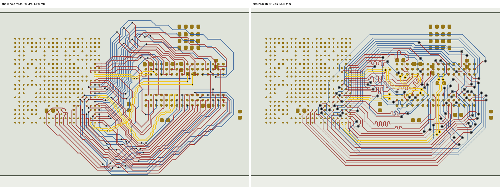
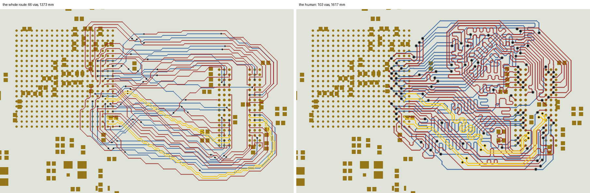
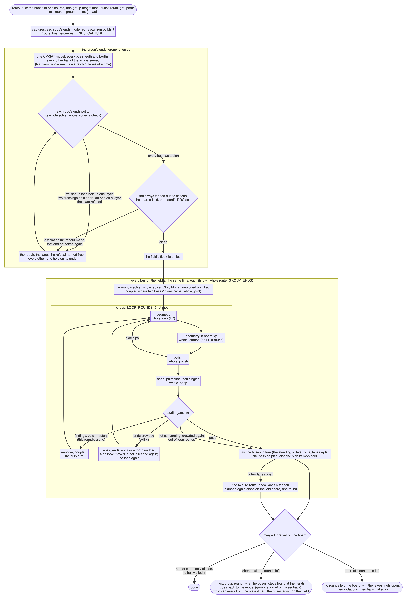

# awx -- topological routing of a BGA-to-BGA bus (#622)

awx routes a fanned-out bus between two BGAs -- an SoC and its DDR3, say --
as one problem: where each net escapes each array, where each lane crosses
the others, and where each changes layer. It holds two routers:

| | how it works | status |
|---|---|---|
| **The whole route**<br>`whole_route.py`, `whole_*.py`, `route_bus.py` | Chooses every net's ends, then plans every lane's **whole path before anything is routed** -- crossings, layer changes, geometry on the router's grid -- checks the plan against the router's own rules, and routes every lane in its band at once. | **The current router.** Every rung of both benches routes connected and DRC-clean on a Mac, with fewer vias and less copper than the human. |
| The braid's pieces<br>`braid.py`, `connect.py`, `corridor.py` | A bench's reading, and the routers that lay one lane or one pair in its band. | From the earlier router. The whole route reuses its fanout, router, benches and audits. |

Two rules both keep:

- **It is general.** No net, face, board or part name anywhere in the code;
  every rule is geometric.
- **It is an autorouter.** The human's boards are tests, never seeds.

**Contents**

1. [The whole route](#the-whole-route) -- [results](#results), [running it](#running-it), [the bus step](#the-bus-step-on-a-real-board), [the group's ends](#the-groups-ends-group_endspy), [how it works](#how-it-works), [the same answer on each machine](#each-machine-the-same-answer); its two solvers explained: [CP-SAT and HiGHS in the whole route](https://drandyhaas.github.io/KiCadRoutingTools/solvers/)
2. [The braid's pieces](#the-braids-pieces)
3. [Shared pieces](#shared-pieces) -- grading, `rules.py`, measuring honestly, the tools, what this adds to `py_router`
4. [TODO](#todo)

<details>
<summary><b>Words this README uses</b></summary>

| | |
|---|---|
| **bench** | a board prepared for the problem: the two arrays, the bus nets, everything else as obstacles. `fb_t2q_pairs` is an H3 BGA `U1` to a DDR3 `DU1`; the zynq **article** is `zynq_ad9364` from the stress corpus, built by `make_bench.py` |
| **K, rung, ladder** | "K51" is a checkpoint on the coherent ladder (`coherent_nets.py`: whole rivers, tightest first). K51 on `fb_t2q_pairs` is 51 nets -- 45 singles and 3 pairs, so 48 lanes |
| **tooth / berth** | a net's escape at the source array / at the destination array: the end of the fanout's stub, where the lane starts / ends |
| **lane, single, pair, legs** | a net's routed copper between its tooth and berth; a single-ended net; a differential pair, one lane of two legs (P and N) |
| **dive, layer change** | a via along a lane; a pair's dive is two barrels |
| **tie via** | a ball's via to a pad of its own net straight under it on the other layer |
| **bar** | the least centre-to-centre distance two neighbouring lanes may have (0.232 mm here) |
| **island** | a piece of static copper -- a part's pads -- that a lane must pass on one side |
| **the human** | the original board's hand-routed copper on the same nets: a benchmark to approach, not a pose to match |
| **v** | vias, in the tables |
| **open, DRC** | nets not connected; DRC violations at the routed 0.1 mm floor |

</details>

---

## The whole route

The whole route decides every lane's whole path first, checks it against the
router's own rules, and only then routes it.

### Results

Both benches route on **our own ends**: the fanout chooses every net's tooth
and berth with the whole route's ends model, and the whole route plans and
routes on them, every lane in its band at once. Each cell counts every via
and millimetre of the run's nets on the board; the human's are counted the
same way. Every cell is connected and DRC-clean.

H3 to DDR3 (`fb_t2q_pairs`):

| | K15 | K28 | K35 | K41 | K51 |
|---|---|---|---|---|---|
| **the whole route** | **12 v, 194 mm** | **32 v, 543 mm** | **42 v, 759 mm** | **54 v, 967 mm** | **80 v, 1262 mm** |
| human | 22 v, 232 mm | 48 v, 678 mm | 60 v, 889 mm | 70 v, 1081 mm | 88 v, 1337 mm |

Zynq to DDR3 (the article's first build, 44 lanes in the ladder; see
[Building the zynq article](#building-the-zynq-article). The human's copper
carries its length-matching meanders):

| | K18 | K26 | K32 | K38 | K42 | K44 |
|---|---|---|---|---|---|---|
| **the whole route** | **14 v, 435 mm** | **28 v, 702 mm** | **42 v, 919 mm** | **48 v, 1173 mm** | **64 v, 1256 mm** | **62 v, 1421 mm** |
| human | 45 v, 662 mm | 57 v, 923 mm | 74 v, 1166 mm | 86 v, 1373 mm | 97 v, 1534 mm | 103 v, 1617 mm |

Reading the tables:

- **Rounds.** Every rung routes in its first fanout round.
- **Machines.** The tables are the Mac's. Linux (`modal_whole.py`, a
  container a rung) can keep a different plan among a solve's equal optima,
  and the ends model's exact ranking can part on them too, so a rung's vias
  and millimetres can differ there.
- **Time.** The Mac ran three rungs at a time: zynq K44 took 12 min, K51 10,
  K41 and zynq K42 8, zynq K38 7, the rest under 5.
- **Generated cases.** `synth_handoff.py` routes 108 generated buses whole --
  lanes handed to a ring on either side of the destination, parts at its
  corner and in the lanes' way (passives and rows of them, PTH headers,
  mounting holes, rows of via barrels), the bus arriving at an angle, lanes
  crossing, pairs; a part in front of a source tooth, a facing berth or a ring
  berth at every distance from none to past the ends model's reach, between
  and off the stub rows and the router's grid, turned, of every kind, on
  either layer, at both ends of a lane; and walls of parts no lane threads,
  in front of the teeth and the berths and across the channel, the lanes
  going round their ends or, where there is no room, under them -- and grades
  each on the route and on the handoff. All 117 pass.
- **More routing layers.** `synth_layers.py` routes generated buses on two to
  six routing layers and grades each against its optimum on that many layers
  (`synth_bus.truth_layers`): reversed, blocked, interleaved, riffled and
  shuffled orders with the arrays' interiors closed, short 3 mm channels, and
  every escape a via (`ESCAPE_VIAS=both`); with them, open interiors, walls
  in the channel, rings, pairs, and lanes ending on the destination's far
  face (`truth_wind`). On three, four and six layers all 48 graded runs are at
  the optimum, and all 87 runs connected and DRC-clean. Two cases wind lanes
  round the destination (`wind_rot16_g3`, and with every escape a via): one
  cut on its south face reaches every berth with no via, a cut on its far face
  pays four, and [the winding cut](#the-ends-whole_endspy) routes both in two
  on three, four and six layers. The short channels and
  the all-via cases are what more layers buy: on two layers they leave nets
  open or lay up to 34 vias where 14 is the optimum (see the TODO).



*K51: left, our fanout's ends and the whole route on them; right, the
human's board. The pairs are yellow. (`whole_compare.py`.)*



*The zynq article at K44 (both DQS pairs yellow), in our frame -- the human's
board turned the same quarter turn: left, the whole route on our own ends;
right, the human, much of its copper length-matching meanders.*

### Running it

One rung, end to end -- the fanout on our own ends, the solve, the loop, the
route and the checks, with up to `ROUNDS` fanout rounds (default 4;
`--feedback-rounds F` makes up to F of them after each draw feedback rounds,
[below](#the-rounds-and-never-nothing-whole_routepy)):

```bash
cd awx
python3 whole_route.py 51 OUTDIR                                       # the H3 bench (BASE=fb_t2q_pairs.kicad_pcb DEST=DU1)
BASE=tmp/zynq/zynqF.kicad_pcb DEST=U2 python3 whole_route.py 9 OUTDIR   # the zynq article (build it first, below), any rung of its ladder
```

It never ends with nothing while a plan for some of the lanes can be laid
(see [the rounds, and never nothing](#the-rounds-and-never-nothing-whole_routepy)).
Every round's result is graded, and the best -- the fewest open nets, then
the fewest vias -- is written to `OUTDIR/best.kicad_pcb` (beside its own
round's `rN/seq.kicad_pcb`). Its last line is that result's grade:

```
WHOLE K=.. round=.. lanes=../.. vias=.. copper=..mm connected=0|1 drc=N secs=.. open=..
```

`drc=` is the number of violations on the round's nets (0 clean). A round that
leaves no net open ends the run, its violations the bus step's own grade to
answer; another round is for nets left open.

It exits 0 when that board is connected and DRC-clean, 1 when nets are left
open or a violation stands, and 2 when nothing could be laid at all (no
fanout board, or no plan even for half the lanes).

Each stage runs as a process of its own. `--inproc` runs every stage in the
driver's own process instead, as a routing call inside KiCad's process will:
the same outputs, file for file, in less wall time. In one process no stage
reads or writes the environment: every awx module reads its settings through
`awx_settings`, which the driver gives each stage.

The ladders on this machine, three rungs at a time, each stopped at an hour
with every stage it started, one grade line per rung (`OUT/ladder.txt`):

```bash
python3 whole_ladder.py OUT                          # both benches (zynq: build it first)
python3 whole_ladder.py OUT --bench h3 --ks 41,51 --jobs 2 --cap 3600
```

The ladder on Linux, one container per rung: `modal run awx/modal_whole.py::main
--ks 15,28,35,41,51 --out DIR` (from the repo root; the zynq article with
`--env "BASE=tmp/zynq/zynqF.kicad_pcb;DEST=U2" --ins
tmp/zynq/zynqF.kicad_pcb,tmp/zynq/zynqF.kicad_pro,tmp/zynq/zynqF.ladder.txt
--ks 18,26,32,38,42,44`). Each rung is stopped at `--cap` seconds (3 h by
default, the cloud's cores being slower), its log and best board still
returned. `modal_whole.py::stage` replays one command in the cloud on the
laptop's files at their own paths.

The generated cases (`synth_handoff.py`, see [Results](#results)) on this
machine, or on Linux one container per case from an app deployed off this
tree -- stopped once every case is in (`--keep-app` keeps it; `--collect`
gathers a run whose client went away):

```bash
python3 synth_handoff.py --jobs 4 [--only TAG,..]                     # in awx/
modal deploy --name APP awx/modal_whole.py                            # from the repo root, then in awx/:
python3 synth_handoff.py --modal APP --outdir DIR
```

The generated buses on more routing layers (see [more routing layers than
two](#more-routing-layers-than-two-route_layerspy-relayerpy)), each case drawn
layer by layer, `--sheet` every case on one image per layer count:

```bash
python3 synth_layers.py --layers 3,4,6 --sheet [--only TAG,..] [--outdir DIR]   # in awx/; 2 the two-layer reference
```

When two runs part -- two machines, or a run before and after a change --
these find where, and the last what stands between a bus pair's teeth:

```bash
python3 fanout_logdiff.py RUN_A/r1/fo.log RUN_B/r1/fo.log    # the first decision the two fanouts made differently
python3 resolve_round.py RUN/r1 OUT [--dest U2]              # a round's first solve again, on that round's own board
python3 synth_ab.py OUT_A OUT_B                              # two runs of the generated cases, case by case
python3 pair_teeth.py RUN/r1/fo.kicad_pcb RUN/r1/nets.lines U1 U2   # another net between a bus pair's two teeth
```

<details>
<summary><b>The same, stage by stage</b></summary>

Every stage reads the bench under the chain's plan environment
(`whole_route.stage_env` sets it for a run):

```bash
export BRAID_EXACT_PAGES=0
```

**1. A bench** -- the human's ends, or our own:

```bash
NETS=$(python3 coherent_nets.py 51 --board=fb_t2q_pairs.kicad_pcb)
# the human's ends ...
python3 human_ends_bench.py fb_t2q_human.kicad_pcb tmp/hp/HHe_k51.kicad_pcb "$NETS" \
    --others bench:fb_t2q_pairs.kicad_pcb --ladder fb_t2q_pairs.ladder.txt --sidecar --marker
# ... or our own
mkdir -p tmp/e tmp/e2
python3 fanout_from_plan.py tmp/e/fo.kicad_pcb 51 --board=fb_t2q_pairs.kicad_pcb
export BENCH=tmp/hp/HHe_k51.kicad_pcb NETS DEST=DU1   # (or tmp/e/fo.kicad_pcb) the bench every whole_* tool reads
```

**2. The plan:**

```bash
SOLVE_UNPROVED=1 python3 whole_solve.py SOLVE.json   # crossings and layer changes (a round's first solve: unproved, still a plan)
python3 whole_route.py --loop SOLVE.json OUTDIR   # geometry -> polish -> audit -> pairs -> singles -> snap
python3 whole_render.py OUTDIR/plan.json OUT.png   # look at it (AUDIT=FILE marks the audit's findings)
```

`whole_route.py --loop` exits 0 with `OUTDIR/plan.json` the snapped plan that
passed, 1 when no round got there, 3 when it stopped not converging, and 4
when it stopped at crowded ends.

**3. Route and check** -- a lane the router reports routed is not proof its
net connects:

```bash
BRAID_PAIR_SLACKS=0 python3 route_lanes.py all --plan OUTDIR/plan.json --board $BENCH --nets "$NETS" --dest DU1 \
    --mode seq --write ROUTED.kicad_pcb            # the router on the plan, each lane in its band (a pair's not widened)
# the checkers on the run's nets, each matched under its sheet (*/NAME)
python3 ../py_router/check_connected.py ROUTED.kicad_pcb --nets $(echo "*/$NETS" | sed 's|,| */|g')
python3 ../py_router/check_drc.py ROUTED.kicad_pcb --nets $(echo "*/$NETS" | sed 's|,| */|g') --clearance-margin 0.1
```

**4. Feedback to the fanout** (on our own ends):

```bash
python3 whole_gate.py OUTDIR/p1.json OUTDIR/p1.audit --hot HOT.json
python3 whole_feedback.py tmp/e/fo.plan.json FEEDBACK.json HOT.json          # the audits' crowded ends
python3 whole_feedback.py --name tmp/e/fo.plan.json FEEDBACK.json [NET ...]  # or: lanes to move, by name
FANOUT_NETS="$NETS" FEEDBACK=FEEDBACK.json INCREMENTAL=tmp/e/fo.plan.json \
    python3 fanout_from_plan.py tmp/e2/fo.kicad_pcb 51 --board=tmp/e/SOURCE_BOARD   # the 'source board:' its log names
```

</details>

### The bus step on a real board

`route_bus.py` is the bus step of the production chains: the
`/plan-pcb-routing` skill's Step 1a, and `py_router/autoroute.py`'s step 2a,
which runs it as the skill does. It takes a board
as the chain hands it on, finds its buses, and writes the board back with
them laid, in the board's own frame:

- a bus is every net between its source array and its destination that the
  ladder admits, and their copper, if any, is stripped. A pair through a
  termination part between the arrays -- a two-pad part with a pad on each
  leg -- is laid as every other termination is (`waypoint_pairs`, then
  `pulled_nets` below): the part's pads off the pair's nets for the step,
  each leg's stub to it left to the rest of the chain. Refused, a memory
  bus's clock pair was left to the chain whole. Refused and named, for the
  rest of the chain: a pair leg whose partner is refused or is no lane
  between the arrays (a leg pulled to another rail by a part of its own) --
  a pair is laid whole or not at all. The whole route names a net by its
  name's last path part where no other net's name ends in it, else by its
  full name (`ENABLE` and `TEST/ENABLE` are two lanes):
  `coherent_nets.net_keys`, and every pattern the step hands a checker or
  the fanout engine selects that net alone;
- its ends -- each net's tooth at the source and berth at the destination --
  are its group's: one model chooses them for every bus off the source,
  together with the arrays' fanout, and lays them on the board, the **shared
  field** ([each source's buses, one group](#each-sources-buses-one-group),
  below);
- the board is turned into the flow frame (`flow_frame.turn_for_ends`): the
  quarter turn that points the centroid of the bus's balls at that of its
  far pads along +x, unless it leaves the two parts' own pad boxes more
  beside each other than ahead -- the bus's balls off to one side of a large
  source -- when the boxes' turn is taken, the frame the ends are planned in
  (a bench turned by the balls alone was refused there, and the bus laid
  nothing);
- the whole route runs on the ladder's nets (`--k K` for its first K). A
  pair's two legs stand in one river of the ladder, side by side, so no
  checkpoint runs a leg alone as a single (the zynq LVDS bus had RX_D3_N in
  its second river and RX_D3_P in its fourth); and a K that falls between
  two legs leaves the first out with its partner, so the run is a net short
  of K rather than a pair run as one leg (`coherent_nets.whole_pairs`);
- the routed board is turned back.

It is graded where it is written:
- every bus net connected;
- no DRC violation on a bus net;
- the whole board no worse than it came.

The rows of the board's `.kicad_dru` length and skew rules are named (the log,
the BUS line's `length rows`, the summary's `length_rows`) and not counted:
the bus is laid untuned, and an unrouted net is never measured, so the board
as it came would always read cleaner than any bus. Tuning the lanes to those
rules is #1363.

It hands on what it laid connected, never nothing for the sake of a few nets:
a net the whole route left open, and a bus net the grade finds open on the
board or named in a violation of the bus's (or of the board's, when the board
came out worse), goes back as it came -- its own copper, if it had any -- and
the rest are graded again. Another net's copper the step laid -- the arrays'
other nets, fanned out with the bus on the shared field -- in such a
violation goes back first (`changed_nets`; never a plane's net, whose drops
the step lays by the dozen), as the bus is what the step is for (summary
`others_put_back`). The nets put back are named in the summary's `refused`,
for the rest of the chain to route. The bus is handed on whenever its own
nets come out connected and clean; a violation the board still has more of
than it came with, on no bus net, is named (`board_violations_added`), never
a reason to throw the bus away: sdi_mipi_conv's SDI bus on four layers, 14
nets laid clean, had been refused whole for one cap pad on a via the arrays'
fanout had laid under it.

A board with inner copper layers is taken as it is. The lanes run on every
copper layer, the planes' included (`route_bus.all_layers`: F.Cu and B.Cu
first, as `ROUTE_LAYERS`, which names them instead where it is set), and
every via is a through via. A layer that carries a pour is crossed by the
lanes: each poured net is graded on the board as it came and as routed, each
refilled, and a split the bus made is named (`plane_grade`, the BUS line's
`planes=`). The nets handed on are protected in the board's project (#521),
with those it came with protected -- an earlier group's among them -- and
their lanes are **locked**: KiCad's `(locked yes)` on every track and via the
step hands on (`route_bus.lock_lanes`). A later step lifts a project's
protection by naming the net exactly; nothing lifts a lock (#1261), so the
rest of the chain routes round the lanes and connects to them, never strips
them. On sdi_mipi_conv the route step after the bus step, given the same bus
board unlocked, ripped DDR3_A2 -- a lane the step had connected -- and left
it open.

**The buses** are the step's own choice (`route_bus.bus_plan`, at the
chain's sizes). A bus is the nets between a ball array (`is_array`: balls
past the outer two rings, on two nets or more -- a QFN's interior is its
exposed pad) and another part, the nets the ladder admits (`find_buses`):

- to **another ball array**, `MIN_BUS_NETS` (8) nets or more -- the larger
  array the source;
- to a **row part no track passes between the pads of** at the chain's sizes
  (`row_gap`: the gap between two neighbouring pads along its rows less than
  a track and a clearance either side), so its lanes must arrive in its
  pins' order. The row parts off one face of the source (`side_of`) are one
  **group bus** (`U1:U4+U3`), the largest first, when one of them has 8 nets
  or more and each other `MIN_GROUP_NETS` (4) or more.

Every other pair of parts is the router's, named with why: two arrays
sharing fewer than 8 nets; a part that is neither a ball array nor a row
part; a row part whose rows stand on both outer faces (an edge connector's
fingers, `two_sided`), which the row model does not take; a row part a
track passes between the pads of; a row part off a face where none has 8
nets, or with fewer than 4 beside one that has. A net on both parts that
the ladder does not admit (another part on it, more than one pad on a part)
is the router's too (`find_buses`' `left`).

**Each source's buses are one group**, their ends chosen in one model
([below](#each-sources-buses-one-group)): its array buses first -- a memory
bus first of those (`memory_bus`: half its nets or more read as a DRAM byte
lane or command and address group, `length_matching.classify_ddr_nets`),
then the larger -- then its row buses, the larger first. The groups go
largest bus first, each on the board the one before handed on, and no array
is two groups': a bus that would share an array with an earlier group is
left, named.

`--find` prints the plan -- the buses in order and the parts not taken, each
with why -- then the `--bus` line that names them, and stops.
`--bus SRC:DEST`, repeated, names the buses and their order instead (DEST a
part, or several, `U4+U3`: a group bus); the buses it names off one source
are one group too, and a bus that shares an array with another source's is
a usage error. `--src SRC --dest DEST` routes one bus by itself, with its
own ends, as each bus of a group runs in its own process: a debugging aid.

Every stage runs under the chain's own policy (`step_policy`), the step's own
imports of the chain's modules included: a module reads its policy when it is
first imported, and the in-process stages run on the modules the step
imported (`tests/test_622_route_bus_policy.py`).

It routes at the chain's sizes, given as the routing CLIs take them
(`--clearance`, `--track-width`, `--via-size`, `--via-drill`, ... and
`--fanout-track-width` for the escapes). One omitted is resolved as
`route.py` resolves its own: see
[One source for every routing number](#one-source-for-every-routing-number-rulespy).
A via in an array's ball is sized to the pad by the production fanout, as in
the chain's own fanouts.

**The arrays' fanout is the group's.** The group's ends model
([below](#the-groups-ends-group_endspy)) fans out every ball of the shared
source and of each destination that is a ball array -- the buses' balls,
every other net's and every plane ball -- from one menu per array
(`joint_escape.build_menus`: each ball's escapes from every via site it
could take, its four gap points, its pad, none, by every face; a via move's
run on no one layer, the model choosing among the layers it clears,
`joint_escape.RUN`), every ball offered the same choices. A plane ball goes
down to its plane as the human's do, sharing vias:

- **A shared gap via:** the balls round one diagonal gap may all drop there
  on one via, which the plan prices once.
- **Off the array:** an edge ball may drop half a pitch off the array, or
  straight out from it where no ball stands beside it.
- **A strap:** a ball may strap to a neighbour of its net that has a way
  down. The strap is priced above the via it saves (`STRAP_VIAS`), so a ball
  takes one only when it has no way down of its own.
- **Onto its own plane, clear of the lanes:** a drop's via lands only where
  its net's pour fills -- on a split layer, inside its own island; a ball with
  none of its plane under it or its gaps is fanned out as a signal, dearest
  of all. A drop's via is held out of the way out of every escape it might
  take (its exit's straight continuation, at the lane's bar:
  `joint_escape.exit_ray_conflicts`). At an LVDS bus's destination an RF ground
  via 0.14 mm past the face stood between one net's two berths, and two
  flanked another's, each 2.5 um short of the bar; the snap found no way out
  for either. On that bus's first 32 nets the best round went from 3 nets
  open to 1. At an LPDDR4 bus's source a ground ball dropped into two teeth's
  ways out, which every later plan refuses, and one of the two lanes ran
  under the ball, so it shipped with no way down; held out of them at the
  source too, the lane leaves the ball room and the route step connects it.
- **A drop's via measured as the router stamps it:** by its ring about the
  grid point it rounds to (`pairs.svia_reach`), as the whole route's audit
  measures it, in the menus' lane tests and the ends model's ways down
  (`joint_escape._ring`). At its own radius, h616's GND drop on U1's south
  face left SDQ6's and SDQM1's lanes 0.175 mm each for a bar of 0.166; the
  audit read 0.130 from the ring, and the bus loop stopped at those ends two
  rounds running. Measured by its ring, the bus passes.
- **A finer via where the rung's does not fit:** a gap or a site off the edge
  the rung's via does not fit takes the largest of the fab ladder's vias
  that does, laid at that size (`joint_escape._drops`). Between two of the
  zynq DDR's U2 berths a 0.45 mm via left each lane 0.075 mm, a 0.30 mm one
  0.15, and four plane balls had no other way down.

On the zynq's U5 the human's RFGND balls stand four round one via, two at a
via off the edge, and three strapped down a column; offered the shared gap
via, the drop off the edge and the strap, a plan of the array's plane balls
went from 42 of 49 dropped, on 42 vias, to all 49 on 26, and on U1 from 92 of
98 on 92 vias to all 98 on 79.

Nothing of another net goes into a laid bus pair's **pocket**, between its two
teeth out to where its legs close (`joint_escape.laid_pockets`): an escape
there is walled in once the pair closes, and a via stands in its way. The
zynq DDR's NetR3_2 escaped on B.Cu between DDR3_DQS1's teeth, 0.77 mm apart.
Nor does another ball's escape leave on a layer between two neighbouring laid
lanes whose copper past the array's face closes to less than a via's room
(`pair_teeth.lane_pockets`, `joint_escape.lane_walls`), unless the ball has no
other way out. The zynq DDR's A14 and A10 leave U1's east face 1.6 mm apart on
F.Cu and run on 0.78 mm apart; the LVDS step laid OTG_DATA5 out between them,
and the USB bus left it open on every board after. Walled, it takes a via, and
the USB bus routes all 12 nets with the stub step after it, against 11.

**A tie via's site is its net's via from the start.** A destination ball with
a pad of its own net under it on the other layer -- a terminating resistor on
the back, under a DDR clock pair's balls -- is tied by a via at the ball
(`fanout_from_plan.tie_vias_under`). The menus are measured with those sites
standing in as vias of their nets (`fanout_from_plan.tie_stand_ins`), so no
other net's berth runs or stands on one, and the field lays the tie at each
unless a via of its net is laid in its ball (`group_ends.write_field`).
Unseen, zynq7020_som's DDR_CK_P escaped along its ball row across DDR_CK_N's
ball, the tie via was laid on that run, and the bus handed on a short.

**No escape ends on a pad it cannot join.** The field is checked before it is
written: a pad some track of its net ends on has one of them on a layer it has
copper on, or a via of the net standing on it (`group_ends.loose_ends`) -- a
stub on any other layer joins its pad to nothing, and no clearance check sees
it. The array's rules ask the same question of every move before the model is
built (`array_rules`), of the other parts' pads of the move's net: a run keeps
only the layers such a pad has copper on where its track ends on one, and a
move left with no layer is not offered. A test point on the back beneath the
array, at the very place an escape's run turns on an inner layer, was
otherwise the state's to choose, and the whole field was refused with no bus
routed.

The passives beneath the arrays are moved off the field once it is laid (the
chain's cap nudge, `place_fanout_clearance.py --beneath-only`: a part beneath
a BGA moves only where it stays beneath it, one beside the array stays where
it is), the buses' pull pads off their nets and each lane's way out laid for
the nudge meanwhile, so no part is moved onto an exit (`write_field`). The
board's DRC then measures the field, and a violation the fanout made is the
model's to answer ([the group's ends](#the-groups-ends-group_endspy), below).

`zynq_ad9364` (`boards/`: its source, license and changes in
`boards/NOTICE.md`), its planes poured as the stress run poured them, and its
buses at the stress run's sizes -- its fanouts' 0.12 mm track at 0.09 mm, its
routes' 0.15 mm track and 0.45/0.3 mm vias:

```bash
cd awx
mkdir -p tmp/zynq/src/boards_set1
gunzip -c boards/zynq_ad9364.kicad_pcb.gz > tmp/zynq/src/boards_set1/zynq_ad9364.kicad_pcb
cp boards/zynq_ad9364.kicad_pro tmp/zynq/src/boards_set1/
STRESS_DIR=tmp/zynq/src /Applications/KiCad/KiCad.app/Contents/Frameworks/Python.framework/Versions/Current/bin/python3 \
    ../tests/stress/strip_routing.py zynq_ad9364
python3 ../py_router/route_planes.py tmp/zynq/src/boards_unrouted_set1/zynq_ad9364.kicad_pcb tmp/zynq/planes.kicad_pcb \
    --nets GND RFGND VCC_1V8 --plane-layers In1.Cu In1.Cu In2.Cu --layers F.Cu In1.Cu In2.Cu B.Cu \
    --clearance-ceiling 0.2 --hole-to-hole-clearance 0.25 --via-size 0.45 --via-drill 0.3 \
    --power-nets GND RFGND VCC_1V8 --power-nets-widths 0.4 0.4 0.4
SZ="--clearance-ceiling 0.09 --track-width 0.15 --fanout-track-width 0.12 --via-size 0.45 --via-drill 0.3"
python3 route_bus.py tmp/zynq/planes.kicad_pcb --find $SZ                          # the buses, and the parts left
python3 route_bus.py tmp/zynq/planes.kicad_pcb tmp/zynq/bus.kicad_pcb --inproc $SZ
```

The zynq's **six-rail board** is the same unrouted board with In2 split six
ways -- VCC_3V3, VCC_1V8, VCC_1V5, VDD_DIG, VDDA_RX_LO and VCC_1V0 -- beside
In1's GND and RFGND:

```bash
python3 ../py_router/route_planes.py tmp/zynq/src/boards_unrouted_set1/zynq_ad9364.kicad_pcb tmp/zynq/zr6.kicad_pcb \
    --nets GND RFGND VCC_3V3 VCC_1V8 VCC_1V5 VDD_DIG VDDA_RX_LO VCC_1V0 \
    --plane-layers In1.Cu In1.Cu In2.Cu In2.Cu In2.Cu In2.Cu In2.Cu In2.Cu --layers F.Cu In1.Cu In2.Cu B.Cu \
    --clearance-ceiling 0.2 --hole-to-hole-clearance 0.25 --via-size 0.45 --via-drill 0.3 \
    --power-nets GND RFGND VCC_3V3 VCC_1V8 VCC_1V5 VDD_DIG VDDA_RX_LO VCC_1V0 \
    --power-nets-widths 0.4 0.4 0.4 0.4 0.4 0.4 0.4 0.4
```

Each bus's process ends its own log (in its group's directory under
`OUT.bus/`: `solo/DEST/bus.log`, or `neg/DEST/bus.log` in a group of
several) with its grade:

```
BUS U1->U2 K=.. round=.. lanes=../.. vias=.. copper=..mm connected=0|1 drc=N secs=.. | on the board: ... walled=.. secs=..
```

and the step's own log grades the board each group hands on (`board_grade`:
the group's ends left N open, its DRC, N walled on the board).

`walled=` counts the arrays' other balls the step walled in (#1348): reachable
on the board as it came, and from nowhere once the locked lanes are laid, at
the fab ladder's finest rung -- each one's net ships open. The walls are the
copper no later step moves: the bus's, the nets an earlier step protected, a
pour's, locked copper and the pads. Another net's escape is no wall, as the
route step takes it up and lays it again. They are named in the log and in
the summary's `walled`.

The lay asks the same of its own lanes first (`route_lanes.lift_walls`): a
ball of the bus's parts the lay walled in has the laid lanes walling it
lifted and routed again, in their order, round its way out -- the via site
nearest along the way its layer reaches with their lanes gone and their
fanout standing (`route_bus.ball_way`), the way itself and the via reserved
-- kept where every one of them routes and the ball is reached, else the
next sites along its ways in turn (`WALL_SITES`, six at most), and all as it
was when none serves. The nearest site alone lay a clearance off the lifted
lane's own tooth, which stands, and left the lane no room to leave past it.
Asked with the walling nets' whole copper gone, the site lay under one lane's
own escape on an inner layer, which no lane routed again could clear;
reserved as a straight line from the ball, the way round the end of the
walling lane's own fanout run was left open, and the lane routed again took
that end and walled the ball once more.

A ball that leaves walled in all the same has its WHOLE way out kept,
BETWEEN the lanes (`route_bus.ball_channel`): the cage test's own way from
the end of the ball's copper to the rest of its net or the edge of its view,
never across a lane, through the least room that has to be made. The laid
singles a track along it is short of its clearance to are lifted, the way
reserved, and they are routed again round it -- each in its band, else in
its band a lane's slice wider (`braid.route_lane`'s `slack`), so a lane
parts from the way and keeps its place in the bundle; a lane with no room to
part stands, and the way is asked for again clear of it. A ball of an
array's second row, its stub out between two lanes that ran on side by side
a track's width short of a track's room, had kept nothing by its via site:
the wall stood past it (`tests/test_622_ball_channel.py`).

**The plan is asked first** (`kept_ways.py`, the loop's `keep_ways`), on two
routing layers and one bus. The plan that passes is read as copper on its
bench -- a single's pieces a track wide, a pair one track over both its legs
-- and given the same cage test. For a ball it walls in, the way out between
its lanes is laid on a copy of the bench as a track of the ball's own net, a
track and a cell of the cage test's raster either side wide, and the loop is
run again on that bench from the round's solve, with its flips, cuts and
history: the geometry moves every lane off the way together, which the lay,
a lane at a time and each in its band, cannot. The plan that passes there
stands; the lay routes round the way as round any copper and takes it up
from the board it leaves, every piece or the run stops. Where no plan passes
with the way kept, or a ball has no way, the round's own plan stands and the
lay's guard is left to it, said in the round's log. A ball whose way out ran
between a lane and a fixed pad a tenth of a millimetre short of a track's
room shipped walled in: the lay routed the lane again to the bare clearance
of the way, a raster cell short of what the cage test asks, and the lane
beside it left it a hundredth too little to give more. Not on a solve's
relayed bench (more routing layers than two) nor among negotiated buses:
there the lay's guard stands alone (`tests/test_622_kept_ways.py`).

It exits 0 whenever it writes OUT (#1738): the bus nets it hands on connected
and clean (those it put back are in `refused`), or none handed on and OUT the
board as it came. The summary's `exit` says which, and over several buses it
is the worst bus's status (`max`): 0 every bus routed; 1 one or more came
through as they came, while OUT may still carry the others routed; 2 the
step's own check refused a bus (the turn back failed, the pull pads were not
found again) and handed it on as it came. Each bus's own status is
`buses[].exit`, and the summary's `plan` holds the buses taken and not, and
why. A non-zero process exit means no OUT was written: 2 for a usage error
or a `--src`/`--dest` bus whose turn into the flow frame failed, any other
code otherwise. A bus net it does not hand on goes back as it came: its
earlier copper, where that copper still clears what the step laid.

#### Row parts, pulls and group buses

**A bus to a row part.** A bus's destination may be a row part -- a QFN, a
connector, its pads in rows round its edge (`escape_moves.row_part`): the
plan's where no track passes between its pads, or any `--bus` names. Its
berths are its pads' fanned stubs (the
row parts of [the group's ends](#the-groups-ends-group_endspy), below). A
decoupling cap standing across a pad's one way out leaves that lane no end
at all, so before the menus are measured the step moves the passives beside
each row part off its pads' escapes (`route_bus.clear_row_escapes`: the
escapes laid on a copy as the plan models them, the cap step's `--near`
moving what they meet, a termination's or a pull's part locked). On one
board a QFN's cap edge stood on the line of one pad's escape: that net had
no end in any round, and with the cap moved 0.2 mm all eleven of the bus's
nets were routed.

A net that other pads alone keep out of the bus is laid as a lane of it
(`route_bus.pulled_nets`): one pad on each of the bus's two parts, and any
other pads -- a pull, a termination, a test point, another part's pin --
each a stub off the lane. A rail stays the router's: a net with a zone, or one
on more than `LEFT_PARTS` parts. So a pull-up or pull-down joins its bus, a
fly-by DDR3's address and command nets join theirs through the resistor arrays
that terminate them to Vtt past the memory, a clock pair through the resistor
across its legs, and a net with a test point on it. The stub pads come off
their nets for the step and go back on in OUT, for the chain to connect the
stub.

A stub pad of a routed lane that a short tie reaches from its net's dog-bone
via at either array -- at most `ATTACH_PITCHES` (1.5) of the array's ball
pitch, straight or along the array's ball and gap lines round other copper;
from the ball itself where it has no via and the pad is on its layer -- is
joined to it by that tie on the routed board, on the pad's layer, as the
human ties the zynq's TX_FRAME_N into its pull RX10 under U1
(`attach_pulls`). The pad is then its lane's own copper and every other
net's obstacle, and the pull is connected when the lane is. A longer tie
would run across the ball lines the lanes need into the array, so the
zynq's FB_CLK_N and AD9361_RST pulls, beside U5, are left to the chain.

**A group bus: one source, several ends.** The zynq's USB bus (U1 to U4, 11
nets) and Ethernet bus (U1 to U3, 8 nets) overlap: their balls interleave on
U1's east face, and routed one after the other the second meets the first's
lanes across its way. A group bus, `U1:U4+U3`, routes them as ONE whole
route in one frame, its DEST naming both parts (`whole_frame.Group`). The
parts' copper boxes are joined into one outline -- the strips between them
closed into POCKETS, wider gaps left open as notches -- and walked round in
one order, each lane placed where it enters the outline. The lanes entering
on the FRONT, the walk under the hull's edges facing the source, end from
the trunk; the rest ride the rings round the hull. A berth in a pocket
leaves it by either of its mouths, or straight under the part in front of it
on a layer that part leaves open. Its ways out are ranked by their depth and
by the pins each mouth's leg passes -- a pad within a stub's length of the
leg, of ANY part of the group: a leg down a pocket runs along the row of the
part that is its other wall as it does its own part's. A way under a part
runs on a layer none of the part's own pads stands on, and no other part's
pad within a lane's reach of THAT WAY'S OWN LINE (decaps on the back layer
under a QFN close it there: `whole_frame.open_on_line`). Read off the part's
whole box instead, four caps on the front layer between a two-row
connector's rows, each at one place, closed that layer under all 19.6 mm of
it: the far row's lanes, which the hand-routed board runs over the near row
on that layer, were held off it, and one taken round the connector's end
left a net open. The solve's cuts under the part and the geometry's bound
read each lane's own way (`whole_frame.under_open`); the census the 2-D
geometry reads stands a part's box as copper on its own pads' layers alone,
the other parts' pads in it standing as themselves (`whole_frame.own_layers`,
`whole_passages.Census`), with the bus's own stubs and vias under an opened
part kept as copper. Read as
closed on every layer by the geometry alone, the lanes planned under a PHY
were pushed out to its box's edge, into the 1.5 mm strip between it and a
connector, and three nets were left open. The lanes leaving one mouth land
on it in their order along the walk, a lane's room apart from the mouth's
end at their own part's wall (spread evenly over it where it is too short
for that): spread over a wide pocket's whole mouth, a part's lanes landed a
pocket's depth from it, and their legs cut back across the strip on the
berths' layer, through parts standing there that no solve sees -- five lanes
through a row of passives whose gaps take one lane each, two or three left
open in every round.

A pocket need not be a strip between two rows. Three chips at the corners
of a triangle close into ONE pocket with three mouths, one of them eleven
mm wide with a chip's whole face behind it, and four rules keep its lanes'
legs from crossing where no place on the walk shows it
(`Group._mouth_place`, `_open_stretch`, `landings`, `pocket_cross`):

- the lanes of one mouth stand along it **in the order of their berths
  along the pocket's walls**, walked from the mouth's one end round to its
  other -- for a part at an end of the mouth that is its nearest pin first,
  as before; a part at NEITHER end (one the mouth looks at across the
  pocket) has its lanes where its wall's points stand nearest the mouth, in
  its wall's order. Ranked by their depth from the nearer end, a chip's
  west face stood at another chip's corner in the reverse of its pins'
  order, every leg across every other;
- a mouth is a way only where the straight leg to it goes **through no
  part** (one that does goes round that part's corner, past pins and across
  lanes nothing counts), unless no other way is left;
- a mouth's line is taken **less what of it runs along a part**: the
  outline's edge between two parts' corners leaves a face at a slant, a hair
  off it for millimetres, and a chip's north-face lanes landed at its
  south-east corner, their legs drawn straight through the chip;
- two ways of one pocket whose stretches in it **alternate round the
  pocket's ring** -- a lane out of one mouth past the berth of a lane that
  leaves by another, or straight under the part in front -- cross in it: a
  conflict in the ends model, as two ends on one place are.

A row lane's **tail**, from its landing down the row to its berth, goes
over the stub ends it passes: where its straight tail would come within a
lane's room of an earlier lane's stub, it goes by a point that room beyond
the stub's end for every lane between the two (`F.tail`). A stub standing
further out than its neighbour's lane runs was crossed by that lane on the
stubs' own layer. On that three-chip bus the first audit's same-layer
crossings, which the solve's own check counted as none, went from 15 to 2
on the same ends, and those two are ends the conflict rule no longer lets
the model choose: on ends chosen under these rules its first audit had one
such row, and the bus laid with no net open where eight to twelve had been
left.

The lanes of a mouth's end land a lane's room apart **across their
tails**, not along the mouth: each after the first takes the mouth's length
that puts it that room from the tail before it -- no more than twice the
room, and the room itself where the mouth has no length for more. A lane's
room apart along a mouth 36 degrees off their way, three lanes of a chip's
far face left 0.19 mm apart, less than a track and its clearance. The
embedding parted them round a berth's via the wrong way, across that berth's
own lane, in the stretch past the route's end where no solve and no layer
cut has a say, and that net was left open (`tests/test_622_two_end.py`).

#### After a group's lanes: last hops, ties and packs

Three things the lanes leave are finished by the step itself, on the board
the group hands on, once its lanes stand and are locked -- each by the
chain's own router run for that job alone (`route.py`, every other net with
copper protected, so it rips nothing).

**A pair that ends on two small parts.** A pair whose legs end on pads
apart -- each on a series part of its own -- has no berth a pair can take.
It is laid as a pair all the same, to a GATHER short of the pads
(`group_ends.gather_berths`): two tips a pair pitch apart on one line across
the face it arrives by, a grid step of track at each for its lane to end
on, and no copper from there to the pads. A stub laid before the lanes
stood where another lane had to come in; the last hop is laid after them,
round the copper that is there. Two rules of the ends model are such a
bus's alone. The lane's own part is no copper in front of its end
(`whole_ends.own_parts`): a part a millimetre off its array has its other
pad within the reach of the tooth's straight run, and the array's balls
within the berth's, and read as blocked every front-layer end was held to a
change of layer no lane that short has room for. And a gather that faces
its teeth leaves the pair room to be laid between them (`_pair_room`). A
bus to an array of pads has neither: its far array's pads stand in front of
a lane as any copper does, and a pair berthing on an array turns onto a
pose of another heading where it must
(`tests/test_622_crowd_diagnosis.py`, `tests/test_622_pose_heads.py`).

**The step's own leftovers** (`route_bus.bus_leftovers`, `_router_step`):
the nets of its buses that end at a small part and that the lay left short
of it -- a gathered pair's last hops, a lane the plan could not draw into
the part's pads -- are routed on the group's board, each net it connects
protected. A net left open is reserved first in a round after: routed alone
before the others or, where the lanes took its way, found on the group's
field and kept there while the group is laid again. The parts off an array
that are no bus of the step's (`router_buses`: a header, a flash, a
resistor array sharing a few nets with it) are routed the same way only
with `BUS_ROUTER=1`. By default they are the chain's: its route step plans
them with every other net of the board, and copper laid for them here, one
net after another and then protected, left nets of that plan with no way.

**The ties and the packs** (`route_bus._supply_ties`,
`field_ties.lay_after`). Every pad of another part on a poured net beneath
one of the group's parts that only a pour of its own layer joins gets a
track and a via of its net: beneath an array that pour is cut by every via
and lane, and by what the chain lays after. With them the step finishes its
PACKS (`_packs`): the other parts a lane's net has a pad on -- a
termination pack, a pull-up. A pack's rail pads are tied by copper whatever
layer the rail is poured on (that pour is not read), and its own stubs --
the pack's pads on the lanes' nets that no copper joins yet -- are laid in
the same pass, the pass's nets planned together (`KICAD_PLAN_TOGETHER`):
the stubs come in a third of a millimetre from the rail pads, and whichever
was laid first stood across the other's way.

The pass is kept when the board grades no worse for it (`board_grade`: nets
open, violations, balls or pads walled in) and the route step's own plan
still has a way for every net it had one for (`plan_boxed`: the first round
of the plan the chain's route step makes of its nets together, on its grid
and at its sizes, ended before it routes; a net with no way in it is walled
in for that step, whatever a finer measure reads). Where a tie walls a pad
in or leaves a net no way, the ties round it are taken out and the rest
graded again (`field_ties.clear_of`: the pieces with copper within
`TIE_REACH` of the walled pad or of the net's free ends, a rail run pad to
pad a piece a span), `TIE_LAPS` times at most. The nets that plan has no
way for on the group's board as its lanes left it are named in the log
(`tests/test_622_supply_ties_packs.py`).

#### Each source's buses, one group

Buses that leave one array in different directions -- a star round it --
meet near it. Routed one after another, a later bus's lanes cross an earlier
bus's routed lanes close to the array, where the earlier one left them no
room, and the bus routed first is never moved for the one after it. So the
buses off one source are ONE GROUP (`negotiated_buses.route_grouped`), a bus
alone on its array a group of one:

1. **The group's ends** ([below](#the-groups-ends-group_endspy)): each bus's
   ends model captured by itself, every bus's teeth and berths and the
   arrays' fanout chosen in one model, and the arrays fanned out as chosen --
   the **shared field**.
2. **On the field.** Every bus is routed on the shared field at the same
   time, each by its own whole route in its own frame and its own process
   (`route_on_field`; `GROUP_ENDS=DIR`: its ends the field's, nothing fanned
   out and nothing stripped), every step of each taken with the others in
   sight. With more buses than one, each round's first plan is a **coupled
   solve**: each bus solves its own plan, lays it out (geometry and polish)
   and asks. The last to ask builds every bus's model into one CP-SAT model
   (`whole_solve.solve(joint=)`, `whole_joint.py`), each hinted with its own
   plan, and couples two buses wherever their laid-out lanes cross or come
   within a lane's pitch of each other: the two lanes take different layers
   there, or the coupling is paid for as `whole_joint.W_CROSS` (20) vias.
   Each bus lays out its share of the coupled plan before any bus's loop
   starts. Where the buses' own plans side by side break no coupling there
   is nothing to settle, and no search runs: each bus's own plan is the
   coupled one (four such searches had taken 198 to 264 s each and ended
   where they began, or 2 vias-worth lower). Where there is something to
   settle, the coupled search's batches are two searches, as a bus's own
   plan-finders' are on more layers than two (`finders_split`, below):
   `whole_solve.FIND_LNS_BATCHES` with every neighbourhood worker on, then
   the rest from that plan and bound with `FIND_LNS_KEEP` alone beside the
   complete searches (`tests/test_622_joint_split.py`).
   Every re-solve of the loops after is coupled in the same way, the buses
   in step (`joint_loop_sync`): a conflict two buses' audits find is the two
   buses' to settle, not only the one that found it. In those solves another
   bus still routing is a coupling, not copper; a bus that has ended is
   copper. The couplings each coupled solve settled are held from there as
   firm layer cuts, a lane kept off the other lane's layer within
   `whole_joint.CUT_R` (0.35 mm) of the coupling. Every stage of every bus,
   from the loop's audits to the lay and the run-out via of a lane escaped
   again (`ends_reescape`), plans round the other buses' copper as
   they publish it (`joint_lanes`: plans, laid boards and each bus's own
   bench copper, in the board's frame), in a **standing order**
   (`negotiated_buses.standing_order`: a bus whose destination stands close
   in front of the source first, then the bus with the least room a lane --
   `lane_room`, the box round its lanes' exits over its lanes: many lanes
   between two arrays fill their own cross-section and cannot give, a few
   lanes to a row of pins have the board to go round by; by the lanes alone
   the smaller bus stood first, was laid blind to the larger one's plan, and
   left it a lane with no way). Of two
   buses the later plans round the earlier one's planned lanes; the earlier
   reads the later one's lanes only once they are laid, and its ends on its
   bench always. Two plans that cross on one layer are a finding in both
   buses' audits, and with both buses moving their lanes off it they crossed
   again somewhere else the round after: of 41 findings in four buses' first
   audits 35 were such crossings, and their counts went 15, 25, 61 and 13,
   19, 18 over the rounds. With one of the two standing, the first bus of
   the order had none and passed in its first round, the last one's went 10,
   2, 0, and the lay on the same ends took 2129 s with 2 nets open where it
   had taken 5931 s with 4.
   The buses **lay in turn**, in the standing order
   (`whole_route.joint_lay_turn`): one bus lays at a time, once every bus
   before it in the order has laid, and it waits for no bus after it. Those
   plan round its lanes, and round its copper once it is laid. A bus whose
   loop did not pass lays the plan its loop held, its best round's. Laid at
   the same time, a bus that passed went round the fourth round's lanes of
   one that then laid its second, and a via of one came 0.064 mm short of a
   track of the other in one run of two. The loops' stages wait in the same
   way (`joint_step_sync`): an audit waits for the polish of the buses
   before it, whose lanes it reads, and for no other. A bus that stood, its
   loop stopped on a finding of its own, had waited 551 s for the bus
   planning round it to lay, and 470 s more after a polish for two such
   buses' loops to end.
   A bus whose loop did not pass, and that waited for the lay of a bus
   whose copper is not what its loop planned round
   (`joint_moved_since`: a bus whose own loop did not pass, or one whose
   lanes its held round has a finding against), **runs its loop again**
   before it lays: from its best round's solve, that round's cuts held,
   with the buses that have laid standing as copper in its re-solves
   (`joint_final`). While another bus still routes, its
   lanes move from round to round, and a finding against them is settled in
   one place and met in another. A memory bus's loop found 7, 1, 5 and 2
   places in four rounds beside a bus still routing and stopped; run again
   on that bus's laid copper, its second round's solve passed in its first
   round, in under two minutes. The loop it ran again stands in place of the
   first where it passes or its best round has no more findings.
3. **Merged.** OUT is the first bus's board with each other bus's nets'
   copper taken from its own board: those it routed, and those it put back
   as they came, whose escapes keep only the pieces its lanes still clear; a
   part another bus moved stands where that bus left it. Every routed net is
   protected and the reservations are lifted, so a reserved net its bus did
   not hand on is left to the rest of the chain. The poured nets the step
   laid copper of -- a plane ball's stub and via, a tie beneath a part --
   are protected with them (`protect_laid`): a later step that rips such a
   net to try one of its taps again takes that copper too, beneath the
   buses' lanes, where nothing lays it again. Each DRC violation between two
   buses' nets, or between a bus's net and another net, is named in
   `conflicts.json`. One between a bus's net and another net gives the other
   net back (`give_back`): the copper the step laid it is taken off the
   merged board, and the net is left to the rest of the chain -- another
   net's copper the step may take up, a bus net's never.
4. **The group's rounds.** With `--rounds` above one, a round that leaves
   the board short of clean (a net open, a violation, a ball walled in)
   sends what its buses' steps found at their ends back to the model
   (`group_ends --from --feedback`), which answers from the state it had,
   and the buses are routed again on that field; the board with the fewest
   nets open, then the fewest violations, then the fewest balls walled in,
   is the group's. No fallback: a bus with no capture, or a first model that
   ends with no state or no plan, is the step's result, named.
5. **The group's escalation** (`--escalation fab|board|off`, route.py's own
   flag and default). A group that still leaves the board short of clean is
   routed again a rung down the fab ladder (`escalation_ladder`): the
   lanes' track, the escapes' track and the via step down together, two or
   three rungs to the policy's floor, and the clearance never -- it is the
   DRC floor's. A rung is not the search again. It starts from the end the
   run before it kept (`group_ends --from --feedback --at-end`): the
   findings that run's lay left at its ends are answered by the model's
   repair -- every lane held on its ends but those the findings name and
   those that cross one -- then the checks, the fanout and the lay at the
   rung's sizes. What a run learned of a lane's room for a change of layer
   is its own sizes' (`resume.pkl` keeps them), and a rung starts without
   it. EVERY RUN'S PITCHES ARE ITS OWN SIZES' (`rules.pitches`): the chain
   plans its rings, its handoffs and a group's mouths a lane pitch apart
   and its teeth an exit pitch apart, and the two, chosen for the chain's
   own lane, are scaled as the run's lane's slice over that lane's, never
   under one slice -- the sizes asked for and every rung alike. NO ROOM AT
   THESE SIZES: the group's model reads, off each solve's own measure of a
   lane, whether a lane a refusal names is too short between its two ends
   for a change of layer at the run's via and has room at a rung's
   (`group_ends.room_on_a_rung`); a lane named so twice, the model's answer
   between, ends the model there -- nothing laid, its end kept -- and the
   group is routed a rung down from that end (`--rungs-below`). THE BUSES
   THAT FAILED ALONE (`_failed_buses`, `_bus_rung`): where the board that
   stands has nets open by some of the group's buses and nothing else
   amiss, a rung routes those buses alone -- their nets put back as the
   board came with them, their ends model, their balls' fanout and their
   lanes at the rung's sizes -- on the board the other buses' copper
   stands on, kept as it is. Routed again whole, a rung laid every bus
   anew, and a bus clean a rung up came back with a net open at the finer
   sizes: each bus clean at some rung, never all at one. On that board a
   ball that carries copper of its net already is served, no lane of the
   model (`group_ends.served_balls`); the buses' ends models are captured
   with their arrays bare (`_bare_arrays`), and what the board holds
   there is put in each bus's view of it (`group_ends.kept_copper`). The
   whole group again where nothing stands yet, where every bus failed, or
   where the result has a violation or a walled ball no one bus answers
   for. The fewest
   nets open, then violations, then balls walled in, stands; of two results
   alike, the one with fewer buses left to route again, then the earlier
   (the sizes asked for before any rung). The earlier of two alike stood
   whatever their buses: a three-bus group came in with a net open by each
   of two buses, a rung left two nets open by one of them and the other
   clean, and the next rung routed both again from the board the group came
   in with -- the bus just made clean came back with a net open, and the
   board shipped it. A rung that leaves the board clean ends the ladder,
   and a group with no result at all is not escalated -- that is the
   step's own result. The board handed on ships as route.py ships its own
   (`shipped_rules`), where a net was routed: its project's floor lowered
   to the copper it carries, and every bus net delivered below the sizes
   asked for in the summary's `design_rules` and the `Design rules [...]`
   line. The Bus tab passes the shared Escalation choice
   (`tests/test_622_group_escalation.py`,
   `tests/test_622_no_room_rung.py`).

The groups go in turn, each on the board the one before handed on. Each bus
is its own routing step, with its own process and its own pool of threads,
so N buses take N runs at the same time. Everything is written in
`OUT.bus/`: the step's `summary.json` (each bus's own, and the plan), and a
directory a group (`SRC-DEST_DEST.bus/`, the group's board and summary
beside it) holding `caps/`, `capture/DEST/`, `group/` (the model's output,
`shared_field.kicad_pcb` among it), `solo/DEST/` or `neg/DEST/`,
`negotiation/` (where the buses meet) and `conflicts.json`.

```bash
python3 route_bus.py BOARD.kicad_pcb OUT.kicad_pcb --inproc \
    --clearance-ceiling 0.1 --track-width 0.15 --fanout-track-width 0.12 --via-size 0.45 --via-drill 0.2
```

#### The group's ends (`group_ends.py`)

Each source's buses take their ends from **one model**: the shared array's
fanout, every bus's teeth and berths, and every other ball of the arrays
served, chosen together. Every bus is then routed from those ends with no
fanout and no end of its own (`negotiated_buses.route_grouped`). A bus alone
on its array is a group of one. The step:

1. **Captures.** Each bus's ends model as its own run builds it, every bus
   in a process of its own at the same time (`route_bus --src/--dest` under
   `ENDS_ONLY` and `ENDS_CAPTURE`), each stopped as soon as its capture is
   written: its frame, its cut, a row part's berths, each array left bare.
   Before the menus are measured, the passives beside each row part are
   moved off its pads' escapes ([row parts](#row-parts-pulls-and-group-buses),
   above).
2. **The model.** `group_ends.py` chooses every end in one CP-SAT model. A
   ball array's menu is one list for every ball (`joint_escape.build_menus`);
   each bus's own ends model sits on it, with one set of rules over every lane
   at an array: two vias never on one site or in each other's reach, a point of
   the array's lines one lane a layer, no via in a lane's way out (a pair's
   from the middle of its two exits, at the pair's width), a pair's two exits
   with nothing between them, each bus's exits one stretch round the array on
   each layer, two buses' lanes that meet on two layers or priced, a pocket
   between two parts of a group entered by one mouth by no more lanes than
   land across it a lane pitch apart (the frame lands every lane of a mouth
   side by side, whatever its layer -- a lane pitch apart across their
   tails, their ways on to their berths, which is more of the mouth where
   those run at a slant to it; the rest go in by the other mouth or
   straight under a part), and every
   plane ball dropped, strapped or (dearest of all) fanned out -- dropped only
   where its plane will pour (a rule area that forbids pours stands as a pour
   of no net, `joint_escape.zone_regions`), and no via within a pad's own
   recorded clearance of a pad of its net. No lane leaves the source by one
   side face and goes round the destination by the other side where the
   trunk has no room for it to change sides: the frame lays it on the
   straight spine between the two boxes at the geometry's slope cap
   (`whole_frame.side_switch`), and two parts standing diagonally, their
   facing corners nearly level along the spine, leave it a few columns to
   cross in -- on one bus four such lanes were laid on one another there,
   and with the rule the bus laid with none open. Every rule is hard; where no state
   holds them all, the rules that cannot hold together are named. The
   objective: a walled ball or a plane ball fanned out first; then the rest,
   a change of layer two vias (`CHANGE_VIAS`), a crossing priced by the layers
   its two lanes share (`whole_ends.JOINT_X_LAYERS`), a run on a plane's layer
   at its price, the way round an array at the vias' exchange rate, and the
   far face's last resort (`whole_ends.FAR_TOOTH`): a tooth on the source's far face
   -- or on a side face turned from every berth its lane has, each past
   the array's other side face (`far_tooth`: a header's end pins lie past
   its array's corner, and a lane out of the face turned from its pin
   went round three faces of the array at a side face's price) --,
   and a pair's berth on its destination's far face, each leg's, since the
   geometry fails to lay a pair wound round its destination past a face of
   berths. The module docstring names each rule.
3. **Checked.** Each bus's ends go to its own whole solve, under its strict
   rules, on the board as the model fanned it out. A refusal teaches the
   model (a lane held to one layer, a set of crossings not all crossed
   again, a state refused) and the model is solved again. Where crossings
   have no window between them, the check names every such set the state
   holds, not the first alone: the first set's crossings are set free and
   the rest asked again, set after set, and each is a refused state of its
   own. Each set is one lesson, not all of its crossings again (a clause):
   one of them uncrossed takes its window off the rest. Held each apart
   instead, the sets of one check held 90 to 196 crossings of a 38-lane bus
   apart at once, and the model had no state. Named one a
   check, a bus whose ends held three was refused at three checks running,
   each with a repair of the model between; over two seeds of a four-bus
   board the checks refused 3 and 8 times where they had 8 and 15, the stage
   a fifth shorter. A plan through a keep-out area
   is no plan there: the check holds each such cut, which the bus's own
   solve may break at a price, and its refusal names the end whose layer
   cannot hold beside the area -- ends whose lane has no way off that layer
   before the area were passed, and the lane was never laid.
4. **The field.** The arrays are fanned out exactly as chosen and the cap
   nudge runs on them, each bus lane's way out held clear for it while it
   does. The board's DRC measures the field: a violation the fanout made is
   the model's to answer (a lesson: an end not taken again, a part the nudge
   could not clear held where it came), and the model is solved again.
   A part the nudge could not move clear of the lanes' **ways out** is a
   finding too, each lane whose way out one of its pads is left standing in
   (`stuck_in_ways`, read off the nudge's own "Stuck" and "Unresolved"
   lines): the ways out are laid for the nudge alone and taken up again, so
   a part left in them breaks no rule of the board's and the field's check
   is clean. A two-layer memory bus's decoupling capacitor in front of its
   array's face -- the corner it had gone to on other ends taken by a via
   on these -- was left in three lanes' ways out; the lanes were planned
   through it, the loop stopped with its ends crowded, and one net shipped
   open (`tests/test_622_stuck_in_ways.py`).
   A part the nudge moved and still could not clear is **held where it
   came**, and from there on it is copper to the model: no via, no track on
   its pads' layer and no bus lane's way out -- the run the nudge is given --
   within the clearance of a pad of its of another net (`held_hits`), the
   lanes that stand on it freed for the repair, and the nudge told to leave
   it (`--lock`). Held against the vias alone, a decoupling capacitor just
   past its array's rim, in two lanes' ways out, was moved off them at every
   laying into the gap between a pair's tracks, where it grazed one: that
   lane's end was ruled out, another with the same track took its place, and
   after six laps the model ended on a field that broke the board's rules,
   nothing routed (`tests/test_622_held_part.py`).
   Then **the field's ties** (`field_ties.py`): the pads on a poured net
   that stand beneath the group's parts -- a decap at an array's edge, a
   pull-up's supply pad under a destination part -- are tied before a lane
   is planned. The chain ties a plane's pads last, and beneath a bus's parts
   that is too late: the lanes have the layers under the pad and no later
   step moves a bus net. The pass is the chain's own (`route.py` on the
   poured nets, its sizes held to the board's own minimums) on a copy of
   the field, every fanned net protected and each
   lane's way out laid as far as the model reads an exit's front
   (`EXIT_REACH`), arrays' and row parts' alike -- and the way out of each
   of the arrays' other signals' escapes the same: a ground tie's via stood
   a third of a millimetre in front of a signal's edge stub, its neighbours'
   stubs either side. A lane too short to change layer is its two ways
   out and the run between them, so where a net's two exits stand within
   twice that reach on one layer the straight run between them is kept
   clear as well (`join_runs`): a tie laid clear of both ways out had run
   between them, an arch from two decaps' pads with a two-millimetre
   lane's tooth inside it and its pin outside. A tie is a stub on an outer
   layer and a via, inside its part's fan; of what the pass lays only such
   pieces that reach a pad beneath a part are kept, and the field's DRC is
   measured again -- ties that add a violation are taken out. So are the
   ties round the free ends of a net the route step's own plan finds no way
   for on the tied field and found one for on the field untied
   (`ties_boxed`, `route_bus.plan_boxed`): the walls' test of the ties asks
   for a way out of a pad at the fab ladder's finest rung, and passed that
   field.
   Before any of it, on the board the menus are measured on, **a ball is
   joined to its pad beneath its array** (`field_ties.lay_beneath`): a net of
   one ball whose only other pad stands under the array on the far face -- a
   test point, a calibration resistor -- is laid whole, a stub to a via on
   one of the four sites round the ball and a track on the far face to the
   pad, the nets' joins chosen together. Its ball is then served, and the
   model reads its copper as any other. Fanned out as a signal's, such a
   ball's escape led out to the array's edge on a layer of its own, and the
   route step found no way back in between the field's vias
   (`tests/test_622_beneath_joins.py`).
5. **The buses on the field** ([above](#each-sources-buses-one-group)):
   every bus routed on that field at the same time, its ends the group's
   (`GROUP_ENDS=DIR`). With `--rounds` above one, a round that leaves the
   board short of clean sends what its buses' steps found at their ends back
   to the model (`--from`, `--feedback`).

**Row parts.** A bus's far end on a row part -- a QFN, a connector -- is
fanned out first by the QFN fanout the chain itself uses (`qfn_berths`: a
straight stub and a 45-degree fan, the tips spread so vias fit between them),
each net's berth the tip of its fanned stub, plain or with a via where one
fits on every layer. A tip is one a lane can leave: it, and its stub's line
on for a lane's bar, stand that bar off other copper on its layer; else it is
walked back along its own diagonal until they do. Two tips the fan had
pointed at a passive and stopped at bare clearance left lanes a few
hundredths of a millimetre short at their berths.

A part of two rows of short pads -- a resistor network's two lines of four --
is a row part of both its rows (`escape_moves._two_rows`: two lines a pad's
length or more apart, as many pads on each at one pitch, each pad longer
across its line than along it), every pad's way out straight out of its row.
Read as a ball field, whose escapes run a pitch past its outer ring, a
network a millimetre off its source had its berths planned at the source's
own exit line, its lanes a tenth of a millimetre long; a hand lays a via
straight out of each pad. A group of seven small buses with such a part
routed three and two more of its forty nets on two seeds.

**The menus, by need and by use.** Every bus ball's whole menu is built, each
move tagged with the first tier that holds it: 0 the pattern a hand lays (a
dog-bone toward the nearest corner, the run straight out along its own row
or column), 1 the pattern from the next gap point that stands clear, 2 the
straight moves toward the bus's other part from every clear site and from a
via in the pad, 3 those by every face, 4 the lines, 5 the rest. The model is
offered a bus ball's first four tiers (`TIER_MENU`, 3), about a fifth of
its moves. Its whole menu comes in two ways:

- **By need:** where a refusal's rules name the ball, as the array's other
  balls are widened from their pattern.
- **By use, in the search's epochs.** The lanes round the source are cut
  into stretches of about 16. Each stretch in turn has its balls offered
  their whole menus, the model is built again from the state (every lane
  keeps the move it took, found again on the rebuilt menus by its
  signature: its moves, and for a berth on a group of parts the way in
  and its place along the group, since one move is offered once per way),
  and the search frees lanes of that stretch.
  Then the stretch goes back to its first four tiers, each ball keeping the
  move its lane took. A sweep is every stretch once; a sweep that gained a
  hundredth of the objective is followed by another, its stretches drawn at
  random (twelve sweeps at most). The gain is read with the walled balls and
  the plane balls fanned out as a count, and the rest of the objective
  apart: the weight on one such ball is each model's own and grows with the
  menus it was built on, so two builds' whole objectives are not comparable
  while one stands.

The wide moves are worth having: a search held to the first four tiers ended
8 and 11 % dearer on two boards. Offering them all at once is what does not
scale. A four-bus group on its whole menus was 371k variables and 1.24 million
rows, and its search took 12 GB and had not ended when it was stopped. On the
first tiers that model is 137k variables and 389k rows, its stretches about
180k and 490k.

**A state at all** is looked for before any search: every rule assumed, and
each lane's end held to its first two tiers where a state allows, since
that is the state the search starts from. Where the whole model has none
its refusal names the rules that cannot hold together, and the balls of
the lanes they name are offered their whole menus. The whole model's
question is asked beside the first tiers', a worker each: its refusal is
theirs too and ends the wait, a state on the first tiers ends its
question, and with neither its answer is the one it would have given asked
after. Asked one after the other, a group's six rounds with no state spent
289 s, 229 of them on first tiers the whole model then refused; asked
together they take 60 s, and name the same rules.

**The search** starts on the first tiers, a lane that takes a move past
tier 1 priced 50 vias, so the start stays as near the pattern as the rules
allow (160 deterministic batches). From it **the arrays are taken in turn**:
one array's every choice is freed on its whole menus and the others' held,
until a turn of the arrays gains less than a via (24 batches a solve at
most, a round's own). With the other array's ends a constant such a solve is an easy one,
proved best in a second or two on a two-layer bus, and it does what no round
of a few lanes can: slide a whole run of exits along a face. Then it runs the
epochs: rounds that free 8 lanes
of the stretch and the other balls near them (24 batches each), each other
lane held at the best state, until 12 rounds in a row gain less than a via.
A round that frees the lanes and balls a round has already freed since the
state last changed is not solved again: it is the same model under the same
count of work, and counts as a round that gained nothing.
A **costly ball** -- a plane ball fanned out, or a lane with a tooth on the
source's far face, the dearest end -- draws the rounds first, and the balls
round it are offered their whole menus with the stretch. A model solved
again after a check or a lesson (a repair, which holds most lanes on their
ends) that leaves a costly ball has the lanes nearest it searched once more,
as an epoch. So has **a dear repair**: one whose state is dearer than the
state before it by a change of layer or more has the lanes it freed -- those
named first, then those it let go, then those that crossed one -- searched
again as a stretch from that state. The repair holds every lane it was not
told of, so what a lesson rules out of an end it can only answer with that
lane's next way, across whatever the held lanes leave it: three lanes moved
off a capacitor took a two-layer bus from 167 crossings to 211, its own
solve had no plan of them, and four nets shipped open where one had; the
stretch brought it to 174 in half a minute, and the bus laid clean in its
first round. Every solve is bounded by deterministic batches, never a clock,
so a board and its settings give one answer.

**The repair** answers a check's refusal, a lesson of the laid field, or a
lay's findings (`--feedback`): every lane the refusal did not name, nor that
crossed one it named, held on the ends it had, and the rest solved for the
objective. Its model is built small first -- a held lane offered the one
option it has at each end, so nothing of its other options is built -- and
whole only where the small one has no state, which means a held lane must be
let go: the whole model names which. It starts from the state refused, not
from each bus's ends arranged again, and so does an epoch's model: both
hold lanes where that state had them. Where the repair's own first question
is unanswered in its work, the repair itself is asked next, and the whole
model's question (is there a state at all, and if not which rules cannot
hold together) only if the repair finds none.

**A walled ball** (or a plane ball fanned out) outweighs everything below it
in the objective by the most the terms below can come to, and no more: of
one end's options, one end's layers, one other ball's moves, one pair of
ends' priced meetings, one is taken, so the dearest of each counts once.
A state's value is read by that weight -- the costly balls its quotient,
the rest its remainder. A lay's findings about two ends crowded together
are priced by weight -- the options of an end that weigh the same are one
term's -- not option by option.

**On two routing layers** the model's count of vias misses some: it counts a
lane's change of layer where its two ends' layers differ and nothing where
they agree, yet a lane with both ends on one layer must go down and back
under a lane it meets there. So a state is judged with the changes the
*order* of its crossings forces (`whole_ends.route_floor`), a round's model is
given the dives it can see (`dive_cuts`), and two rounds in three free a group
by what crosses: the lanes most of the state's dives are owed to, together,
or a lane and the lanes it crosses. A round there is a quarter solve and the
rest the work round it, so that work is done once: the order puzzle of a
state asked before is answered from what it was answered, and solved by the
two strategies that prove it rather than eight, each to its own proof; the
dives' rows are written only where their lanes can stand as a dive needs
them (a held lane's layers are its option's own); and a round's solve runs
without the solver's own neighbourhood searches, being one neighbourhood of
this search already -- with them the one strategy that moves the bound had
a task in sixty, and the few rounds that ended unproved held their optimum
from their first seconds. On more routing layers than two the rounds keep
them, and so does a bus's ends in turn: there they are what finds the state
(`tests/test_622_ends_search_speed.py`).

**The cut** round a ball array destination, where the order of its exits
starts and ends, is its far face's middle, no variable of the group's model.

**What it costs,** the group's ends within each board's bus step below. Peak
memory is as macOS counts it, the process's footprint, measured on the model
run alone on the step's captures (which gives the same ends), beside three
to six other runs:

| board | buses, lanes | the group's ends | peak memory |
|---|---|---|---|
| kintex | 1 bus, 32 lanes | 187 s | 2.5 GB |
| h616 | 1 bus, 41 lanes | 439 s | 1.9 GB |
| orangecrab | 1 bus, 47 lanes | 967 s | 5.0 GB |
| zynq7020 | 2 buses, 75 lanes | 1435 s | 3.4 GB |
| h3 | 1 bus, 50 lanes | 299 s | 1.0 GB |
| sdi | 4 buses, 101 lanes | 3477 s | not measured |

The bus step on those ends, `tests/stress/bus_boards.py`, every bus in one
round. Every bus's loop passes (one of sdi's when run again, once the bus
beside it had laid): none is laid from a plan its loop held.

| board | bus nets | open | DRC | walled | vias | copper | the step |
|---|---|---|---|---|---|---|---|
| kintex | 34 | 0 | 0 | 0 | 34 | 508 mm | 307 s |
| h616 | 45 | 0 | 0 | 0 | 70 | 845 mm | 546 s |
| orangecrab | 50 | 0 | 0 | 0 | 80 | 735 mm | 1311 s |
| zynq7020 | 78 | 0 | 0 | 0 | 137 | 1386 mm | 2048 s |
| h3 | 53 | 0 | 0 | 0 | 114 | 1707 mm | 687 s |
| sdi | 119 | 0 | 0 | 0 | 235 | 3281 mm | 6008 s |

The times are of a Mac's twelve cores shared between the boards run at
once: kintex, h616 and orangecrab with a fourth board; zynq7020 and h3 each
alone; sdi beside one other.

```bash
python3 tests/stress/bus_boards.py --cases kintex,h616,orangecrab,zynq7020,h3,sdi
```

`group_ends.py CAPTURES OUT --board=BOARD` runs the model alone on a bus
step's captures (a group's `caps/` under `OUT.bus/`), writing `group.json`,
each array's `exits.json` and `drops.json`, and `shared_field.kicad_pcb`;
`--log` adds the search's own log, `--verify` samples its rules against the
whole route's conflict test, `--full` offers every ball its whole menu from
the start. Its budgets are counts: `BATCHES` (160, the start's batches) and
`START_WORK` (120, the deterministic seconds a first state is looked for
in).

### Building the zynq article

The second bench is built from a public board: `ZYNQ7020_AD9364_V2` from
[kangyuzhe666/ZYNQ7010-7020_AD9363](https://github.com/kangyuzhe666/ZYNQ7010-7020_AD9363),
the Zynq `U1` (CLG400) to its DDR3 `U2`. Its routing is stripped, the bench is
made two-layer with `U1` fanned out, and the result is turned into the flow
frame (one quarter turn), where `whole_route.py` runs it. The board is in
`boards/` (`boards/NOTICE.md`: its source, license and changes):

```bash
cd awx
mkdir -p tmp/zynq/src/boards_set1
gunzip -c boards/zynq_ad9364.kicad_pcb.gz > tmp/zynq/src/boards_set1/zynq_ad9364.kicad_pcb
cp boards/zynq_ad9364.kicad_pro tmp/zynq/src/boards_set1/
# strip the routing with KiCad's bundled python (macOS path shown) -> tmp/zynq/src/boards_unrouted_set1/
STRESS_DIR=tmp/zynq/src /Applications/KiCad/KiCad.app/Contents/Frameworks/Python.framework/Versions/Current/bin/python3 \
    ../tests/stress/strip_routing.py zynq_ad9364
python3 make_bench.py tmp/zynq/src/boards_unrouted_set1/zynq_ad9364.kicad_pcb U1 U2 tmp/zynq/zynq.kicad_pcb --two-layer
NETS=$(python3 coherent_nets.py 47 --board=tmp/zynq/zynq.kicad_pcb)
read K CX CY <<< "$(python3 flow_frame.py quarter tmp/zynq/zynq.kicad_pcb U2 "$NETS" | tail -1)"
python3 flow_frame.py turn tmp/zynq/zynq.kicad_pcb tmp/zynq/zynqF.kicad_pcb $K $CX $CY   # its .kicad_pro and .ladder.txt beside it
```

This build gives 48 two-pad nets between the arrays, `DDR3_A14` refused at
the source, 47 in the ladder (checkpoints 9 17 25 31 37 42 47). The table
above is on the article's first build -- 44 in the ladder, checkpoints 9 18
26 32 38 42 44 -- whose net selection `make_bench` no longer makes, so this
build does not reproduce it rung for rung.

### How it works

The two solvers at its heart -- CP-SAT for every crossing and layer change,
HiGHS for the geometry's LP -- and how they negotiate have a page of their
own, with interactive demos:
**[CP-SAT and HiGHS in the whole route](https://drandyhaas.github.io/KiCadRoutingTools/solvers/)**.



*Drawn from `docs/diagrams/bus_rounds_detail.mmd` by `docs/diagrams/render_mermaid.py`.*

| stage | decides | how |
|---|---|---|
| [**ends**](#the-ends-whole_endspy) | each net's tooth and berth | a search over the fanout's escape menus, judged by the whole route's own via and congestion estimate |
| [**frame**](#the-frame-whole_framepy) | the trunk, the rings round the destination, the two orders, each lane's reference path | read off the board, with the ends model's far-face cut |
| [**solve**](#the-solve-whole_solvepy) | every crossing and every layer change, all lanes at once | CP-SAT, proved optimal in vias |
| [**geometry**](#the-geometry-whole_geopy) | each lane's offset along the trunk and the rings | one joint LP (HiGHS) |
| [**geometry in board xy**](#the-geometry-in-board-xy-whole_embedpy) | each lane's line and each via's place in the board's own x and y, the solve's layers and order kept | an LP a round over each layer's free space, cut into cells; a stage of its own, run in every loop round |
| [**polish**](#the-polish-whole_polishpy) | the audit's measures, met in board xy | small vertex moves, an LP per round |
| [**snap**](#the-snap-whole_snappy) | octilinear paths on the router's grid, the pairs first | a grid search per lane |
| [**audit, gate, lint**](#the-audit-the-gate-and-the-lint) | whether the router can lay it | every `plan_audit` check, nothing waived |
| [**loop**](#the-loop-whole_routepy---loop) | what to try next | findings back to the solve as cuts and history |
| [**rounds**](#the-rounds-and-never-nothing-whole_routepy) | the next draw, and what the run hands back | a round left with nets open: round 1 again under the next seed, from the same board (or, `--feedback-rounds`, a round under the same seed fed what it found); the best round's board; never nothing while a plan for some lanes can be laid |
| [**route**](#the-route-route_lanespy---plan) | the copper | the production router, each lane in its band |

#### The ends (`whole_ends.py`)

`fanout_from_plan.py`. Each net's tooth at the source
and berth at the destination are chosen together from the fanout's escape
menus, because **the ends decide the braid**: the teeth's order round the
source and the berths' round the destination fix every crossing, and the
layers at the two ends fix what each crossing costs. The fanout lays what the
model chose, and the result is judged **as laid**. In the bus step each bus's
ends model is captured as built here, and the group's model chooses every
bus's ends on it at once ([the group's ends](#the-groups-ends-group_endspy));
a bench, or a bus run by itself (`--src`/`--dest`), chooses its own as below.

<details>
<summary>Details</summary>

**What can stand together.** One conflict test, the same in the planner that
seeds the berths and in the ends model that judges them: two escapes conflict
when they cross (every crossing counts: `select_moves.SEL_XING` is 2), or when two exits on one layer stand closer than a track and
a clearance, or when one's via stands within another's run by less than the
router keeps a track off a via (`rules.fan_via_reach`: its via-to-track
clearance for a fanout track rounded up to whole grid cells, and a quarter
cell). An F exit stacked over a B one is allowed, and the engine checks
a stub against other nets' tracks on the stub's own layer only, so it lays
what the model allows. A pair's own two legs are laid together exactly as
their moves are, so the ends model holds one leg's run off the other's via by
the rule itself (`rules.fan_via_clear`: the via's radius, the run's half width
and the clearance). At 0.45 mm vias, 0.12 escapes and 0.1 clearance the grid
ring is 0.406, past the 0.4 a dog-bone stands off the next ball line, so at
the ring a dog-bone met the other leg's run on the next ball line, and a
strobe pair kept a fifth of its tooth options, none of them clear of its
neighbours'.
Two teeth **as laid** -- copper the fanout's own audit passed -- are held to
the exits, stacks and runs alone, not to a via's reach: the engine lays a
tooth a grid step off the move asked, and at the reach a realized board's own
teeth conflicted where the moves had not (the zynq six-rail DDR3's DQS1_N
dog-bone 0.375 mm from DQS1_P's via in its pad, 0.400 asked), so every
realized board was judged worse than the one it came from by a conflict no
move could clear.

**The estimate.** The route's layer changes are estimated from the ends alone:
the end-layer changes, a least-weight cover of the crossings between lanes on
one layer end to end, the settling of a lane whose end layers differ, and the
coupling of two such lanes. The best few states are then ranked **exact** on
their orders: the whole solve's order model without its lengths, CP-SAT on
one worker to a deterministic work limit (`EXACT_WORK`, 60). The model gives
no crossing a position. One bool orders the three crossings of three lanes
that all cross, each lane's crossings keep one order (any three of them
transitive), and each of a lane's changes falls before or after each of its
crossings; a run's layer is one bool a layer. The search is core-guided,
since the objective sums the lanes' changes and nearly every lane has none.
Each set of lanes that all cross one another, more than there are layers,
has that many more of them change layer: the colouring's bound, which the
search would otherwise prove by search. h616_lpddr4's thirteen states of one
choice took 963 s with a position per crossing, five of them unproved, and
take 29 s, every one proved. The limit stands far above a proof, because a
machine's deterministic time is its own; a route stopped at it keeps the
best plan it found (6 of the 326 in six boards' bus steps).

**The objective**, one sum in vias:

- every via, the ends' own and the route's -- a pair's change two, its two
  barrels;
- **five more for every via a net carries past two** (a net of 0, 1, 2, 3, 4
  vias costs 0, 1, 2, 8, 14), a tie via not counted toward the two;
- each lane's ride at `select_moves.VIA_MM` a via;
- **congestion** on the trunk between the arrays: each lane's load there
  (the room its crossings and changes take, over the trunk's length) priced
  by the square of its excess over `LOAD_OK` (`W_CONG`), and each crossing
  there `X_TRUNK`, a fifth of a via -- the solve's work follows its
  crossings, not its vias;
- **stacking**: five for every two lanes' ends at one point on different
  layers where either lane changes layer, ten where either is a pair (a
  pair's dive is two barrels beside the other lane's via);
- **what stands in front of a single lane's exit** (`exit_front`): its
  straight run out, `FRONT_REACH` (1.2 mm) along its escape on its layer,
  against copper outside the run -- a passive's pads, another net's track or
  via -- at the router's bar, which grows by its corner buffer at a pad's
  corners (`pairs.pad_corner_buffer`): a track threading the gap between two
  pads is clear only where a grid column crosses it. Blocked with room for a
  via before the block, the lane can change layer there: `FRONT_VIA`, one
  via. Blocked with none: `FRONT_BLOCKED`, past any via count, yet no
  refusal, so a lane with no other end keeps it. Where an earlier round's
  audits found the end crowded, that change is **planned**: the block's span
  along the escape, to the last step within the reach that meets copper, and
  where the via fits before it go to the solve (`front_span`, through the
  fanout's plan sidecar, `ends_model.front`) -- never at a block on every
  layer, a barrel or a hole, which the lane goes round. A pair leg's menu
  keeps only exits with room for the pair there
  (`fanout_from_plan.pair_exit_clear`);
- the feedback's prices (`FB_AVOID`, `FB_PAIR`), by place and escalated
  ([feedback](#feedback-whole_feedbackpy));
- **a plane ball walled in** (`plane_ways`): each
  plane ball of the two arrays has its ways down -- its drops
  (`joint_escape._drops`), on the board without the run's copper, and its straps
  to a neighbour with a drop -- and each end kills those its legs, its via,
  its lane past its exit or a pair's pocket stand on. A state that leaves a
  ball none pays `WALLED`, past any via count, yet no refusal. On the zynq
  DDR the cheapest ends ran the bus over every way down three of U1's
  VCC_1V5 balls had (a bus track on B.Cu under each pad, bus stubs in every
  gap round it); priced, the ends keep them a way down for 8 vias more. A
  pair's pocket starts just short of half a pitch inside its two exits
  (`POCKET_ROW`), the line the outer row's balls stand on: on the six-rail
  board GND B1, between DDR3_DQS0's teeth with its via laid in its pad, was
  read walled in by 0.0003 mm;
- a conflict, a split pair or a refused move, at a price no via count
  reaches.

**The search**, where the joint ends (below) have no state the solve's
check passes, its ends then taken only where the check passes them.
One lane's tooth or berth at a time (one other lane ejected
where it is in the way), iterated from seeded random kicks (`ILS_SEED`);
then **ban
kicks**: up to eight times, the three most crossed lanes that have another
option get their current ends banned, the search runs with the bans and
again without them, and the better state stands (four in a row finding
nothing stop). First with the teeth as laid, then with the teeth free from
the berths just chosen; a tooth move is asked only for half a via. The best
distinct states within `EXACT_MARGIN` of the best (`EXACT_TOP`) are ranked on
the exact route, all at once on the model's threads (each on a copy of the
model: the same answers, the zynq DDR3 bus's fanout 9% sooner), and a state
whose exact route fails ranks after every one that routes. Each state is
scored once and each end's place round a grown box is cached.

**The solve's check** (a group bus's ends, several destinations). The ends
chosen are put to the
whole solve under its strict rules before any is laid -- the bench they make
built in memory (`whole_ctx.candidate`), so the solve holds them to the same
frame, spans, end rooms and crossing windows the round's will. With no plan,
the crowded lanes' best alternatives are asked alone, the crossings the solve
could not place are priced, and the ends searched again, up to `CHECK_TRIES`
(four) times; a state still without a plan stands as chosen. On the zynq LVDS
bus the round's first solve had no plan in 21 of 29 rounds where the ends
model's own route found one.

**A tooth whose layer cannot hold** (any bus, in the round). A round's solve
with no plan names, in its rules core, the lanes and rules it could not hold
together; a tooth's fixed layer is its own rule there (`toothlay`, a berth's
`berthlay`). Each such lane alone is escaped again off that layer
(`whole_route.repair_layers`, `ends_reescape.py --avoid`) and the round's
solve asked again on the repaired bench. An escape clears when its first
stretch past the exit is clear on its layer and its via, where it has one, on
every layer; one the engine lays back on the layer to avoid (its ladder falls
to a surface stub when the asked via cannot stand) is refused and the next
tried. Where no escape of the ball clears,
its menu is read again without the escapes of other nets near the ball --
unlocked, fanned, not yet routed -- and an escape only those stand in is laid
with them escaped again in the same call (`source_realize.realize`'s
`free`). Never a net more than one ball of which stands on the array -- a
plane's: the realize strips a freed net whole, and a ground net freed for one
lane's dogbone came back with a ball walled in -- nor, on a group's field, a
lane of another bus of the group, whose tooth is that bus's end. A memory
bus's edge data line, a surface tooth with four crossers in
a 3.2 mm channel, had no room to change layer before its first crossing:
another net's escape ran under its ball, its menu held no via; with that
escape laid again it took a via in its pad and the solve proved a plan.

**The joint ends** (`joint_choose`, every bus's ends first). Before any
search, every lane's tooth and berth are chosen together by CP-SAT
over the same menus: one choice per lane and end, the conflicts the search
honours and a pair's opposite hands forbidden, each end on a layer its
domain allows, two lanes whose orders round the boxes differ crossing on
different layers where neither changes, and two via ends whose runs meet, or
two legs stacked at one exit, on different layers. It minimizes the fanout's
vias and ten vias a crossing -- crossings first, where the search's objective
prices a stack at five vias and a crossing at a hundredth, and so buys stacks
back with crossings the solve then cannot place: on the zynq LVDS bus's round
one, none of 39 of its local optima at K47 had a plan under the solve's
check. The far face's cut and each winding gap off it are ranked by a descent
of the same objective (each lane in turn takes its best tooth and berth
against the others), and CP-SAT is hinted from the best cut's descent. The
state is put to the solve's **exact** check: with no plan, a second solve
names the LANES whose rules cannot hold together (every rule of a lane on one
assumption, the core made minimal), and the crossings whose windows either
core named. A refused state teaches every later one: those lanes not all on
those ends again, a lane no change fits in on one layer, those crossings not
all again, and their crossings priced. With no plan in five checks
(`JOINT_TRIES`) the last state stands: the round lays it, and a round left
with nets open is followed by the next seed's ([the
rounds](#the-rounds-and-never-nothing-whole_routepy)). Reproducible: a
count of interleaved batches stops it, and every set it is built from is
walked in order. On that bus's round-one benches at K32, K40 and K47 each had
a plan at the first check, the whole fanout in 14 to 108 s, where the search's
took 455 to 1193 s.

Two lanes cross only where their orders round the boxes are **strictly**
opposite: exits within `TIE_MM` round a box are one exit -- two lanes leaving
one point on two layers -- and decide nothing there, as [the
frame](#the-frame-whole_framepy) takes their order from the other end. Broken
by the lanes' index instead, a tie made crossings the model and the solve
counted differently: on one bus all ten the model missed were stacks.
A lane whose two ends stand on different layers changes layer between them,
and those changes are ranked before everything else the model prices (a leg
each; their weight one more than the rest of the objective can take): a via at
an escape stands in the array's via grid, while a change in the channel needs
room beside it. The model is written per pair of **lanes**, not per
pair of options -- a lane's conflicts with another's an at-most-one round
each option of the side with fewer; each end's layer one-hot; two ends whose
runs meet or stack one literal per pair of lanes; the crossings on
order-encoded places (each lane's literals [place >= v], chained; a lane
before another a clause per threshold; a pair whose order the places settle a
constant) -- the same choices, rules and objective in a sixth of the
constraints, built and presolved in about a second where the per-option form
took fifteen. The search starts from a **feasible** state: the descent breaks
rules it does not see (conflicts, a pair's hands, the layer rules), and CP-SAT
dropped such a hint and started from its own, several times worse. So the
descent's ends, and the joint ends the round before chose (its plan sidecar's
`joint_ends`), are each moved to the nearest state every rule allows (fewest
ends moved, `START_WORK` deterministic seconds on one worker), completed for
the objective, and the better one hints every variable. On one bus over
four seeds the step ended with 11 nets open against 13, in about 40% less time.

**The far-face cut.** Berths on the destination's far face go round its
north or its south side, split at the middle of the widest gap between them.
The model takes that cut from its own exits and it rides the plan sidecar
(`dest_cut`) to [the frame](#the-frame-whole_framepy), so the model and the
solve share one order: recomputed from the laid stubs, which stand a hair off
the menu's exits, two near-equal gaps could split the face differently, and
the solve then faced crossings the model never priced.

**The winding cut** (`wind_on`: on with more routing layers than two, off
on two). The cut may stand anywhere round the destination but its facing
face, and the berths past it go round the other way: lanes wind round the
destination to enter it from every side, as the human's zynq LVDS lanes wind
round U5. The model scores a cut at the middle of each gap between berths,
clear of every menu exit, on the far cut's best ends, searches the best few
again, and takes one only when its ends predict fewer vias than the far
cut's and beat its objective by a via (`WIND_GAIN`). A wound lane's ride
round the destination is priced a ring's distance out, with the room its
turns stack up. The cut rides the sidecar as the far-face cut does, and the
frame's two rings meet at it. The best few cuts are searched at once, each on
a copy of the model, beside the teeth's search from the berths as they stand;
a winding that moves the berths sends that search again from them. The ends
model takes four threads at most, its caller's counted (`THREADS`): each
exact route is one CP-SAT worker, which gives up the GIL as it solves. The
two-end bus's fanout went from 163 s to 98 s, its plan the same. Each cut's
searched ends are routed exact first, and the search's other best ends only
when those come within `EXACT_MARGIN` of beating the far cut: on
h616_lpddr4's LPDDR4 bus on four layers every one of the 57 cuts its two
fanouts tried lost, each after up to seven exact routes, then run to the
work limit. With one each, that bus's first winding took 151 s for 436, and
the two-end bus's cuts and their outcomes are the same, round for round.

**Scored in Rust** (`ends_kernel.py`, `grid_router.EndsKernel`), and only
there. On any number of routing layers, for one destination or a group of
them, the model's estimate -- the objective its searches ask of some 400,000
states a choice -- the parts of a kept state and the local search's loop run in
the router's Rust core, on tables read off the model once. The route exact on
a state's orders is CP-SAT in the Python, called back from the kernel where the
estimate would stand. A binary without the kernel is refused. On two routing
layers the kernel scores the estimate's own two-layer route -- each layer's
cover, the settling by a minimum cut, the coupling -- and on more the crossing
graph coloured on the layers, a plane's layer priced; a group's lanes by their
ways in, at the place on its walk that crosses fewest. In Python the searches'
threads took turns at the GIL: a group bus's first choice took 200 s, and
takes 6.

**Laid as asked, or not kept.** The destination is chosen, fanned out and
audited in passes (`DST_ITERS`, 8):

- a berth not laid as asked, or in a DRC violation, is banned and the
  berths are chosen again, each pass seeded from the last; two berths laid
  as asked but in violation of each other are learned as a pair not to choose
  together;
- a ban covers the move's class -- its kind, direction, layer and exit --
  every leg variant at once, and a pair's two legs are banned together;
- berths laid exactly are held, matched by their exact move (the sidecar's
  `berth_sig`), except those the re-plan still finds in conflict, which are
  freed;
- every pass is graded -- berths not as asked, then the model's objective --
  and the best pass's board ships, not merely the last;
- a net whose every move the bans refuse is offered its whole menu again, and
  said (`unbanned_or_all`): a net with no move stops the whole search, where a
  refused move is only one the engine may lay otherwise: the zynq's USB bus,
  on a board whose LVDS step had laid OTG_NXT's tooth on an inner layer no
  move is on, banned that tooth's one class and laid nothing.

At the source, a board the fanout did not lay as asked is not kept, and a
move set the realize rejects for DRC has the moves its violations name
banned. A realized board judged worse on its teeth as laid than the board
kept is not the end when its own choice asks teeth that would beat the kept
board: those teeth are realized too, and theirs, while each board is better
as laid than the one before (`TEETH_AHEAD`, three steps at most), and the
first that beats the kept board is kept; else the kept board stands. On the
zynq DDR3 bus with its reset's pull the first realize
met two berths in conflict as laid and was reverted, and the round laid 104
vias; stepped on, it lays 72.

**Never chosen:**

- two moves the fanout cannot lay together;
- a tooth move through another run net's laid tooth;
- a pair's legs apart;
- a tooth on the source's far face still inside the array (a ball's via
  whose lane has not left the field): the frame has no way round the source
  from there.

**A tooth on the source's far face** (the face turned away from the
destination) is priced `FAR_TOOTH`, past any via count, yet no refusal, so
a lane takes it only when it has no other way out of the source. Its ride
round the source is priced as any lane's (`around_box`), and the far face
is cut between its teeth at the gap that crosses the fewest lanes
(`whole_frame.src_cut`); the cut rides the sidecar (`src_cut`) as the
destination's does. A pinout can leave a bus no other way: sdi_mipi_conv's
SDI bus sits in the columns of U11 beside its far face, and four of its
lanes had no tooth escape on any other face.

**A fenced side of the source.** Another net's copper across the band a
lane rides round a side of the source -- a bus an earlier step routed:
its tracks across the line 1.5 mm outside the side face, its vias beside
that line (`side_fences`) -- costs that lane `FENCE_VIAS`, two vias, a
change under the fence and one back: a far-face lane round that side of the
cut, a tooth on that side face where the fence stands between its exit and
the near corner. The far face's cut counts the fence's crossings as it counts
the lanes'. On sdi_mipi_conv the DDR3 bus leaves U11's south face on four of
its eight layers; the north side is free.

**Another bus's laid lanes.** A fence of LOCKED copper -- the lanes an earlier
step laid -- costs a lane more: `FENCE_LAID`, a via for each
such lane it passes between its exit and its side's corner (a far-face lane,
each one on its side of the cut). Where another bus fans out of the array, a
lane crossing it there finds the least room for a via of its own. And a lane
whose every way out but the far face passes one is not held to the far face's
last resort: its `FAR_TOOTH` is waived (`Ends.far_w`, the ends kernel's far
price lane by lane), and it leaves by the far face, round the side the other
bus leaves free. A bus routed after a DDR bus off one array: the corner balls
on the side away from it sent their lanes north across the DDR bus's fan and
crowded its locked lanes at their teeth; priced so, they leave by the far face
and go round the south, as the human's do.

**A tooth out of the array's other half.** A tooth on a side face of the
source on the other half from its ball -- neither toward the destination nor
on the ball's own half, the faces a ball is never offered (below) -- is
priced `AWAY_FACE`, five vias a leg: its escape runs under the array through
the other half's balls' way out. A DDR bus's ball in the middle of the array
left by a surface run out of the far half, through the balls of the bus laid
after it, and three of that bus's teeth stood against it.

**The source's climbs** run up to six pitches under the array (`SRC_CLIMB`),
their runs on the inner signal layers too (`SRC_RUN_INNER`), and a destination
row part's inward berths offer three surface lanes along their strip
(`DST_ALONG`). That DDR ball's menu had held two teeth, the surface run out of
the far half and one toward its destination; with them it holds thirteen, and
the ball leaves by a dog-bone beside it and a run on an inner layer north under
the array, as the human's does on another.

**Never offered** -- which halves each pass:

- a berth on the destination's far face from a ball in the array's other half;
- a tooth on a source side face, or on its far face, from a ball in the
  other half.

**Far dog-bones.** A dog-bone whose via stands past its ball's diagonal cells
goes to the engine with its stub as a walked `path`, the one way the engine
takes a caller's far site.

**Street berths** (`DST_STREET`, 2 under the ends; `escape_moves`
`street=`). The array's empty rows between two groups of balls -- DU1's
3.2 mm between its north and south halves -- are lanes a track pitch apart. A
ball beside them runs on its own layer into a lane of its half, dives at its
stub's line or a half pitch on toward the source, and leaves along the lane
on the other layer, as the human stands most of its vias at DU1. The conflict
test prices the stub's legs on its own layer and a via within reach of a lane
a track pitch away.

</details>

#### The frame (`whole_frame.py`)

The whole route's own frame of a bench, read off the board -- no braid
corridor, branch or path:

- a straight **trunk** spine from the source's pad box through the
  destination's;
- a **ring** round the destination for each of its north and south faces,
  the far face split between them at the ends model's cut (the sidecar's
  `dest_cut`, mirrored with a board turned over; without one, the middle of
  the widest gap between the far face's berths). The ends model takes the
  widest gap too, except where another gap is within a lane pitch of it: a
  difference that small is no evidence, so it scores the ends at each of the
  tied cuts and keeps the best (`whole_frame.cuts_tied`): on the generated
  `wind_rot_e2` the two gaps beside its far-face berths tie, and the cuts give
  32 crossings and 36 -- 8 vias against 12. It goes round the destination's **hull** -- its pads, the
  berths, and other parts' pads within a lane pitch and two lanes' room of
  them -- its lanes stacked across the trunk's handoff line outside it, the
  ring starting a lane pitch inside the first. A ring whose spine folds back
  along the trunk from that start (a slanted trunk to a wide destination: the
  hull's far corner sets the stack, its start past the near corner) is
  stacked again from the near corner -- the hull up to two lane pitches past
  the arrival -- out only as far as its start on the arrival line clears the
  hull. A part on that **stack** is
  passed **inside** when the ring's lanes fit between it and the
  destination's copper -- the stack packed into the gap, never inside the
  facing face's lanes -- and is one more thing the ring goes round when they
  do not (`room_inside`): a cap at the corner is gone round, a header lying
  along the face with the ring's berths behind it is passed inside. A part
  that ENDS, along the trunk, short of where the destination's copper on
  that side begins, with the stack's room between the two, is passed
  **ahead**: the ring starts past its far end (`_past_part`). Read by its
  offset from the trunk alone, a pin header lying along the trunk beside a
  group of three chips joined the hull, and the ring went round its far end:
  64 mm of ring where 40 serve, eleven lanes of 99 to 131 mm, and a third of
  the bus left open;
- the two **orders** the solve inverts: the teeth round the source, the
  berths round the destination -- two lanes at one place round a box (within
  `TIE_MM`: a stack, one exit on two layers) in the order the other end gives
  them, so a stack makes no crossing, as the ends model counts them;
- each lane's taut **reference path**.

Its lanes are the run's nets that start at its source: each net's source the
part of its pad nearest its tooth, the destination's own pads never one (a
dog-bone run down the channel ends nearer a ball of the destination, and its
net was read as starting there and left out of the frame, open every round).

A pair whose stub stands across the trunk -- a tooth on the source's side
face -- starts at the end of its end run and the run its turn onto the trunk
takes, as a ring pair lands.

A tooth on the source's **far face** -- the face its escape leaves by
(`tooth_face`), not the face it stands nearest, so an exit past the north
face beside the far corner is a north-face tooth -- goes round the source
on a **lead-in** (`lead_ins`). The trunk cannot carry a lane along the far
face: its columns stand across the spine, and that stretch runs along
them. So the lane leaves its tooth straight out of the face, runs along it
and round the corner on a 45-degree chamfer, and starts beside the side
face, where the trunk takes it as it takes a side face's lanes. Which
corner is decided by the far face's cut: the teeth north of it go round
the north, outside every lane of the north face, first in the launch order
(`perim_s`); those south of it round the south, last. On each side the
tooth nearest the corner is innermost, and the lanes nest a lane's room
apart, a pitch out of the far face's teeth and the side face's -- and
outside the copper in their way (`lead_obstacles`: another part's pad,
another net's via or track, on a lead-in's layer), as the destination's rings
go round the parts hugging it: the run along the far face, or the chamfer
and the start, moved out past it by its bar. Laid through a cap beside the
far face, a lead-in was found against it every round, and the lane stayed
open. A far-face tooth still inside the array has no way round from there,
and is refused (`FarFace`; the fanout is told, below).

#### The solve (`whole_solve.py`)

Every lane's route is one coordinate: the trunk from its tooth, then its ring
round the destination (the pad box unrolled from the cut) to its berth. One
CP-SAT model decides every crossing and every layer change for all lanes at
once, proved optimal in its vias.

<details>
<summary>Details</summary>

**Crossings.**

- Every pair of lanes whose launch and berth orders disagree crosses once;
  the braid rule holds over every triple.
- A lane's crossings keep a pitch along a stayer and less along a mover's
  sweep; a pair's two crossings of opposite ways keep its turning run apart.
  On more layers than two each side of a crossing is ONE room whose size the
  mover/stayer choice sets, shared by the spacing on the crosser's layer and
  the stack at that point (as is a change's room from it): the same plans as
  a room per choice, in a model some 30% smaller that the search proves
  sooner.
- Crossing lanes are on different layers. On more layers than two a lane's
  layer at a crossing is one literal per layer, exactly one, set wherever its
  run there (run j where change j-1 stands before the crossing and change j
  does not) is on that layer -- clauses one way, no integer for the presolve
  to expand -- and the layers' rule and the spacing on the crosser's layer
  read those literals; a crosser's via near the crossing, which takes the
  stack's whole room, is forced one way only, off the same bits: the same
  plans, in a presolved model half the size. (In the crowd diagnosis, where
  a lane may break its room rule and the bits come loose from the places,
  both are read off the places.)
- No crossing and no change in the band along the source's near face, where
  the teeth stand.
- On the group's ends -- laid exactly as their moves are (the plan
  sidecar's `escape`) -- no change in either array's **face zone** -- the
  band in front of a face where the ends' own copper stands (two via rooms
  and a lane pitch) -- its own via room beyond it: inside, a dive has no room
  beside it, the neighbours not yet spread from the array (a dive in a lane
  of 3.5 mm or less laid 20-34% open, against 4-8% without). Those ends are
  checked against the solve before they are laid, so where a lane changes
  layer near the arrays is theirs to choose; other ends were never chosen
  for it, and a short lane with its crossings packed near the faces would
  have no window left for a change.

**Layer changes.**

- Up to three per lane, each a via's room from its own crossings -- the room
  of both lanes there, a pair crossing the via's lane the wider by its second
  leg.
- A single's change is a change's room from both its ends, and far enough
  along the route from a neighbouring lane's that the two vias clear the
  via-to-via rule.
- A single leaving or arriving on a surface layer may change layer right at
  its stub's end -- no end room, no stagger -- only where a via there is
  measured clear of every other net's copper on every layer. The fanout ends
  two to five nets' stubs at one point of a channel's exit, each on its own
  layer, and a via at such a point stands on the others' stubs: the lane laid
  after it had no first step to take.
- An opposite-hands pair makes at least one change where its tooth and berth
  share a layer.
- A single's end with a planned change (the ends model's, above): the lane
  on the other layer across the block, its change where the via fits -- its
  end room waived down to that, and no stagger or pad cut there, the ends
  model having measured that via clear of every copper on every layer. Soft,
  priced as the geometry's cuts (`W_SOFT`).
- A lane the loop's layer cut holds on the other layer across an island
  ([the loop](#the-loop-whole_routepy---loop), below) -- a single, or a pair:
  its legs run on one layer, its P leg's, which each of its dives flips as a
  single's changes flip a single's: its changes a via's clearance off the
  island's box on the trunk -- where a single's end room leaves none before
  the island (or after it, at a trunk lane's berth), from its stub's end, its
  end room, the face band and the stagger waived there as at a planned end;
  a pair keeps its dive room. A pair's cut read on more layers alone, a
  strobe pair found against a passive's pad on two was given its cut every
  round, planned the same, and the loop stopped not converging on it.
- **Layer walls** (`whole_cells.py`): the same cuts, known before any plan.
  Each layer's free space -- a lane's
  bar off every pad and every other net's track and via -- falls into
  **pieces** with no way between them on that layer. Where a lane's reference
  line passes from one piece to another, and no piece stands on both sides
  of that place, the lane cannot be on that layer there: it is held off it,
  firm, in the round's own solves. The pieces are those of the lane's own
  band, its line and the bus's own width either side, so a way round farther
  off than that counts as none. Without them the loop would learn each such
  place from a geometry, a round later. A candidate's check (the ends
  model's) is not told them: the pieces are cut again for every solve, and
  an ends search asks dozens.
- Soft cuts are priced `W_SOFT`, **three whole vias** -- above a dive's two,
  below a net over two -- as the search's proof reads them: at two and a
  half, a plan breaking a cut floored to the same whole number as one holding
  it two vias dearer, and stood as proved.

**Pairs and fixed obstacles.**

- A pair's end keeps crossings out of its **end connector**
  (`pairs.end_connector`: its legs converging at 45 degrees from its tips
  onto a pose on the grid), and its own layer changes beyond its **dive
  room** (`pairs.dive_room`).
- A pair's changes stay off the turns its route is known to make before any
  geometry -- its spine's and ring's corners, the handoff onto its ring --
  and beyond the turn onto an end whose stub stands more than 45 degrees off
  the route there.
- Every lane's changes stay off the stretch where its reference passes within
  a via's reach of another part's pad or a tooth outside the bus
  (`whole_ctx.foreign_teeth`), a pair's the longer by its dive's straight
  run. These are the **built-in via cuts**. Past the handoff the same along
  each ring, by each lane's own place in its ring's stack: the lanes that
  berth sooner peel off sooner, so the ones still on the ring run inside them,
  and a pad cuts the lanes whose place stands within its reach.
- A pair whose tooth is a surface stub may change layer in the face band, at
  its tooth (its dive room kept). There the arrays' ends stand thick, so at
  each step of that window its **dive** as the pair router lays it -- two
  barrels a dive offset either side of the line, each leg's straight run
  beside them -- is tested against every other net's copper on the bench
  (`dive_clear`), and the change is cut where it does not stand clear. This
  is a plain cut: built-in cuts are waived in a tooth via's window.

**The objective**, as the ends model's:

1. **five more vias for every via a net carries past two** on the board (its
   stubs' own and its lane's changes; a tie via the fanout laid is not counted
   toward the two, leg by leg, as the ends model counts it) -- a price, never
   a cap;
2. the fewest vias, a pair's change one, and **a run on a plane's layer
   priced** (more routing layers than two, a signal layer among them;
   `route_layers.plane_kinds`: an inner layer whose pours cover a quarter
   of the most-poured inner layer's is a plane's, a ground plane's where the
   ground family covers most of it): a run on a **ground** plane's layer
   ten vias, whatever its length (`route_layers.GND_RUN`), and a run on a
   **power** plane's layer by its length, a signal layer's twice
   (`route_layers.PWR_X`, the excess at `VIA_MM`'s rate) -- where an inner
   routing layer carries no plane (`route_layers.inner_signal`). Where every
   inner layer is a plane's, the planes are the bus's only inner routing, and
   a run on any of them is a via: priced as planes there, a DDR bus's ends
   left one lane's crossings no room in every round's solve, and a
   four-layer board's two ground planes left its solve no plan it could
   prove. A lane takes a plane's
   layer only where it saves that much, and between plans of one price the
   planes tie (4) moves its runs off them. The ends model and the group's
   ends price the same layers (`route_layers.run_price`), a power plane's
   run flat at `VIA_MM`'s length (they lay no run) (below);
3. **history** congestion, below a via: every place an earlier round's audit
   found the plan short (`whole_gate --hot`), priced by how many audits found
   it so -- a crossing there a lane pitch square of copper, a change a via's
   patch. The first solve prices nothing.
4. **the planes**, below everything else: between plans of equal cost each
   run's layer is chosen again by the plane it would split -- a ground
   plane's dearer than a power plane's, a layer with no pour free, and among
   planes of one kind the one nearer F.Cu -- so a plan and its mirror on the
   inner layers come out the same way every time, and the ground plane is cut
   the least (`_plane_tie`: after the search, nothing the plan pays allowed to
   grow).

**Proving it.**

- **The workers:** two LP searches (the default and the strongest
  relaxation), core-based search and the objective's lower-bound search
  (`SUBSOLVERS`), so a plan's vias are proved from below.
- **The fallback:** when they cannot prove it, the plan-finding workers they
  leave out run on (`FALLBACK`: quick restarts, the search without the LP,
  core-based search), from the first run's best plan with its bound a
  constraint.
- **The root's floor:** a re-solve only adds cuts and history to the bench's
  first solve, so it can do no better; the root's proof, carried in each
  solve's JSON and taken where its signature matches, floors it, and a plan
  at the root's cost is proved at once. A root is a bus's own solve's alone:
  a coupled solve proves the buses' models together, its objective all of
  theirs and the couplings' prices, and records none -- taken as one bus's
  floor, that sum left the bus's re-solve no plan and ended its loop after
  one round (`tests/test_622_joint_root.py`).
- **Unproved, still a plan:** a round's first solve, and the loop's last
  re-solve, keep a plan they cannot prove (`SOLVE_UNPROVED`). The nets such a
  plan leaves over two go back to the ends.
- **No plan, and why** (`SOLVE_CROWD`, a round's first solve): a model with
  no plan at all is solved again as its **crowd
  diagnosis** -- each lane free to break what its crossings need (their
  spacing per layer and the stack of crossers at one point, a crossing's two
  lanes on two layers, a change's room from them, the layers at its ends), the
  fewest such lanes the only price. The lanes it names (`OUT.crowded.json`, and
  in the round's log) go to the next round's fanout as open nets do, their
  ends freed and avoided. On the zynq LVDS bus's 47 nets the model had no
  plan, and the diagnosis named one lane, CTRL_OUT0, in 37 s: with that
  lane's rules free there is a plan.

**Bounded in work, not time.** Counts of CP-SAT's interleaved batches, the
workers sharing no clauses; bounded by deterministic time, or sharing clauses,
one model gave a different answer on every run.

**Its work by need.** The bound-raising workers run first, a probe of 10
batches (`PROBE_BATCHES`): their plan meeting their bound is the solve.
Else the plan-finding workers run on from the probe's plan and bound, one
search of at most 100 batches (`SOLVE_BATCHES`). On two routing layers that
search is its complete searches' alone, the solver's own neighbourhood
searches off (`finders_alone`): an interleaved search shares its work evenly
among all its subsolvers, and beside the three named here the solver adds ten
neighbourhood searches once a plan is known, which took two thirds of every
batch where only a complete search raises the bound. Four seeds of a 50-lane
two-layer bus, each unproved with them (63, 226, 47 and 44 vias' worth
against bounds of 25, 38, 21 and 28), are proved without, at 63, 78, 35 and
44. With more layers the neighbourhood searches are the ones that find the
plans -- an eight-layer bus kept 82 with them and 92 without, unproved both
ways -- so there the 100 batches are two searches (`finders_split`): 50 as
before, then 50 from their plan and bound with two neighbourhood searches
alone beside the complete ones (`FIND_LNS_KEEP`), which then have a turn about
every other batch where they had one in eight. Of 15 such buses' first
solves the one search left unproved, 7 are proved and 7 keep a better plan
(by 3 to 51 vias' worth); the last keeps its 82, its bound raised from 68 to
80, and the 10 it proved are as they were (`tests/test_622_finders_alone.py`,
`tests/test_622_finders_split.py`). Each stops sooner once the vias are
proved, and the probe once it has a plan and three of its own
model reductions in a row find no better plan or bound -- both at the end of a
batch: the proof by CP-SAT's own gap test (`absolute_gap_limit`, a whole via
less one), the stall between two batches, where the solver writes its `#Model`
lines. A search stopped from a new plan's line, in the middle of a batch, kept
whichever of that batch's plans the other workers had handed in: one model's
probe ended at three different plans in three runs side by side, and a lay
from one recorded input left a net open in about half its runs. Stopped at a
batch's end, one model stops at one plan on every run, alone or beside others
(`tests/test_622_solve_stops_reproducible.py`). With more routing
layers than two every solve of a round keeps a plan it cannot prove, and the
probe is all the bound-raising workers spend there: on the two-end bus their
bound stood at 38 from 4 s on, and given 100 batches they ran 160 s to it. A
re-solve's warm start, the round before's plan, is laid out whole first
(0.1 s there): every variable hinted, its search has a plan from the first
batch.

</details>

#### The geometry (`whole_geo.py`)

One joint LP over the trunk and both rings, columns four grid steps apart,
places each lane: its offset per column, in the solve's order, on its solved
layers, same-layer neighbours a bar apart, a via's room round every change,
inside the board and off the pad boxes. A second pass holds each lane to one
side of every island near it. What the LP had to pay for goes back to the
solve as **cuts**.

It is one-dimensional: a lane is an offset across its frame at each column,
and a via stands at the place along the route where the solve put its change.
It can move a lane sideways and nothing along the route.
[The geometry in board xy](#the-geometry-in-board-xy-whole_embedpy), below,
starts from its layout where that stage is run.

<details>
<summary>Details</summary>

- **Soft costs:** the length each column's sideways move adds (from below by
  tangent cuts, so a lane takes the **comfortable pitch**, a track more than
  the bar, wherever there is room); the bends; every neighbour short of that
  pitch, four times as steeply below halfway to the bar.
- **The tangents lazy** (`lp_lazy`): the second pass's tangent cuts (a
  column's length, a pitch, a via's room, each at several slopes) are most
  of its rows and few of them bind. It is solved with those near binding at
  the first pass's answer, then again with any its answer breaks, until it
  breaks none: the whole LP's optimum, its tie-break making it one point. On
  the two-end bus, 228 000 rows: two solves on 130 000, 40 s to 16 s.
- **Turns:** a lane turns at most 45 degrees a column, a pair 45 degrees per
  turning run. A lane is bounded by the free interval its reference lies in,
  outside the arrays' pad boxes grown to the line their stubs end on (the
  median stub) -- a lane whose own tooth or berth stands inside that line, on
  the trunk, by the array's pads alone: held out of the grown box, a short
  tooth among long ones was sent to the nearest interval round it, 5 mm off.
  Held a column before, a lane keeps to the intervals that overlap that one:
  a reference that runs into a box and out of its far side does not carry the
  lane across it. Where a box's corner splits the column, the lane takes the
  side of the end ahead of it -- its piece's end, a ring lane's trunk its
  place in the ring's stack.
- **Vias** stand at the solve's changes, held within the lane's own extent:
  a change the solve's grid rounds a part of a step past a stub's end stands
  at it. A via is kept off a part by the part's own extent on the via's
  column, as a lane is, not by the part's box in the frame -- a part past a
  ring's end projects onto the whole ring. A change AT a terminal -- a
  surface tooth's via at its stub's end, a surface berth's -- has a column of
  no length, so the terminal's own layer is drawn a grid step long there: the
  line had never taken it, and the lane reached its berth on the other layer
  with no via (sdi_mipi_conv's PCLK, its berth on F.Cu: the route refused it).
- **Other nets' vias in the field** the lanes cross -- the arrays' boxes and
  `FIELD_MARGIN` (5 mm) round them -- are islands on every layer, at the
  router's ring about each (`pairs.svia_reach`), as the stubs' vias beside the
  boxes are: a bus an earlier step routed drops its lanes there
  (sdi_mipi_conv's DDR3 bus south of U11, where the SDI lanes pass on the plane
  layers: one lane 0.007 short of such a via round after round, a finding no
  cut answers). The gap between two of them, or between one and a part, holds
  only the lanes that fit it as the board measures it: disc to disc, at their
  rings. Unmeasured, two vias were no gap at all, and two SDI lanes were sent
  between the DDR3 bus's CK_P and A13 vias, 0.647 mm inside their rings where
  two lanes need 0.667: every polish left both short there. Two islands are
  told apart across the lanes by their middles, never by their boxes along the
  frame: two discs slanted to it have boxes that overlap there where the
  copper leaves a gap, and two vias 0.67 mm apart, no lane's room, overlapped
  by 0.004 and were never measured -- a lane on each of two layers was sent
  between them, the loop did not converge, and both stayed open.
- **Islands:** one split per island and layer, in the lane order, pinned by
  the lanes' own ends. An island is a part, or parts no lane can surely pass
  between (`whole_ctx.part_islands`). A two-pad part whose pads stand a lane
  apart, one beside the other ACROSS the lanes of its home frame, is two
  islands, and a lane may run between them (`corridor.pads_across`); a part
  of more pads stays one -- decided pin by pin, a lane wove through a
  header's row -- and so does one whose pads lie along the lanes, where
  "between" crosses the part's axis (K51's C12). The geometry writes the
  islands it held lanes to, and the polish names its flips by them. The rows hold a lane over its whole
  piece but its own tooth and berth, and a pair's via off an island by its
  barrels' reach. A round pad or hole is held off as the cross of two
  rectangles that covers it (`corridor.round_cover`), reaching 0.22 of its
  radius past it at the corners where its box's square reached 0.41.
- **One side on the board:** which side of a part a lane passes is decided
  once, not per frame. A part's **home** is the frame that sees it whole,
  nearest its spine; a lane that meets the part in two frames -- the trunk and
  a ring, at the corner where the one hands its lanes to the other -- takes the
  home frame's split, else that of the frame it meets the part in over most
  columns, and every frame holds it there (`corridor.decide_sides`,
  `side_carry`): both frames' offsets run the same way round a part a lane
  travels past. Decided in each frame, the trunk and the ring could send one
  lane past the part on opposite sides, the handoff crossing the part between
  them -- and a flip flipped both.
- **A row of vias, one side:** other nets' vias whose rings leave less than
  two lane strokes between them are one row, and a lane passes the whole row
  on one side -- the side of its first pass's mean offset against the row's
  middle (`whole_geo.static_sides`). Each via given a side of its own, a lane
  was sent above one via of a part's dog-bone row and below the next, through
  a ring gap of 0.06 mm.
- **Each column measured on its own line:** a part's rows hold a lane off
  where that column's offset line meets the part's pads (`corridor.line_extent`),
  within the frame's box of the part and the lane's reach; the box of its four
  corners projected into a slanted or bent frame is far larger than its
  copper. Every column of a piece is held, the handoff's included.
- **Pairs** run straight for the pair router's straight run either side of
  each dive; a dive within reach of its fixed end runs straight from the end
  through it.
- **Trunk to ring:** a ring lane's trunk ends on its ring's side of the
  ring's start (`ringside`, elastic): the frame starts each ring outside the
  destination's corner and the parts hugging it, and a trunk end inside it
  lies behind the ring's first column, where the ring cannot see it. The ring
  piece enters where its trunk ends, re-anchored after the first pass, its
  offset tied to the trunk's end offset at the trunk's last column; the
  columns the re-anchoring adds are held off the parts like every other, at
  offsets between the trunk's end and the first column the pass laid. The tie
  is exact across the ring; along it the two ends stay apart by the half
  column the ring's first column rounds to and the second pass's move from
  the end it was tied about, and that stretch is drawn. A layer change up to
  the ring's handoff is the trunk's and a later one the ring's, and each piece
  reads its layers that way (`corridor.piece_u`): a ring piece entering short
  of its ring's origin read the trunk's last change again -- the zynq DDR's
  DQ1 drawn F, B for 0.18 mm, F, two vias 0.15 mm apart.
- **Drawn as its own lines:** at a spine corner a lane's two legs meet where
  its own two lines cross, and a column past the crossing is not drawn
  (`Spine.lane_line`). A lane inside a corner lies, near it, beyond where its
  leg's line meets the other's -- sooner where its offset grows into the
  corner -- and drawn through every column it stepped past the corner and
  back.
- **Cuts** for the solve: an island a lane could not be kept off, a change it
  could not give its room, a pair's dive it could not lay straight.
- **The solver:** the LP goes to HiGHS as its **dual**, the lanes read back
  from its multipliers; the interior point is capped at 500 iterations, past
  which the dual simplex solves it. `detmath`'s tie-break makes the optimum
  one point.

</details>

#### The geometry in board xy (`whole_embed.py`)

The same plan -- the solve's layers, the order of the lanes that share a
layer, each via's side of every other lane -- fitted into the board's free
space in x and y, **with the vias free**. The geometry above can only move a
lane sideways: a via the solve put where the board has no room for it is a
via cut, and a solve again. Here a via is a point on the board like any
other, and may move along its lane to where there is room.

It is a stage of its own, run on a geometry of the same solve, and it writes
what `whole_geo.py` writes, so the polish, the audit and the snap read it as
they read that (the bench from `BENCH`, `NETS` and `DEST`, as
[every stage reads it](#running-it)):

```bash
python3 whole_geo.py SOLVE.json GEO.json                                   # the layout it starts from
python3 whole_embed.py SOLVE.json EMBED.json --ref=GEO.json --draw=EMBED.png
```

The loop runs it every round, between the geometry and the polish. What it
still lacks is in the
[TODO](#next-the-whole-route-whole_py).

<details>
<summary>Details</summary>

- **Cells.** A layer's **free space** is where a lane's centreline may
  stand on it: inside the board, a lane's bar (half a track, the clearance
  and half a grid step) off every piece of fixed copper on that layer -- off
  an array's own box half a track, its teeth and berths standing on that
  line. It is cut into triangles on the fixed copper's own corners, the
  **cells**: no corner of a cell stands in open space, so the cells a lane
  passes through say only which side of each piece of copper it passes. The
  vias have a free space and cells of their own, a via's bar off every
  layer's copper. The fixed copper is the arrays, every other part's pads
  each on its own (a lane passes between two pads wherever the cells between
  them are free), other nets' tracks and vias (a via at the router's ring
  about it, `pairs.svia_reach`, as the geometry and the audit take it), and
  the stubs and stub vias that end on the arrays' box lines. The stage works
  in a window 4 mm round the layout it starts from.
- **Runs and their own points.** A **run** is a lane's stretch on one layer,
  between two of its ends or vias. It crosses a chain of cells and carries
  its own points: one where it crosses each cell edge -- one number, its
  place along the edge -- and free points between them (where the layout it
  starts from bends, and every three and a half pitches of a straight
  stretch), each moving **across** its lane, inside its cell. Two points in
  turn stand in one cell, and a cell is free space, so a run never leaves
  the free space. A via is a free point too, inside a cell of the vias' space
  and the end cells of its two runs.
- **Lane ends.** A lane leaves its tooth, and reaches its berth, straight
  along its stub: through its own stub's bar to the first free point of the
  layer, the stub's **mouth**, where its run begins. The straight piece
  between is the lane's own, written with it, and the lane's points next to
  a mouth are held ahead of it along the stub's way, so the two meet with no
  fold. A stub that ends in a via, or has nothing free straight ahead of it
  within three bars, has no mouth along its stub: a single lane's is then
  where its own reference line last stands in the free space, walking back
  from that end, the side it arrives by. Read from the nearest free point,
  the end of a lane on a via in a row of vias (a connector's berths a pin
  pitch apart, their bars one wall) was as near the row's far side as the
  near one, and the lane was taken through a gap of the row and back to its
  via from behind. With no free point of its own line within that reach, its
  run is read from the nearest free point.
- **A pair's via** is what the later stages lay there: two barrels either
  side of the pair's line, across **one router heading** through the via,
  and the pair router's straight run along that heading either side. The
  heading is read off the pair's lane (the router's nearest; the next either
  side where the via fits that way and not the nearest). The via stands in a
  cell of its **own** free space: the places where both barrels stand a
  via's bar off every layer's copper and both straight runs lie in their
  layers' free space. Its two runs end at the ends of the straight run,
  points that move with the via, and every other lane keeps off each barrel,
  and off each of the cells the pair router tests for the dive, by that
  one's own bar. A via whose straight run cannot be laid yet (its lane turns
  at it, or it stands too near its lane's end) is tried again after each
  round; one its lane has come to fold at is taken up and its heading read
  again. The sizes are the polish's own, each from the same rule of
  `pairs.py`, so what the polish lays there stands as laid.
- **One LP a round** (HiGHS, the interior point first) places every via and
  every lane's points together: the shortest and straightest lanes -- length
  as the snap will lay it, on the router's eight headings, and a price on a
  point off the line through its neighbours -- with every two lanes of a
  layer a pitch apart, every lane a via's room from every other lane's via
  on the solve's side of it, and vias their own distance apart. Each rule is
  a **separating line** read off the layout as it stands: a lane's point
  against the nearest stretch of each lane beside it, held apart along the
  line between the two. Every point moves at most its **trust** a round
  (0.65 of a pitch; halved where a point swings to and fro, or a via
  wanders), so the lines the round was read off still hold where it ends.
- **Priced in steps, and nothing passes through anything.** A rule may fall
  short, at a price: first the comfortable pitch (soft), then a slack of a
  tenth of the bar (a grid step at least), then the bar itself, dear. Lanes
  and vias keep a grid step more off fixed copper too, wherever there is
  room for it. But every shortfall is capped: two lanes of a layer, a lane
  and a via, two vias keep the sides they stand on; two lanes on one cell
  edge keep their order; and a via is never further out of its cells, toward
  the fixed copper, than it stands. A round whose LP has no answer inside
  those caps is solved again with the dear rules' caps lifted, and the log
  says which rules went past a cap and by how much; the stage never stops on
  a round.
- **Into the next cell.** A point pressed on an edge of its cell with free
  space beyond goes on into the next cell: a lane pushed aside bulges into
  it, crossing that edge and back. A via pressed on an edge of one of its
  cells does the same, its runs' ends with it. A point changes cell three
  times at most, a via twelve: one that has gone to and fro stays on the
  edge.
- **Pulled straight.** A run that doubles back on itself -- a stretch half
  as long again as the straight line between its two ends, with no fixed
  copper, no other run of its layer and no via in between -- is that
  straight line, where the line stands no nearer anything than its bar, or
  than the stretch it replaces did. A via that has moved drags its run
  behind it along its own way, and a lane that bulged into a cell and came
  back keeps the bulge: both are loops with nothing in them. A pull is
  another way through the cells, or takes free points with it: a stretch
  that only crosses the same cell edges in the same order is left alone,
  because where it crosses each is the LP's own unknown.
- **Only what moved.** A round's LP holds the points and vias that stand
  near where the round before moved; the rest are fixed points to it. The
  rounds end when nothing moves: 40 at most, and 20 more after each slide of
  vias (below). A layout still moving then is written all the same, and the
  log says so.
- **A via slid along its lane.** A via the rounds leave short of its room,
  or inside a bar of fixed copper, is slid along its own lane, either way and
  up to twelve pitches, to the most open place: the farthest from any fixed
  copper's bar, over the layers, and at least half a pitch more open than
  where it stands. The stretch of the lane between the old place and the new
  changes layer with it, which it may wherever that stretch lies in the
  other layer's free space and crosses no run of that layer. The rounds then
  run again from there, and a via still short after them that has not been
  slid is slid then: two such passes at most, each via once. The LP cannot
  make this move: inside a corridor too narrow for a via and the lane that
  must pass it, no small step along the corridor gains anything. The lanes
  that share a layer keep their order and the plan its vias; only where
  along its lane that change stands is new, and the solve's sides of a slid
  via are no longer held.
- **Where the layout it starts from cannot stand.** Inside a bar of fixed
  copper its line is read out to the free space and the runs put a pitch
  apart. Two runs read more than a pitch apart on a cell's edge keep the
  order that line has them in; two read within a pitch of each other take
  the order the solve's braid gives them (`order_bit`), since lines that
  lie on top of each other inside a bar say nothing of their order. Round
  an array's corner two lanes of one layer lay so, the other way round over
  one stretch: ordered by where the lines stood, they crossed and crossed
  back inside the bar, no round could part them, and the gate read the two
  as teeth short of their pitch. Where an edge has no room for a pitch
  between them, two lanes still stand a hair apart in their order, never on
  one place: on one place two runs the wrong way round cross nothing as
  read, and the first round parts them across each other. Where it crosses fixed copper
  that no free cells of the layer lead round -- the two sides are separate
  pieces of that layer's free space -- the run is read as it stands, with a
  **breach**: two fixed points either side of the copper. No geometry can
  lay that lane on that layer there, and it is a finding for the solve.
- **Two runs ordered by where they go.** A place read out of a bar, or off
  a way round fixed copper the line does not take (two cells it passes that
  are not neighbours, joined by the shortest chain between them), is no
  order either. Two runs with such a place on a shared cell edge are
  ordered by where they go (`way_order`): followed through the edges they
  share to the cell they part in, the one leaving by the edge at the shared
  edge's one end is the nearer that end, and so back cell by cell; asked
  forward and backward, and no word where the two disagree (the runs cross
  between) or neither says anything. Two lanes taken round one side of
  another bus's laid track were read by their places the wrong way round on
  two edges with a corner in common: a crossing inside one cell that the
  start's count did not see and no round undid.
- **Runs read in loops.** A line through a bar has its samples read out to
  the nearest free place each on its own, and where two lie either side of
  a wall the chain joining them goes round the wall's end and back: a run
  comes round to a cell it has passed. A run that crosses another of its
  layer as read and has such a loop is read again with its loops cut, the
  two runs of a crossing together where both have one, and kept so only
  where the layout as spread then has fewer crossings. A loop that crosses
  nothing stands: the lanes beside it are read round the same copper the
  same way, and cut alone it would cross them.
- **Two runs crossed as read.** Two runs of a layer that cross inside one
  cell of the layout as read have their own points given up where they are
  crossed: from a point's spacing before the first place they cross in that
  cell to as far past the last, each run then straight across the stretch
  (`uncross`). Where that leaves them crossed a longer stretch is given up,
  at last the whole cell, and a give-up is kept only where the layout then
  has fewer crossings than before. A cell is as large as the open board
  between pieces of fixed copper: where one spans the bend of a whole bundle,
  two runs laid straight across it cut through every lane inside the bend,
  and the rounds, which pass nothing through anything, cannot part them.
- **Where a passage has no room.** Before the rounds, a passage between two
  pieces of fixed copper that holds fewer lanes on a layer than were read
  through it has an end run of it taken another way through the cells: round
  the far side of the copper it stood next to (`jump_edges`). A passage's
  room is the two bars' distance apart, not the length of a cell edge
  across it: between two vias a slanted edge of the mesh measured twice the
  gap. The cells a run crosses are the reference's reading of the plan; the
  braid orders lanes and vias, not which side of a piece of copper a lane
  passes, and a lane taken round it through cells no other lane of its
  layer stands in crosses nothing. The way taken is the shortest found that
  crosses no run of its layer, passes no other lane's via on its other
  side, and goes through passages with a grid step to spare. Two lanes of
  a three-part bus were read on one inner layer through the one gap between
  two of the bus's own berth vias, 0.45 mm that holds one: no round could
  part them, no layer cut answers a via, and the whole solve had no plan
  with the two on different layers there. One now goes round the far via,
  and that bus's loop passes in its second round. A way with no room to
  spare is not taken: through a channel between two parts' pads that holds
  one lane to fifteen microns, a lane ended four hundredths short of both
  pads after the polish.
- **The shorter side.** The same move is then asked wherever it shortens a
  run (`shorten_edges`). Which side of a piece of fixed copper a run passes
  is the reference's reading, taken where its line stood in the copper's
  bar or beside it, and the rounds only move a run's points along the cells
  it is in: a lane read round the far side of a capacitor's pad went 1.7 mm
  round it where the near side was 0.2 mm away. Each end run of each passage
  is tried the other side of the copper it stands next to there, and the way
  is kept where it leaves the run shorter by a lane pitch at the least,
  under the rules above, through passages that have room for it with the
  runs they already hold. Only a run bent enough near the passage to gain
  a pitch is asked (`passage_slack`: the stretch the move may leave, less
  the straight line between its ends). On a seven-bus group it moved up to
  eleven runs of a bus and laid the group 2.3% shorter on each of two
  seeds, the same nets connected and no more time. `--no-shorter` leaves it
  out.
- **Written clean.** The written lines are cleared of folds and notches by
  the audit's own measures (a turn of more than 100 degrees; two opposite
  turns of 60 degrees or more nearer than a track and a grid step): a point
  at one is left out where the triangle it makes with its two neighbours
  holds no fixed copper, no other run of the layer and no via, and the
  straight line stands no nearer anything than its bar, or than the line
  did. A stub's mouth is never left out.
- **Findings for the solve**, in the geometry's own form: a via cut for
  each via that stands short of its room by more than half a grid step, or
  inside a bar of fixed copper; a layer cut for each breach, with the
  copper's names. Every place the slack had to be given up is listed with
  the plan (`tight`).
- **No millimetre of its own.** But for the window, every length the stage
  chooses -- a point's trust, the spacing of a lane's points, how far a via
  may slide -- is a multiple of the board's own pitch, track width or grid
  step.
- **Looking at it:** `--draw=PNG` the layout after the rounds and
  `--draw0=PNG` as it starts, exact geometry; `--view=X0,Y0,X1,Y1` a window
  of it, `--draw-cells` the cells, `--draw-points` each lane's own points,
  `--draw-ref` the starting layout's lines over it.

</details>

#### The polish (`whole_polish.py`)

The audit's own measures -- pitch, via rooms, static clearance, turns -- met
in board xy by small vertex moves, one LP per round. Each bar is the snap's
plus a grid step, so every gap the snap later splits holds a grid row. A lane
that cannot be held on its side of an island is **flipped**, and the geometry
runs again with the flip before anything is snapped.

<details>
<summary>Details</summary>

- **Static clearance** to a pad as KiCad draws it, plus the router's corner
  buffer for a single in a pad's corner zone; a pair at its legs' reach at a
  45-degree corner plus the half step its off-grid legs take. A via on the
  board (another net's dog-bone, a stitch) as the router keeps a track off it:
  its ring about the grid point it rounds to, and as far again as it stands
  off that point (`pairs.svia_reach`) -- the geometry and the audit read the
  same.
- **Shape:** the audit's fold and notch findings straightened before and
  after the rounds; the rounds stop once no vertex moves more than a
  nanometre.
- **A pair's end run** (`pairs.end_run`) laid straight and held; **its dive**
  kept clear at the three cells the pair router tests, priced at the worst
  off-grid offset its barrels can take.
- **A single's ends** stay inside the arc of router directions within 90
  degrees of its stub, so its grid path cannot fold where lane and stub meet.
- **Flips:** only a part the geometry holds lanes to one side of flips, never
  the source or the destination. **Via cuts:** a dive it cannot lay straight,
  a change it cannot give its room.
- **Held pairs:** their barrels kept off the other lanes by the router's ring
  round each; pairs not yet laid held off static copper from their poses on.
- **Every round has an answer:** a turn already past 90 degrees that the
  shape pass could not straighten (at a held vertex, a via or an end) is
  opened as far as the round's trust lets it and the rest paid (`W_FOLD`).
  Asked to open at once, a round that could not had no answer and moved
  nothing: sdi_mipi_conv's DDR3 bus's first polish stood at 452 short before
  and after.
- **No rule broken unseen:** a rule is in the LP while it stands within twice
  the trust (`MARGIN`) of its bar, as two vertices each moving the trust close
  a gap by that much. At one grid step the rules a round broke out of sight
  came back the round after, and the rounds wandered.
- **The best state is kept:** the state written is the one with the fewest
  short rules and shape faults any round reached, not the last round's.
- **Out of a pad:** a lane inside a pad has no nearest edge to be pushed off,
  so it is pushed out of the pad's whole island across its own line, on the one
  side with less of the way out, and the lanes beside it go outward ahead of it
  by their pitch rows. A via inside a pad goes out along its lane or across it,
  whichever is shortest. With no direction the row moved nothing: on the zynq's
  U4+U3 bus, OTG_DATA5 stood 1.18 mm inside R29 and C119 round after round.

</details>

#### The snap (`whole_snap.py`)

The smooth plan made octilinear on the router's grid, one lane at a time: a
grid search in a band round each lane's smooth line (length, bends, distance
from the line). The **pairs** go first and alone, moving as the pair router
does; they are then **held** while the polish fits the singles round them,
and the snap lays the singles. Where a single's change of layer has no room
beside a laid pair, the polish names it, and the loop's next solve keeps that
lane's changes out of the place (a via cut) as well as pricing where the
singles stood short; with the price alone, one via 0.02 mm inside a
capacitor's pad bar was answered by a whole new plan the solve could not
prove.

<details>
<summary>Details</summary>

**Pairs** (`--pairs`).

- **They move as the pair router does:** 45-degree turns, a turning radius's
  straight run after each, a via only on a straight run either side of it;
  each step inside a single's share of a gap costs its length again -- and
  inside a single's planned via's ring, on every layer, since a barrel spans
  the board: with its line's share alone, on its own layers, a pair laid on a
  third leaned 0.07 mm onto the site (the LVDS bus's first 32 nets: TX_D1 on
  In1 by CTRL_OUT4's dive, and CTRL_OUT4 had no path; held it off, that round
  lays every lane).
- **Its dives off the singles' lines, while it can:** a pair's via sites keep
  every single's planned line and via its share, as its legs pay to; only a
  pair with no dive clear of them is laid again without. A dive set across a
  single's row leaves that single no way past it, where legs beside the row
  cost it a jog: on an LVDS bus, one draw left three nets open that
  way, and fewer with the dives held off.
- **Keeping to its line:** a slanted line is laid as a staircase on the two
  router headings either side (`pairs.stair_spread`); beyond that and a grid
  step it pays `W_KEEP` per mm of length per mm. The plan leaves room for the
  staircase where nothing else can: a single with a pair either side on its
  layer, which the snap cannot move off either, is held that much further off
  each pair's line where it runs at a slant (`pairs.stair_dev`: half the
  smallest staircase along its heading there, no more than half how far a short
  jog runs across) -- in the geometry, the polish and the audit alike. A pair
  the plan holds (laid already, `whole_snap --pairs`) is its staircase, with
  none more to come: the polish and the audit ask no room for one of it. On
  h616_lpddr4's bus SDQS2 and SDQS3 ran 12 degrees off vertical either
  side of SDQM2, 0.40 from it as planned and 0.30 as laid, where it needs 0.34:
  SDQM2 had no path; held off, every lane of the bus is laid. A single with
  another single on one side is moved toward it by the snap, as every such lane
  there was; and a pair beside a pair is laid against the other's steps.
- **End connectors** (`pairs.end_legs`): two legs from its tips to a **pose**
  on the grid, the shortest whose legs clear everything. The pair router
  takes over at the pose with no setback of its own
  (`diff_pair_setback_floor` 0), so the plan and the router share one end.
  The dozen best poses per end (the shortest legs, nearest the plan's line)
  are searched first; where no pair of them has a body between them, the best
  of each heading the dozen lack are added (`POSE_HEADS`): the dozen can all
  stand straight ahead of the tips, where a line arriving across the escape
  cannot turn onto them. On the zynq LVDS bus TX_D4's dozen at the
  destination's south face all headed south, its line arriving at 45
  degrees: laid onto a pose heading south-west, TX_D2 to TX_D5 are laid
  where all four were refused, and the round's open nets fall from 15 to 9.
  On a generated bus of six pairs berthing on the destination's south face
  three were refused, six nets open; now every pair is laid. An end with no
  pose clear at all has no pose pair to search, and the pair is left unlaid
  (the step goes on).
- **Pose to pose**, owing the router's probe past each pose and turning as
  the pair router's own counters allow (`pairs.pose_turn_over`).
- **The crossover:** an **opposite-hands** pair -- P on one side of its
  travel at its tooth and on the other at its berth -- swaps its legs at its
  first dive with a crossover (`pairs.crossover`): 45-degree jogs, both
  barrels on one side, staggered by the least whole grid steps. The whole
  plan knows its shape before it is laid (`pairs.crossover_shape`). Its side
  keeps its barrels off the planned line of every pair not yet laid, then
  leaves the singles not yet laid the most room: on a bus of pairs alone the
  singles' room ties both sides, and a crossover laid on the next pair's line
  left that pair no way past.
- **A pair the step cannot lay** sends its change nearest where it got stuck
  back to the solve as a via cut, a jog's room wide.
- **A change with no room where the plan put it:** a lane, pair or single,
  that cannot be laid with each change within `RVIA` (two lane pitches) of the
  plan's has one try more within `RVIA_WIDE` (three times that), each layer's
  run as much farther along the lane. On the zynq LVDS bus the polish left
  dives short of their room, and every cell within `RVIA` of TX_D3's and
  RX_D4's planned dives was taken -- their nearest sites 1.30 and 0.86 mm on.
  A pair laid so is two nets connected; the audit still judges it.

**Singles.**

- **Start and end where the router does:** at the grid point nearest its
  tooth and berth, wherever a track fits; an off-grid terminal joins the
  nearest grid point whose join folds neither against the stub nor the lane.
- **Shares:** a lane not yet placed keeps its share of every gap, so the
  lanes laid first cannot take the room the later ones need.
- **Two sweeps** then lay every lane again against the others' real copper. A
  lane the first pass could not lay is tried again with no share of another
  lane it could not lay: neither has copper, and two failed lanes each keeping
  the other's share are never laid. On the zynq LVDS bus TX_FRAME's planned
  dive fenced TX_D3 and TX_D3's fenced TX_FRAME, and eight of a round's
  sixteen pairs were left so; over thirteen rounds of the bus's benches the
  nets the snap left unlaid fall from 98 to 52, in none more.
- **A single the snap cannot lay** at its width is searched again with its
  end stretches -- the face band at each end along its line -- read at the
  width the lay may narrow a track to (the fab escalation's first rung, never
  wider than the escape's stub; none under `--escalation off`). A berth whose
  exit stood 0.16 mm from another part's pad on the stub's own row left a
  lane no path in at its full width, and the held plan dropped a lane the lay
  could lay. A single still not laid is named with where its search got
  stuck, and the loop sends that place to the solve.

**What it measures against:** the router's own base map for static copper
(its pad stamps with their corner buffers, other nets' stubs and vias,
holes, the board edge), placed copper at the audit's bars, a via by the ring
the router stamps round it.

**Speed:** both searches run in the router's Rust core and only there -- a
single's (`grid_router.lane_search`, which also names where a lane with no
path is stuck) and a pair's (`grid_router.pair_search`); a binary without
them is refused. A pair's end connectors -- each candidate pose's legs, and
their clearance of the board's fixed copper -- are kept from one try of the
lane to the next (its first, its wide one, each sweep), and their clearance of
the copper placed since is measured against what stands within their reach
alone. On the zynq LVDS bus a K47 round's pairs snap in 29 s, 194 s before.

**Looking at a lane that did not snap:** `SNAP_DEBUG=LANE` (a comma list, or
`*`) prints the map round where the lane's search stopped, each cell marked
by the stage that blocked it.

</details>

#### The audit, the gate and the lint

`whole_ctx.lanes` installs a plan in the whole route's own lanes exactly as
the router will get it. `whole_audit.py` runs every `plan_audit.py` check on
it; `whole_gate.py` passes it only when it is complete and clean with
**nothing waived**; `whole_lint.py` checks what the snap promises.

<details>
<summary>Details</summary>

**What the router gets** (`PlanLanes` on the whole frame): reservations, via
sites, bands, layer runs, search windows. A snapped lane's band is its own
grid line -- half a grid step either side, its end cells and its via cells. A
search window's edge is a board edge to the router, so the window stands at
least a via's half size, the board-edge clearance and two grid steps past the
lane's points (`connect.connect`): at 0.6 a via at the lane's outermost point
had no cell (sdi_mipi_conv's SDI_D2 on four layers, its change 1.4 mm short
of its berth, refused every round).

**The audit** runs every `plan_audit.py` check: pads as KiCad draws them --
a tilted pad measured in its own frame (`pairs.into_pad`, as `check_drc`
turns a point into it), as the geometry, the polish and the snap stamp it: on
the board's axes a 0402 turned 45 degrees read 0.111 mm clear of a via the
router and `check_drc` measure 0.063 from it, and the snap refused the via; a
single's terminal join as the router lays it; each piece's off-grid allowance;
a pair's end connectors and crossover as exact copper; a pair's dive for its
straight runs, its room from both ends and the three cells the pair router
tests; every pose for the router's probe; bands sampled on the router's grid;
a via against a pair's legs, unplated holes and every stub, and against its
own lane's other vias by the hole-to-hole rule. A shortfall of a
quarter of the router's grid step or less is a near-miss, not a finding: the
grid snap or a nudge moves a lane or a via that near its bar off it. Each
check counts its near-misses on a `NUDGE` line of their own.

**The gate** passes a plan only when every corridor member is laid, every
check is clean, and every lane's band joins its tooth to its berth.

**The lint:** grid points, 0/45/90 pieces, continuity, no reversal; no fold
where a lane meets its stub (named with its place, which the loop sends on);
a via at every layer change, and a layer change at every via -- at a lane's
end, the change from its last piece's layer to the layer its stub stands on
(the bench's plan sidecar): read between the lane's pieces alone, a lane on
an inner layer into a berth's B.Cu stub had its via there "with no layer
change", and the loop sent a clean snapped plan back to the solve; a pair's
turns, dives, end connectors and crossover as the pair router makes them.

</details>

#### The loop (`whole_route.py --loop`)

Every stage is fed a measurement of the one before. What the audits find goes
back to the solve as **cuts** and **history**, so a round that fails solves
again rather than stopping; side flips go back to the geometry. The loop
stops when it is not converging, or when the trouble is at the ends, which
only the fanout can move.

<details>
<summary>Details</summary>

- **Findings become history:** every audit's findings go to the solve with
  the cuts (`whole_gate --hot`: each finding's place and the lanes it names),
  so a round the geometry has no cut for still solves again.
- **Cuts and history are the round's own.** Every re-solve of a round's
  loop holds them all, and no other round sees them: a draw starts with
  none, and a feedback round hands the fanout its round's findings, not its
  cuts.
- **Cuts that leave no plan** (together they can ask more than any plan
  gives) are kept as soft costs for that solve and the rounds after, with the
  history (`whole_solve SOFT_CUTS`), and that re-solve keeps a plan it cannot
  prove.
- **Layer cuts:** a lane -- a single or a pair -- the audit finds against an
  island on one layer, or the snap cannot lay with its search stuck within
  `SNAP_ISLAND_REACH` (2 mm) of one, is held on the other layer across that
  island from the next solve on (`lcuts` in the cut files: the island's box,
  whole_geo's `island_boxes`) -- a wall the lanes cannot go round. Not at an
  island on both layers, which no change answers, and not before a new side
  flip at it has had its round.
- **Not converging:** it stops after two rounds that do not beat the best
  score so far (how far the plan got, then its findings there). A round with
  new side flips to try is not counted.
- **Flips and cuts together:** the solve with the cuts, then the geometry
  with the flips. An island cut is dropped only where its flip was already
  given to the geometry that made it. A round whose findings give no cut but
  new flips goes back to the geometry on the same solve, its findings left to
  the flips: two lanes between a passive's pads, both flipped round it, had
  gone to a solve with nothing new to give it, which planned the same lanes
  again in three minutes.
- **The geometry in board xy:** each round's
  geometry is fitted again by
  [`whole_embed.py`](#the-geometry-in-board-xy-whole_embedpy), from that
  geometry's layout (the round's `eN.json` and `eN.log`). The polish, the
  audit and the snap then read its lanes, and its via cuts and its breaches'
  layer cuts are the round's.
- **The stage cache** (`stage_cache.py`): a stage whose script, arguments,
  environment and every file it read are unchanged is restored, not run. Off
  by default; on in `whole_route.py` (`STAGE_CACHE=1`, as `TAUT_MEMO=1`; `=0`
  turns either off).
- **The planned bench** is planned once and saved (`whole_ctx.plan`, under
  `tmp/ctx_cache`).
- **Refusals:** a bench outside the canonical frame (`flow_frame.py`), or
  without the routing layers it is asked to plan on (`ROUTE_LAYERS`), is
  refused, not misread. A run of only some of
  the bus's lanes -- the last resort's partial -- is judged by the frame's own
  trunk, pad box to pad box, where its balls' centroids alone read a quarter
  off: a bench turned for the whole bus is in the frame for any part of it.

</details>

#### Feedback (`whole_feedback.py`)

What a round names -- the lanes it left open, a refused fanout's split pairs,
the lanes the ends model reads worst when it laid nothing -- is recorded for
the **last resort** ([the rounds](#the-rounds-and-never-nothing-whole_routepy)),
which leaves those lanes out. By default the rounds do not hand it to the
next fanout: a round left with nets open is followed by the next seed's
round, from the same board. With `--feedback-rounds F`, up to F rounds after
each draw are **feedback rounds**: the round before's findings go to the
fanout (`FEEDBACK=`, the draw's own `findings.json`), which chooses again
incrementally from that round's board (`INCREMENTAL=`). The channels below
are what they price.

**Crowded ends repaired in the round** (`repair_ends`): before a loop that
stopped at crowded ends hands them on, the round mends what one lane's copper
can, on its own fanout bench, and runs the loop again from its solve. Each
STATIC finding the stop named is read off the stopping round's audit, the
copper it names found there:

- another net's unlocked via (a plane ball's drop), at either end: moved off
  the lane (`ends_nudge.py --via-at`);
- a bus lane's own unlocked via or stub track, at the teeth: nudged clear,
  0.25 mm at most (another net's via, 0.5 mm) (`ends_nudge.py`);
- anything else right past a tooth -- another net's track or pad, a locked
  via: the lane's ball escaped again (`ends_reescape.py`), on the same face
  within a millimetre of the old tooth, where the solve's order still holds.
  Its new tooth is measured against every part of a group's destination: by
  the first part alone, a lane ending at another member had its berth's stub
  read as the tooth, and the loop on the repaired ends drew it with no length.

Every move is checked on the fanout's own obstacle model and the moves chain.
The findings are read off the audit of the round the loop goes on from; a lane
the stop named with no finding there is read off the stopping round's audit
(`crowded_rows`), so a loop that went on past a held round still repairs what
stopped it.
A pair's own end and a finding at the berths that is not another net's via
wait for the next round. On DDR and two-end buses on four and eight layers, a
round that had stopped crowded passed in that round with fewer vias, and two
lanes that a tooth against an earlier bus's locked track had left open
closed.

<details>
<summary>Details</summary>

The channels:

- **Crowded ends** (`FEEDBACK=`): a finding the audits make beside a face
  within the width its lanes stack to, or in front of it within the band the
  solve keeps clear. Two lanes named together become a pair of ends not to
  choose together again; one alone, an end to avoid. The loop stops for it
  (exit 4) at once for a finding no solve moves, and for any that stands two
  rounds running.
- **Over two:** the nets an unproved plan leaves over two vias, each priced
  over by at least that much.
- **A refused fanout** (`--refused`): a pair the laid fanout split, and a
  tooth on the source's far face still inside the array, avoided.
- **By name** (`--name`): a round that leaves nets open names them, whatever
  its audits found, each at the end where it fails -- where the round's
  findings name it, else the array nearer its ball cut off from its copper,
  else both; one that lays nothing, with nothing new from its audits, names
  the lanes the ends model reads worst -- those over two, else those loaded
  past `LOAD_OK`, else the three most crossed.

A feedback end is priced **by place**: in full where **any leg** of the lane
stands at any of its points on its layer, so a pair cannot dodge it by moving
one leg; half (`FB_OTHER_LAYER`) on the other layer there, as a layer change
is some answer; and off the place at most that half, falling to nothing
`FB_RADIUS` (0.76 mm) beyond, as moving away -- to the nearest other exit, or
further -- is a better one. An end named again in a **later round** is not
added twice: its price doubles (`FB_ESCALATE`), once a round.

**Raised when not followed** (`--raise`): a fanout that lays the round
before's ends again has priced its feedback and not followed it, and the rest
of the round would be the same. The ends named in that round are raised once
more and the fanout alone runs again, up to `FANOUT_RAISES` (3) times; the
second time the other ends of the lanes named are added too, at the base
price, for a lane named where it fails whose failing end has nowhere else to
go (a via-in-pad berth).

</details>

#### The rounds, and never nothing (`whole_route.py`)

A run hands back the best board it laid, and lays something whenever a plan
for some of the lanes exists:

- a round whose loop does not pass is laid all the same, from the plan it
  held (`held_plan`: its snapped plan, else its best smooth plan snapped with
  no gate); a lane that cannot be laid stays open. The best round's plan is
  snapped and laid on that round's own bench, its via ends where its solve
  put them (more routing layers than two relay them each re-solve): laid on
  the first round's, a later loop round's plan on the zynq LVDS bus had eight
  lanes refused at their teeth and berths, 33 nets open, where on its own
  bench it leaves 13;
- a round's loop runs six rounds at most (`LOOP_ROUNDS`); a loop that does
  not pass, its held plan laid with nets open, lays its other rounds' plans
  too -- each snapped on its own bench, the fewest findings first, a plan the
  snap lays nothing of skipped, stopping at the first with no net open -- and
  keeps the best lay (open nets, then DRC, vias, copper): on an LVDS bus the held round
  laid 10, 3, 2 and 2 nets open where the loop's best round laid 6, 0, 2 and
  2, and on a bus of ten pairs the held round and the round of fewest
  findings each left a pair open where the third round's plan laid all ten;
- a round's lay that leaves a FEW lanes open -- a quarter of the bus's at
  most (`MINI_SHARE`) -- is followed by **the mini re-route**
  (`mini_reroute`): those lanes planned again BY THEMSELVES on the board that
  lay made, every other lane's copper there as copper and their own ends put
  back as the fanout left them -- the solve, the loop, the route -- and kept
  where it leaves fewer open. A whole re-solve moves every
  lane to answer two; this moves none of what is laid. A 53-lane bus whose
  loop stopped at crowded ends and whose held plan left one lane open had it
  closed in 23 s, the board's first lay with no net open on those ends; a
  bus that left two had one closed in 30 s. Its loop has a round's rounds:
  the first plan of a lone lane is made before the laid copper is met, and
  it is the round's findings -- this lane under that laid track -- that move
  the lane's via ends to a layer that is clear. A lane between two via ends,
  another layer empty between them, was left open by one round and laid by
  the second with no via more. The loop's own stop, two rounds with none
  better, ends the lanes that have no way. Its ends are put back with the
  pads they came on: a via standing in a pull pad of its own net -- a
  termination's, read off its net for the step -- is no copper met since
  (`route_bus._came_with`), and the step's clearance grades read such a pad
  as the net's (`route_bus.true_view`, `whole_route.drc_count`);
- with `route_bus.py --pack` (the setting `BUS_PACK=1`; off by default), a
  round's lay -- and its mini re-route, where one ran -- is followed by
  **the pack** (`pack_lay`; the stage `pack_lanes.py`, on `pack.py`): each
  single-net lane is pulled taut against its neighbour and laid again as
  packed octilinear copper, on a board of its own (`rN/pack/`). The packed
  board is graded as the lay is and is the round's board only where it has
  no more nets open and no more violations than the lay, which stands
  otherwise. A pair, and a lane the lay necked, stay as laid;
- a round that lays nothing, or leaves nets open, is followed by **round 1
  again under the next seed**, up to `ROUNDS` (default 4): every solve of a
  round -- the
  joint ends and their checks, the round's solve and the loop's re-solves --
  searches under the step's seed plus the round less one (`cp_seed`:
  `BUS_SEED`, else CP-SAT's default, so round 1 is as before), from the same
  board, nothing carried from the round before. On one bus, rounds that fed
  the next fanout what they found cleaned 1 of 9 rounds left open and made 4
  worse, where another draw of the same board laid clean in 5 of 12; over
  four boards the step left 2 nets open against 4, in 42 minutes against 74.
  Four draws rather than two: over the five boards' eight buses, 2 nets open
  against 6, in 27% more time -- a bus clean in its first round takes no
  longer. In the bus step a bus runs one round on its group's field, and
  `--rounds` are the group's: a group round that leaves the board short of
  clean sends what its buses found back to the group's model
  ([each source's buses, one group](#each-sources-buses-one-group));
- with `--feedback-rounds F` (default 0), up to F of those rounds after each
  draw that leaves nets open are **feedback rounds** under its seed instead:
  the fanout is fed the round before's findings
  ([feedback](#feedback-whole_feedbackpy)) and chooses again incrementally
  from that round's board;
  a feedback round whose findings add nothing new, or whose fanout lays the
  same ends after raising them, is the next draw instead. On a short DDR bus
  whose round 1 left one net open under both of its first two seeds, a
  feedback round after the first closed it;
- a round whose solve has **no plan** is followed by a feedback round
  whatever F, within the rounds: its solve's lanes with no room for their
  crossings named to the fanout. A draw under the next seed may choose the
  same ends: a memory bus's four draws chose the same ones, every solve with
  no room for one lane's crossings, and the bus was left 2 nets open (the
  last resort); fed that lane, its second round laid every net clean. The
  feedback round's fanout takes about a draw's time, so the rounds take no
  longer;
- a tooth no escape of its ball clears -- the loop stopped at crowded ends
  and `repair_ends` found none (`ends_reescape`: `NO escape clears`), another
  net's copper on its way out that nothing moves -- is an end **every later
  round avoids**, a draw under the next seed as much as a feedback round
  (`whole_route.put_blocked`, the run's `blocked_ends.json`, each round's
  `ENDS_BLOCKED`; `whole_ends.round_feedback`), priced as a front blocked with
  no room (`FRONT_BLOCKED`). Drawn again with nothing of the round before, a
  later bus's tooth beside an earlier bus's locked lane on its own exit line
  was chosen in each of four rounds, and its lane left open in each; carried,
  the second round took a tooth on another face and routed it. Only such
  proven-blocked teeth carry: the rest of a round's findings go to a feedback
  round alone;
- with `route_bus.py --round-edits FILE`, a round also takes the **round
  edits** an agent wrote after reading the round before, per bus and round:
  ends banned (that place out of the lane's options) or pinned, ends to avoid
  or not to choose together (priced), cuts and areas that hold lanes off
  layers in a box or polygon (the solve holds them firm along the lanes'
  reference routes, every audit as keep-outs), and raw cuts and flips for the
  solve and the loop (`whole_route.round_edits`, `round_edit_files`;
  `whole_feedback --edits`). An edit naming an end makes that round a
  feedback round. The file is recorded with the step, so a replay runs the
  same rounds with nobody looking. A bus round 1 left with two lanes open
  closed in round 2 with two of its teeth banned, and the recorded file
  replayed that round 2 identically. The `/plan-pcb-routing` skill has the
  format;
- when no round laid anything, the **last resort** is a partial plan on the
  last ends laid: the lanes the rounds named left out (else the three most
  crossed), then more, to a quarter and to half of the lanes -- never every
  lane;
- a round whose plan lays connected and DRC-clean ends the rounds, whether
  or not its loop passed and whether or not its solve proved the plan: a
  later round could change only the ends its audits named, which the lay
  already went round, and on a DDR3 bus a second round after an unproved
  clean one took 1000-1600 s for a few vias;
- every round is graded, and the best -- the fewest open nets, then the
  fewest vias -- is `OUTDIR/best.kicad_pcb`; the run's nets' tracks on it
  narrower than the escape's stubs (a lane's necked end stretches, the lay's
  own escalation) are disclosed in the fab ledger and the `Design rules` line.

#### The route (`route_lanes.py --plan`)

The production router on the plan installed in the whole route's own lanes:
the pairs first, then the singles, each in the berths' order round the
destination, every lane in its band, post-passes off.

- A pair's end connectors and crossover are laid as given and the pair router
  runs between them (`connect.connect_pair`'s `a_given` / `b_given` /
  `x_given`) -- or, where the crossover stands at an end, its pose within a
  pair's width of the end's, the two are joined leg to leg: the pair router
  refuses two poses that close (a generated bus's crossed pair, its crossover
  0.075 mm from its berth's pose, was refused in its band).
- **A pair refused in its band is tried in a wider one, then free of the
  plan, last**, after every lane has had its band. Free in its turn, ahead of
  the singles, it took the room the plan gave them: on the zynq LVDS bus one
  pair routed free 2.8 mm off its line, two more after it, and nine singles
  refused.
- **A single refused in its band** at its width is laid again in three hops
  along its planned line: its tooth's face band at the narrow width the snap
  read there, on at its own width, and its berth's face band narrow again
  (`braid.route_lane_necked`). The narrowing is in the fab ledger, and the
  run's `Design rules` line says what ships narrowed (the rounds, below).
- Each lane alone, or all in order (`--mode seq`). `--write` writes the board
  for `check_connected` and `check_drc`. A lane whose routing raised is named,
  and the run exits 1.
- The copper is written back in the board's own frame.

#### More routing layers than two (`route_layers.py`, `relayer.py`)

`ROUTE_LAYERS` names the layers the whole route lays its lanes on: F.Cu and
B.Cu first, then the inner layers it may use (`F.Cu,B.Cu,In1.Cu`). The bus
step sets it to every copper layer of the board, the planes' included
(`route_bus.all_layers`), unless it is set already. Unset, as on a bench, it
is F.Cu and B.Cu and the route is the two-layer one: every piece below is
taken only with more routing layers than two. Every via is a through via.

- **Escapes.** A bus's own fanout (`fanout_from_plan.py`, a bench's or a
  bus run by itself) plans and lays its escapes on F.Cu and B.Cu
  (`route_layers.escape_layers`): a surface escape on F.Cu, a via's run on
  B.Cu. A via stands through every layer, so a run on an inner layer needs
  no other via. On the group's ends a via move's run takes the layer the
  model chose among those it is clear on (`joint_escape.RUN`).
- **Via ends.** An end whose stub carries a via -- a dog-bone, or a via in
  its pad -- is a via end, and its lane may leave it on any layer its run can
  lie on: the solve chooses which (`VIA_ENDS`, on with more routing layers
  than two). On the group's ends each end's layer is the model's, held
  (`VIA_ENDS=0`), except where the model left a bus's end layers to its own
  solve (`group_ends.layers_free`). A held end is freed again where the
  loop finds another net's laid track across its lane on the layer it is
  held on (a firm layer cut: `whole_solve.freed_of_hold`): the group chose
  that layer for the crossings its model had, a track laid across the lane
  there is one it had not, and held at its end as well the lane has nowhere
  to change before it. Another net's copper within the rule of the run bans a layer, and
  two runs within the rule of each other end on different layers. A pair's two
  legs move as one run, and each leg is held off its partner's ball and neck:
  TX_D5_P's run on B.Cu passed under TX_D5_N's ball, moved onto F.Cu it ran
  across it, and the zynq LVDS bus's first 19 nets shipped a short.
- **The solve.** A lane's runs between its changes each lie on one layer, two
  lanes cross only on different layers, and a crossing's room is shared only
  by the lanes crossing on one layer.
- **The relayer.** Before the geometry each via end's run is moved onto the
  layer the solve chose for it, and a via left with its net's copper on its
  pad's layer alone is dropped (`relayer.py`). Where the runs moved wall in
  a ball of the arrays on no bus net (`route_bus.walls_made`, the step's
  cage test), every end whose run passes within `WALL_NEAR` (1.6 mm) of that
  ball or of the copper that leaves it -- its escape's stub, its via: what
  walls a ball stands across its way out, not its pad -- stays on the layer
  it was laid on, which walled nothing, and that
  layer is banned for it in the round's re-solves (`VBAN_WALLS`); asked
  again up to `WALL_RETRIES` times (`whole_route.relay_ends`).
- **The ends model** prices the same route: a surface escape's end fixed on
  its layer, a via end free on the layers its run fits -- less one already
  taken there by another end's copper -- and its via dropped on its pad's
  layer; the crossing graph coloured on the layers for the estimate, the
  solve's own model for the exact route -- a plane's layer priced as the
  solve prices it, a ground plane's run alike and a power plane's flat at
  `VIA_MM`'s length (the exact route has no lengths).
- **Layer cuts.** A lane the audit finds against a part on one layer is held
  on another across it -- the first answer, before a side flip. A lane found
  against an array's own pad is held off that layer round the place
  (`ARRAY_CUT_R`): the lanes beside it pushed it there, and another layer has
  room. A drilled ball stands on every layer, so it is no island's cut.
- **Another net's tracks** -- a bus an earlier step routed -- are cut so too: a
  lane found against one is held off every layer the bench's other tracks
  cross that place on, the finding's own among them, and none where they cross
  it on every layer. Held off the one layer, a lane moved a round found the
  next one blocked: sdi_mipi_conv's DDR3 bus runs along U11's south face on
  four of its eight layers, and the loop had stopped there, ENDS CROWDED.
  The cut is FIRM, as a keep-out's: a lane planned across another net's track
  on its layer is a lane not laid. Soft, SDI_D6, already over two vias, broke
  its cut under `~{DDR3_CS}` three rounds running, the same plan each round,
  and the loop stopped NOT CONVERGING with the lane open.
- **A track's cut holds for every lane through its place**
  (`whole_route.place_cuts`): each other lane whose laid path passes within
  the audit's bar of that copper, on a layer the cut holds, is held off those
  layers there too. Held for the one lane found, the next round sent another
  lane through the same crossing: on sdi_mipi_conv the same four SDI lanes
  crossed the DDR3 fan below U11 every round, a different one on B.Cu each
  time, for six rounds. The bus's own stubs are no such place, and a lane
  that ends in the place is not held there: its end is the fanout's to move --
  unless that end is a via end (`whole_route._via_ends`), whose run's layer
  the solve chooses. Two lanes' teeth stacked on two layers at one exit, an
  earlier bus's track crossing in front of it on one of them: the lane found
  was held off that layer, the other was put on it the next round, and the
  repair holding every lane it crosses could keep it off nowhere.
- **A lane that only passes an end.** A finding at an array's ends is the
  fanout's only where every lane it names ends there, by the feedback's own
  test of a lane's end (`whole_feedback --own`: the face its end leaves by,
  to that face's reach). A lane to a part's far side found short of its
  pitch with the lane of the near side's last berth is the solve's to move:
  it is held off that layer there, firm, and the loop gives the solve the
  round that asks it. Read off the place alone it was "at the berths": the
  loop stopped, ENDS CROWDED, with nothing asked of the solve, and the
  berth's lane shipped open in four lays of one bus.
- **A twist.** Two lanes found on top of each other, far from both their
  ends, that the round's solve crossed nowhere: the geometry took one across
  the other's approach where its handoff had no room. No crossing of the
  solve's stands there to price, so the history moved nothing and the same
  plan came back. The one whose own end is the farther is held off that
  layer there (`audit_layer_cuts`' `cross`); where the solve did cross the
  two it is its own crossing to price (`tests/test_622_passing_lane.py`).
- **One cut each.** A layer cut is one cut by what the solve makes of it --
  its lane, its island, its layer and its stretch of the lane's route --
  whatever the cut files' rows: two findings of one audit a box apart, the
  lane's stretch the same, were read twice, the second after the first had
  waived the lane's end room, and the solve stopped on sorting the two.
- **Keep-out rule areas.** The audit measures each lane against the board's
  keep-out areas whose tracks are not allowed on its layer
  (`plan_audit.keepout_areas`, resolved as the router resolves them), and a
  lane found in one is held off its layers where its laid path meets the area
  itself, not the area's box (`whole_route.own_spans`, the cut carrying the
  area's shape: the area round U15 is an L whose box reaches U15's berths).
  The router stamps them and the plan did not see them: on sdi_mipi_conv the
  wound SDI lanes round U15 were planned on In2.Cu through the area east of it
  that keeps In1 and In2 clear, and the snap failed them there every round.
  The cut is FIRM (a hundred vias broken, where a layer cut is otherwise
  soft at three): a lane planned through the area is a lane not laid. Soft,
  SDI_D1 on four layers kept its run through the area every round, its
  changes off In2.Cu and back dearer than the break; firm, it held and the
  lane was laid.
- **Cuts on the lane's own route.** A cut is written in route u, and a place
  in u is a line across the frame. Where a lane runs steeply across the trunk,
  a few millimetres of it advance u by a fraction of that, so an island's
  whole box, or a via's whole room, in u lands millimetres from where the
  lane met it. Each cut is held instead to the stretch of the lane's own laid
  route that met what cut it (`whole_route.own_spans`, from the geometry's
  map of each lane's route u to the board, `uxy`).
- **Firm cuts, one solve.** A re-solve holds every cut it can, and breaks one
  only where no plan holds them all, at a hundred vias each (`CUTS_FIRM`): one
  solve, where two layers solve with the cuts hard and again with them soft.
- **The round's repair first.** Before that re-solve, the
  lanes the round's audit and lint name -- with those of its snapped plan
  where that did not pass, and every lane an end of which the relayer kept
  off the solve's layer -- are solved again with every other lane held as the
  plan before laid it: its changes, its layers and its crossings with another
  held lane (`whole_solve` `SOLVE_HOLD`), and only the free lanes' cuts asked
  of it. A lane the audit passes is one whose cuts the smooth plan answered
  (a round whose audit names nothing goes to its passes whatever cuts it
  has), so it is held with them; only a round whose audits name no lane frees
  the lanes its cuts name. Taken when it has a plan breaking no firm cut. A
  lane whose cut it breaks frees the lanes crossing it, and the repair runs
  again, `REPAIR_WIDEN` (3) times at most; with no plan, or still breaking
  one, the whole re-solve follows. Given the whole model each round, a group bus's re-solves (387 to
  456 s each, none proved) moved lanes no finding named, each with findings
  of its own, and the loop stopped not converging on its first round's plan.
  Freeing every lane the round's cuts named, one with a single finding freed
  14, broke the held lanes' cuts and widened to 37 (209 s); freed by its
  audit, it re-solved that one lane in under a second.
- **The whole re-solve in windows** (`whole_solve` `SOLVE_WINDOWS`, which the
  loop sets on that re-solve). From the plan before, laid out whole, eight
  neighbouring lanes in their order along the trunk are searched again with
  every other lane held (`WINDOW_LANES`, `WINDOW_STRIDE`: the next window
  four lanes on), a window's plan taken when it is better, sweeping until a
  sweep gains nothing; each window is a small model, proved optimal in a
  second or three. Then the whole model's search runs from the windows'
  plan for four batches (`WINDOW_FULL`), what no window can do alone, and
  its bound is the solve's. On two buses of 45 and 41 lanes on eight layers,
  three of their loop's re-solves took 251, 273 and 211 s searching the
  whole model for plans of 88.9, 367.1 and 260.0 vias-worth, and 75, 68 and
  57 s in windows for 95.1, 371.3 and 263.9, holding every firm cut the whole
  search held.
- **A pair's turn, a grid step wider** (`whole_geo`'s `PAIR_TURN_ROOM`: a
  grid step here, none on two layers). From a pair's end through its end run and
  its two 45-degree turns onto its lane, the lanes beside it on its layer
  stand that much further off. The snap lays that turn on the grid, and at
  the bare bar the single beside it was refitted a few hundredths short there
  every round, round the pairs the snap had laid.
- **Part gates.** A part whose pads stand on one
  face is a gate on that layer. Across the frame at the part, the lanes the
  solve puts on its layer must fit the width left beside it, counted in lane
  pitches: the free width along the whole column, less every such part's box
  grown by its clearance, at the narrowest column across the part's span and
  a via's room either side. A lane over is priced at a hundred vias. Without
  the gates the solve would learn such a wall a round at a time, from the
  geometry's layer cuts.
- **Passages.** Every gap the fixed copper leaves on a layer across a
  column holds its count of lanes at the lane pitch
  (`whole_passages.Census`), a lane over priced as a part gate's. A lane
  counts in the gap its reference crosses the column in, and not at a column
  where its reference stands in its own array's box -- the bar round its
  destination's pads a step before its berth, its source's a step past its
  tooth: there it is arriving or leaving, not passing. Counted in the nearest
  gap, every lane ending on a connector's row overfilled the gaps at the
  row's two ends, and the plan bought dives to take lanes off the
  connector's layer for their last millimetre. The census holds the board's
  keep-out areas too -- the rule areas with tracks not allowed and the mask
  artwork, as the router stamps them -- each a piece on its layers: the box
  round a compact area, a sparser one in slabs a lane pitch deep. So the
  solve's rows, the layer walls and the geometry in board xy all go round
  them.
- **Passive regions** (`whole_solve`'s `REGION_W`, 2 vias, and
  `REGION_REACH`, 3 lane pitches). Parts whose pads stand on some
  routing layers only -- decoupling caps, an RF network's 0402s -- within a
  lane pitch of each other on a layer they share make a region. A lane whose
  reference route (the frame's, as the geometry draws it) passes within the
  reach of one is priced two vias on each of the region's layers it is on
  there, so the solve puts it on another layer where one is free; and the
  lanes it still holds on one of them take at most half the room that layer
  has open across the region (on a line square to the lanes' way through it,
  the region grown by the reach, less the layer's islands and the arrays), a
  hundred vias past that. A lane's bit on a region's layer only prices and
  caps, so it is set one way, wherever one of its sample points' runs is on
  that layer (the points' bits shared by the region's layers); the plan
  reports the lanes its own runs put there. On the LVDS bus's first 32 nets
  the plan ran lanes on F.Cu in the 1.2 mm between U5's south face and its
  row of caps, a dive 0.33 mm off C151; with the regions the first fanout
  round lays every lane (69 vias), where three rounds had left a net open.
- **A pair's dive, in millimetres along its lane.** Whether a pair's dive is
  at its end, and how long its straight run is, the geometry counts along the
  lane's laid copper, not in the frame's columns. A lane running down a
  channel the spine crosses covers several millimetres a column; counted in
  columns, a pair millimetres down the channel was still at its tooth, held
  at its tooth's offset through its dive, and crowded the lanes beside it.
- **`ESCAPE_VIAS`** (`0`, `dest` or `both`; `0` by default): every escape at
  those arrays through a via, so a lane chooses its layer at its ends too.

### Each machine, the same answer

**The standard:** every rung routes on every machine, no solve hangs, and a
machine gives the same board on every run of a rung, whatever Python's hash
seed. Two machine types may route a rung to different copper -- their C
libraries round differently in the last bit, and CP-SAT keeps a different
plan among equal optima -- which is accepted; a rung that routes on one and
not the other is not.

| what could move a machine's answer | what holds it |
|---|---|
| an LP with a face of optima | `lp_tie_break` and `lp_round` on both LPs (`detmath.py`): a fixed cost per column below any real cost's step, and the solver's last bits rounded off |
| the order of a set or a dict under a hash seed | sorted wherever the order reaches a model |
| a clock budget | none: every budget is in work |

Nothing swaps the platform's math functions: the bus step will run inside
KiCad's own process. `tests/test_622_detmath.py` holds the LP helpers to one
answer per model and every awx module to no such swap. To check a change
keeps a machine's answer, run a rung twice with two seeds and every cache off
and compare the two OUTDIRs file for file:

```bash
STAGE_CACHE=0 TAUT_MEMO=0 PYTHONHASHSEED=1 python3 whole_route.py 15 OUT1
STAGE_CACHE=0 TAUT_MEMO=0 PYTHONHASHSEED=2 python3 whole_route.py 15 OUT2
```

---

## The braid's pieces

The earlier router was a corridor braid: the lanes routed in corridors of
two pages, every lane by the production grid router inside its band. The
whole route plans every lane before anything is routed, and what it takes
from the braid stays in `braid.py`: the bench's reading (`setup`: the ends,
the layers, the taut paths), the obstacles, and the routers that lay one
lane or one pair in its band (`Corridor.route_lane`, `route_pair_lane`,
through `route_lanes.py --plan`).

`synth_bus.py` writes synthetic buses with a known optimum
(`synth_bus.py --self-test` checks its truth model).

---

## Shared pieces

### Grading

Every write that can put a via in a pad declares IPC-4761
Type VII on it (`ship_vias.stamp`), as the route step does (#962).

### One source for every routing number (`rules.py`)

`awx/rules.py` is the single definition of the chain's design constants:
every module's constant defaults to it, and every stage installs from it
(`rules.install_defaults()` in each entry point). It does not resolve numbers
from the board: `py_router` does that, and the chain is given its geometry
(`Rules.from_router_config(cfg)` is the seam).

`route_bus.py` supplies it, taking the chain's sizes as the routing CLIs take
them: `--clearance`, `--clearance-ceiling`, `--track-width`, `--via-size`,
`--via-drill`, the hole-to-hole and edge floors, and `--fanout-track-width`
for the escapes. One omitted is resolved as `route.py` resolves its own: the
board's Default net class, else the fallback; the clearance capped at a
ceiling; the floors the board's own; every size pinned up to the fab floor.
The rules go to every stage as one setting (`rules.SETTING`), and `rules.install()`
rewrites a module already imported, bit for bit as the import would
(`tests/test_622_rules_supplied.py`).

With nothing supplied, as on the benches:

| quantity | source | value |
|---|---|---|
| spec clearance | `rules.SPEC_CLEARANCE` -> `topo_strings.SPEC_CLEAR` | 0.1 (fanout, grade, the project written) |
| braid hug clearance | `Rules.hug` -> `braid.CLEAR` | 0.105 = clearance + 5 um |
| lane track / fanout track | `rules.TRACK` / `Rules.fan_track` | 0.127 / 0.1 -- two widths on purpose |
| via size / drill | `rules.VIA_SIZE` / `VIA_DRILL` | 0.25 / 0.15 |
| lane slice, lane pitch, exit pitch | `Rules.lane_slice` / `.lane_pitch` / `.exit_pitch` | 0.232, 0.35, 0.38 at the chain's own lane; the two pitches scaled as a run's slice (`rules.pitches`) |
| hole-to-hole / edge | `Rules.hole_to_hole` / `.edge_clearance` | read off the board, tighten-only |

### Measuring honestly

- **A board with open nets has artificially low vias.** Only 0-open boards
  compare.
- **A single K is not a result.** Judge on the whole ladder, both benches;
  run-to-run spread on one board is 2-3 vias.
- **Quote the settings with the number.**
- **A rung that routes on one machine and not on another is a defect**, and
  so is a run that does not repeat itself on its own machine. Find the stage
  that does not repeat by comparing two runs' stage outputs in the order the
  chain writes them.
- **There are no clocks.** Every budget is in work; a clock budget makes a
  slower machine answer differently, not later.
- **Verify every new flag byte-identical with the flag off.**
- **Grade at the routed floor with the right checker**, and check a "clean"
  board's connectivity separately from its DRC.
- **The profiler inflates hot Python rows three to five times.** Time
  without it before deciding what to port or cache.
- **Look at the renders.** `../py_router/route_render.py`; the copper is the
  plan.

### The tools

**The whole route:**

| | |
|---|---|
| `route_bus.py` | the bus step: a board as the chain hands it on, its buses routed in the board's own frame, graded on the board (`BUS ..`), handed on whenever their own nets come out clean, another net's copper it laid put back first (`tests/test_622_bus_handed_on.py`); the buses it routes and the parts it leaves, each with why (`bus_plan`, `find_buses`, `--find`: `tests/test_622_find_buses.py`), each source's buses one group (`route_buses`), the lanes on every copper layer (`all_layers`); the lanes handed on locked (`lock_lanes`: `tests/test_622_bus_lock.py`); a pull pad a short tie reaches joined to its lane on the routed board (`attach_pulls`: `tests/test_622_attach_pulls.py`); a net a pull or a termination alone keeps out laid as a lane (`pulled_nets`: `tests/test_622_route_bus_pulled.py`); one source and several ends as one whole route, `--bus SRC:U4+U3` (the parts one destination, `whole_frame.Group`: `tests/test_622_two_end.py`); `--src`/`--dest`, one bus by itself with its own ends, a group's per-bus process |
| `negotiated_buses.py`, `whole_joint.py`, `joint_lanes.py` | each source's buses one group (`route_grouped`): every bus's ends model captured, the group's ends, every bus on the shared field in its own frame and a process of its own (`route_on_field`), merged (`merge`, `conflicts`, `give_back`, `protect_laid`), the group's rounds; a round's first plans and every loop's re-solves one coupled solve, one CP-SAT model, the buses in step, coupled where two buses' lanes cross or come within a lane's pitch (`whole_joint.py`, `JOINT_DIR`, `whole_route.joint_loop_sync`); each bus's lanes published in the board's frame and laid as copper of their own nets on every other bus's stages (`joint_lanes.publish`, `foreign`) |
| `group_ends.py` | the group's ends (`negotiated_buses.route_grouped`): every bus off one array given its ends by one CP-SAT model over its captured ends model and the arrays' shared menus; the model offered each bus ball's first tiers, its whole menu by need (a refusal's rules) and by use (the search's epochs, a stretch of lanes at a time; `tier_search`, `lane_stretches`); each bus's ends checked by its whole solve; the arrays fanned out as chosen and measured, a violation the fanout made answered by the model (`write_field`, `teach_laid`); a bus step's fanout stage on the group's ends (`bus_stage`, `GROUP_ENDS`) |
| `field_ties.py` | a ball joined to its pad beneath its array before the arrays are fanned out (`lay_beneath`); the field's ties: the pads on a poured net beneath a group's parts tied on the fanned-out field, before the lanes (`group_ends`, after the field is measured), and after them the pads a pour alone joins and the packs' rail pads and stubs (`lay_after`, `clear_of`, `relay`: `tests/test_622_supply_ties_packs.py`) |
| `escape_plan.py` | a dog-boned ball's escapes, the menus' moves from its via (`escape_menu`: along a ball line beside it, a sidestep to a line further over, or a street; `escape_out`: a surface escape from a ball with none) (`tests/test_622_escape_menu.py`). The lines they leave along are one lattice a face (`line_step`): the ball pitch cut in the most even parts each at least a lane's pitch at the fanout's sizes -- half a pitch at ordinary sizes, a quarter at the fab ladder's narrowest, where two lanes fit between two balls. No sidestep runs along the exit line: an outer ring's dog-bone stands half a pitch out, and the "row" beside it is the exit line itself -- read as that line within the relayer's tolerance, since an array's balls may stand a few nanometres off their grid (`tests/test_622_escape_lattice.py`). Every test of a ball's own coordinate against a line of its array is asked within that tolerance (`escape_moves.ON_LINE`) -- the box's edge, its middle, the ball lines beside a band with no balls: those lines are other balls' coordinates, and asked to the nanometre a ball 2 nm off its grid lost the line along the box's edge, its own line from a via a board had laid, and its side-steps into a band, while 2 nm inward a point on the box's edge read as inside it (`escape_menu`, `escape_out`, `joint_escape.escape_field_moves`, `escape_moves.enumerate_moves`; `tests/test_622_grid_tolerance.py`) |
| `joint_escape.py`, `conflict_groups.py` | an array's menus for the group's ends (`build_menus`: every ball's escapes, drops and straps; a drop at a finer rung's via: `tests/test_622_drop_fine_via.py`; nothing in a laid pair's pocket: `test_622_pair_teeth.py`; no escape between two laid lanes that close round it: `test_622_lane_walls.py`; a rule area that forbids pours read as a pour of no net, so no plane drop is planned where no plane will pour: `zone_regions`); an array's whole plan in one CP-SAT solve, laid by the under-pad engine's joint escape (`plan_array`, `fan_array`: a bus's own run escapes the balls its comb refused by it; `tests/test_622_plan_array.py`); the escapes' conflicts as cliques and bicliques (`tests/test_622_conflict_groups.py`) |
| `whole_route.py`, `modal_whole.py` | one rung end to end -- fanout, solve, loop, route, checks, rounds under the next seed -- graded in one line (`WHOLE K=..`); the loop's layer cuts from the audit and the snap (`tests/test_622_layer_cuts.py`); a lane its fanout gave no end, or ran and did not lay, left out of the round, open (`with_ends`: `tests/test_622_whole_route_no_ends.py`); the ladder in the cloud, one container per rung |
| `cp_seed.py` | the bus step's seed: every CP-SAT solve of a round under one seed (`BUS_SEED`, else CP-SAT's default), the next draw under the next and a feedback round under its draw's -- the same board and seed the same plan |
| `whole_ends.py`, `ends_kernel.py`, `whole_frame.py`, `whole_feedback.py` | the choice of ends (the fanout's ends model; every plane ball kept a way down: `tests/test_622_walled_balls.py`; its estimate scored in Rust); the frame of a bench (a part on a ring's stack: `tests/test_622_ring_room.py`); what goes back to the fanout (`tests/test_622_ends_fixes.py`, `test_622_exit_front.py`, `test_622_feedback_rounds.py`; an item for a lane the round's ends have no option for keys nothing: `fb_tables`) |
| `ends_nudge.py`, `ends_reescape.py` | a crowded end repaired on the round's fanout bench (`whole_route.repair_ends`): a lane's via or tooth, or another net's via, nudged the smallest step clear of a finding; a ball escaped again from its menu, its first stretch clear of every other net's copper, laid alone by `source_realize.realize` |
| `whole_solve.py`, `whole_geo.py`, `whole_polish.py`, `whole_snap.py` | the crossing and layer solve (a pair's layer cut on two layers, held as a single's: `tests/test_622_pair_layer_cut.py`), the geometry LP (a part seen from several frames: `tests/test_622_part_frames.py`; islands made of pads: `tests/test_622_pad_islands.py`), the polish, the snap onto the router's grid |
| `whole_cells.py`, `whole_passages.py` | each layer's free space cut into its pieces, and the layer walls they give a bus's lanes before any plan; the passages the fixed copper leaves the lanes layer by layer, the census the solve, the walls and the geometry all read (a group's part standing only on its pads' layers, `Census`) |
| `whole_embed.py` | the geometry in board xy, a stage of its own: a geometry of a solve fitted again in each layer's free space, the vias free; drawn with its cells and each lane's own points (`--draw`, `--draw-cells`, `--draw-points`); in every loop round |
| `whole_audit.py`, `whole_gate.py`, `whole_lint.py`, `whole_render.py`, `whole_ctx.py` | a plan installed and audited, gated, linted, drawn; the bench they share, read as the ends model reads it (`tests/test_622_candidate_ctx.py`: an all-pair bus's plan sidecar read by the pairs' legs) |
| `whole_ladder.py` | the ladders on this machine: rungs side by side, each stopped at a cap with every stage it started, one grade line each |
| `route_layers.py`, `relayer.py` | the routing layers (`ROUTE_LAYERS`), the escapes' layers and `ESCAPE_VIAS`; a via end's run moved onto the layer the solve chose, its via dropped where it is left on its pad's layer |
| `pack_lanes.py` | the pack stage (`route_bus.py --pack`, the setting `BUS_PACK=1`; off by default): a round's laid single-net lanes packed on a board of its own, which the chain keeps only where it grades no worse than the lay (`whole_route.chain`'s `pack_lay`); a pair, a necked lane and a lane whose copper is no one chain from its tooth to its berth left as laid, each named |
| `pack.py` | the packer: the lanes taken in their order across the bus, each relaxed as a taut string between its two ends, which never move -- a point on a layer against that layer's copper, a via against every routing layer's -- emitted as octilinear copper and validated piece by piece at the true radii; a lane whose packed copper fails keeps the router's |
| `synth_layers.py` | the whole route on generated buses on two to six routing layers, each graded against its optimum on that many layers (`synth_bus.truth_layers`, `truth_wind`) and drawn layer by layer, `--sheet` every case on one image |
| `synth_handoff.py` | the whole route on generated buses (`synth_bus.py --ring-n/--ring-s`, parts anywhere round the bus with `--part KIND@ANCHOR:U:V`, turned with `:rDEG`): ring faces, parts beside the facing column and in the ring's path on either layer, parts in front of every kind of stub, walls, the bus arriving at an angle, crossings, pairs -- each routed whole and graded on the route and on the handoff (every join drawn, no lane stepping back, nothing paid holding a trunk end); `--modal APP` one container a case (`modal_whole.py run_synth`) |
| `resolve_round.py`, `fanout_logdiff.py` | a round's first solve again on its own board; the first decision two fanout logs made differently -- where two runs part |
| `replay_stage.py`, `replay_loop.py`, `replay_round.py` | a bus's recorded run again in pieces, nothing before them run: ONE stage of a round under the environment its loop gave it (a snap from the loop's plan, a repair re-solve from its hold and cut files -- seconds; `replay_stage.round_env`), the round's LOOP from a given plan with a later round's cuts, history and flips, and the round on its recorded FANOUT |
| `frame_render.py`, `snap_render.py` | a round drawn with its frame -- trunk, arrival, rings and their handoffs, a group's front -- and a plan's lanes; a snap's laid lanes at track level: a pair's two legs by layer, its dive and crossover barrels as the router stands them, the lanes not laid crossed out |
| `synth_ab.py`, `pair_teeth.py` | two runs of the generated cases compared case by case (`tests/test_622_synth_ab.py`); another net's copper between a bus pair's two teeth, which the pair walls in as it closes (`tests/test_622_pair_teeth.py`) |
| `whole_compare.py`, `whole_movie.py`, `whole_movie_sound.py` | a rung beside the human's board, the run's nets alone (the renders above); a film of one run on any number of layers, five minutes at most (colour for layers only: each copper layer its colour, apart by lightness as well as hue, a via a ring split in its two layers, every other meaning in greys and shapes; a legend of the board's stack-up), the ends to the copper: a cold open on the laid copper; for a bus step's run on its group's field, the group's ends (its buses, the model and the ends it chooses, its search run again from its recorded inputs and watched -- every state it found, the ends moving at both arrays, the lines and terms of what it minimises -- compared with the run's `checks.jsonl` by `--check` and kept as `trace_group.json`, and the field as laid), then one bus end to end -- its round's solve and geometry (the 2-D geometry too, where the loop ran it) run again under observation and filmed only where each writes what the chain wrote (`--check`: that comparison alone; a negotiated bus's first solve compared with its `solve.solo.json`, the coupled solve's plan then a scene of its own, and the negotiation from the step's records: every bus on one clock, the coupled solve's couplings, the others finishing, all the buses together on the merged board) -- the lay, its loop told plainly, the negotiation and every bus together, and a closing; `--sound` adds a sound track (`whole_movie_sound.py`): every scene narrated from the run's own numbers, effects on what the scenes draw and music, mixed by ffmpeg, the film's timeline fitted to the narration -- spoken by default in the neural Kokoro-82M voice `kokoro:am_puck` (installed into `~/.cache/krt_tts` and its weights fetched there on first use only; `whole_movie_sound.py --fetch` ahead of time), or `--voice NAME` a macOS `say` voice; without `--sound` the film is unchanged; `--short` cuts the run instead into a 30 s short of a few of its moments (a hook on the laid copper, the group's search, the taut strings, the solve's plans on the strings, the 2-D geometry's rounds, the snap, the lay last), each an excerpt of the film at one framing of the bus, chosen from the run's own records, cut on the pulse of the film's own music, with its effects at -14 LUFS and no words, captions or cards |
| `baseline_bench.py`, `baseline_freerouting.py`, `baseline_render.py` | a rung by two other routers on the same bench, nets, rules and grade -- the toolkit's production chain without the bus step, and Freerouting through KiCad's Specctra DSN (`FREEROUTING_JAR`, `FREEROUTING_JAVA`) -- and the boards drawn alike, every other net's copper grey |
| `plane_render.py` | a board drawn with its planes: each zone as KiCad fills it (its outline without KiCad's python), each (net, layer) its own colour at alpha, outlined thin black; the buses' tracks (route_bus summaries, or every net's) by layer over them, the arrays boxed, the page turned by quarter turns (`tests/test_622_plane_render.py`) |
| `stage_cache.py`, `awx_settings.py`, `detmath.py` | the stage cache; the settings every module reads by name; one answer per LP |
| `bus_trace.py`, `run_trace.py` | what a run saved, read back: the group's ends' checks and lessons (`checks.jsonl`), a bus's feedback trace, the run's settings (`run.json`) |
| `bus_events.py` | the bus step's progress events: one JSON object a line in `<OUT stem>.bus/events.jsonl` (`BUS_EVENTS`), written by every process of the step as it goes and read by the GUI's Bus tab -- never by the routing (`tests/test_bus_events.py`; the stages and payloads: `docs/bus-routing.md`, "Progress events") |

**Shared by both routers:**

| | |
|---|---|
| `fanout_from_plan.py` | both fanouts |
| `select_moves.py`, `escape_moves.py`, `plan_ends.py` | menus, conflicts, plan cost; a row part's (a QFN's) one escape a pad, laid as planned (`fanout_from_plan.row_berths`: `tests/test_622_row_part.py`) |
| `source_realize.py` | a source plan realised with the production engine, audited per dimension |
| `connect.py`, `corridor.py`, `topo_strings.py`, `taut_fast.py` | the real router, corridors (a lane's layers on its two pieces: `tests/test_622_piece_u.py`; a ring wound round the destination from a bundle arriving at a slant: `tests/test_622_wrap_spine_slant.py`), the taut relaxation |
| `pairs.py` | a differential pair's rules: its hand, end connectors, dive room, crossover, staircase |
| `plan_audit.py`, `route_lanes.py` | a plan's checks before routing (run by `whole_audit.py`); a plan's lanes routed one at a time in band (`--plan`), with renders and a refused search's frontiers |
| `human_ends_bench.py` | a bench on a human's ends, with the plan sidecar |
| `ship_vias.py`, `rules.py` | Type VII on a via in a pad; the routing numbers |

**The braid's pieces:** `braid.py`, `schedule.py`.

**Benches, frames and comparisons:**

| | |
|---|---|
| `coherent_nets.py`, `k_ladder_coherent.txt` | the coherent K-ladder |
| `flow_frame.py`, `make_bench.py`, `rotate_board.py` | the canonical frame, the poses, articles from any board |
| `synth_bus.py` | the synthetic channel with a known optimum (on two to six layers: `truth_layers`; with lanes free to go round the destination either way: `truth_wind`, with `--ring-e` berths on its far face (a block `--e-depth` columns deep), `--pattern rotate`, and `--closed` arrays no lane can pass under) |

### What this adds to `py_router`

The branch's `py_router` delta against main (`git diff main...HEAD --
py_router/` is the exact list):

- **The under-pad engine** (`bga_fanout/underpad.py`):
  - the **joint escape** (`joint=True`): a whole array's planned moves --
    escapes, straps, plane drops -- laid together, stepped down the fab
    ladder only while a ball is left. A plane drop planned at a gap where
    its net's via already stands lays its stub alone, one planned off the
    array's edge is laid there, one planned with a finer rung's via is laid
    at that size, and a plane ball's planned strap is laid to a neighbour
    that dropped;
  - a stub is checked against other nets' tracks **on its own layer only**
    (`stub_track_conflict`; its via against every via as before), for every
    caller;
  - a ball's centre via judged at the pad centre, where it is laid;
  - the shrink, surface and rip-swap rescues work per ball, counting the
    board's copper as well as the call's.
- **`bga_fanout`'s two-pass fanout (#129):** a net that already carries
  copper is left alone; the two passes are compared counted the same way
  (nets with no escaped ball, then bare balls); the second pass runs the
  under-pad engine, which routes around the first pass's copper; a failed
  plane drop is retried at the fab-floor rung. `flip_frame` mirrors a joint
  plan's straps.
- **Planes poured before the fanouts** (`route_planes.py`,
  `plane_lattice.py`): the pour's clearance lowered to what threads each
  array it serves (never below the fab floor), and the fanout's via stepped
  down when a pour still cannot pass between its vias, disclosed in
  `design_rules`; every deferred pad seeds its split; a split's islands
  joined by corridors that clear every other net's region. These change
  routing defaults: a corpus A/B is owed before main.
- **`GridRouteConfig.diff_pair_setback_floor`** (default `None`, the old
  floor): the least setback the pair router takes from a terminal. The whole
  route's pair step sets it to 0, so the router takes over at the plan's own
  poses. A config field only: no CLI flag or GUI control reaches it.

---

## TODO

Ordered, highest value first. An item leaves this list when it is done or
abandoned with a measurement. Untried ideas live here and nowhere else.

### First, the bus step in the routing chain

The whole route becomes a step of the production chain. It owns an array
pair's bus -- both ends of every net, the pairs among them, the lanes between
them -- and hands the board on with that copper laid and protected. A*
routes everything else, including any lane the step refuses. The chain:

- pour the planes;
- **the bus step**: it fans out its buses' arrays whole -- its own nets,
  their other nets and their plane balls -- and nudges the passives beneath
  them;
- fan out every other array, plane drops included;
- the cap nudge;
- the other differential pairs;
- the impedance pass;
- `route.py` on the rest, with the plane finalize.

The bus comes before the other fanouts, so it takes its arrays' faces and
channels first, and the other escapes leave round it.

1. **An engine function, `route_bus`.** One call on a board file, which the
   CLI makes and the GUI will make; caches off, everything written beside
   its output (`<OUT>.bus/`). It moves into a `py_router/bus_topo/` package
   once the basics route real boards. Each stage becomes a function driven
   by its arguments, not argv and the environment; importing `whole_ctx` no
   longer changes directory.
2. **The real board as it is:** the outline read as drawn, not as its
   bounding box, and keepouts that forbid tracks or vias.
3. **Other nets' copper in every stage.** Only the snap and the polish see
   foreign tracks and vias; the geometry and the solve see only pads and
   array stubs, so a plan can run through a foreign via and fail late, in the
   audit.
4. **The router's rules:** a bus net class that differs from the Default
   class, `.kicad_dru` layer rules, and `--fab-tier` / `--escalation`.
5. **Multi-drop nets.** The nets `find_buses` leaves that no pull or
   termination explains are refused; one could be laid through its parts.
6. **The handoff.** The laid nets go into the project's `protected_nets`;
   a refused lane is left with no partial copper, unprotected, and listed in
   a JSON summary for `route.py`; the bus's own pairs stop going to
   `route_diff`.
7. **Plane vias and the bus.** Pads of plane nets inside the bus's area get
   their plane vias before the plan, which then sees them as copper.
8. **Crossings, measured:** a census of the nets that must cross the bus's
   corridor, and whether A* still routes them (item 10).
9. **The front ends.** A CLI step (`record_invocation`, `KRT_TOOL`, a JSON
   summary, exit codes by outcome); the GUI calling the same function on a
   worker thread; the wiring CLAUDE.md asks for (plan executor action,
   `reset_params_to_defaults`, settings persistence, `manifest_to_plan`,
   `test_cli_postpass_coverage`, a parity gate); the `lane_search` and
   `pair_search` crate changes' release binaries.
10. **The gate.** The full chain with and without the step on the corpus's
    array-pair DDR boards (allwinner_h3_ddr3, zynq_ad9364, orangecrab, keks,
    ulx5m_gatemate, sechzig): unrouted plus broken nets and real DRC not
    worse, the bus's vias down, paired and directional on three boards or
    more. Then the routing skills emit the step.

**The group's ends (`group_ends.py`):**

- **As few vias as a bus's own ends.** On the H3 board the group's ends lay
  142 vias on the bus's 53 nets, where the human lays 92 and the whole route
  on a bus's own ends laid 78 to 82 at K51. Most of the difference is the end
  layers the model chooses: it prices a change of layer at two vias and an
  escape via at one, so a lane with both ends on the bottom layer scores
  cheapest though it lays as many vias; it has no dive (a lane changing
  layer twice) and forbids two lanes on one layer at both ends to cross; and
  its best states are not ranked on the exact route, as a bus's own ends
  are. Its first plan's corridor solve also stops far from its bound there.
- **Smaller at its peak.** The group's ends peak at 2 to 6 GB, mostly CP-SAT's
  own memory on a stretch's model: fewer balls
  offered their whole menus at once round a costly ball and round a pair's
  legs, and fewer search workers at the peak.
- **Room past a part's face for the lanes that ride along it.** An end's
  front is read straight ahead of its exit (`whole_ends._front`), and a
  pocket's mouth holds its count of lanes, but nothing counts the lanes that
  turn and ride along a face on a passive's layer against the room between
  that face and the passive. The idea: such a face channel held to its count
  of lanes in the ends model, as a mouth is.
- **A via's room in the solve's passages.** The passage rows
  (`whole_passages.Census`) hold each gap of the fixed copper to its count of
  lanes at the lane pitch. They count neither the bus's own vias among that
  copper nor a change of layer the solve plans inside a gap, whose via needs
  its room there on every layer. The geometry now takes a lane round the
  copper where a passage is over full and another way has room; where none
  has, the plan is still the solve's to change. The idea: a census that
  measures a via's room (the real pads and the bus's own stubs and vias, not
  the arrays' grown boxes), the bus's own vias among the fixed copper, and
  each planned change counted at a via's width in every layer's row of the
  gap it stands in.

**Later, once the basics route real boards:**

- **A walled ball kept a way out, not only named.** The step names the
  arrays' other balls it walls in (`walled_grade`, #1348): each a stub to the
  array's face that the lanes laid after it close round. The whole route
  could count each as an open net in a round's grade and hold, the next
  round, a stand-in via at its stub's end for the fanout and the lanes, as
  `tie_stand_ins` holds a tie via's site.
- **Length and time matching inside the step:** group spreads and pair skews
  in the judge, room for meanders in the geometry, the production matching
  on the step's own copper. The room as the geometry's own: each lane's
  meander area a variable of the LP, with the groups' length targets among
  its constraints, and a target it cannot meet sent to the solve as a cut,
  as the rules it must pay for are. This is the two-stage matching of
  Fang et al. (DAC 2024) and Lin, Guo and Fang (TODAES 2026) -- a region of
  its own for each trace by LP, then meanders within it -- with the regions
  planned with the lanes rather than cut from a finished route.
- **Routing on inner layers:** the page pair chosen among the signal layers.
- **Fly-by and multi-drop nets,** as legs in daisy order.
- **A row part at one end** beyond a QFN (TSOP-II SDRAM, SODIMM, a
  two-sided edge connector, which `bus_plan` leaves to the router):
  `escape_moves.row_part` reads their rows, and none has been routed.
- **A small pour kept whole.** The solve prices a run on a plane's layer,
  but not which pour it cuts there. h616_lpddr4's LPDDR4 lanes wind round
  U2 on In2 inside VCC_DRAM's island and leave it in two pieces, and the
  route step then has no way to one of its pads past the bus's copper. The
  same holds for the zynq's USB and Ethernet buses, which split VCC_1V8 between
  U1 and the PHYs. Pricing a cut through a pour other than the layer's
  largest, or keeping that pour's region whole, would protect it.
- **A faster first solve.** A bus's first solve has no plan to start from,
  and it is still the solve's longest. On a 46-lane DDR bus on four layers
  it took 435 to 546 s over three seeds (six routes running at once): the
  bound-raising probe's 10 batches, then the plan-finders' whole 100 from
  the probe's plan, stopped unproved at a cost of 69, 69 and 59 vias against
  bounds of 44, 65 and 16. A cheaper first plan, or a
  stronger bound, would leave the search the rest.
- **A layer left for the nets that cross the bus,** if item 8 finds many
  failing.
- **Feedback from `route.py`:** failures that name bus copper as the blocker
  sent back to the step as reservations.
- **Which nets get planes, and where:** review the planes the routing skills
  pick (the nets, each one's layer, the pour's extent, rails sharing a layer)
  and measure it in the whole-chain A/B.
- **The arrays' fanout, finished:** a drop's via is placed in its pour's
  outline, not its fill -- on the zynq DDR, KiCad's own refill leaves
  several balls of both arrays (U2's GND B1, M9, T9, ...) an island the fill
  does not reach; the whole route does not see the other nets' copper
  (item 3); the whole-chain A/B with and without the bus step is owed
  (item 10).

### Next, the whole route (`whole_*.py`)

- **The geometry in board xy, finished.**
  [`whole_embed.py`](#the-geometry-in-board-xy-whole_embedpy) runs in every
  loop round, after the geometry. The solve still
  places every crossing and change along the route with no knowledge of the
  board's free space in x and y, and this stage still starts from the
  geometry's one-dimensional layout. To try:
  - **the solve told what the cells know, further:** the layer walls
    ([the solve](#the-solve-whole_solvepy)) tell the round's solves which
    layers are shut across a lane's way before they plan. Left: a pair whose
    end is laid on a shut layer has no change at its tooth, so its wall can
    only be broken -- the ends are what must hear of it; the ends model's
    own checks of a candidate are not told; the band a wall is read in is a
    judgement; and `whole_cells.py` and `whole_embed.py` each read the fixed
    copper for themselves, where one reading should serve both;
  - **a starting layout of its own:** drawn from the frame and the solve
    alone, with no LP, so a round does not pay for the geometry's LP first
    and a lane's side of each piece of copper is not the side that layout
    happened to take; then the stage in the loop in the geometry's place;
  - **a lane's side of a piece of copper chosen here:** no move takes a lane
    to the other side of a pad; a side chosen by counting the lanes that fit
    each way round it;
  - **rounds that always settle:** on many buses points are still moving
    when the rounds reach their limit;
  - **no crossing left standing:** each rule's cap holds two things on their
    sides along that rule's own line, which does not rule out two lanes of a
    layer ending crossed: that is seen during the rounds on plans whose
    starting layout has breaches. The stage counts such crossings in its log
    each round and sends none back; a crossing that stands after the rounds
    as a finding for the solve.
- **The source's far face, further** (the lead-ins of [the frame](#the-frame-whole_framepy)
  route its teeth today). Left:
  - **Teeth beside an earlier bus on every layer.** A tooth at the source's
    corner whose way out an earlier group's bus crosses on every routing
    layer has no way to leave. To try: the ends priced by another net's
    copper across a tooth's escape on every routing layer, as the side
    fences price the copper beside the source's faces.
  - **Power pours split.** A bus's lanes under its source can cut a power
    pour into islands for the chain's plane repair to join (the plane grade
    names each). To try: a lane's run on a plane layer priced by the islands
    it would cut from its pour.
  - **The lead-in's own geometry.** It goes round the copper in its way but is
    laid as the frame draws it, fixed. To try: the destination's rings mirrored
    at the source (`braid.ring_spine` on the source's hull), so the geometry
    places those lanes as it places a ring's.
  - **Winding at the source.** A lane may leave a side face and go round the
    far face to the other side, as a destination's wound lanes do: the
    generated `wind_rot16_g3` routed source and destination swapped lays 14
    vias on three layers and 4 on four, where routed forward the winding cut
    lays 2.

- **The zynq's LVDS bus (U1 to U5).** The human runs
  every net from a dog-bone via at each array on one
  layer end to end, each layer's nets a family that crosses nothing on it and
  rings U5 to enter it from every side -- on B.Cu nested bundles round U5's
  bottom, far side and top, the far side's lanes outermost -- and runs B.Cu
  lanes through U5's field between its dog-bone vias. To try:
  - **the channel's room in the ends model:** on more than two layers its
    route estimate prices a crossing at a hundredth of a via, and what the
    solve runs out of is the room a channel has for crossings on each layer,
    not their count;
  - **escapes that turn inside the array** -- along a ball line, then onto a
    street or another ball line -- so an inner ball reaches any face;
  - **a shorter search:** most of the states the ends model scores are its
    ejections (each clear option of the lane it moves aside scored in full),
    and the winding cuts each search again from the start;
  - **each lane's own route coordinate in the solve:** the trunk runs from
    U1's centre to U5's, and a millimetre of a lane leaving U1's east face
    advances route u by a quarter to a sixth of that, so every room and
    window the solve measures in u is that much too short for it -- each
    crossing and change at a place on each of its lanes instead, its rooms in
    that lane's millimetres;
  - **the room in the corridor:** the part gates count a layer's room along
    the whole column, board edge to board edge; here the lanes pass the caps,
    T1 and X4 beside U5 with room to spare elsewhere on that column, so no
    gate binds.
- **A dive given its room.** A lane that leaves its ball on the surface and
  arrives at a dog-boned ball must change layer between the arrays -- for a
  pair, two barrels side by side through every layer. The geometry holds the
  nearest lane on every layer off each side of a change, and sends a via cut
  back where it cannot; but the solve places the change knowing only its
  stagger from the other changes and its room from its own crossings, so,
  told there is no room, it can only slide the change along the lane. Near
  the arrays, where the lanes leaving the same ball lines have not fanned
  out yet, a pair's change seldom finds its room wherever the cut leaves it.
  To try:
  - the solve judging the room before it places a change: a pair's change
    held off every lane's stub end at both arrays, its own and the other
    lanes', by the run those lanes need to fan out round its two barrels, as
    it is held off the teeth outside the bus (see "A change near a shared
    stub end");
  - a surface exit the ends model can take apart from the other layers' exits
    on its ball line;
  - a lane whose dive found no room given its ball's dog-bone the next round,
    its change then the dog-bone's own via.
- **Corners made robust.** Where two arrays stand a few millimetres apart and
  the lanes use two faces of one and every face of the other, nearly the whole
  route is corners: lanes from two faces merge at the source's corner, the
  bundle splits round the destination's, and the trunk hands lanes to the
  rings there. A corner is where the stages part: the solve and the geometry
  read every lane as an offset along one straight spine, so a lane that turns
  the source's corner and then runs across the spine has no slope the
  geometry can lay, and it is drawn through the corner's dog-bone vias; the
  trunk and a ring meet at the destination's corner with no order kept
  between their lanes; and a crossing or a pair's crossover the ends leave to
  the first millimetre past a corner has no room. The room itself is there: the
  cuts from corner to corner hold many times the lanes the plans send. To try:
  - **a corner suite of synthetic buses** -- two arrays at gaps of 2 to 6 mm,
    offset either way, lanes leaving one face or two, pairs crossed and not,
    passives at the destination's corners -- each routing clean in seconds,
    so a corner defect is found and fixed in isolation before the ladders;
  - **coordinates that turn with the lanes:** source rings, as the
    destination's, for the lanes leaving the source's side faces, or each
    lane's own route coordinate along its corridor, a corner an arc whose
    lanes stack outward in their order;
  - **one order where frames meet:** the trunk's and a ring's lanes in one
    ordered set of columns wherever the two overlap;
  - **corner zones:** round each array corner no change, and no crossing but
    a stacked one (two lanes already on two layers there), with the ends
    model told where each crossing can stand -- the stretch two lanes share
    -- and pricing one that only a corner zone offers;
  - **more ways out of a corner ball:** both faces, its own layer, and the
    room a neighbour's surface escape frees, so the ends can keep a corner's
    crossings out of the corner.
- **A lane with no place to change layer, named.** A lane can be left no
  change position at all: its window empty (a crossed pair's dive rooms
  longer than its span), every position in it cut, or a clique of crossing
  lanes the layers cannot colour with room for their changes. The solve's
  check asks only which crossing windows conflict, so it names none of these
  and the ends model searches the same state again. To try: every rule the
  solve holds a lane to as its own assumption, the check returning a core of
  (lane, rule), and the ends model pricing what that rule needs -- a crossed
  pair's hands, the crossings among the core's lanes, a lane's end layers.
- **A pair's dive off the face.** The face band keeps every change a room
  past the source's near face, so a pair leaving a side face dives only after
  it has turned the corner, among the other parts there; the human dives
  such pairs a millimetre or two straight off the face. To try: the dive's
  window in the band where both legs' via sites are measured clear.
- **A change near a shared stub end.** Where stubs end together, a lane's
  change of layer keeps its end room, but its neighbours' lanes leave the
  same point the same way. To try: the window starting where the stacked
  neighbours have fanned aside.
- **Exits packed as the human packs them.** The human's escapes leave a face
  about a third of a ball pitch apart on each layer; ours leave a ball pitch
  apart, one to a ball line, so each face holds two to three times fewer
  lanes per layer. To try: exits between the ball lines, several to a street.
- **Rounds that keep what connected.** Each round plans and lays every lane
  again -- a round after the first is round 1 under the next seed -- so a bus
  that ends with a net open pays for every round in full (6 to 11 minutes
  each for the buses of a four-layer board), and a lane laid in one round
  fails in the next for reasons far from it. To try: the copper of every
  lane that connected kept as it lies, and only the open ones planned and
  laid again round it.
- **One bar per rule in every stage.** The stages measure one rule with
  different numbers: the audit's pitch tolerance sits below the snap's share
  bar off the grid, a pair's dive is held a little short of the static
  clearance the lay asks, and no stage before the lay checks hole-to-hole
  between vias. So a plan that every stage passes can be refused at the lay
  by a few micrometres. To try: each rule's bar computed once, from the
  router's rules and grid, and read by the geometry, the polish, the audit
  and the snap.
- **A pair's crossover checked against its own path.** The snap picks a
  crossed pair's crossover cell by cell inside its search and never checks it
  against the path it then takes, so a pair can turn back through its own
  crossover's barrels and be refused at the lay. To try: once the path is
  found, the crossover's barrels as the pair's own obstacles outside its span.
- **Settings read off the board.** Some defaults still describe the benches:
  tolerances in millimetres rather than in pitches or grid steps, a trunk gap
  measured along x only, and a fixed list of reference prefixes taken for
  passives. To try: each read off the board -- tolerances as fractions of the
  pitch -- each judged on both ladders and the synthetic buses.
- **Via ends on two layers.** On more than two routing layers a lane ending
  at a via (a dog-bone, or a via in its pad) takes whichever layer the solve
  gives it there, and the via is dropped where the lane leaves on the ball's
  own layer (`whole_solve`'s via ends, the ends model's `end_domain`, the
  relayer). On two layers that is off: each such end is held on the layer the
  fanout laid its run, so its lane pays the escape via and a change besides.
  With every escape a via (`ESCAPE_VIAS=both`), two layers lay 18 vias where
  10 is the optimum (`vias_rev_k6`) and 34 for 14 (`vias_shuf_k12s3`), and the
  3 mm channel (`vias_shuf_k10s4_g3`) finds no plan at all; three layers meet
  the optimum on all three (`python3 synth_layers.py --layers 2,3 --only
  vias_rev_k6,vias_shuf_k12s3,vias_shuf_k10s4_g3`). To try: the same via ends
  on two layers, the relayer moving a run between F.Cu and B.Cu. It changes
  default two-layer routing -- the two-layer fanout lays some of its teeth as
  dog-bones on B.Cu -- so it is judged on the two-layer synth suite and both
  ladders before it ships.
- **Parts in the solve.** The solve knows of a part in the lanes' way only
  where a lane was found blocked by it -- an end's planned change, the loop's
  layer cut; the geometry fits the lanes round every other part afterwards,
  deciding each part's side from where its first pass laid them. A part as a fixed slot in the solve's lane order, on its layers,
  would make the side a decision of the solve's own, priced with everything
  else, and passing under it on the other layer one more choice:
  - **Round its end or under it:** a lane found blocked gets its change
    planned, and crosses under the wall where going round its end would cost
    fewer vias (`wall_dst_g60`: 10 vias under it, 4 round it). The solve
    weighing the two, the length round against the vias under.
- **A row of islands, one side.** The geometry decides a lane's side of
  each island apart, from where its first pass laid the lane; nothing keeps a
  lane on one side along a row of them, so a header's pins, or a two-pad
  part's pads lying along the lanes, stay one island and no lane runs between
  them. A lane's sides along a row, changing at one gap at most, would let it.
- **A dead band in the decisions.** The two machines part on choices that turn
  on the last digits: on zynq K42 a stub join 9.4 µm apart in the polish, from
  geometry 6e-14 mm apart, decides a side flip the Mac takes and Linux does
  not. A choice -- a side flip, a cut, a finding counted at its bar, an end
  taken over another -- made only when it gains more than a small tolerance,
  and held otherwise, lets such differences pass without tipping it. To try:
  find each such threshold in the loop (polish, snap, audit) and the ends'
  ranking, give it a tolerance well above the machines' numeric noise and
  well below a grid step, and compare the two machines round by round.
- **Tune the policy weights,** one at a time over both ladders and synthetic
  buses, judged on passes on every machine, then vias, then time:
  - the ends' prices: `X_TRUNK`, `W_CONG` and `LOAD_OK`, the surcharge past
    two vias, the stacking price, `FRONT_VIA` and `FRONT_REACH`;
  - the feedback's: `FB_AVOID`, `FB_PAIR`, `FB_OTHER_LAYER`, `FB_RADIUS`,
    `FB_ESCALATE`, `FANOUT_RAISES`;
  - the ends' search: `ILS_ROUNDS`, `ILS_KICK`, `ILS_PATIENCE`, the ban
    kicks' count, lanes and patience, `EXACT_TOP`, `EXACT_MARGIN`,
    `EXACT_WORK`;
  - the solve's probe, budget and stall (`PROBE_BATCHES`, `SOLVE_BATCHES`,
    `SOLVE_STALL`);
  - the geometry's comfort pitch (`P_COMF`), the snap's `W_KEEP`, the loop's
    `PATIENCE`, the street sites (`DST_STREET`).
- **The teeth chosen again on the realized board.** Each source realize
  round re-chooses the teeth on the board it laid, where real teeth score as
  they stand, but a round runs only when a move is refused. Re-choosing on
  the laid board on purpose, once the first realize stands, is untried.
- **The far-face cut chosen by cost.** The ends model scores a state at each
  cut that ties with the widest gap; it could score every gap along the far
  face, on its own objective, and take the best -- a score per gap, so the
  search would need it cheaply (moving the cut past a berth flips only that
  berth's crossings with every other lane). The joint ends rank every gap by
  a descent; the cut a variable of their CP-SAT model is untried.
- **`EXACT_MARGIN` against the estimate's error:** the margin (4 vias) is
  below what the estimate can be off, so a state just outside it is never
  ranked on the exact route.
- **Congestion bounded:** the trunk's congestion has no upper bound, and can
  outweigh the surcharge past two vias.
- **One tie rule for stacked lanes:** whether two lanes stacked at one point
  cross is decided three ways -- by the estimate (singles before pairs), by
  the exact route (the order that does not cross them) and by the solve (the
  laid stub ends, in the nets' order).
- **Rescue victims not banned:** a berth the engine's rescue moved to serve
  another ball counts as not laid as asked, and is banned; the move that
  asked for the rescue is not.
- **The ends, proved.** The search's estimate is exact in its parts, so a
  CP-SAT model choosing every lane's tooth and berth with it as its
  objective -- the fanout's conflicts as forbidden pairs, the congestion's
  square piecewise linear -- could prove the best ends under it.
- **The exact route's vias for a fixed crossing order, by matching (two
  layers).** On two layers, with the order of the crossings fixed and the
  ends' layers given, the fewest changes is a minimum T-join on the planar
  dual of the wiring diagram. T is the faces with an odd number of flips
  round them: each crossing on a face's boundary is one, its two lanes being
  on opposite layers there; a face at the ends adds the end layers; every
  triangle is odd. Each change is a dual edge, across a lane between two of
  its crossings. The vias are then domain walls pairing the frustrated faces
  -- the problem of decoding a surface code -- and a minimum-weight matching
  (PyMatching, Blossom) solves it exactly, in integers, in milliseconds, the
  same on every machine. On more layers two crossing lanes need only be on
  different layers, not opposite ones -- a colouring, which no matching
  answers exactly -- so there the matching gives a two-layer plan: a hint,
  its count of changes a bound from above. `exact_route` and
  `exact_route_nl` instead ask CP-SAT the whole question within a
  deterministic work limit, whose proofs cost each machine its own time. To
  try: a local search over the crossing order by braid moves (a triangle's
  three crossings taken in the other order), each order scored by the
  matching, its best given to CP-SAT as a hint, or standing in where the
  work limit is hit; and the matching's count as a check on a solve's plan.
  The matching does not see the price on a net's vias past two (`W_OVER`),
  which couples one lane's changes, nor a lane's cap on its changes
  (`EXACT_KMAX`), nor via room, which couples neighbours; a pair is one lane
  whose changes count two.
- **DDR bit swaps as variables.** A DDR controller usually lets the DQ bits
  within a byte lane be swapped, and often whole byte lanes, each byte's
  strobe pair and mask going with it. The rules are the controller's own
  (some keep a bit for write leveling), so they are declared, never guessed:
  a board file cannot say them. The crossings come from the ends'
  permutation, so a move in the ends search that gives a net another ball of
  its byte lane at one end (the net there taking its ball) can remove most of
  a byte lane's crossings, and their vias; a byte lane moved whole, the
  crossings between lanes. The estimate prices such a move as it prices any
  other. It needs: the swap groups from the user; the swapped nets written to
  the board's pads and named in the JSON summary, for the schematic to be
  updated to match; and a census apart from the human's, whose board was
  likely swapped by its designer already and whose netlist is no longer the
  same.
- **Round 1 passing: the side of a small part.** The geometry chooses each
  island's side from a room estimate the LP then cannot always hold; a side
  the first geometry pays for could be flipped within the round, or the room
  estimate made the LP's own.
- **A review's open findings:**
  - an island's room is measured alone (its neighbours' pads aside);
  - a lane paid across another lane's end, stub or stub via is never fed
    back;
  - history cannot buy a via -- a hard layer cut for a static that survives
    its flip could;
  - a pair's pose or crossover shortfall carries no place for the loop;
  - the snap reserves a crossover's dive room where the audit asks its
    crossover room;
  - with the pairs laid first, a pair's dive barrels do not see the singles'
    lines;
  - a crossover's two barrels ignore the hole-to-hole rule;
  - the snap rounds to the grid as `round(x / g)`, the router as
    `round(x * inv_step)`;
  - the geometry's slope correction leaves its flat cut unscaled;
  - a via is placed where its column was not checked;
  - end holds run along the spine, not the stub;
  - the smooth plan's pairs can turn past 45 degrees within one turning run.
- **Units.** `rules.py`'s margins on `via_need`, `lane_min` and `end_keep`,
  the braid's planning distances the whole route starts from, and the snap's
  `W_DEV` are millimetres where they should be the rules' units.
- **Speed.** The group's ends take two fifths to four fifths of a bus
  step's time on the boards in [their table](#the-groups-ends-group_endspy).
  Of the
  geometry's time, the LP in HiGHS is about 70% -- its first, full pass 40%,
  the lazy second 30% -- and the islands' sides are another fifth, most of it
  the Python of each island's reach. Of the snap's, a third is the Python
  search it runs again after a lane's native search fails, to name what
  stopped it.
- **Memory.** The pairs' search states are packed integers, but their cost
  and predecessor sit in dicts; flat arrays would keep every stage under
  1 GB at K51. `braid.py` pins HiGHS at import, which loads `scipy.optimize`
  in stages that solve no LP.
- **Intra-pair skew:** nothing plans a pair's two legs to one length; a skew
  term in the snap's pair search, or a serpentine the geometry reserves.
- **Runs from a band via into the ball field,** as the human runs from its
  street vias on B between the other balls' vias; and destination climbs
  (`DST_CLIMB`), which building `Ends` does not yet scale to.
- **awx in production:** the caches off or in a per-user cache directory
  with a size cap, and every output beside the board, not in the install
  directory.

### Then

- **The corpus A/B for the `py_router` changes, then the PR to main.**
- **The `.kicad_dru` read with real layer names inside the turned frame:** a
  per-layer rule lands on the opposite face for a back-side part. Shipped
  `py_router` code, so it blocks the merge.
- **`bga_fanout` keeps an escape only the routing clearance off an
  unplated hole.** Its escape and jog checks (`bga_fanout/__init__.py`)
  price an NPTH drill's edge at `clearance`, where `check_drc` grades copper
  to it at the NPTH-to-track floor (`NPTH_TO_TRACK_CLEARANCE`, 0.2 mm, or the
  project's `min_hole_clearance`). `synth_bus.py OUT --k 12 --dst-cols 8
  --ring-s 4 --w-align south --part npth@sf:1.425:0.4:d1.0`, then
  `make_bench.py OUT SU1 SD1 BENCH`: an F.Cu escape ends 0.11 mm from the
  1 mm hole, one TRACK-HOLE violation, and the bench is refused. The same
  code is on main.
