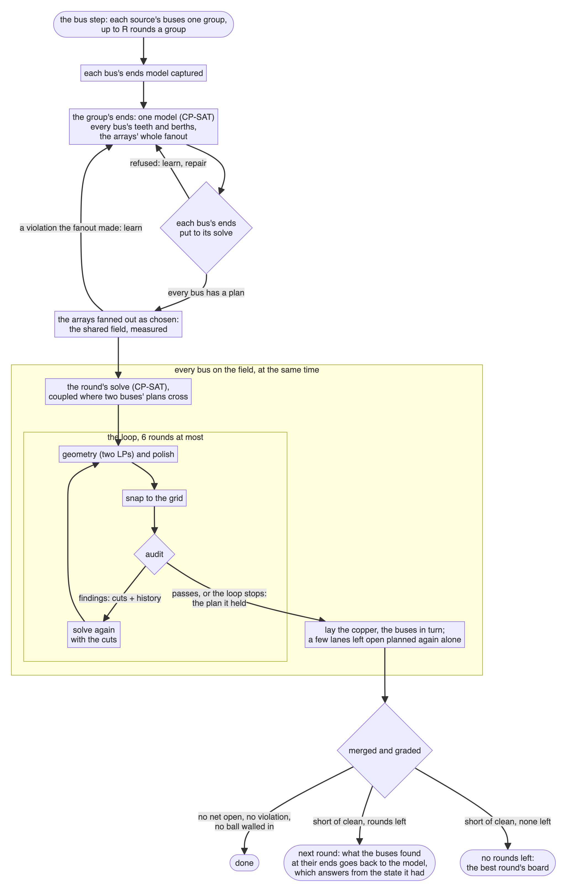

# Bus Routing

Two tools route buses:

- **`route.py --bus`** (this page's main subject): the A* router's bus mode. It detects groups of nets that travel together, routes each group first and middle-out, and attracts every member to one planned corridor (or to its already-routed neighbour), so the group comes out as parallel traces in a common river.
- **The topo bus step, `awx/route_bus.py`** (experimental): plans a whole bus between two ball arrays (a DDR, an LVDS bus) before laying any copper. See [Buses between two arrays](#buses-between-two-arrays-the-topo-bus-step-experimental) at the end.

Implementation of `--bus`: `bus_detection.py` (detection, filter, ordering, neighbour selection), `bus_corridor.py` (corridor planning), `single_ended_loop.py` (where they run), `rust_router/src/router.rs` (the attraction discount).

## Overview

Without bus routing, each net in a data bus is routed independently and the results can fan out along unrelated paths. With `--bus`, nets whose endpoints cluster together are detected as a group, a corridor with room for the whole group is planned, the group routes middle-out ahead of every other net, and each member is *attracted* toward the corridor, producing parallel traces that follow it.

```bash
python3 py_router/route.py board.kicad_pcb --nets "DATA*" --bus
```

The GUI's Advanced tab has the same switch ("Enable bus routing", with the four parameters below) and the `bus` ordering choice. `route_diff.py` accepts the `--bus` flags, but pairs are never bus-routed: the parameters are ignored there.

## Command-Line Options

| Option | Default | Description |
|--------|---------|-------------|
| `--bus` | off | Enable bus detection, corridor planning and each member's lane |
| `--bus-detection-radius` | 5.0 | Max endpoint distance for nets to form a bus (mm) |
| `--bus-min-nets` | 2 | Minimum number of nets for a raw clique (the strict filter below then needs 3) |
| `--ordering bus` | - | The bus-first ordering alone, with no corridor and no lane (see [Net Ordering](net-ordering.md)) |

## Bus Detection

`detect_bus_groups()` looks for *cliques* of nets whose endpoints cluster: a group qualifies if either all of its **source** endpoints or all of its **target** endpoints lie pairwise within `--bus-detection-radius` of each other. Endpoints are the centroids of the net's two main stub groups where stubs exist, otherwise pad positions.

The clique search (`_find_largest_clique()`) is greedy: candidate pairs are sorted closest-first, and each seed pair is grown by adding nets within radius of *every* current member. The largest clique (≥ `--bus-min-nets`) becomes a bus; its nets are removed and detection repeats until no further group can be formed.

**Both-end coherence:** a clique found at one end is then sub-clustered by where its members' *other* endpoints go (greedy centroid clustering at 2× the detection radius). A 20-net grab-bag at a BGA corner splits into the real rivers (the SD-card group, the SDIO group, the PCM group), because members of a true bus travel together at both ends. Sub-groups below `--bus-min-nets` fall back to individual routing.

**Strict geometric filter** (`filter_bus_groups_geometric()`, on by default): a group is kept as a bus only if its members genuinely travel together. Each member's run is the farthest-apart pair of its pads; the group keeps its largest subset whose runs are at least 5 mm long, parallel within a cos > 0.9 cone (either way round, a net has no direction) and within a 1.5× length ratio of each other, and drops power nets (`--power-nets`). A group left with fewer than 3 members is not a bus. This retires decoupling-cap clusters and power rails that raw cliques swept up. The run prints `Bus filter: N raw clique group(s) -> M geometric bus(es)`.

When the clique formed at the targets, members route from that clustered end, in one direction only, where the lane can guide them.

## Routing Order: Bus Groups First, Middle-Out

Bus groups are moved to the **front** of the routing order, ahead of every non-bus net; the remaining nets follow in the order the `--ordering` strategy gave them. Within a bus, nets are ordered by physical position along the bus's dominant axis (left-to-right if the endpoints spread more in X, else top-to-bottom), and routing starts from the middle net and alternates outward (`get_bus_routing_order()`):

```
Physical order:   A  B  C  D  E
Routing order:    C, B, D, A, E
```

The middle net (the "guide") is also the group's corridor representative.

## Corridor Planning

Before any member routes, `plan_bus_corridors()` probe-routes each group's representative at a ladder of inflated widths: rung *k* routes it as a track `2k × (track + clearance)` wider, which keeps room for *k* sibling tracks on each side (the wide-power-net `track_margin` mechanism, neck-down disabled, on one probe map that leaves out every bus member's own copper, since the siblings will pack into the corridor). Rungs run from `k_max = min(3, max(1, N // 2))` down to 0, and each rung that routes is scored

```
score = probe length + (k_max − k) × (track + clearance) × 40
```

so a corridor with room for the whole group wins unless it costs much more length. The winning centreline becomes the lane of **every** member, the guide included. Probes commit nothing.

- **Laminar probe.** The probe pays `KICAD_BUS_CORRIDOR_PROBE_VIA_MULT` (default 20) times the via cost, so the corridor stays on one layer unless a change is unavoidable. Members route at the normal via cost.
- **Demotion.** A centreline that still needs more than `KICAD_BUS_MAX_CORRIDOR_LAYER_CHANGES` (default 1) layer changes away from its ends (changes within 3 mm of either end are the river's on-ramps and do not count) has no lane to offer: the group is **demoted**, with no corridor, no attraction and no bus ordering, and its members route as plain nets.
- **No corridor.** A group none of whose rungs route keeps its bus ordering and falls back to its routed neighbour's path as its lane.

## Multi-Point Bus Members

A bus member with 3+ terminals (e.g. a strobe line with pull-up resistors) routes in the multipoint phases: one **main edge** now, the remaining taps in Phase 3, *after every other net's main route*. Two bus-specific behaviours keep such members on the corridor:

- **Corridor-spanning main edge.** The MST normally realizes each connection by the *closest* terminal pair, which for a BGA-to-chip bus net is typically resistor-to-trunk, leaving the dense ball tap deferred until the surrounding balls' own escapes seal it in. When the member has an attraction path, the main edge is instead re-realized as the terminal pair that spans the corridor's two endpoints (e.g. the BGA ball and the far chip pin), and only off-corridor taps (the pull-ups) defer to Phase 3. Disable with `KICAD_BUS_MULTIPOINT_SPAN=0`.
- **Corridor attraction on the main edge.** The multipoint main routes with the same attraction path (and cross-layer share) as point-to-point members.

## A Member's Lane

A member's lane is its group's planned corridor, else (no corridor) the path of an already-routed adjacent net in the bus's physical order, the left neighbour first (`get_lane_neighbor()`). The path is sampled at every grid step (`set_lane_path()`).

During A*, a step that enters a cell **off the lane pays a price** (`lane_price()` in the router, `lane_price.py` for its terms):

- **Free** within half the bus's width of the lane, on the lane's own layer there (never less than `LANE_FREE`, 0.2 mm): the members run side by side about the corridor.
- **Rising** linearly over the next `LANE_RAMP` (1.0 mm) to the full price.
- **The full price** everywhere farther off, and on a layer the lane is not on there: a step costs `1 + LANE_COST` (5) times a step on the lane's own layer.

It is a price for leaving the lane and not a discount for keeping to it. The search is weighted (cost so far plus `--heuristic-weight` times the distance left, at the full step price): a discount lowers the cost along the lane and leaves the weighted distance as it was, so a lane that bends from the straight line loses to the straight line at every step. A price off the lane raises the cost of the straight line instead. It is a scalar field, the same whichever end the search starts from. A net routed along a lane is not straightened afterwards by the octolinear smoothing. Clearances are enforced as normal: the lane only changes which legal path is cheapest.

## Interaction with Other Features

- **Net ordering**: `--bus` reorders whatever `--ordering` produced (bus groups first). `--ordering bus` gives the same reorder over an MPS base without corridors or lanes.
- **Failures**: a failed member gets the normal rip-up and retry. Ripped members re-route *along* their corridor (or routed neighbour) again. Other members continue; a failed neighbour simply provides no lane (the next routed neighbour is used, if any).
- **Differential pairs**: not bus-routed (see Overview).

## Tuning

- Increase `--bus-detection-radius` if a connector's pins span more than 5 mm and aren't being grouped; decrease it if unrelated nets are being pulled into a bus.
- The run prints the detected groups and their physical order; `--verbose` adds the routing order, the guide, which neighbour each member follows, and every corridor rung.
- Env knobs on the default behaviour: `KICAD_BUS_STRICT=0` turns the strict filter off (raw cliques), `KICAD_BUS_CORRIDOR_PROBE_VIA_MULT` and `KICAD_BUS_MAX_CORRIDOR_LAYER_CHANGES` set the laminar probe and the demotion rule, `KICAD_BUS_MULTIPOINT_SPAN=0` turns the corridor-spanning main edge off.

## Limitations

- Grouping is geometric: two unrelated buses that leave a connector side by side and run parallel can be grouped together.
- Attraction is strongest on the path's own layer; other layers get the 35% share.
- A bus member with no corridor and no routed neighbour (e.g. all earlier members failed) routes with no lane.

## Buses between two arrays: the topo bus step (experimental)

`awx/route_bus.py` is the topological bus router of the `awx` research tree. Rather than routing nets one at a time, it plans a bus between two parts whole (the order of every lane, which layer each runs on, where each changes layer, and the fanout at both arrays) and then lays it. It is experimental. The [plan-pcb-routing](claude-skills.md#plan-pcb-routing) skill runs it as Step 1a, on the poured board and before any other fanout, and its Step 1a is the guide to running it and checking the result.

```bash
# The buses the step would route (read-only), and the parts it leaves to the router, each with why
python3 -X utf8 awx/route_bus.py board.kicad_pcb --find \
    --clearance-ceiling 0.1 --track-width 0.1 --fanout-track-width 0.0975 \
    --via-size 0.35 --via-drill 0.15

# Route them, in one call
python3 -X utf8 awx/route_bus.py board.kicad_pcb board_bus.kicad_pcb \
    --inproc \
    --clearance-ceiling 0.1 --track-width 0.1 --fanout-track-width 0.0975 \
    --via-size 0.35 --via-drill 0.15
```

- **The buses are the step's own choice** (`bus_plan`, at the sizes given). A bus is the nets between a ball array and either another ball array sharing 8 nets or more (the larger array the source), or a **row part** no track passes between the pads of at those sizes, whose lanes must arrive in its pins' order. The row parts off one face of the source are one **group bus** (`U1:U4+U3`: one source with several ends, routed as one bus in one frame) when one of them has 8 nets or more and each other 4 or more. Two-sided edge connectors and parts a track passes between the pads of are left to `route.py`. `--find` prints the plan, each bus and each part left with why, and the `--bus` line that names the buses; `--bus SRC:DEST`, repeated, names them instead (DEST a part, or several, `U4+U3`). There is no fanout mode and no layer list: the lanes run on every copper layer, the planes' included.
- **Each source's buses are one group.** One model chooses every bus's teeth and berths together with the arrays' whole fanout -- every ball of the shared source and of each destination array served: escaped, dropped to its plane or strapped -- and lays it, the **shared field**. Every bus is then routed on that field at the same time, each in its own frame and its own process, their plans one **coupled solve** where their lanes cross or come close, and the buses' boards are merged. The groups go in turn, a memory bus's first, then the larger, each on the board the one before handed on, and no array belongs to two groups. A violation on the merged board between a bus's net and another net gives the other net back: the copper the step laid it is taken off and the net is left to `route.py`.
- **Sizes** are the routing CLIs' flags (`--clearance`, `--clearance-ceiling`, `--track-width`, `--via-size`, `--via-drill`, `--hole-to-hole-clearance`, `--board-edge-clearance`), an omitted one resolved as `route.py` resolves it; `--fanout-track-width` sets the escapes' track under the arrays. In a chain, pass `--clearance-ceiling` as everywhere else.
- **What it hands on.** The output is graded before it is handed on: the bus nets connected, no DRC violation on a bus net, and the board no worse than it came. When it passes, the output is the routed board, with its routed nets recorded as protected (#521) so `route.py`'s rips and the plane finalize leave them alone, and any net it left open is left to `route.py`. The poured nets the step laid copper of on the shared field (a plane ball's stub and via) are recorded protected too: a later step that rips such a net to retry a tap would take that copper from beneath the bus, where nothing lays it again. Otherwise the output is the board as it came and `route.py` routes the whole bus. The summary (`--json-out`, default `<OUT stem>.bus/summary.json`) names the nets routed and refused, and why, and holds the plan (the buses taken and not). Exit code 0 means the step wrote the output (#1738) -- the bus handed on routed and clean, or the output the input board as it came, both cases a board the chain carries on from. The summary's `exit` says which, and with several buses it is the WORST bus's status (the max over them): 0 every bus handed on routed; 1 one or more came through as they came, while the output may still carry the others routed; 2 the step's own check refused a bus (the turn back failed, its pull pads were not found again) and handed it on as it came. Each bus's own status is `buses[].exit` (and its record `buses[].summary`), which names every net refused. A non-zero process exit means no output was written: 2 for a usage error (a part the board does not have, a named bus sharing an array with another source's) or a `--src`/`--dest` bus whose turn into the flow frame failed, any other code otherwise.
- Every ball of a bus array must leave the step served (escaped, dropped to its plane or strapped): `route.py` cannot reach a bare ball in a ball field, and a fanout run after the bus step finds the field already full. The skill's Step 1a says how to count them.
- **Recorded and replayed.** The step records its own invocation in the board's `redo_commands.sh` (#132) when `REDO_MANIFEST` is set -- its line alone: the stages it runs inside (a cap pass, each bus's own process) record nothing, and `--find` and `--src`/`--dest` runs are not recorded. `tests/stress/manifest_to_plan.py` converts the line into a GUI plan `bus` step, every flag intact (`--bus` as the step's `buses`, in order); it refuses `--find` (it routes nothing) and `--src`/`--dest` (one bus by itself, outside its group: a debugging aid). `python3 awx/route_bus.py --help` lists every option.

### In the GUI: the Bus tab

The plugin's **Bus** tab (after **Fanout**) runs the step as a child process on a snapshot of the open board, with the command a terminal would type (see the README's *Plugin Tabs*), and an AI plan's `{"action": "bus", "buses": [...], "params": {...}}` step runs on it: `buses` omitted is the buses the step finds itself; `params` are its options (`rounds`, `feedback_rounds`, `fanout_track_width`, `k`, `inproc`, `pack`, `round_edits`) and the chain's sizes (`clearance_ceiling`, `track_width`, `via_size`, `via_drill`, `hole_to_hole_clearance`, `board_edge_clearance`). The plan executor waits for the child, applies its output to the live board and goes on. The child needs a Python with OR-Tools. The step keeps KiCad's `pcbnew` out of its processes (`swig_compat.keep_pcbnew_out`: OR-Tools and pcbnew cannot share a process -- WinError 127 on Windows either way, a crash in KiCad's bundled python on macOS), so KiCad's own Python serves once OR-Tools is installed in it. Its 2-D embedding's constrained triangles are shapely's own from shapely 2.1, and GEOS's routine called directly under shapely 2.0 (`py_router/constrained_triangles.py`; KiCad 10's bundled python on macOS is 3.9, which shapely 2.1 does not support) -- the same triangles. The tab's *Python* field names another python, and **Check Python** says what the one it has lacks.

### Progress events

The step writes what it is doing, as it does it, to `<OUT stem>.bus/events.jsonl` (`awx/bus_events.py`), one JSON object a line -- or to the file the `BUS_EVENTS` setting names. Every process of the step writes to it (the group's model and each bus's own process too), each line in one write, so `tail -f` follows the step and the Bus tab reads it into its rows. Nothing reads the file back into the routing. Every event has `v` (1), `t` (epoch seconds), `pid`, `stage`, `kind`, `group` (the source part: each source's buses are one group) and `bus` (`SRC:DEST`, or null for the group's own events), plus `phase: "capture"` in a bus's ends-model capture run.

| stage | kind | from | payload |
|-------|------|------|---------|
| step | start | the step | `board`, `out`, `buses` (the `--bus` specs, or null: the step finds them), `rounds`, `feedback_rounds`, `k`, `sizes` |
| step | plan | the step | `buses` and `left`, each `{src, dest, nets, why}` (when the step found them) |
| step | end | the step | `status` (0 every bus routed, 1 one or more left as they came, 2 refused), `out`, `summary` |
| group | start / round / end | the step | its `buses`, its `work` folder; a group round's `open`, `drc`, `walled`, `secs`; its `exit`, `open`, `drc`, `walled` |
| capture | start / end | the group | the buses; each bus's `ok`, `secs`, `log` |
| ends | start / end | the group | the group's model's `round`, `exit`, `secs`, `log` |
| ends | solve / check / field / no_plan / done | the group's model | each solve's `check`, `status`, `secs`, `rest` (vias' worth), `bound`, `walled`, `changing_layer`; a check's `refused` buses; the field's `drc`, `drc_bare`, `lessons`; the model's end |
| route | start | the group | the `buses` routed on the shared field, `negotiated` |
| bus | exit | the group | a bus's process ended: `exit`, `secs`, `log` |
| merge, grade | end | the group | the merged board's `conflicts` between buses; its `open`, `drc`, `walled` |
| bus | start / graded / end | the bus's process | its `nets`, `k`, `work`; on the board: `vias`, `copper_mm`, `connected`, `drc`, `walled`; its `exit`, `why`, `routed`, `refused`, `secs`, `grade` |
| round | start | the bus's process | `round`, `rounds`, `feedback`, `draw` |
| fanout, solve, loop, lay | start / end | the bus's process and its stages | the `round`; a fanout's and a loop's `exit`, `secs`, `log`; a solve's `status`, `secs`, `crossings`, `proved`, `plan`, `obj`, `bound` (a loop's re-solves too); a lay's `lanes`, `vias`, `copper_mm`, `open`, `drc` |
| coupled | start / end / search | the bus's process; the coupled solve | a bus waiting for its round's coupled solve, then `joint`, `own`, `secs`; the solve's `status`, `secs`, `cost`, `bound`, `broken` of `couplings` |
| ends, solve, coupled | progress | a long CP-SAT search, while it runs | `label` (the start, an array's ends, the model, the bound-raising or plan-finding workers, the coupled search), `best` (the best plan's cost, vias' worth; null before the first), `bound` (the cost the search has proved no plan can beat), `secs`. Read off the solver's own progress lines: a first or better plan at once, the same numbers again at most every few seconds. The Bus tab and the Autorouter's bus step row show them as "best, bound (gap % apart)" on the running stage |

### Rounds, seeds and the loop

A round is one whole attempt: choose every net's ends and fan out, solve every crossing and layer change (CP-SAT), then a **loop** that turns the plan into geometry, snaps it to the router's grid, audits it and solves again with what the audit found, and finally lays the copper.

- **`--rounds R`** (default 2): rounds at most. In the bus step they are the group's: each bus runs one round on the shared field, and a round that leaves the board short of clean (a net open, a violation, a ball walled in) sends what its buses found at their ends back to the group's model, which chooses again from the state it had, and the buses are routed again on that field. The board with the fewest nets open, then the fewest violations, then the fewest balls walled in, is kept.
- Every solve of a round runs under one CP-SAT seed (`BUS_SEED`, else 1), so the same board and seed give the same plan.
- A bus routed by itself (`--src`/`--dest`, a debugging aid) runs the whole route's own rounds: a round that leaves nets open is a **new draw** by default, round 1 again from the same board under the next seed, nothing carried from the round before; with **`--feedback-rounds F`** (default 0), up to F of the rounds after each draw keep that draw's seed and are fed what it found -- its crowded ends, its lanes over two vias, its open nets -- the fanout choosing again from that round's board. A round whose solve finds no plan at all is followed by a feedback round whatever F. When no round lays anything, a **last resort** lays a partial plan, leaving out the lanes the rounds named.
- Every bus's ends are put to the solve before they are laid, each refusal teaching the next choice.
- **The loop** (six rounds at most) sends its findings back to the solve as cuts and history. They stay within the round: no later round sees them.
- **`--escalation fab|board|off`** (default `fab`, route.py's own flag): a group of buses that still leaves a net open, a violation or a walled ball is routed again a rung down the fab ladder -- the lanes' track, the escapes' track and the via together, never the clearance -- each rung from the end the run before it kept, down to the policy's floor (`board`: the board's own minimums; `off`: no rung). Where only some of the group's buses left nets open, those buses alone are routed again at the rung's sizes and the other buses' copper is kept as it stands. A group whose ends model finds a bus no room for its changes of layer at the sizes asked for, and room at a rung's via, steps down without laying anything. The result with the fewest nets open stands (of two alike, the one with fewer buses left to route again, then the earlier); the board's project floor is lowered to the copper it ships, and the bus nets delivered below the sizes asked for are listed in the summary's `design_rules`.
- **`--pack`** (off by default; the setting `BUS_PACK=1`): after a round's lay, each single-net lane is pulled taut against its neighbour and laid again as packed octilinear copper. The packed board is graded as the lay is and kept only where it has no more nets open and no more DRC violations than the lay; otherwise the lay stands. A differential pair, and a lane the lay necked, stay as laid.



*Drawn from `diagrams/bus_rounds.mmd` by `diagrams/render_mermaid.py`.*

`awx/README.md` ("How it works") has every stage in detail.
