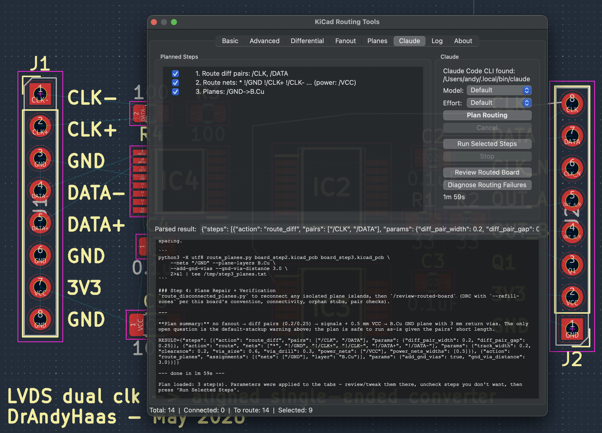

# Claude Code Skills

The repository ships ten [Claude Code](https://claude.ai/claude-code) skills in `.claude/skills/`. They combine the project's deterministic Python tooling (`kicad_parser`, `list_nets.py`, `analyze_power_paths.py`, the checkers) with AI judgment where it's actually needed — reading datasheets, classifying components, planning workflows, and diagnosing failures. Outputs are formatted as ready-to-use CLI arguments so they feed straight back into the routing tools.

## Using the Skills

Skills are discovered from `.claude/skills/` in the directory Claude Code is launched from, so run it from the repository checkout, and pass board files by absolute path if they live elsewhere:

```bash
cd /path/to/KiCadRoutingTools
claude
> /plan-pcb-routing /absolute/path/to/my_board.kicad_pcb
```

Skills that look up datasheets (`/analyze-power-nets`, `/find-high-speed-nets`, `/identify-diff-pairs`, `/recommend-stackup`, `/recommend-plane-mappings`, and `/plan-pcb-placement` for parts the board does not explain) use WebSearch and can take a few minutes on boards with many unique ICs.

### Using them with opencode (#503)

[opencode](https://opencode.ai) discovers the same `.claude/skills/` directory and loads skills on demand through its `skill` tool, so the whole set works there too - with any model provider opencode supports (it ships free gateway models out of the box; `opencode auth login` adds provider accounts):

```bash
cd /path/to/KiCadRoutingTools
opencode run --agent pcb-analysis -m anthropic/claude-sonnet-4-5 \
    "Load the 'plan-pcb-routing' skill with your skill tool and follow it for: /absolute/path/to/my_board.kicad_pcb"
```

The `pcb-analysis` agent (defined in the repo's `opencode.json`) denies file edits - the opencode equivalent of the read-only tool allowlist the Claude Code runs use (`CLAUDE_ALLOWED_TOOLS` in `kicad_routing_plugin/ai_backend.py`; the list is deliberately not restated in either place, because it was, and it went stale). Neither list grants a dedicated write tool. **Neither is a sandbox, though**: both grant `Bash`, and `--allowedTools` auto-approves the tools it names rather than removing the others (measured on Claude Code 2.1.251: the run's `init` event reports `permissionMode: auto`, taken from the user's own settings, and lists `Write`/`Edit` regardless). Read the allowlist as a statement of intent.

Both can dispatch a subagent, so an analysis skill can hand its close-out to an independent verifier (#552): the Claude list grants the dispatch tool per run, and the `pcb-analysis` agent grants opencode's `task` tool in `opencode.json` (opencode has no per-run allowlist flag, so that grant holds for every run of the agent). Because the pinned agent *is* opencode's allowlist, `OpencodeBackend.build_cmd` **refuses** a caller naming `Write`/`Edit` rather than dropping the request - a run that believes it can write and cannot fails deep inside the skill instead of at launch. That check matches tool *names*, so it is a guard against handing over a write-capable allowlist wholesale, not a proof of read-only-ness.

The behavioural half of the contract - *analysis and planning only, and any subagent you dispatch is given this sentence verbatim and answers with `VERDICT=`, never `RESULT=`* - is prompt text, not an enforced flag, and lives once in `ai_backend.ANALYSIS_CONSTRAINT`. Every GUI analysis prompt is built from it; `tests/test_552_analysis_constraint.py` is what keeps that true. The enforceable form exists and is owed rather than done: `claude --agents <json>` can define a subagent and its tools outright, which is what #552 item 2 ultimately wants.

`/plan-pcb-placement` writes files (its groups, intent, placed boards and report), so it does not run under the read-only `pcb-analysis` agent; the GUI's placement runs use Claude Code.

The skills' RESULT/plan output contracts are tuned on Claude models; smaller models may follow them less reliably.

## Plugin GUI Integration

<p align="center">
  
</p>

Nine of the ten skills are reachable from the plugin's routing dialog (all but
`/stress-test-router`; the GUI spawns
the selected agent CLI - Claude Code or opencode, per the **Backend**
dropdown on the **AI Drive** tab; the placement runs need Claude Code - headless
with the working directory set to the plugin root, streams a
live transcript, and parses a machine-readable `RESULT=` last line back into
controls):

| Where | Button | Skill | What it fills / shows |
|-------|--------|-------|------------------------|
| AI Drive › Routing | **Plan Routing** | `/plan-pcb-routing` | Fills parameters across the tabs and loads a checkable step list; **Run Selected Steps** executes them in-process |
| AI Drive › Routing | **Review Routed Board** | `/review-routed-board` | QA report in the transcript with a PASS/FAIL verdict |
| AI Drive › Routing | **Diagnose Routing Failures** | `/diagnose-routing-failures` | Root-cause report from the board + the Log tab content |
| AI Drive › Placement | **Place (AI)** / **Place + Route (AI)** | `/plan-pcb-placement place` / `full` | A headless run into a `krt_placement/` folder beside the board: the seed candidates with a preview, progress from the milestone ledger, then the final board and REPORT.md; **Apply Result to Board** brings it onto the open board |
| Route tab (Layers) | **Check Stackup (AI)** | `/recommend-stackup` | Stackup report; recommended layer count logged |
| Route tab (Options) | **Ask AI** (Power Nets) | `/analyze-power-nets` | Fills the Power Nets / Power Widths fields |
| Differential tab | **Ask AI** | `/identify-diff-pairs` | Checks confirmed pairs, unchecks name-matching false positives; unconventional pairs reported in the log |
| Planes tab | **Ask AI** (assignments) | `/recommend-plane-mappings` | Fills the net → layer assignment list (replace/merge prompt) |
| Planes tab | **Ask AI** (GND vias) | `/find-high-speed-nets` | Fills the GND via Max Distance field |

The Routing sub-tab's **Backend**, **Model**, and **Effort** selectors apply to every button
above except the two placement buttons, which have their own on the Placement
sub-tab (Claude Code only), and all of them persist with the other dialog settings (model/effort are remembered per
backend; opencode models are `provider/model` strings, its effort maps to
`--variant`). Claude Code runs show a startup header (version, model, discovered
skills) so you can confirm what actually ran.

**Saving and replaying a plan.** Next to the step list the Routing sub-tab has **Save…**
and **Load…** buttons. **Save…** writes the current plan steps (actions, nets/pairs/
assignments, and per-step parameters) to a JSON file; **Load…** reads one back into the
step list so **Run Selected Steps** replays the exact same routing chain **without another
Claude run** — useful for re-running a vetted plan or sharing it.

## Plans from the command line

A plan is just a JSON file, so it does not need the GUI at either end (issue #507).

### Making a plan

`make_plan.py` converts a **recorded command chain** into a loadable plan. Every
stress run leaves one (`redo_commands.sh`), and the board-mutating tools
self-record whenever `REDO_MANIFEST` points somewhere, so your own CLI session
becomes a plan too:

```bash
python3 py_router/make_plan.py runs_set1/myboard --list       # a recorded run directory
                                                    # -> myboard_plan.json

export REDO_MANIFEST=$PWD/redo_commands.sh          # or record your own chain
python3 py_router/bga_fanout.py board.kicad_pcb -o s1.kicad_pcb --component U1
python3 py_router/route.py s1.kicad_pcb s2.kicad_pcb --nets '/SPI*'
python3 py_router/make_plan.py .                              # -> plan JSON for the GUI
```

The conversion prunes superseded retries and dead-end branches (the same file
dependency chain a replay runs), drops check/grade commands, and carries every
recognized `--flag` into the step's parameters — so the GUI routes the way the
recorded commands did. Load the result with the Routing sub-tab's **Load…** button.

### Running a plan headless

`run_plan.py` executes a plan against a board through the **real** plugin dialog
and plan executor — no window, no clicks, no Claude. It re-execs into KiCad's
bundled python (which has `pcbnew` + `wx`) automatically:

```bash
python3 py_router/run_plan.py board.kicad_pcb plan.json -o routed.kicad_pcb
python3 py_router/run_plan.py board.kicad_pcb plan.json --list        # show the steps
python3 py_router/run_plan.py board.kicad_pcb plan.json --steps 1,3-5 # run a subset
```

The input board is never modified — it is copied *with its `.kicad_pro`* (which
carries the DRC floor, #441) to the output path, and the plan runs on that.
`--snapshot-dir` keeps the board after each step.

This is the same driver (`headless_plan.py`) the GUI/CLI parity harness uses, so
what runs here is what the buttons run.

## The Skills

| Skill | Purpose | Main output |
|-------|---------|-------------|
| [`/plan-pcb-placement`](#plan-pcb-placement) | Place a board by function over 12 seeds (6 started scattered, 6 with each group gathered) and keep the one of the 6 cheapest that fast-routes best; in `full` mode route it with `/plan-pcb-routing` (modes `place` / `full`) | The best board it reached, its groups file, intent and REPORT.md, checked by one independent verifier |
| [`/plan-pcb-routing`](#plan-pcb-routing) | Placement gate, full board analysis and step-by-step routing plan | Ordered routing commands, saved as `<board>_plan.sh` / `<board>_plan.json` and checked before they run, executed on approval |
| [`/analyze-power-nets`](#analyze-power-nets) | Identify power nets and track widths via datasheets | `--power-nets` / `--power-nets-widths` arguments |
| [`/find-high-speed-nets`](#find-high-speed-nets) | Classify nets by speed tier and find impedance-controlled nets via datasheets | `--gnd-via-distance` and `--impedance` recommendations |
| [`/identify-diff-pairs`](#identify-diff-pairs) | Find diff pairs by pin function, not just naming | Per-interface `route_diff.py` commands |
| [`/recommend-stackup`](#recommend-stackup) | Review/recommend the board stackup | Stackup table + `--impedance`/plane-layer arguments |
| [`/recommend-plane-mappings`](#recommend-plane-mappings) | Recommend net → plane-layer assignments with SI rationale | Assignment list for the Planes tab / `route_planes.py` arguments |
| [`/diagnose-routing-failures`](#diagnose-routing-failures) | Root-cause failed routes from logs + board | Targeted retry command for the failed nets, or a hand-back to placement |
| [`/review-routed-board`](#review-routed-board) | Post-route QA and sign-off | Pass/fail report with next actions |
| [`/stress-test-router`](#stress-test-router) | Batch-test the router on real-world open-source boards | Completion/DRC summary table + GitHub issues for findings |

### /plan-pcb-placement

Placement by function, the way a designer lays a board out:
- **Grouping.** The agent sorts the parts into functional groups (power entry and conditioning, the core and its clock, each interface, the user interface), reading pin functions and datasheets, and records why. `py_tools/check_groups.py` checks the result; `near` / `apart` / `edge` / `side` hints steer where groups go.
- **Fixed parts and the intent.** Connectors, mounting holes and other mechanical parts are placed and locked first (`py_placer/place_pose.py`), from the design brief, `mechanical.json` or the user; `py_tools/check_floorplan.py --emit-intent` writes the intent `place_simple` reads (proximity claims, keep-outs, zones, faces, decap limits).
- **Datasheet layouts.** For each template candidate the agent names while grouping (a switching stage or an RF front end, judged from the parts, with `emc_roles`' pin reading as a hint), the agent reads the datasheet's layout guidelines and example figure, matches its parts to the board (`py_tools/fit_template.py --pins`), turns the drawing into the footprint's frame and writes a sketch; `fit_template.py` fits it to the board's footprints, renders it to compare with the figure, and writes it into the intent's `templates[]`. The placer seats those parts as drawn, carries them with the chip and prices their drift; the grade measures it, and for a switching stage how far each cap's ground returns from the chip's.
- **Placement.** `py_placer/place_simple.py` keeps each group in one piece and arranges the pieces by one objective (wire, crossings, claims such as each crystal at its IC's oscillator pins, decaps spread over their own IC's supply pins and held to the intent's limits, group contiguity and the hints, fan-out room in front of fine-pitch parts, foreign pads, congestion), annealed from a random start; the same seed gives the same placement. It places its default seeds in parallel: `--scattered` (default 6) from a random start and `--clustered` (default 6) with each group's parts gathered round one random point, which routes better on boards dominated by one big IC and worse on others, so the judge chooses; it names the `--judge` (default 6) legal seeds to judge in `judge.json`, those `check_floorplan --intent` grades without an error first, then the cheapest.
- **Selection.** The seeds `judge.json` names are fast-routed by one chain (`py_placer/judge_seeds.py`: `route.py --quick 2` on every route step, scored by `py_tools/quick_score.py --intent`) and the one that routes best is kept (floorplan errors first, since a route cannot clear one, then fewest blocking nets, then the fewest joins the open nets still need, then vias, copper, segments); a seed that left a part illegal is never judged. When no seed can be judged (every seed illegal, or every judged one NOT BUILDABLE or failing the floorplan), the skill fixes the input that is the same in every seed and places again (a new pass, recorded as a rejected ledger row), or repairs one seed by hand and judges it alone.
- **Routing (full mode).** The kept placement is routed by running `/plan-pcb-routing` on it (never a `--quick` run) and graded with `board_score` and `check_complete`.
- **Hand-back (both modes).** One independent verifier grades the result, and the board comes back with its groups file, intent and REPORT.md. `scripts/grade.py` and `scripts/measure.py` grade the board and split the wall clock independently of the agent's own claims, and `scripts/make_unplaced.py` builds an all-off-the-board input for from-scratch runs.

### /plan-pcb-routing

The orchestrator. It starts with a placement gate: `check_assembly` must call the board buildable, or the skill stops and hands it to `/plan-pcb-placement`, because no router setting fixes parts in the wrong places. It then analyzes the board structure, identifies components needing fanout (BGA/QFN/QFP/PGA, with actual pad-depth analysis for hollow-center packages), detects differential pairs and DDR length-matching groups, categorizes power/ground nets, and assesses signal speeds. Produces a numbered plan — pours first, then fanout (+cap clearance), diff pairs, impedance nets, one route step over ALL nets whose in-run plane finalize does the repair, optional GND return vias/stitching, verification — with each command explained. The plan is saved next to the board as `<board>_plan.sh` (replayable with no model) and `<board>_plan.json` (the GUI's Load… form), and `scripts/route_plan_check.py` checks it before it runs; then it runs on approval. Defers to `/recommend-plane-mappings`, `/find-high-speed-nets`, `/identify-diff-pairs`, `/recommend-stackup` and `/analyze-power-nets` at the appropriate points rather than duplicating their logic.

Note: guide corridors (`User.1` polylines) and keepout zones (`User.2` polygons) are **user-drawn** — the skill suggests in words where they would help, but never draws the geometry itself.

### /analyze-power-nets

Identifies power nets and recommends track widths. Auto-classifies obvious components (resistors and caps with one side on GND as shunts, inductors, ferrites, fuses and switches as pass-through, a part with a `power_out` pin as a source), looks up datasheets for the rest, assigns each a role (power source, current sink, pass-through, shunt), traces current paths from sinks to sources, and emits ready-to-paste `--power-nets` / `--power-nets-widths` configurations. See [Power Net Analysis](power-nets.md) for the full documentation of the underlying analysis.

### /find-high-speed-nets

Classifies nets into speed tiers (ultra-high / high / medium / low) by looking up component datasheets for max interface frequencies and rise times, tracing signals through series passives. Recommends `--gnd-via-distance` values for GND return via placement (see the [planes documentation](route-plane.md)). It also finds the impedance-controlled nets — RF/antenna feeds and other controlled-impedance interfaces — and recommends their target ohms, the `route.py` / `route_diff.py --impedance` commands, and near-fab-floor width and spacing. `/plan-pcb-routing` includes a lightweight name-pattern-only version of this analysis; run this skill first for datasheet-accurate numbers.

### /identify-diff-pairs

Finds differential pairs by **pin function** rather than net naming: checks pad `pinfunction` metadata, looks up datasheet pinouts for high-speed ICs, and traces through series passives (AC coupling caps, termination resistors). Catches pairs whose net names don't follow P/N conventions and flags name-based false positives. Recommends per-interface parameters — differential impedance (USB 90Ω, LVDS 100Ω, PCIe 85Ω, …), `--diff-pair-gap`, and whether `--diff-pair-intra-match` matters — and outputs `route_diff.py` commands grouped by interface.

### /recommend-stackup

Reviews the board's stackup and flags untouched KiCad defaults — which silently skew `--impedance` width calculations and `--time-matching` delays. Gathers impedance targets from the board's interfaces, looks up the user's fab's standard stackups, and recommends layer roles and dielectric thicknesses, validated with the project's own IPC-2141 formulas in `impedance.py` so the recommendation matches what the router will compute. Outputs the resulting routing arguments; never modifies the board file.

### /recommend-plane-mappings

Recommends which nets deserve copper planes and on which layers. Reads the stackup and existing zones, identifies plane-worthy nets by pad count and datasheet current estimates (the `/analyze-power-nets` approach), and assigns layers with signal-integrity rationale: GND adjacent to the primary signal layers for return paths, power planes paired against GND for interplane capacitance, and split layers for multiple low-current rails (flagging the seams). On 2-layer boards it recommends pours and points at `/recommend-stackup` when the signal content justifies four layers. Ends with a machine-readable `RESULT=GND:In1.Cu;VCC:In2.Cu` line that maps 1:1 onto the Planes tab's assignment list.

### /diagnose-routing-failures

Root-causes failed routes after a `route.py` / `route_diff.py` run. Parses the `JSON_SUMMARY` (including the structured per-failed-net `blockers` attribution and the `pad_pairs_*` routability tallies / open outcomes, #409), failed-net histories, and blocking reports from the captured logs, correlates failures spatially with board regions and components, classifies the failure mode (BGA exclusion zone, corridor congestion, layer conflicts, search space exhausted, grid-vs-pitch, placement-shaped geometry, genuine capacity), and outputs a targeted retry command for just the failed nets — most-targeted fix first, global parameter increases last. A placement-shaped failure (pads `check_reachability.py` calls CAGED, or geometry already at the floor) goes back to `/plan-pcb-placement` instead, since no router flag fixes it.

### /review-routed-board

Post-route QA on any routed board (from this tool, by hand, or another router). Runs the DRC, connectivity, orphan-stub and copper-hygiene (`check_weird.py`) checkers, cross-checks with KiCad's own `kicad-cli pcb drc` (zone copper needs it), verifies length/time-match groups landed within tolerance and audits meander arm spacing, checks GND return via coverage and impedance/return paths (`check_impedance.py`) on high-speed nets, and reviews diff-pair gaps and polarity. Produces a compact pass/fail sign-off report, with `board_score`'s counts, ending with concrete next actions.

### /stress-test-router

A development/QA skill rather than a board-design skill: batch-tests the router against real-world open-source KiCad boards of varying complexity (simple keyboards up to 6-layer SoC carriers). Drives the `tests/stress/` harness — downloads the corpus from upstream GitHub projects (boards are never checked into the repo), normalizes via a `pcbnew` round-trip, strips all routing, then routes each board end-to-end with the `/plan-pcb-routing` workflow under strict resource limits (a ~12 GB per-step memory watchdog, boards admitted by load via the `run_queue.sh` manager). Aggregates per-board completion rates, DRC deltas vs the original routed board graded at the same floor, connectivity verdicts, and crash/hang findings into a summary table, deduplicates findings against existing GitHub issues, and files new issues after user approval. See `tests/README.md` and `tests/stress/README.md` for the harness internals.

## How They Fit Together

```
Placement (or the whole job):
  /plan-pcb-placement place     - group, place, fast-route, re-place; then continue below
  /plan-pcb-placement full      - also routes itself --> /review-routed-board
        |
        v
Before routing:
  /recommend-stackup        - fix the stackup before impedance work
  /identify-diff-pairs      - confirm pairs, get gap/impedance
  /analyze-power-nets       - power net widths / plane decisions
  /recommend-plane-mappings - which nets get planes, on which layers
  /find-high-speed-nets     - GND return via distances, impedance nets
        |
        v
  /plan-pcb-routing         - builds and runs the routing plan
        |                     (consumes all of the above; a board that is
        |                      not buildable goes back to /plan-pcb-placement)
        v
  routing runs (route.py, route_diff.py, route_planes.py)
        |
        +-- failures? --> /diagnose-routing-failures --> targeted retry
        |                   (placement-shaped? --> /plan-pcb-placement full)
        |
        v
  /review-routed-board      - final sign-off
```

Each skill also works standalone — you don't need the full plan flow to ask one question of one board.
