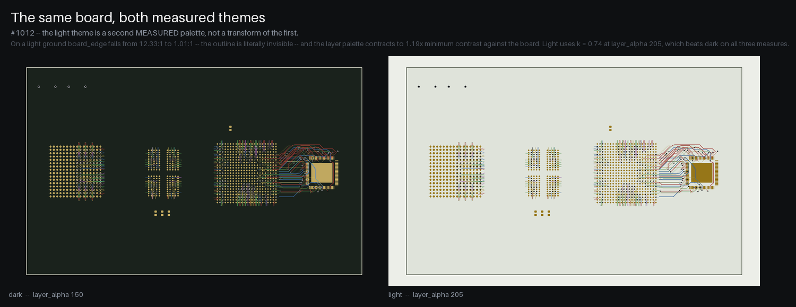

# Utility Scripts

This document describes the checkers, placement tools, renderers and other
utility scripts included with KiCad Routing Tools. Every script prints its full
option list with `--help`; `python3 krt_registry.py --list` lists every
runnable tool in the clone with a one-line purpose.

**Contents**

- Verifying a routed board: [DRC](#drc-checker-check_drcpy) ·
  [connectivity](#connectivity-checker-check_connectedpy) ·
  [KiCad's unconnected count](#kicad-unconnected-count-kicad_unconnectedpy) ·
  [board score](#board-score-board_scorepy) ·
  [is it done?](#completion-check-check_completepy) ·
  [orphan stubs](#orphan-stub-checker-check_orphan_stubspy) ·
  [pad geometry](#pad-geometry-checker-check_padspy) ·
  [cycles](#cycle-checker-check_cyclespy) ·
  [copper hygiene](#copper-hygiene-checker-check_weirdpy) ·
  [non-orthonormal segments](#non-orthonormal-segment-checker-check_orthonormalpy) ·
  [impedance](#impedance-audit-check_impedancepy) ·
  [reachability](#reachability-check-check_reachabilitypy) ·
  [net forensics](#net-forensics-net_forensicspy) ·
  [hand-join verifier](#hand-join-verifier-check_joinpy)
- Placement: [placer](#placer-place_simplepy) ·
  [groups checker](#groups-checker-check_groupspy) ·
  [pose setter](#pose-setter-place_posepy) ·
  [assembly checker](#assembly-checker-check_assemblypy) ·
  [board brief](#board-brief-board_briefpy) ·
  [context sheet](#board-context-sheet-board_contextpy) ·
  [route review](#route-review-route_reviewpy) ·
  [seed judge score](#seed-judge-score-quick_scorepy) ·
  [seed judge runner](#seed-judge-runner-judge_seedspy) ·
  [datasheet template fit](#datasheet-template-fit-fit_templatepy) ·
  [run ledger](#run-ledger-convergepy) ·
  [label tidy](#label-tidy-beautify_labelspy) ·
  [decap clearance repair](#decap-clearance-repair-place_fanout_clearancepy) ·
  [rule-area writer](#rule-area-writer-add_rule_areapy) ·
  [mounting-hole copper](#mounting-hole-copper-check_mounting_holespy)
- Pictures: [board renderer](#board-renderer-route_renderpy) ·
  [placement renderer](#placement-renderer-render_placementpy) ·
  [floorplan overlay](#floorplan-overlay-render_planpy) ·
  [nets side by side](#nets-side-by-side-render_netspy) ·
  [power view](#power-view-render_powerpy) ·
  [routing movie](#routing-movie-route_moviepy) ·
  [placement movie](#placement-movie-place_moviepy)
- Fanout: [BGA](#bga-fanout-generator-bga_fanoutpy) ·
  [QFN/QFP](#qfnqfp-fanout-generator-qfn_fanoutpy)
- Boards and projects: [net analyzer](#net-analyzer-list_netspy) ·
  [copy a board](#board-copy-copy_boardpy) ·
  [DRC settings fixer](#drc-settings-fixer-fix_kicad_drc_settingspy) ·
  [fab tiers](#fab-tier-floors-fab_tierspy) ·
  [fill for delivery](#fill-for-delivery-fill_for_deliverypy) ·
  [geometry extractor](#pcb-geometry-extractor-extract_pcb_geometrypy) ·
  [parser-parity validator](#parser-parity-validator-validate_pcb_datapy)
- The clone itself: [build script](#build-script-build_routerpy) ·
  [tool inventory](#tool-inventory-krt_registrypy-krt_capabilitiespy) ·
  [reach metrics](#reach-metrics-repo_metricspy) ·
  [clean ignored files](#clean-ignored-files-clean_ignoredpy) ·
  [test scripts](#test-scripts) · [common workflows](#common-workflows)

Documented elsewhere: the routing CLIs `route.py` / `route_diff.py` /
`route_planes.py` / `repair_planes.py` in [Configuration](configuration.md),
[Differential Pairs](differential-pairs.md) and [Plane Routing](route-plane.md);
`check_floorplan.py` in [Floorplan Intent](floorplan-intent.md); `make_plan.py` /
`run_plan.py` and `analyze_power_paths.py` in [Claude Skills](claude-skills.md);
the placer's internals in [the placement README](../py_placer/placement/README.md);
the release scripts (`package_pcm.py`, `install_plugin.py`, `update_metadata.py`,
`check_release_version.py`) in [Release Pipeline](release-pipeline.md).

## DRC Checker (`check_drc.py`)

Checks a routed PCB for Design Rule Check violations.

### Usage

```bash
python3 py_router/check_drc.py output.kicad_pcb [OPTIONS]

Options:
  --clearance, -c FLOAT  Copper clearance to grade against, in mm. Default: auto-detected
                       from the sibling .kicad_pro Default net-class clearance (the value
                       the routing steps recorded as actually used, incl. auto-stepped
                       fine-pitch taps), floored at Board Setup min_clearance as
                       KiCad's DRC does (#1210); falls back to 0.2 if no project is
                       found. Other net classes are graded at their own clearance
                       (pairwise max, as KiCad does) either way.
  --hole-to-hole-clearance FLOAT  Minimum drill hole edge-to-edge clearance in mm
                                  (default: 0.20, the JLC fab floor — same as routing;
                                  raised to the board's own min_hole_to_hole)
  --board-edge-clearance FLOAT    Minimum clearance from board edge in mm (0 = use
                                  --clearance; raised to the board's own
                                  min_copper_edge_clearance, never below the fab's
                                  0.20 copper-to-edge floor)
  --hole-clearance FLOAT  Minimum copper-to-hole clearance in mm (0 = auto: the
                          project's min_hole_clearance, else the 0.20 fab floor).
                          Raises the floor, never lowers it
  --clearance-margin FLOAT  Fraction of --clearance used as tolerance (default: 0.05 = 5%).
                            Violations smaller than clearance*margin are ignored — filters
                            grid-quantization noise (~8 µm artifacts); raise to e.g. 0.1 to
                            suppress more borderline grazes
  --nets, -n PATTERN [...]  Only check nets matching these fnmatch patterns
  --debug-lines, -d    Write debug lines on User.7 showing violation locations
  --quiet, -q          Print only a summary line unless there are violations
  --max-print INT      Max violations listed per type before "... and N more"
                       (0 = print all; default 20)
  --no-size-checks     Skip the track-width and via/hole-size fab-floor checks
  --min-track-width FLOAT   Minimum manufacturable track width in mm
                            (default: the physical fab floor, see check 11)
  --min-via-diameter FLOAT  Minimum via outer diameter in mm (default: fab floor)
  --min-via-drill FLOAT     Minimum via drill diameter in mm (default: fab floor)
  --size-margin FLOAT       Absolute tolerance in mm for the size checks (default: 0)
  --check-pad-edge          Also check pad-to-board-edge clearance. Off by default:
                            pad-edge violations are almost always pre-existing
                            edge-connector pads, not router-introduced.
  --baseline BOARD          The board this one was derived from (checks 6, 15, 16 and 19)
  --json FILE               Also write the result as JSON: the graded floors with their
                            source (graded_at), the violation and accepted counts,
                            by_type, contacts_by_type, via_in_paste, keepout and every item.
                            Complete regardless of --max-print
  --render DIR              Write one cropped PNG per spatial cluster of violations
                            (drawn by route_render)
  --fab-tier {standard,advanced,auto}  JLC fab tier (default: auto)
  --fab-overrides FILE      Fab-floor override file; it replaces the physical floor
                            the size checks grade at (see [Fab Tier Options](configuration.md#fab-tier-options))
```

`check_drc.py` also accepts `--escalation`, `--clearance-ceiling` and
`--strict-sizes`, which the shared fab-tier helper adds to every CLI; they
change nothing here. `--fab-tier` does not move the size floors either (they
are the physical floor, check 11); only `--fab-overrides` does.

Exit 0 when nothing but accepted items and warnings remain, 1 when any
violation is left.

The per-type listing is capped at `--max-print` (default 20); when a type has
more, a `... and N more (use --max-print 0 to show all)` marker is printed so
the listing is never silently truncated relative to the header count. Use
`--max-print 0` to dump everything for log-based triage.

### Examples

```bash
# Auto-grade at the clearance the board was routed to (read from its .kicad_pro)
python3 py_router/check_drc.py routed.kicad_pcb

# Override the grading clearance explicitly
python3 py_router/check_drc.py routed.kicad_pcb --clearance 0.15

# Override clearance and hole-to-hole explicitly (hole-to-hole defaults to the 0.20 fab floor)
python3 py_router/check_drc.py routed.kicad_pcb --clearance 0.2 --hole-to-hole-clearance 0.2

# Check specific nets only
python3 py_router/check_drc.py routed.kicad_pcb --nets "*DATA*"
```

### Checks Performed

The DRC checker validates:

1. **Track-to-track clearance** - Segments on the same layer maintain minimum clearance
2. **Track-to-pad clearance** - Tracks maintain clearance from pads on other nets
3. **Via-to-track clearance** - Vias maintain clearance from tracks on other nets. A via KiCad types blind, buried or micro is graded only on the copper layers between its end layers, here, in check 5 and inside a filled copper graphic (#1268); a via with no type word is a through via whatever its `(layers ...)` pair, as KiCad loads it
4. **Via-to-via clearance** - Vias maintain clearance from each other
5. **Pad-to-via clearance** - Vias maintain clearance from pads on other nets (an SMD pad off a blind/micro via's span is not graded against it)
6. **Pad-to-pad clearance** - Pads of different nets on a shared copper layer maintain clearance (catches overlaps/shorts, e.g. a placement step nudging a part onto a foreign pad). Two pads of ONE footprint that TOUCH on different nets are a `pad-pad` violation too (#1306, `check_drc.footprint_own_pad_census`, which check_assembly and place_pose read): KiCad reports them as `shorting_items`, or as `clearance` at actual 0 against a no-net pad. Exempt as KiCad exempts them: one net, one pad number (unless it carries two different real nets), one `net_tie_pad_groups` group; two no-net pads are not graded. With `--baseline BOARD`, a contact the baseline's same footprint already had is accepted `inherited-own-pad-contact`. Two of a footprint's pads closer than clearance without touching are library pad geometry no step changes; KiCad reports each as `clearance`, and check_drc counts them on a console line without grading them.
7. **Copper-to-hole clearance** - Tracks maintain clearance from NPTH (no-copper) drill holes of other nets — a real fab short the via-drill hole check misses (e.g. a track across a mounting hole)
8. **Hole-to-hole clearance** - Drill holes (via drills and through-hole pad drills) maintain edge-to-edge clearance, even on the same net (manufacturing constraint)
9. **Board edge clearance** - Tracks and vias maintain clearance from the real `Edge.Cuts` outline (outer ring **plus interior cutouts/slots**), so copper routed into a cutout — which sits inside the bounding box — is caught. Falls back to the bounding box when the parser finds no usable outline. With `--check-pad-edge`, pads are checked too.
10. **Same-net soft joints** (`segment-endpoint-gap`) - Two same-net track ends whose caps overlap without meeting: connected today, an open after etch tolerance. A counted violation; a gap at or below 0.02 mm (quantization-level contact) is only a warning.
11. **Track width** - Segments are at least the physical fab floor: JLC's advanced rung, 0.10 mm on 2-layer and 0.0762 mm on 4+ layer boards (or the `--fab-overrides` file), raised per net and layer to the board's own minimums (Board Setup `rules.min_*` and `.kicad_dru` track_width rules, #530). An explicit `--min-track-width` overrides both.
12. **Via / hole size** - Via outer diameter and drill are at least the same physical floor (JLC advanced: 0.25 mm / 0.15 mm), raised per net to the board's own via_diameter / hole_size minimums.
13. **Copper inside a filled footprint graphic** (#1181) - A track, via or pad of another net lying inside a filled copper shape a footprint draws (a SOT-89 tab, a connector shield), where the stroke tests above cannot reach it.
14. **Footprint graphic copper past the outline** (`graphic-off-board`, #962) - Copper a footprint draws (a SOT-89 tab, an antenna) reaching past the board outline, measured with the stroke as drawn, circles on their true curve, and inside a FILLED shape. One row per shape. It runs even when the edge check is off (severity `ignore`), and regardless of `--nets` (graphic copper is net 0). Waived only for board-level art and for a footprint that owns the board outline; a lock is not a waiver. Copper the parser does not model (pad-less logos, bezier curves, copper text) is printed as not measured.
15. **Graphic copper grazing the edge** - Inside the outline but within the edge clearance, footprint graphic copper is accepted as `immutable-graphic` (library art no routing pass can fix). With `--baseline BOARD`, a graze on a part whose pose differs from the baseline is a `graphic-board-edge` violation (`origin: placement`); an unmoved one is accepted `inherited`. Without it, grazes are accepted `unverified` and a console line says so.
16. **Via in a solder-paste opening** (`via-in-paste`, #962) - A via whose barrel overlaps a paste opening of its own net and is not filled AND capped (IPC-4761 Type VII; the via's own spec, then the board setup, then KiCad's factory value, token by token). Paste wicks into such a barrel, and KiCad has no such check. A filled+capped via is accepted `protected-via-in-paste`; with `--baseline BOARD`, a via the baseline already had inside an opening, unprotected, is accepted `inherited-via-in-paste`; on a file older than KiCad 10 (version < 20250000), which cannot carry per-via capping/filling at all, every other such via is accepted `undeclarable-via-in-paste` (the requirement belongs on the fab drawing). A buried via, or a blind via that does not reach the paste side, is not a hit. A console line and the `--json` `via_in_paste` block count every class.

17. **`.kicad_dru` length windows** (`length-out-of-range`, #1313) - Every `(constraint length (min ..) (max ..))` rule in the sibling `.kicad_dru`, read by `kicad_dru.read_board_length_rules`. The rule binding a net is KiCad's (the last matching rule in file order), and the net is measured the way KiCad's length DRC measures it (`net_queries.net_match_length`, mode `total`: track and via-barrel copper plus every pad's pad-to-die length); outside the window it is a violation, KiCad's `length_out_of_range`. Honoured conditions: none (every net), or `||`-joined `A.NetClass == 'X'`, `A.NetName == 'X'` and `A.hasNetclass('X')` terms (KiCad's case-insensitive `*`/`?` wildcards; class by membership). A console line counts the nets graded and out of range, names the nets **not measured** (pads not joined by track copper -- not routed yet, which connectivity already counts), and names every rule whose condition is not modelled with the nets it may bind, as **NOT GRADED** (KiCad still grades them). The net is measured as the installed kicad-cli's release measures it (`net_queries.length_measure_release`, #1432): KiCad's length DRC changed within the 10.0 series by up to about one via barrel per via (which layers a via joins and how much of an inner layer it is charged, where runs are cut at via and pad outlines, which tracks merge into a run), and each change is gated on the release that made it, from 10.0.0 to 10.0.7 (the table is in [the API](api-net-analysis.md)). A newer kicad-cli is measured as 10.0.7, an older one as 10.0.0, and with no kicad-cli the measure is 10.0.7's. The printed length equals that release's `length_out_of_range` actual at its four decimals on every net of three routed boards and a one-net-per-change fixture, for 10.0.0, 10.0.2, 10.0.4, 10.0.5, 10.0.6 and 10.0.7 (`tests/test_1432_kicad_release_length.py`). A console line names the release measured as, and the installed kicad-cli when it is outside the modelled range. The one deliberate difference: KiCad also grades a net that is not routed yet, by whatever copper it has, where this check reports it not measured.
18. **`.kicad_dru` diff-pair rules** (`skew-out-of-range`, `diff-pair-uncoupled`, #1303) - Every `(constraint skew ..)` and `(constraint diff_pair_uncoupled (max ..))` rule, read through the same channel as check 17 (`read_board_length_rules(kinds=...)`; `A.inDiffPair('X')` is honoured too, with KiCad's case-sensitive match on the pair's base name). **Skew**: the nets a rule binds form one group, and each net is graded by how much shorter it is than the group's longest (`net_match_length`, mode `total`); with `(within_diff_pairs)` each pair (KiCad's `+`/`-`, `P`/`N` suffix pairing) is its own group. **Uncoupled**: for each pair, `max(P, N track length) - coupled length`, where the coupled length is KiCad's (`net_queries.diff_pair_coupling`: parallel facing spans on one layer with nothing between them, under the pair's binding `diff_pair_gap` window). These are KiCad's `skew_out_of_range` and `diff_pair_uncoupled_length_too_long`; on a 4-layer route and a fixture of ten cases (straight, diagonal, offset, split layers, wide gap, a track or a via between P and N) the actuals matched kicad-cli 10.0.0 to 0.1 µm. The lengths a skew is taken from are measured as check 17 measures them, as the installed kicad-cli's release does (#1432); the skew subtracts float mm where KiCad subtracts integer nm, so it can differ from KiCad's in the fourth decimal. Unjoined members, unmodelled conditions and time-domain (`ps`) bounds are reported as in check 16. `board_score` counts these rows in its `diff_pairs` component, not in `drc`.
19. **Copper in a keep-out rule area** (`keepout`) - Every rule area (`(zone ... (keepout ...))`, board-level and footprint-owned alike, as `PCBData.board_info.keepouts` reads them) is graded against the copper it forbids: with `(tracks not_allowed)`, a track on one of the area's copper layers (`*.Cu` and `F&B.Cu` expanded; no layer list = every copper layer) whose copper -- the centreline grown by half its width -- reaches into the area, outline minus holes; with `(vias not_allowed)`, a via whose copper disk reaches into it and that has copper on one of the area's layers (a blind or buried via off them is not a hit). A reach of no more than the clearance margin (see below) is not graded. Each row names the area, the net, the layer and a point inside, with how far the copper reaches past the area's edge and how much centreline lies inside. With `--baseline BOARD`, the same item the baseline already had in the same-named area is accepted `inherited-keepout`. Not graded: pads and footprints (an area's `(pads ...)` / `(footprints ...)` flags are not read), zone fill (a pour fills around a keep-out by construction), and footprint graphic copper. kicad-cli 10.0.0 reported no `items_not_allowed` for a track through a tracks-not-allowed rule area when we measured it, so this is check_drc's own class; `kicad_drc_compare` keeps it on a `keepout` channel of its own, and `board_score` counts it in `drc` (blocking). A console line and the `--json` `keepout` block count the violations and the inherited rows.
Same-net copper overlaps -- a track crossing its own net on one layer, two same-net vias touching -- are printed as warnings, not violations, as KiCad permits them. So is a part's net-less footprint copper touching its own pad's net (`footprint-own-copper`, #995), which KiCad's DRC reports as `shorting_items` but is not a short.

Checks 11–12 are on by default; pass `--no-size-checks` to skip them, or override the floors with `--min-track-width` / `--min-via-diameter` / `--min-via-drill`. The floor is derived from the board's copper-layer count unless overridden.

`--baseline BOARD` is the board this one was derived from (the unrouted input, or the placement run's starting board). It is a checker option, not a routing parameter; pass it whenever you have that board, or pre-existing vias in paste openings, a footprint's own touching pads and copper the input already had in a keep-out read as violations against the run.

### Clearance Margin

The DRC checker uses a 5% clearance margin by default to ignore tiny geometric artifacts from corner handling. For example, with a 0.1mm clearance, violations smaller than 0.005mm are ignored.

### Debug Visualization

With `--debug-lines`, the checker writes a line on the `User.7` layer of the
board file itself, joining the closest points of each track-to-track
violation (other violation types get no line):

```bash
python3 py_router/check_drc.py routed.kicad_pcb --debug-lines
```

Output includes the distance of each violation:

```
Debug lines (center-to-center distance, required clearance = 0.2mm):
  Net-(U2A-DATA_0) <-> Net-(U2A-DATA_1): dist=0.2850mm, required=0.300mm, violation=0.0150mm
    from (10.2000, 15.3000) to (10.4015, 15.5015)

Wrote 1 debug line(s) to layer User.7
```

Open the PCB in KiCad and enable the `User.7` layer to visualize where clearance violations occur.

### Output

```
Grading at clearance 0.2 mm (from routed.kicad_pro Default net class)
Loading routed.kicad_pcb...
...
============================================================
NO DRC VIOLATIONS FOUND!
============================================================
```

If violations are found, they are listed by type, each type capped at
`--max-print`, with a count of those in actual copper contact:

```
FOUND 1 DRC VIOLATIONS:

SEGMENT-SEGMENT violations (1):
----------------------------------------
  Net-(U2A-DATA_0) <-> Net-(U2A-DATA_1)
    Layer: F.Cu, Overlap: 0.015mm
    Seg1: (10.20,15.30)-(10.40,15.50)
    Seg2: (10.30,15.20)-(10.50,15.40)

LISTING: 1 of 1 violation(s) shown
```

## Hand-Join Verifier (`check_join.py`)

Verifies a CANDIDATE hand-join (a polyline of track points plus optional
vias) against all board copper, before the first segment is committed —
promoted from the run-7 endgame, where hand-authored copper verified only
against its target pads shipped 42 shorts.

```bash
python3 py_tools/check_join.py BOARD NET x,y,layer x,y,layer ... [via:x,y ...]
```

Consecutive same-layer points become track segments; a layer change must
happen at one coordinate over a `via:` token or it is a `missing-via`
violation. The candidate is staged onto a copy of the board and graded by
the real `check_drc` engine (staged-vs-baseline diff), so netclass pairwise
clearances, `.kicad_dru` layer rules, rotated pads, custom pad polygons,
board-edge and hole-to-hole all apply — plus a same-net via-stack check
KiCad's DRC deliberately never does. Track width and via geometry default
from the board's own Default netclass; override with `--width` /
`--via-size` / `--via-drill`. `--keep-staged PATH` writes the staged board
for inspection in KiCad; `-q` prints only the verdict and the violations.
Exit 0 clean, 1 violations, 2 usage errors.

## Placer (`place_simple.py`)

Places a board by function: the parts sorted into groups, one objective,
lowered by simulated annealing, and exact pad legality at the end. It is the
placer the `plan-pcb-placement` skill runs. By default it places 6 seeds
started scattered and 6 started clustered; the skill fast-routes the 6 legal ones its
cost rates best (`route.py --quick 2`, scored by `quick_score.py`) and keeps
the best, which in full mode is then routed in full (`/plan-pcb-routing`).

```bash
python3 -X utf8 py_placer/place_simple.py board.kicad_pcb placed.kicad_pcb \
    --groups groups.json --intent intent.json [--seed 0] [--json report.json]
# the default seeds (the skill's), one process each, and the ones to judge:
python3 -X utf8 py_placer/place_simple.py board.kicad_pcb 's{seed}.kicad_pcb' \
    --groups groups.json --intent intent.json [--scattered 6] [--clustered 6] \
    [--judge 6] [--jobs 4] --json 's{seed}.json'
# seeds of your own:
python3 -X utf8 py_placer/place_simple.py board.kicad_pcb 's{seed}.kicad_pcb' \
    --groups groups.json --intent intent.json --seeds 0-3 [--clustered-seeds 2-3] \
    [--jobs 4] --json 's{seed}.json'
```

- **Inputs.** `--groups` is the groups file (`py_tools/check_groups.py`
  checks it): each group a set of parts kept together, with optional `near`,
  `apart` and `edge` hints and a `side`. `--intent` is the emitted intent
  (`check_floorplan --emit-intent`): its `proximity[]` claims, keep-outs,
  zones, declared faces, `fixed_poses[]`, and the decap limits it grades at
  error (priced per mm past each limit, `--decap-limit-weight`).
- **What stays put.** Parts the board locks (`(locked yes)`) and parts the
  intent seats at a declared pose, written there first. Faces the intent or a
  group's `side` declares are applied first, by the writer's flip.
- **What moves.** Every other part starts at a random place on the board and
  is annealed: 500 moves per movable part by default (`--moves` sets the
  total instead). A seed named in `--clustered-seeds` starts instead with each
  group's movable parts gathered round one random point of the board, in a
  square of their courtyards' area; one named in `--anchored-seeds` (opt-in)
  gathers them round the point its wiring prefers -- a least-squares solve
  pulling each group toward the fixed parts and groups it is wired to and its
  `near` / `edge` hints, re-weighted and jittered per seed (the `start` key of
  the report says which). A group gets no
  region or shape; its gap tree is a cost term that keeps it in one piece.
  The hints are soft terms; the intent's keep-outs and zones bind every part
  through the anneal's overlap term. Every weight is a flag (`--help`).
- **A part that draws no courtyard** is seated on an estimated one (#1300,
  `body.estimated_courtyards`): its .Fab body, else its silk, else its pads,
  united with its pads -- what `check_assembly` grades it on -- with no
  library courtyard margin round it, since the board declares none. The
  anneal's overlap, the seat
  gate and the final legality read it wherever they read a courtyard, so a
  legal seed keeps the graded bodies apart; a NOTE names the parts. Two
  declared or locked poses are still judged against each other on what the
  board draws.
- **A part under another part's body (#1443).** Each part's height, and the
  room under each part, are read off its 3D model (one `kicad-cli pcb export
  glb` of the board, cached by the footprints' models in
  `~/.cache/krt_heights`), else off an IPC-7351 name (`CAPC1005X55N` is
  0.55 mm tall). A part may stand inside a COVER's occupancy -- a module on
  headers, a shield can, a part whose body stands off the board -- where the
  cover's model is over it at least its height plus 0.5 mm higher (and at
  least 1.5 mm: every lower underside the corpus showed was a model's offset
  or a standoff, not room), never in a
  courtyard the cover draws and never on the cover's pads; and it may not
  stand under a cover's raised body past that occupancy (a module's overhang)
  where the two models meet, cell by cell -- the human boards tuck a part's
  edge under a raised body with as little as 0.06 mm to spare, never through
  one. A part something reaches from above (a connector, a switch, a test
  point: `part_class` classes it, or its designator says so) never goes
  under, and nothing goes inside its outline. Only a model's surfaces that
  face the board say how much room is under it, so a model drawn without a
  bottom reads as solid, not hollow. A part whose height is unknown is judged on its occupancy alone, as
  before, and with no kicad-cli every height is unknown. The seat gate, the
  anneal, check_assembly and place_pose read the one measurement
  (`placement.heights`); the run prints which parts have room under them.
  On the human boards, 157 put 2898 parts inside another part's outline and
  KiCad flags 87 of them: the covers draw no courtyard where parts go under.
  A card in a socket or a module on stacking connectors is DECLARED in the
  design brief (`covers[]`, from `cover_facts.py` and the datasheets,
  compiled into the intent; `removable` lets a test point under it): its body
  moves with its connector, a part goes under it only when its height is
  known and fits, and its standoffs are held at their lengths as template
  members. `heights[]` declares a part's height or underside from its
  datasheet, and a keep-out's `max_height_mm` admits a part of known height
  no taller (`docs/floorplan-intent.md`).
  A run that leaves a part with no legal pose is annealed again from a fresh
  start, up to two more times (the last one shoves its remaining overlaps
  apart where they stand); the run with the fewest illegal parts is kept.
- **Deterministic.** The same board, inputs and `--seed` give the same
  placement. Seeds differ more than most input changes, so place several and
  judge them by routing.
- **Several seeds.** An OUT carrying `{seed}` (and `--json` too, when given)
  with no seed named places the default seeds: `--scattered` (default 6)
  started scattered, then `--clustered` (default 6) started clustered, then
  `--anchored` (default 0, opt-in) started anchored, numbered from 0. Over 11
  boards these defaults shipped fewer open nets and vias than 24 scattered
  seeds with 12 judged, in half the time. `--seeds 0-3` (or `0,1,2,3`) places
  the seeds it lists instead, with `--clustered-seeds` and `--anchored-seeds`
  naming their starts; `--seed N` places that one seed. Each seed runs as its
  own `--seed` process, `--jobs` at a time (default one per seed, at most 4),
  its log beside its board as `.log`; it prints one line per seed and exits 2
  if any seed failed, else 4 if any left parts illegal, else 0. One process
  takes about 120 MB.
- **The seeds to judge.** Each seed grades its own floorplan
  (`check_floorplan --intent`, as `board_score --intent` grades it; the
  `floorplan` line of its log and of its report). A run of several seeds then
  names the `--judge` (default 6) legal seeds for a judging route: those
  graded without a floorplan error first, then the fewest errors, each lot
  by lowest `final.cost` (`judge_order`, #1296). A route cannot clear a
  floorplan error, so such a seed cannot be DONE as placed, and the limit it
  breaks often made it the cheapest. They are printed, a WARNING naming each
  judged seed that carries an error, and written to `judge.json` beside the
  boards (`judge` in judging order, then the `scattered`, `clustered`,
  `anchored` and `illegal` seeds, `floorplan`: each seed's error count,
  `refused`: the declared poses that are not legal, and `oversubscribed`:
  the edges that cannot seat all their declared parts together -- both the
  same in every seed, so they do not keep a seed from the judge, and each
  printed once as a WARNING).
  Judging all 12 default seeds instead of the 6 cheapest shipped worse.
- **Output.** The placed board with its siblings, a `JSON_SUMMARY:` line
  (final cost, moves, seed, `start` -- `scattered`, `clustered` or `anchored` -- parts
  moved to a legal pose after the anneal, parts left illegal, seconds) and,
  with `--json`, the full report (adding
  `runs`, the anneals it took; `declared`, the parts set at a declared pose or
  face; `repaired`; `stats`, each move kind's tried and kept counts; the
  groups, the notes, and `unseated`: declared edge parts that found no seat on
  their edge and were placed as any other part, each with what stopped it --
  an overhang reading that never comes down to the band, pads longer than the
  edge, or the conjuncts every tested position failed and the parts in the
  way -- and each also a WARNING line).
- **An edge that cannot hold its declared parts together.** Parts that each
  have a seat may not fit on their edge at once: the seat packs each edge's
  parts, one row per edge and face, as the anneal's row packer would
  (courtyards abutting, each in its own free stretches, at any turn it
  seats at), trying every subset. When they do not all fit, the most that
  fit together keep their seats, the earlier declared in
  `edge_connectors[]` on a tie, and the rest are placed as any other part,
  so the seeds stay legal and are judged. The edge, the parts, each one's
  length along it and where it can stand, and the free span are reported as
  `oversubscribed` (each seed's `JSON_SUMMARY` and report, and
  `judge.json`) and printed once as a WARNING: the intent is the input to
  fix -- another edge for a connector, one declaration fewer, or a wider
  band -- before placing again.

Exit 0 placed; 2 unreadable input, a part in two groups, or a face or pose
the inputs contradict (two declarations disagree, or a KiCad-locked part is
declared on the other face or at another pose), nothing written; 4 placed,
with parts left illegal, a declared pose that is not legal, or an edge that
cannot hold its declared parts (each named on the console). The objective's terms and the anneal's moves are in
`py_placer/placement/README.md` ("The objective").

## Groups Checker (`check_groups.py`)

Checks a groups file against its board before `place_simple.py` places it.
Which parts belong together is a judgement (the `plan-pcb-placement` skill
makes it); this measures the judgement before any part moves.

```bash
python3 -X utf8 py_tools/check_groups.py board.kicad_pcb --groups groups.json
python3 -X utf8 py_tools/check_groups.py board.kicad_pcb --groups groups.json --intent intent.json
python3 -X utf8 py_tools/check_groups.py board.kicad_pcb --groups groups.json --json report.json
```

- **ERROR** (exit 4): a movable part in no group, a part in two groups, a ref
  the board does not have, a group with no part on the board.
- **WARN**: a part with more signal links to another group than to its own
  (rails are left out), and a decap whose IC is in another group while no IC
  of its own group carries its rail -- `place_simple` then leaves it out of
  the decap term, which is right for a load or RC cap and wrong for a real
  decap.
- **Reported**: bridges (two-pad parts linking two groups), the inter-group
  signal-link matrix and the rails.
- **Claims**: the parts `place_simple` seats by a proximity claim -- the
  intent's `proximity[]` rows, and each passive crystal with its load caps at
  its IC's oscillator pins -- and the group each follows its partner into. A
  claimed cap is no decap conflict (`--no-crystals` checks as if no crystal
  claim were written).
- **`--intent`**: the intent `place_simple` will read. Parts it seats at a
  declared pose (`fixed_poses[]`) count as fixed, like locked parts, and its
  claims are followed as above.
- **Templates**: the template candidates the groups name (a group's
  `templates`: a switching stage or an RF front end whose datasheet layout
  the skill copies). With `--intent`, each one's state (templated, skipped
  and why, no row yet), and a WARN for a template member in another group
  than its chip's. As a HINT, each chip the board's pins and nets suggest
  that no group names or records `none`:
  - `emc_roles` reads a switching converter;
  - a pin's net carries an inductor and at most four other parts;
  - a cap sits across two of its pins, one named a bootstrap or flying-cap
    pin;
  - a pin is named as an RF port.

  Hints are for the agent to weigh and never fail the check.

Exit 0 placeable (warnings allowed); 2 unreadable input; 4 errors.

## Pose Setter (`place_pose.py`)

Applies a pose the MODEL chose, and lets the engine grade it, so a rotation or
a lock is a registered lever rather than a hand script around
`placement.writer`.

```bash
python3 py_placer/place_pose.py BOARD OUT set U1 129.9 98.3 --rot 270
python3 py_placer/place_pose.py BOARD OUT set U1 --near 130 98 --rot 270
python3 py_placer/place_pose.py BOARD OUT rotate CON2 180 [--relative]
python3 py_placer/place_pose.py BOARD OUT face U1 W USB1
python3 py_placer/place_pose.py BOARD OUT lock U1 CON1
python3 py_placer/place_pose.py BOARD OUT set U1 129.9 98.3 rotate CON2 180 lock U1
python3 py_placer/place_pose.py BOARD OUT replicate --from CH1 --to CH2 --to CH3 [--anchor REF | --offset DX DY] [--allow-net-mismatch REF.PAD ...] [--only REFS | --skip REFS] [--search MM]
python3 py_placer/place_pose.py BOARD OUT --intent intent.json replicate   # the intent's replicate[]
```

`rotate REF DEG` sets an ABSOLUTE angle and `--relative` adds DEG; both turn
about the footprint ORIGIN, which is pad 1 on a through-hole axial, so a half
turn there swings the body by the pitch. To swap a two-pad part's pads in
place, `set` it at the pose a half turn about the midpoint of its pads gives
(origin `2*M - origin`, rotation + 180). An op that leaves its part where it
was says why (`ops[].unmoved_why`: "already at 180 degrees: `rotate` sets an
ABSOLUTE angle ..."), and the writer counts only changed poses ("Modified 0
footprint positions (1 placement(s) already at that pose, unchanged)",
#1322).

Several verbs in one call describe ONE arrangement: every op is resolved
against the INPUT board and written in a single pass, so no op sees another's
effect, and the arrangement is graded at the exact points given -- so a snap
needs a call with ONE pose op: `--near` beside a second pose op is refused at
exit 2 before anything is graded (issue one `set REF --near X Y` per
call; lock/unlock may ride along), and `--snap` there is skipped and says so.
`set` takes exact coordinates positionally; `--near X Y` is the same
point read as approximate and implies `--snap`, which takes the nearest legal
pose within `--radius` (ranked nearest first by `pose_score`, then RE-GRADED here — the
ranker's legality is an AABB gate and this verb's verdict is exact geometry,
so a candidate is verified, never trusted). `face REF FACE PARTNER` names a
pad row by the face it is on NOW and turns the part until that row points at
the named partner; the rotation is predicted from the rigid body and then
MEASURED on the board actually written, because `escape.face_of` takes an
argmin against a box that is not square and a corner pad can change sides
under a rotation that carries the row.

The verdict is `placement.legality.grade_pad_legality` — the same numbers
`check_assembly` and `render_placement`'s review sheet print, netclass- and
`.kicad_dru`-aware — on the candidate board against the same grade on the
input. A request is refused when it makes a category worse:

- the counts (pad conflicts, hole conflicts, pads off-board) **and their
  magnitudes** (`pad_shortfall`, `oob_pad_amount`);
- **pad stacks**: two parts' pad copper overlapping on a shared side, ANY net,
  measured by check_assembly's own `legality.pad_intersection_pairs`
  (`pad_stack_count`, `pad_stack_area` summed over every stacked pad pair, and
  `pad_stack_pairs` as a set, so a new stack is refused when the totals tie).
  The pad-conflict count skips same-net pads, so this is the category that
  catches a part set on another part's same-net pad;
- **pads on another part's footprint graphic copper** (a drawn SOT-89 tab, an
  antenna, its filled interior included): `graphic_pad_conflicts` short of
  clearance on a net the copper is not, `graphic_pad_stack_count` touching on
  any net but a net tie's own, `graphic_pad_shortfall`, and their `_pairs`,
  measured by `check_drc.footprint_graphic_pad_census`;
- **one part's own pads touching on two real nets** (#1306):
  `own_pad_short_count` and `own_pad_short_pairs` (`["U1.1", "U1.2"]`), by
  `check_drc.footprint_own_pad_census`. Every other channel is between two
  parts, so a footprint whose pads the writer left at their old angle read
  clean.

A request is **never refused for damage the board already had**: an absolute
gate is False for a large share of parts on a real board before anything
moves, so it would refuse poses no worse than where the part already sits, and
would make this tool useless on the unplaced pile it exists to arrange. The
summary carries the two facts under different names: `no_worse` is the
verdict the verb acts on, `legal` is whether the board is clean at this pose.
`legal` needs the pad-edge clearance measured exactly, which it is against a
rectangular outline, or one within 0.1 mm of its bbox (measured against the
bbox shrunk by that stray, `pad_edge.outline_inset_mm`); a castellated pad
straddling the outline is exempt there, as it is off the board (#1326).
`--strict-legal` refuses unless the result is clean; `--force` writes anyway
and records `forced`. A KiCad `(locked yes)` refuses a direct move — name the
ref in `unlock` in the same call if you mean it; `--force` deliberately does
not open that, and the unlock is verified on the staged board before anything
is promoted.

With `--intent PATH` each MOVED part is also graded against that
floorplan intent's zones, by the grade's own `zone_containment` rule. A pose
that leaves a part further outside its block's zone than it was, as an ERROR
finding, refuses at exit 4, and nothing is written; with the rule demoted to
warn the pose is written and the row reported. `JSON_SUMMARY.zone_check` names the block, the
zone and the overrun before and after. The check is relative, like the legality
verdict: a move from the pile toward its zone is never refused for not
arriving. `--force` writes anyway and says so. A call that only locks or
unlocks moves nothing and records `zone_check.skipped`. With a plan in hand,
pass it.

`--snap` tries candidates from a ladder of rungs, nearest the aimed point
first, and **every** candidate from any rung is re-graded in this verb's own
currency before it is written:

1. **`ranked`** -- `pose_score.rank_poses`: the poses its gate admits within
   `--radius`, nearest the aimed point first. It judges the part from its pose
   on the INPUT board, the baseline the re-grade compares with, while it
   sweeps around the aimed point.
2. **the lattice** -- every pose on a grid around the aimed point. The
   ranker's gate is absolute, so it can return nothing where the relative
   re-grade would accept many poses; the lattice reaches those.

When the part's INPUT pose is off the board, the ranker's escape branch is
open (its incumbent is the input pose, `QuenchState.incumbent_at`) and admits
poses merely LESS off the board than the input. So the ranking with that
branch closed goes first, as its own rung (`ranked_on_board`, with its own
`--snap-tries`), ahead of `ranked`. A pose only the escape branch admits is
labelled `legal: false, escape: true` wherever it is reported
(`nearest_legal`), and the no-snap suggestion says so in words. A pose on two
rungs is re-graded once, and when `ranked_on_board` answers, a nearer lattice
pose must grade no worse than that answer too, or the lattice would trade it
for pad copper still past the outline. `snap_census` reports the rungs
(`ranked_on_board` is null from an input on the board) and `snapped.rung` says
which answered; the no-snap suggestion takes the same order. Neither the snap
nor the no-snap suggestion ever returns the request itself
(`requested_dropped`). `input_pose_vetoed` is the ranker's verdict on the
part's input pose: when it vetoes even that, its knobs are stricter than the
board, and the refusal says so.
When every candidate fails the re-grade, the refusal says what the census
found instead -- `regrade_refused_by` / `regrade_refused_pairs` per
category, e.g. `hole_conflicts x4 (H1/TP1)` -- plus the `untried` count
(raise `--snap-tries`) and the ranker's nearest pose past the bound
(`nearest_beyond_radius`, raise `--radius`). It never offers back a pose its
own re-grade refused, and never advises `--snap` to a call that snapped:
`nearest_legal` on a snap is the pose it wrote, or null.

`replicate` copies one placed instance of a hierarchical sheet onto
its sibling instances. Parts are matched by the symbol uuid that ends every
footprint's `(path ...)`, the correspondence KiCad's "Repeat Layout" uses.
Each target part takes its source part's rotation and side at the source
position plus one offset. By default each target keeps its anchor in place:
the source part with the most pads, or `--anchor REF` from any named sheet.
`--offset DX DY` gives the offset directly, with one `--to` only. It refuses
at exit 4, writing nothing, unless the instances are interchangeable: the
same parts, the same footprints and pads, and nets that correspond one to
one, with a net on both instances (GND, a rail) mapping to itself. The
pads are judged against the net map under which the most pad pairs agree,
chosen over all of them at once (ties go to the pairings met first), so a
strap names itself rather than the pads wired alike; a pad that
breaks the rule under any map (a shared net renamed, a net against no net)
takes no part in choosing it. The
refusal names the refs and pads and spells, for each pad, the waiver
`--allow-net-mismatch REF.PAD`: one pad per flag, for a pad wired
differently per instance BY DESIGN (glasgow_revC's IO_Buffer address
straps U19.2, U20.6, U21.2). REF on the `--from` sheet waives it in every
target, on a `--to` sheet in that one; `nets_waived` reports each waived pad
and whether it was needed. A copy that does not fit has two answers.
`--only REF[,REF]` / `--skip REF[,REF]` copy part of the channel (a `--from`
ref names that part in every target, a `--to` ref that one part); the rest
stay where they are, need no counterpart and are not checked, but a rail on
a part left out still counts as shared. `--search MM` (pitch
`--search-step`, default 0.5 mm) tries each target's offset on a lattice
within MM of the default, nearest first, and keeps the first one the call
grades no worse; targets are fitted in `--to` order, each judged with the
later targets left out of the grade (they are about to move), every
candidate written and re-graded, a move of a locked part skipped. None
within MM is exit 4, with `replicate.to[].search` saying what was tried
and why each was refused. An unknown or ambiguous sheet (a name such
as `CH1`, or a path or a unique start of one of 4+ characters) exits 2 and
lists the instances.
The copy is graded as one arrangement like any other call, with the same lock
rule; `--snap` does not apply. `summary.replicate` reports the mapping, the
offset and the renamed and shared nets, and each moved member lists its new
conflict pairs and the off-board / edge-band / keep-out findings it newly
carries (`ops[].new_conflicts`), which is the list to `--skip` from. The
same copy can be DECLARED in a floorplan intent (`replicate[]`, `min_reader`
11, see `docs/floorplan-intent.md`): `replicate --intent PATH` with no
`--from`/`--to` applies every declaration as one call, and `check_floorplan`
grades each target's distance from the source arrangement. `place_simple`
does not apply them: arrange and lock the source instance, apply the copies,
lock them, then place the rest. See `py_placer/placement/README.md`.

Knobs come from the board (`list_nets.board_floor_knobs`) unless given
(`--clearance`, `--board-edge-clearance`, and `--track-width` for the `face`
rule's lane price) — a CLI-supplied `--clearance` loosens the verdict on a
tool whose job is to refuse, so it is disclosed on stderr — and the siblings
are carried. The snap sweep's lattice step is `--snap-step` (0.25 mm) and it
re-grades at most `--snap-tries` (6) ranked poses. `--dry-run` grades the
request and prints the summary without writing (OUT is still required; the
summary names it under `would_write`).
The clearance is the one KiCad grades the board at (#1338,
`list_nets.board_grading_clearance`): the Default class floored at Board
Setup `min_clearance`, as check_drc reads it since #1210, source `board
minimum clearance` when the floor binds. check_assembly, check_floorplan,
render_placement, converge and the placers resolve the same value, so a
pose the placer seats is graded at the clearance it was seated at.
The edge clearance is the board's `min_copper_edge_clearance`; when that is
unset (0 or absent) it is the fab edge floor every routing step writes back
there (0.20 mm, `fix_kicad_drc_settings.fab_edge_floor`, source `fab edge
floor (what routing writes)`, #1301), no longer a fixed 0.55 mm. The placed
board and the routed board are therefore graded at the same edge margin. A
declared value, or an explicit `--board-edge-clearance`, under that floor is
raised to it, as routing raises it
(`fix_kicad_drc_settings.effective_board_edge_clearance`): sonde declares
0.01, and every routed copy is graded at 0.20. Its knob keeps its source and
adds `declared` and `raised_to`. A value at or above the floor is read as
given.
Exit 0 written; 2 the request does not name a thing on this board (a typo you
rewrite); 3 the board carries copper (`--allow-routed` to override); 4 well
formed, and the board said no (a measurement you act on), nothing written —
note that 4 departs from `place_simple`, where it means "written, with parts
left illegal". Every exit the tool itself decides prints one `JSON_SUMMARY:`
line; argparse's own usage errors exit 2 from inside argparse, before there is
a board to summarise. That line caps each per-pad and per-pair list (the
pad-edge findings and unmeasured rows, pad stacks, graphic-copper rows,
`pad_clearance_required`, ...) at 20 entries, with `<list>_count` and
`<list>_truncated` beside a capped one, as board_score does (#1352: a 97-part
pile printed a 291 KB line); the counts and magnitudes the verdict reads are
never cut. `--json PATH` writes the whole summary, and the text report lists 5
pad-edge findings and says how many more. There is no `--allow-unplaced`: this tool has no
unplaced gate, because arranging a pile one decision at a time is what it is
for.

## Assembly Checker (`check_assembly.py`)

Is this placement physically buildable? One verdict, `buildable (blocking 0)`
or `NOT BUILDABLE`, from the body-overlap channel (cross-footprint pad
intersections, fab and courtyard pairs with their waiver labels) and the pad,
hole and off-board legality echo.

```bash
python3 -X utf8 py_tools/check_assembly.py placed.kicad_pcb
python3 -X utf8 py_tools/check_assembly.py placed.kicad_pcb --baseline start.kicad_pcb --json grade.json
```

Read `buildable`. It needs no intent. `--baseline` compares with the board the
placement started from: it reports the advisory pairs that are NEW, and arms
the gates that only make sense for parts that moved -- a courtyard
interpenetration past the area and depth floors, a test point left under
another part's body, a pad on another part's footprint graphic copper.
Without a baseline those are report-only, because healthy human boards ship
such pairs by design. Always gating: pad copper off the outline, a pad
intersection between parts, copper landing on a KiCad-locked part, a stack of
parts at one origin, a containment, and (when `--intent` declares
`assembly.body_edge_mm`) a body inside the body-to-edge band. `--intent` also
reads `overlap_waivers` and a `mating:<ref>` keep-out, and each
`fixed_poses[].accept_courtyard_overlap` pair (#1298): that pair's courtyard
overlap is waived whatever the parts' lock and listed under `COURTYARD
ACCEPTED BY A DECLARED POSE` (JSON `courtyard_fixed_pose_waived`), while a
drawn-body containment, pads and holes keep their gates. `check_floorplan
--emit-intent` writes those pairs, with a WARNING, for declared poses that
overlap each other. Courtyards are graded
at the project's own `courtyards_overlap` severity unless
`--ignore-project-severity`. A part standing under another's body with room
to spare (#1443, the placer's notes above) is labelled `height_clear` on
every channel and never gates; one under a raised body too low for it is a
`height` pair, which gates like a courtyard pair (JSON `heights`,
`height_clear`, `height_pairs`).

Exit 0 buildable; 2 usage or load error; 4 not buildable.

## Board Brief (`board_brief.py`)

Everything a placement author needs to read about a board, in one document:
whether it is a pile, its copper and poured nets, escape-lane deficits and
who causes them, block displacement, net affinity, part classes, groups, lock
advice and the design brief and `mechanical.json` it found beside the board.
It assembles; every number comes from the function that owns it, and
`sources` names that function per section. A section that cannot run says why
under `skipped`.

```bash
python3 -X utf8 py_tools/board_brief.py board.kicad_pcb --json brief.json
python3 -X utf8 py_tools/board_brief.py board.kicad_pcb --fit 15.5x15.5   # where a part this size fits
```

Read `pile`, `has_copper` and `poured_nets` on the `JSON_SUMMARY` line first.
`--requirements TEXT` (or `--requirements-file`) carries the constraints the
board cannot state (an enclosure, connector edges) verbatim; the design brief
(`--brief`, else the sibling `<board>.design-brief.json`; `--no-brief` to skip
it) is the structured channel for them, and `mechanical.json` beside the board
is read the same way (`--mechanical`, `--no-mechanical`). `--render-json PATH`
folds in a `render_placement --json-out` document.

Exit 0 written; 2 usage or load error; 3 no board outline (nothing to place
against).

## Board Context Sheet (`board_context.py`)

A per-part sheet a model can reason from: each part's value, package and body
size, each pad with its net and pin function, which board face its partners
are on, what each cap decouples, and the pin-order pairs marked `CROSSED`
(a pair whose order crosses costs a via per net at every rotation).

```bash
python3 -X utf8 py_tools/board_context.py board.kicad_pcb --md
python3 -X utf8 py_tools/board_context.py board.kicad_pcb --json -o context.json
```

The JSON adds `emc_roles`: each converter, crystal, oscillator and ESD array
its pin functions name, every leg measured pad edge to pad edge, a ready
`proximity` row with `max_mm` left null for the user to fill, and
`emc_roles.keep_away`, a proposed keep-away rule per clock with a `brief_row`
to paste into the design brief. Every derived fact carries its source, and
"unknown" is printed apart from "not looked at". `--panels DIR` writes one
cropped PNG per part. Markdown to stdout is the default (`--md`); `--json`
prints the JSON instead, and `-o FILE` writes either to a file. The design
brief is read as `board_brief.py` reads it (`--brief`, `--no-brief`).

**The schematic.** The sheet reads the project's root schematic beside the
board (`<board>.kicad_sch`, else the one `.kicad_pro`'s; `--schematic PATH`
names another, `--no-schematic` reads none) and its whole sheet tree
(KiCad 6+ `.kicad_sch`; a KiCad 5 `.sch` is reported, not read). Each
footprint is matched to its symbol by the uuids of its `(path ...)`, so a
part matches whatever its reference. The `## Schematic` section prints, per
sheet, its **blocks** -- the parts drawn together (average linkage on the gap
between their symbols' drawn boxes, cut at 25.4 mm) -- with the short notes
drawn beside each ("RTC Clock Crystal"), the parts drawn on their own, and
the designer's **layout notes** ("C11 close to pin45", "Place R4/R5 close to
RP2040"): each split into clauses, with a candidate `proximity` row
(`max_mm` null) for every clause whose two parts the note names. Each row is
checked against the netlist, and one whose part is not on the named pin's net
(a note left behind by a renumbering) is printed as STALE with the parts that
are. Each part's
entry gives its sheet and block (`parts[].schematic` in the JSON). A sheet
file that cannot be found, and a board part on no symbol, are named. On 239
corpus boards against where their designers put the parts, how close two
parts are drawn predicted how close they sit (median AUC 0.76) better than the
netlist did (0.60), and a drawn block sat 0.20 as wide as random parts of its
size, against 0.45 for netlist clusters of the same count. The plugin's
Placement tab stages the tree beside its `input.kicad_pcb`.

Exit 0 written; 2 an unreadable design brief.

## Rule-Area Writer (`add_rule_area.py`)

Writes a copper keep-out rule area -- `(zone ... (keepout ...))` -- onto a board.
A module's PCB antenna needs one on every layer; the router stamps
a rule area (`obstacle_map.add_rule_area_keepout_obstacles`), placement grades
it, and `check_drc.py` reports copper inside it as a `keepout` violation
(check 19; kicad-cli 10.0.0 reported no `items_not_allowed` for one when we
measured it).

```bash
python3 py_router/add_rule_area.py in.kicad_pcb out.kicad_pcb \
    --name ANT_KEEPOUT --ref U1 --rect -9 -18 9 -12
```

The area is `--rect X0 Y0 X1 Y1` or `--polygon X,Y X,Y X,Y ...` in board mm,
or, with `--ref`, in that footprint's local frame as the file stores it -- the
frame its pads' `(at)` positions are written in, already mirrored for a part on
the back -- so re-running after the part moves puts the area where the part
now is. It goes on every copper layer unless `--layers` names some, and
forbids `tracks vias copperpour` unless `--forbid` lists others (pads and
footprints stay allowed by default). A board-level rule area of the same
`--name` is replaced, so the command is idempotent; the output gets the
input's siblings. Exit 0 written, 2 for a usage error, a `--ref` the board
does not have, or a layer it does not have.

**Mounting holes (#1442).** `--mounting-holes` (with `--name` as a prefix and an
optional `--ring MM`) writes one area per mounting hole instead of a shape: its
screw-head ring, 0.4 x the drill past the hole's edge (about an ISO 7380 head,
for every metric size), named `<name>_<ref>` and forbidding `tracks vias`. A
mounting hole is a footprint that is ONE round hole: at most 9 pads, the widest
a round drill of 2.0 mm or wider, every other pad that hole drawn again (front
and back pads) or a small plated stitching via inside its pad (KiCad's
`_Pad_Via`), none on a signal net (a milled slot, or a part of several holes
such as a keyboard stabilizer, is not one). A hole whose pad carries a net (a
ground ring) gets no area, since its own copper has to reach it; an
`unconnected-*` pin net is not such a net. The router and the plane
steps honour the areas like any other; [`check_mounting_holes.py`](#mounting-hole-copper-check_mounting_holespy)
grades the result.

## Mounting-Hole Copper (`check_mounting_holes.py`)

KiCad checks a mounting hole against the ordinary hole clearance only; the
screw head, washer or standoff on it is not in the board file, so a track laid
up to the hole passes every DRC. This reports each mounting hole's other-net
tracks and vias inside the screw-head ring (0.4 x the drill past the edge, or
`--ring MM`); copper of the hole's own net is not reported.

```bash
python3 py_tools/check_mounting_holes.py board.kicad_pcb [--ring MM]
```

Exit 0 when every ring is clear, 1 when any holds another net's copper.
Declare the ring before routing with `add_rule_area.py --mounting-holes`.

## Connectivity Checker (`check_connected.py`)

Verifies that all nets are fully connected after routing. Detects two types of issues:

1. **Unrouted nets** - Nets with pads but no tracks (routing was never attempted or failed)
2. **Broken routes** - Nets with tracks that don't connect all pads (incomplete routing)

Unrouted detection is based on whether a net is actually covered by a copper
zone, not a hard-coded name list — a power net (GND, +3V3, …) with no plane on
this board *is* reported as unrouted. Same-net pads whose copper overlaps (e.g.
a castellated module's co-located through-hole + SMD pad pair) count as
connected even with no track between them, and so do same-number pads of a
footprint that declares them jumpered (`duplicate_pad_numbers_are_jumpers yes`,
or a `jumper_pad_groups` group). An auto-named `unconnected-*` net with two or
more pads on ONE footprint (a connector's shield or mounting tabs, a reversible
footprint's doubled pins) is an open net like any other, as KiCad's DRC counts
it (#1405), and route.py's wildcard routes it after the named nets. One whose
pads lie on several footprints (separate no-connect pins under one auto-name)
is skipped and listed, as a single-pad one is; `--nets` naming it still checks it.

### Usage

```bash
python3 py_router/check_connected.py output.kicad_pcb [OPTIONS]

Options:
  --nets, -n PATTERN [...]  Only check nets matching these fnmatch patterns
  --component, -C REF  Check all nets connected to a component (e.g., U1)
  --tolerance, -t FLOAT  Connection tolerance in mm (default: 0.02)
  --verbose, -v        Show detailed break location info
  --quiet, -q          Only print summary line unless issues found
  --routed-only, -r    Only check routed nets (skip unrouted net detection)
```

**KiCad refill cross-check.** On a board with zones, the verdict on
zone-covered nets is also checked against KiCad's own DRC with a zone refill
(`kicad-cli`, the same oracle as
[`kicad_unconnected.py`](#kicad-unconnected-count-kicad_unconnectedpy)): a
net KiCad sees connected is reclassified CONNECTED (a fill-model artifact),
and a net only KiCad sees unconnected is added as an issue. One status line
always says whether the cross-check ran, agreed, changed something, or could
not run (no `kicad-cli`, a DRC timeout), so a silent clean pass is never
ambiguous. `KICAD_NO_GRADE_RECONCILE=1` disables it.

Exit 0 when every checked net is connected, 1 when any issue is found, 2 when
`--nets` / `--component` matched no net at all (nothing was graded).

### Examples

```bash
# Check all nets (detects both unrouted and broken routes)
python3 py_router/check_connected.py routed.kicad_pcb

# Check specific nets
python3 py_router/check_connected.py routed.kicad_pcb --nets "*lvds*"

# Check all nets on a component
python3 py_router/check_connected.py routed.kicad_pcb --component U102

# Check specific patterns on a component
python3 py_router/check_connected.py routed.kicad_pcb --component U1 --nets "*DATA*"

# Only check connectivity of routed nets (skip unrouted detection)
python3 py_router/check_connected.py routed.kicad_pcb --routed-only

# Verbose output with break locations
python3 py_router/check_connected.py routed.kicad_pcb --verbose
```

### Output

```
Loading routed.kicad_pcb...
Checking 64 routed nets
  KiCad refill cross-check: ran, 0 KiCad link(s), agrees with copper grading

============================================================
ALL NETS FULLY CONNECTED!
============================================================
```

If issues are found:

```
============================================================
FOUND 3 ISSUES:

  Unrouted nets (2):
    /PROG- (2 pads)
    /PC-A3 (3 pads)

  Connectivity issues (1):

  Net-(U2A-DATA_5) (net 42):
    Segments: 12, Vias: 2, Pads: 3
    Disconnected components: 2
    Disconnected pads:
      (25.10, 30.40) on F.Cu [U2A]
============================================================
```

## KiCad Unconnected Count (`kicad_unconnected.py`)

KiCad's own unconnected-item count, from `kicad-cli pcb drc --refill-zones`:
the oracle cross-check for `check_connected.py`, whose fill model can credit
a plane connection through a pour island KiCad's fill never actually joins.
Report both numbers; a gap between them is a grader-parity bug or a real
plane gap, never noise.

```bash
python3 py_tools/kicad_unconnected.py routed.kicad_pcb [--items] [--json report.json] [--pairs-json pairs.json]
```

It prints `KICAD_UNCONNECTED: <n>`, or `KICAD_UNCONNECTED: ERR <why>` when
`kicad-cli` is missing or fails (no oracle, never 0). `--items` prints each
unconnected pair, `--json` keeps KiCad's full DRC report, and `--pairs-json`
writes the parsed pairs (net and both endpoints with x/y/layer/kind) as a
work list; it can hold fewer pairs than the item count, so the exit code, not
the pairs file, carries the verdict. Exit 0 clean, 4 items remain, 3 the
oracle could not run (no pairs file is written then).

## Board Score (`board_score.py`)

One authoritative score for a board, so a loop can tell better from worse:
`(blocking, quality)`, compared lexicographically, never as a weighted sum.

```
blocking = unrouted + broken + drc + undersized + floorplan + assembly
           + impedance + length + net_widths
quality  = (vias, copper_mm, segments)     # compared only once blocking == 0
```

Between two boards of equal `blocking` above 0, compare `joins_needed`
before `quality`: the joins the open nets still need, an unrouted net of N
pads needing N - 1 (`components.unrouted.pads` has each count) and a broken
one its components - 1. `unrouted` counts nets, so a board missing a 17-pad
rail and a board missing one 2-pad net both score 1, and the rail-less one
has fewer vias and less copper because the rail is missing (#1340).

It reimplements no checking: every component runs the real CLI
(`check_connected.py`, `check_drc.py`, `check_assembly.py`,
`check_floorplan.py`, ...), so the score equals what those report. A
component that was asked for and could not run makes `blocking` null, not 0,
and every component carries `ran` and a `reason`; the ones not asked for are
listed as `ungraded`.

```bash
python3 -X utf8 py_tools/board_score.py routed.kicad_pcb --json score.json
python3 -X utf8 py_tools/board_score.py routed.kicad_pcb --baseline start.kicad_pcb \
    --intent intent.json --impedance-nets "/USB_*" --length-groups groups.json
```

- `--clearance` — leave it out: `check_drc` then grades at the board's own
  project floor.
- `--baseline BOARD` — the unrouted input: vias it already had in a paste
  opening are accepted as inherited, and `check_assembly` gates a courtyard
  pair a moved part entered.
- `--intent`, `--impedance-nets GLOB ...`, `--length-groups JSON`,
  `--net-min-widths JSON` — enable the floorplan, impedance, length and
  per-net width components (a path that is not a file leaves its component
  ungraded).
- `--min-track-width` / `--min-via-diameter` / `--min-via-drill` /
  `--size-margin` — the board's spec size floors, when tighter than the fab's.
- `--label` — free text carried into the JSON.

Stdout carries a `SCORE_JSON=` line (each assembly list capped at 20 entries,
with `<list>_count` / `<list>_truncated`), a `BLOCKING=` summary and
disclosure lines (`ADVISORY`, `UNGRADED`, ...); `--json` writes everything.
DRC pairs that exist only because a `.kicad_dru` track rule raised the pair
clearance, and vias in paste openings without `--baseline`, are advisory and
outside `blocking`. Exit 0 graded with blocking 0; 4 graded with blockers;
3 board state (missing or unreadable board); 2 bad arguments; 1 crash.

## Completion Check (`check_complete.py`)

Is this board DONE? `board_score` is the authority on `blocking`, but read
alone it says "done" too easily: it exits 0 with components ungraded, its
size check runs at the fab floor unless given the spec, and it has no
component for orphan stubs, weird copper or pad overlaps. This repo-root tool
wraps it, adds those instruments (`check_orphan_stubs.py` per copper layer,
`check_weird.py`, `check_pads.py --cross-footprint`), and checks the fab
floors the board grades itself against.

```bash
python3 -X utf8 check_complete.py routed.kicad_pcb --authored-from original.kicad_pcb \
    [--baseline start.kicad_pcb] [--intent intent.json] [--json done.json]
```

Three verdicts: **DONE** (every component that could be graded is graded and
clean; exit 0), **INCOMPLETE** (a component ran and could not answer, or an
added instrument found something; exit 4) and **UNSOUND** (the board grades
clean only against floors a DRC writeback lowered; exit 5). Ungraded
components do not block DONE but are named in the verdict line -- except a
`.kicad_dru` size rule `check_drc` cannot model, which makes the verdict
INCOMPLETE. A component the BOARD declares and nothing grades (a project
diff-pair net class with no `.kicad_dru` skew / `diff_pair_uncoupled` rule
that binds it) is named apart, `DISCLOSED, not counted`. Net impedance
declarations recorded by `route.py --impedance` and the power widths route.py
was asked for are measured without a flag and reported by `board_score`
(`impedance.declared_failing`, `net_widths.requested_under`), not graded.
`--authored-from` is the board the chain started from (its project carries
the floors this one should still respect); without it the floors are read
against the project's recorded `fab_floor_origin` (what the board declared
before the first routing step lowered anything) and copper below them is
DISCLOSED in the reason, not graded, and `fab_floors` is named unexamined
when the project records none. The
copper-to-hole floor is graded by `kicad-cli` on the fill as shipped, and the
reference excuses only the kinds of pair it also breaks, at least as badly.
`--baseline` is handed to
`board_score`. It takes `board_score`'s spec flags (`--clearance`, `--intent`,
`--impedance-nets`, `--length-groups`, `--net-min-widths`, the size floors),
`--skip-slow` (only `board_score`, not the added instruments) and `--timeout S`
per instrument (default 3600). Exit 2 usage, 3 board state.

## Route Review (`route_review.py`)

What to move after a route. It reads one routed board and lists what a
placement pass that moves parts and routes again needs:

- **open nets**, each with the parts holding its loose pads (the
  connectivity checker's verdict). A net a pour serves is marked `poured`,
  since the fill rather than the placement decides it;
- **costly signal nets**, ranked by vias and by detour: routed length over the
  length of the minimum spanning tree of the net's pads. Rails and poured
  nets are left out;
- **congested areas**: the board on a grid (`--cell`, 2 mm). A cell's
  occupancy is its track length times the routing pitch (track width plus
  clearance), plus its vias' footprint on every layer they cross, over its
  area on the layers that carry signal copper. Cells at `--hot` (0.5) or more are
  joined into areas, each listed with its parts and the nets through it;
- **turned parts**: two-pad parts whose two nets would both be shorter with
  the part turned 180°.

```bash
python3 -X utf8 py_tools/route_review.py routed.kicad_pcb
python3 -X utf8 py_tools/route_review.py routed.kicad_pcb --top 12 --json review.json
```

What to do about each finding is in
`.claude/skills/plan-pcb-placement/references/placement-lessons.md`. The
`/plan-pcb-placement` skill (`.claude/skills/plan-pcb-placement/SKILL.md`,
§3.7) runs it in `place` mode on the kept seed's fast route
(`route.py --quick 2`) and turns the two-pad parts it lists;
`render_nets.py` draws a finding's nets beside another routed board's.
Exit 0 reviewed (findings or not), 2 unreadable input.

## Seed Judge Score (`quick_score.py`)

Scores a board a `route.py --quick 2` chain routed, the judging route the
placement skill gives each seed. `blocking` is the board's own connectivity,
graded as `board_score` grades a full route (`check_connected`: unrouted nets
plus the joins each broken net still needs), over the nets without a zone.
Level 2 skips the plane finalize, which taps a poured net's pads into its
pour, so those nets' open pads are listed apart as `poured` and not counted.
The board is graded rather than the route step's tally because each route
step of a chain tallies only its own `--nets`: a recorded one-net retry at the
end reports `already_connected` and nothing about the rest of the board.
`quality` (vias, copper_mm, segments) is `board_score`'s own count of the
board. With `--intent` it grades the floorplan as `board_score --intent`
does (check_floorplan's errors, `blocking_by.floorplan`, summed into
`blocking`): a route cannot clear a floorplan error, so the judge ranks by
it first (`judge_key`: floorplan errors, then blocking, then `joins_needed`
-- board_score's own count of the joins the open nets still need, #1340 --
then vias, copper, segments; #1296). With `--baseline BOARD` (the board the
seed was placed from) it grades the assembly as `board_score --baseline`
does (check_assembly's count, `blocking_by.assembly`, summed into
`blocking`), and `judge_key` ranks it with the floorplan errors: no route
makes a NOT BUILDABLE placement buildable. It leaves DRC out: level 2 skips
the passes that fix grazes, so DRC on its board measures the polish it
skipped, not the placement. The JSON has `board_score`'s keys, so the GUI's candidates
table reads either, and it lists what it leaves out in `ungraded`, by
`board_score`'s component names (`components[k].reason` says why): a converge
ledger compares two rows' graded sets before their `blocking`, so a quick row
followed by a full one reads as incommensurable, not as a full row that
graded fewer components (#1323).

```bash
python3 -X utf8 py_tools/quick_score.py s0_fast.kicad_pcb --intent intent.json --baseline pile.kicad_pcb --json s0_fast.score.json
```

Exit 0 when no net blocks, 4 when some do, 2 when check_connected gave no
summary.
Never grade a board to ship with it: route that one in full and run
`board_score`.

## Seed Judge Runner (`judge_seeds.py`)

Runs the placement skill's judging step over the seeds `place_simple` names
in `judge.json`: each seed routed by the SAME chain, its last board copied
out and scored, so the seeds compare (#1327). The chain is a text file, one
command per line (a trailing `\` continues it, `#` comments), each naming its
boards by placeholder: `{in}` the board the step reads (the seed's placement
for the first step, then the board the last step wrote), `{out}` the board it
writes (`s<S>_route/<N>_<script>.kicad_pcb`; a step without one writes no
board), `{dir}` the seed's route folder, `{seed}`, and `{run}` the folder
`judge.json` is in.

```text
python3 -X utf8 py_router/route_planes.py {in} {out} --nets GND --plane-layers B.Cu
python3 -X utf8 py_router/qfn_fanout.py {in} --output {out} --component U2 --nets '*' '!GND'
python3 -X utf8 py_placer/place_fanout_clearance.py {in} {out} --clearance 0.2 --intent {run}/intent.json
python3 -X utf8 py_router/route.py {in} {out} --nets '*' --json-out {dir}/route.json
```

```bash
python3 -X utf8 py_placer/judge_seeds.py wk/run/judge.json --chain wk/run/judge_chain.txt \
    --intent wk/run/intent.json [--seeds 3,4] [--jobs 1]
```

- Every `route.py` and `route_diff.py` step runs at `--quick 2`, added when
  the line has no `--quick` of its own (and logged), so the full route's
  chain can be the file as it stands.
- A command runs from the current folder (the repo root) with no shell: a
  quoted `'*'` reaches the tool as `*`, and `python3` at the head of a line is
  the runner's own interpreter.
- Per seed: `s<S>_route/` made afresh with the placement copied in
  (`copy_board`, siblings included), every step's output in
  `s<S>_route/chain.log`, the last board copied to `s<S>_fast.kicad_pcb` and
  scored by `quick_score.py` (with `--intent`, and `--baseline` from
  judge.json's `baseline`, the board the seeds were placed from) into
  `s<S>_fast.score.json`,
  the names the skill and the GUI's candidates table read. A step's non-zero
  exit is logged and the chain goes on; a step whose `{out}` was not written
  stops that seed.
- At the end the seeds are ranked by `quick_score.judge_key` and the best
  named; keeping it (its placement, never the `--quick` board) is the
  skill's step. `JSON_SUMMARY:` carries every seed's score and the ranking.

Exit 0 every seed scored; 4 a seed's chain wrote no board or its score could
not be read (named); 2 nothing run: `judge.json` unreadable or naming no
seed, a seed's placement missing, or a chain that reads no `{in}`, writes no
`{out}` or names an unknown placeholder (`~{...}`, KiCad's overbar in a net
name, is not one).

## Datasheet Template Fit (`fit_template.py`)

Turns a chip's datasheet layout into an intent `templates[]` row
(`placement/templates.py`): each support part's pose in the chip's own
frame, fitted to this board's footprints. `--pins REF` prints what matching
the drawing to the board takes: each pad's number, pin function, position and
side in the footprint's own frame (the outer row or column it lies on;
`centre` for an exposed pad and each piece of a split one, `inner -x` and so
on for an inner pad off the middle), net, and the other parts on that net
with their values and pads.

`--sketch` fits a sketch: the members in the drawing's order, nearest the
chip first. Each member gives `pads`, its own pads and per partner (the chip,
or a member listed earlier) the partner's pads it belongs beside, matched by
net as an intent `proximity[]` row's `pads` are. Optionally it also gives:
- `side`: its centre beyond that edge of the chip's courtyard (`-x`, `+x`,
  `-y`, `+y`), or a corner (`+x-y`, beyond both);
- `rot`: its turn relative to the chip.

Each member is seated in turn within `--reach` mm (4, or its own `reach`) of
its partner pads, as close to them as the courtyards already seated allow.
They are kept the board's clearance apart (the placer's seat rule), at the
quarter turn that brings the pads closest. The run prints each member's legs
one by one and its gap to the chip, and a NOTE for a member with one `side`
that ended beside another edge. A LOCKED chip's locked neighbours, containers
aside, are where the board has them: obstacles, and partners a member may
name (an antenna's feed); the render draws them in grey. A member that cannot
be seated stops the fit: it names the side, or the members already seated,
that stood in the way, prints the members seated so far, and `--render`
draws them.

`--render` draws the fitted template:
- courtyards, and every pad with its number;
- each leg across its pad-edge gap to the nearest partner pad;
- parts with no courtyard labelled, since each is fitted on the estimated
  courtyard `place_simple` seats it on (#1300), and the run names them.

The sketch's `kind` (`switching stage` or `rf front end`, as the groups
file names the candidate) goes into the row. For a switching stage the run
also prints each member cap's ground return: the pad-edge gaps from its
ground pad to the chip's ground pins, or a member transistor's, through the
other members' ground pads. It adds a NOTE for one past 3 mm, or the
sketch's `ground_return_mm`. An output cap whose ground pad names no partner
is seated by its VOUT pad alone, and can end past the inductor with every leg
short.

`--write-intent` adds the row to an intent, replacing one for the same chip,
and raises its `min_reader` to 13, or 14 for a row with a `kind` or
`ground_return_mm`.

```bash
python3 -X utf8 py_tools/fit_template.py board.kicad_pcb --pins U2
python3 -X utf8 py_tools/fit_template.py board.kicad_pcb --sketch u2.sketch.json -o u2.row.json \
    --render u2.png --intent intent.json --write-intent intent.json
```

`place_simple` seats and carries the template and prices each member's
drift (`--template-weight`); `check_floorplan` grades it (`template`, a
WARN), and a switching stage's ground returns (`template_ground_return`, a
WARN). Exit 0 fitted. Exit 2 means one of:
- an unreadable input;
- a sketch the board cannot fit: a partner listed after its member, or no
  pose within reach.

## Cover facts (`cover_facts.py`)

What a board says about the bodies its connectors carry: the facts a
`covers[]` row (#1443, `docs/floorplan-intent.md`) is declared from. A card
in a socket or a module on stacking connectors stands over the board, and
how low it reaches depends on the socket and the card fitted, which the
board does not say. For each connector (ten pads or more), and each part
whose 3D models raise a body past its own outline, it prints in the
connector's own frame:
- its footprint and its height (its model's top, when one resolves);
- each model it names that does not resolve;
- what its resolved models raise over the board, with that model's
  underside -- one card type's, to weigh against the datasheets;
- the standoffs and mounting holes (a hole 2 mm or wider, at most one
  numbered pad) within 15 mm of one of its four axes, each with its distance
  along the axis and its offset to the axis's left;
- the parts inside the raised extent now, with their heights where known.

```bash
python3 -X utf8 py_tools/cover_facts.py board.kicad_pcb --refs J3 --json facts.json
```

Facts only; the skill's §3.4b turns them and the datasheets into a row.
Exit 0, or 2 for an unreadable board.

## Run Ledger (`converge.py`)

The ledger a long placement-and-routing run keeps: what each lap produced,
where an open net is walled in, and whether the run should go on. The
`/plan-pcb-placement` skill and its verifier drive it; three verbs:

```bash
# what is unconnected, where the gap is, which foreign copper walls it in
python3 -X utf8 py_placer/converge.py where routed.kicad_pcb --nets USB_DP [--oracle]
# store a board by content (with its siblings) and record what produced it
python3 -X utf8 py_placer/converge.py record --ledger ledger.jsonl --board routed.kicad_pcb \
    --kind completion --lever "moved C6 to U3" --score-file score.json
# continue, or stop -- and which stop: DONE-EXHAUSTED, STUCK or BUDGET
python3 -X utf8 py_placer/converge.py verdict --ledger ledger.jsonl --score score.json
```

`where` runs [`net_forensics.py`](#net-forensics-net_forensicspy); `--oracle`
starts from KiCad's own join list instead. `record` keeps each board in a
content-addressed store beside the ledger (`py_placer/board_store.py`), so
"the board of lap 7" is exact; `--score-file` is a `board_score --json`
payload, `--lens-file` a verifier lens verdict, and `--final` with
`--stop-condition` closes the run. `verdict` reads the recorded laps of both
halves (`--budget` ledger entries, `--flat` laps without improvement). Every
flag is in each verb's `--help`. A request it refuses writes nothing and
exits 2.

## Label Tidy (`beautify_labels.py`)

Re-places reference-designator silkscreen labels (#481): each label goes on a
ring around its part's courtyard, upright (world angle 0 or 90, never upside
down), clear of pad copper, drill holes, other labels and the board edge,
shrinking down a size ladder when it cannot fit at the target size.

```bash
python3 py_placer/beautify_labels.py placed.kicad_pcb labeled.kicad_pcb
python3 py_placer/beautify_labels.py placed.kicad_pcb --orientation vertical --refs "C*" "R*"
```

- `--size` (1.0 mm), `--thickness` (0.15 mm), shrinking to `--min-size`
  (0.7 mm) in `--size-step` (0.05 mm) steps.
- `--orientation horizontal|vertical` is the preferred one; the other is tried
  unless `--no-rotate-fallback`.
- `--anchor-gap` (0.2 mm) from the courtyard, growing at most
  `--max-distance` (2.0 mm); `--silk-pad-clearance` and `--label-clearance`
  (0.15 mm); `--board-edge-clearance` (the board's own
  `min_copper_edge_clearance`, else the fab edge floor routing writes, 0.2 mm).
- `--refs PATTERN ...` limits the parts (the other labels stay put as
  obstacles); `--include-hidden` tidies hidden labels too (they stay hidden);
  `--skip-locked` leaves locked parts' labels alone (a lock pins the part, not
  its silkscreen, so they are tidied by default).
- `--report-json PATH` writes every label's outcome; `-v` prints them.

OUT defaults to `<input>_labels.kicad_pcb`. It refuses a board that does not
look placed (parts stacked at one point) unless `--allow-unplaced`. Exit 0
every label placed; 2 argument error; 3 the unplaced-board refusal; 4 done,
with labels that could not be placed left unchanged and reported. The engine
is `py_placer/placement/labels.py`; the GUI's placement tab calls it too.

## Board Renderer (`route_render.py`)

A still PNG of a board straight from its parsed geometry (segments, vias,
pads, zones, outline) with [Pillow](https://python-pillow.org/): no KiCad,
`kicad-cli`, SVG step or headless browser, ~0.2 s a board. It is the one
renderer the other pictures are drawn on: the GUI placement tab's live
preview (`render_board_file`, redrawn each time the board being placed
changes), `render_placement.py`'s stills, `check_drc.py --render DIR`'s
violation-cluster crops, `route.py --preview --preview-png`'s proposed
copper, the stress-run images, and the routing and placement movies.

```bash
python3 py_router/route_render.py BOARD.kicad_pcb [-o OUT.png] [--size 1600]
    [--supersample 2] [--layer-alpha N] [--no-pads] [--no-zones]
    [--layers F.Cu,B.Cu] [--view X0,Y0,X1,Y1] [--refs | --no-refs]
    [--ruler | --no-ruler] [--theme light|dark]
```

- `-o` — the PNG to write (default: beside the board, same name).
- `--size` — longest image dimension in px. `--supersample` anti-aliases (1 = fastest, 2 = crisp stills).
- `--layer-alpha` — per-layer copper opacity 1–255; `<255` blends overlapping layers at crossings, `255` = opaque (default: the theme's own, dark 150, light 205).
- `--layers` — render only these copper layers (per-layer views).
- `--view` — crop to a world rect in board mm; the frame is labelled with the rect.
- `--refs` / `--ruler` — reference designators at footprint origins, and mm ticks along the top and left edges, so the picture can be matched to JSON coordinates. On by default for a `--view` crop, off for the whole board.
- `--theme` — `light` (the default, or `$KICAD_RENDER_THEME`) or `dark` (KiCad's own canvas).



Library API:

```python
import sys
sys.path.insert(0, "py_router")
from kicad_parser import parse_kicad_pcb
from route_render import BoardRenderer

r = BoardRenderer(parse_kicad_pcb("board.kicad_pcb"))
r.render().save("board.png")                       # whole board
r.frame(segments=subset, vias=[]).save("f.png")    # an arbitrary subset
```

`BoardRenderer` computes the world→pixel transform and the static substrate
(outline, zones, pads) **once**; each `frame(...)` composites a chosen subset of
copper on top, with optional highlight colors and `overlays=` drawing
callables. `render_board_file(board, out_png, ...)` is the one-call form
(parse, render, save; the same options as the CLI) that the GUI preview uses.

## Placement Renderer (`render_placement.py`)

Headless PNG stills of a placement, drawn on `route_render`: courtyards, pads,
reference designators, airwires, and a legality overlay (pad and hole conflict
rings, NPTH keep-outs, pad copper past the outline), with a metrics caption
that carries the verdict. A board with back-side parts gets an F and a B
panel by default. It draws a broken or unplaced board rather than refusing it
(an unplaced pile is framed to the parts, not the outline).

```bash
python3 -X utf8 py_tools/render_placement.py placed.kicad_pcb -o placed.png
python3 -X utf8 py_tools/render_placement.py placed.kicad_pcb --before start.kicad_pcb -o delta.png
python3 -X utf8 py_tools/render_placement.py placed.kicad_pcb --intent intent.json \
    --review-sheet sheet.png --json-out render.json
```

- `--before BOARD` — dashed rects where each part started and displacement
  arrows; `--pair` instead renders both boards with identical settings and
  diffs their legality findings by name (what the move fixed and broke).
- `--side F|B`, `--per-side`, `--flat` — one face, both faces, or one
  flattened panel.
- `--view X0,Y0,X1,Y1` or `--zoom-group BLOCK` (`--list-groups` prints the
  blocks) — crop; `--focus` with `--summary-json` (a route.py
  `JSON_SUMMARY`) adds one panel per failed-net cluster.
- `--ratsnest-nets PATTERN ...` — airwires for just these nets (route.py
  `--nets` glob syntax), with their parts labelled; `--ratsnest-all` draws
  every net.
- `--groups FILE` — colour each part by its group in a groups file (the
  `place_simple` / `check_groups` format), keyed in a corner.
- `--intent PATH` — the floorplan intent: its `overlap_waivers` and
  `assembly.body_edge_mm` are graded, and its zones, keep-outs and edge
  bands are drawn under the parts (`render_plan.py`).
- `--review-sheet PATH` — one composite image: F and B side by side over a
  facts strip (courtyard census, each connector's distance to the nearest
  edge).
- `--json` / `--json-out PATH` — the summary document, including the
  `checklist` (`a_off_outline.pad_copper_gating` names the parts whose pad
  copper lies outside the outline; `b_courtyard_blocking_pairs`,
  `c_hole_conflicts`, ...).
- A part that draws no courtyard is drawn, dashed, on the estimated
  courtyard `place_simple` seats it on (#1300), and
  `a_off_outline.courtyard` measures that estimate;
  `a_off_outline.courtyard_estimated` lists those parts as `[ref, basis]`.
- `--clearance` defaults to the board's own Default net-class clearance, else
  its `min_clearance` constraint, else 0.25; the value used and its source are
  printed.

Exit 0 drawn, whatever the board's state; 2 for arguments that cannot be
honoured (an unreadable `--intent`, `--pair` without `--before`, `--view`
with `--zoom-group`, an unknown block, a requested review sheet that was not
written); with `--gate`, 4 when the checklist finds anything. Every toggle,
with pictures, is in `py_placer/placement/README.md` ("Reviewing a
placement: render it").

## Floorplan Overlay (`render_plan.py`)

A library module, not a command: it draws a floorplan intent's geometry onto
a `route_render` frame. Each block's `zone` is a dashed rectangle labelled
with its name and first refs, each keep-out (`rect` or `circle`) is outlined
and hatched, and each edge connector's `along_edge_band` is a thick stroke
on its edge. `render_placement.py --intent` draws it faint, under the parts.

It reads no intent file: it takes an `Intent` already loaded by
`placement.floorplan`, so the overlay cannot disagree with the grade about
what the intent means. `plan_overlay(intent, verdict=..., alpha=...)` returns
a callable for `BoardRenderer.frame(overlays=[...])`; a `verdict` map
(block name to held / drifted) recolours the zones by it. `plan_summary(intent)`
is the one line printed beside the render, and it says so when the intent
declares nothing, so an empty overlay is never mistaken for a plan that was
met. A drawing error never fails the render.

## Nets Side by Side (`render_nets.py`)

Draws chosen nets' copper on several routed boards side by side, one panel
per board over the same window, to compare them track by track: a routed
result against the human layout, or against another placement's route. The
chosen nets' tracks are drawn bright in their layer's colour (F.Cu red, B.Cu
blue, then the inner layers in a fixed order) with their vias, their pads
pink, and every other track, pad and via faint behind them. Each panel's
title is its label, the chosen nets' via count and their track length.

```bash
python3 -X utf8 py_tools/render_nets.py -o osc.png --nets PA1,PA2 \
    human=routed_human.kicad_pcb ours=routed.kicad_pcb
python3 -X utf8 py_tools/render_nets.py -o gnd.png --nets GND --view 120,60,150,90 a.kicad_pcb
```

- Boards are `LABEL=board.kicad_pcb`, or a bare path (labelled by its file
  name).
- `--nets` — exact names or fnmatch patterns, comma-separated; repeat the
  flag for more.
- `--view x0,y0,x1,y1` — the window in mm (default: the chosen nets' pads
  and copper on every board, plus 2 mm).
- `--scale` — pixels per mm (default 12).

Exit 0 drawn; 2 an unreadable board, or a pattern no board's net matches.

## Power View (`render_power.py`)

A picture of a board's power components: each part that passes power from
rail to rail (regulator, filter, fuse, switch) and each connector where power
enters, filled in its output rail's colour, outlined bold and named; each
decap and every other part of the power groups filled in its rail's colour;
under them each supply rail's copper (tracks, vias, plane) in the same
colours, muted, and every other net's copper faint. A key below the board
names the rails and marks the planes.

```bash
python3 -X utf8 py_tools/render_power.py routed.kicad_pcb -o power.png \
    --groups groups.json --manifest runs_set3/tigard/redo_commands.sh
```

- Rails: `--power-nets NET ...`, else a recorded chain's own `--power-nets`
  (`--manifest`, its redo_commands.sh; its route_planes `--nets` mark the
  planes), else the nets `list_nets.find_power_nets` names. Ground is never a
  rail.
- `--groups` adds the parts of the groups file's power groups.
- Which part passes power is read, not graded: one of its rail pins is an
  output (`OUT`, `VO`, `SW`, `LX`), or it is a two-pad part between rails, a
  switch, jumper, fuse, diode, resistor, inductor, bead or transistor, or a
  small (8 pads or fewer) or power-group chip whose pins carry no names; its
  input is the rail on an input pin, else the one whose name gives the higher
  voltage (or says VBUS, VIN, BAT). A chip with supply pins alone on several
  rails -- a level shifter -- is a load. Power enters at a connector on a rail
  some part takes in and no part makes.
- `--size` (default 1800 px), `--theme` (default `dark`), `--title`.

Exit 0 drawn; 2 no rail found (name them with `--power-nets`).

## Routing Movie (`route_movie.py`)

A movie of a routing run: each step's copper in the order it was laid, drawn
by `route_render` on the dark theme with a caption naming the step, the event
and the net. Every stress run makes one (`<rundir>/routing.mp4`, through
`tests/stress/render_run.py`); by hand:

```bash
python3 py_router/route_movie.py RUNDIR                       # RUNDIR/routing.mp4
python3 py_router/route_movie.py step1.kicad_pcb step2.kicad_pcb final.kicad_pcb -o run.mp4
```

- A run dir's boards play in chain order -- the order its `redo_commands.sh`
  writes them (without one: `stepN` in the name, else the order they were
  written, a `final*` board last) -- and the movie ends on the last. The first
  frame is the chain's input board, the first board `redo_commands.sh` reads,
  when it can be found. Pours are drawn faint, so a track over a plane on its
  own layer still reads.
- Where a step left a `<board>_routetrace.json`, its copper plays one router
  event per frame: new copper flashes white, restored copper cyan, and ripped
  copper red and dashed before it goes. `route.py` and `route_diff.py` write
  that file beside their output when `KICAD_ROUTE_TRACE=1` (the stress
  harness sets it; it records, and changes no copper).
- Whatever else a step changed -- a plane pour, the route step's plane
  finalize, any step with no trace -- then lands net by net, until the frame
  is the board that step wrote.
- `-o` — the movie (default `RUNDIR/routing.mp4`, or `<last board>_routing.mp4`).
  An `.mp4` needs `ffmpeg` on PATH; without it, or with `-o x.gif`, it is a GIF,
  which holds every frame in memory (the stress harness films only with
  `ffmpeg`).
- `--size` (default 1000 px), `--fps` (default 12), `--theme` (default `dark`).
- `--max-frames` (default 2400) — past that many router events, several share
  a frame.

## Placement Movie (`place_movie.py`)

A movie of a placement, step by step, in the routing movie's style -- and,
with `--route`, of the placement skill's whole flow: seeds placed, the
cheapest fast-routed and judged, the best routed in full. It takes every
`place_simple.py` argument (BOARD and OUT first) and places the board exactly
as `place_simple.py` does: the same placement for the same seed.

```bash
python3 -X utf8 py_placer/place_movie.py board.kicad_pcb placed.kicad_pcb \
    --groups groups.json --intent intent.json --seed 0 [--movie placed.mp4]
python3 -X utf8 py_placer/place_movie.py board.kicad_pcb placed.kicad_pcb \
    --groups groups.json --intent intent.json --route ch32v003_usb:6
```

Each placement frame is the board with every part's pads and courtyard, the
airwires the objective prices (ground left out: it is poured), the parts that
moved since the last frame outlined in white, a caption, and a key in a band
along the bottom, spread across the width and never over the board: each
group with a movable part in a colour of its own, by name, then fixed parts
(hatched), parts in no group and the parts that just moved. The steps:

1. **input**: the board's outline with two piles in view, each 2 mm off an
   edge: the movable parts, and the fixed parts (off whichever other edge
   leaves the board biggest in the frame). The fixed parts then fly to their
   places one at a time, biggest first, 3 frames each;
2. **faces and poses**: the parts the intent puts on the other face or at a
   declared pose (when there are any);
3. **scatter**: the pile glides onto the board (10 frames), each part to the
   random place it is seeded at, and the view closes in on the board;
4. **edge seats**: the parts declared on an edge, held to it (when any);
5. **anneal**: the moves, with the move count, temperature, cost and
   overlap, playing faster as it goes (`--speedup`, default 4 times faster
   at its end than at its start; `--frames`, default 120, per run). A long
   edge part's half-turn trial and a fresh start after a run that left a
   part illegal are captioned where they happen;
6. **best**: the best placement the anneal saw, each part moved to its
   nearest legal pose where it needed one;
7. **placed**.

With `--route BOARD:SET` -- a stress-corpus board whose recorded chain routes
this one, the chain `tests/stress/placement_ab/route_placed.py` replays -- it
first runs the flow: places the skill's seeds (`--scattered` and
`--clustered`, default 6 each, and the opt-in `--anchored`, default 0, as
place_simple's default seeds; `--jobs` at a
time), fast-routes the `--judge` (default 6) legal seeds place_simple
names (buildable and floorplan-clean first, then the objective's cheapest; the chain with
`--quick 2`, scored by `quick_score.py`), and routes the best
(`quick_score.judge_key`) in full. The movie films that seed's placement -- the one routed
in full -- then:

8. its **fast route**, played by the routing movie's own player;
9. a **zoom out** to every judged seed's fast route side by side, a box round
   it, and a **zoom in** back to it;
10. its fast route **cleared**, net by net, and its **full route** played.

OUT is then the best seed's placement; the placed seeds, routes and scores
are in `--work` (default: OUT's name + `_work`). A second run reuses them --
every placed seed and finished route there -- so it only films (`--fresh`
places and routes again). `--route-jobs` runs the fast
routes fewer at a time than the placements: a 350-part board's route can take
5 GB, so `--route-jobs 1` there. Measured on one laptop with 24 seeds and
12 fast routes, twice the default, argus_mainboard (334 parts): 48 min
for the whole flow -- 18 min placing the seeds 4 at a time, 23 min for the
fast routes one at a time, 7.5 min for the full route; ch32 (25 parts) took
1 min and tigard (89 parts) 4.3 min, everything 4 at a time.

- `--movie` — the movie (default: OUT's name, `.mp4`); a GIF without `ffmpeg`.
- `--size`, `--fps`, `--theme` — as the routing movie.
- Exit codes are `place_simple.py`'s; with `--route`, 2 also when no seed
  placed legally or a route did not finish.

## Orphan Stub Checker (`check_orphan_stubs.py`)

Detects trace endpoints that end without a proper connection point (via or pad).

### Usage

```bash
python3 py_tools/check_orphan_stubs.py input.kicad_pcb [compare.kicad_pcb] [OPTIONS]

Options:
  --net NET_NAME       Only check this net
  --layer LAYER        Only check this layer
  --compare            Compare two files to find new/removed orphans
                       (a second file alone also compares)
```

Without `--layer` it scans every copper layer the board declares; `--layer`
narrows it to one. Exit 1 when orphans are found (with `--compare`, when
file 2 has new ones), else 0.

### Examples

```bash
# Check all nets
python3 py_tools/check_orphan_stubs.py board.kicad_pcb

# Check specific net and layer
python3 py_tools/check_orphan_stubs.py board.kicad_pcb --net "+3.3V" --layer F.Cu

# Compare before/after to find new orphans
python3 py_tools/check_orphan_stubs.py original.kicad_pcb modified.kicad_pcb --compare
```

### What It Detects

An orphan stub is a trace endpoint that:
1. Has only one connected segment (degree-1 node in the connectivity graph)
2. Does not overlap same-net copper with its end cap: a via, a pad (by its
   real outline), another track's body, or a same-net zone outline
3. Is NOT a reverse T: no other same-net track vertex or via lands on the
   stub's own body within 3 track widths of the free end (check_weird's
   mid-body-anchor rule, #1167)

These represent traces that end without a proper electrical connection.

### Output

```
Loading board.kicad_pcb...

Checking for orphan trace stubs...

============================================================
FOUND 2 ORPHAN STUBS:

  +3.3V on F.Cu: 1 orphans
    (142.50, 98.30)
  +3.3V on B.Cu: 1 orphans
    (155.20, 102.10)
============================================================
```

When no orphans are found:

```
Loading board.kicad_pcb...

Checking for orphan trace stubs...

============================================================
NO ORPHAN STUBS FOUND!
============================================================
```

When comparing two files:

```
Orphan Stub Comparison
============================================================
File 1 (original.kicad_pcb): 5 orphans
File 2 (modified.kicad_pcb): 3 orphans

New orphans in file 2: 0
Removed orphans (fixed): 2
```

## Pad Geometry Checker (`check_pads.py`)

Reports same-footprint, different-net pads whose copper **overlaps** - a short, and
almost always a sign that the pad's rotation or size is being modelled wrong. The
classic trigger is a QFN/QFP/BGA placed at a non-orthogonal board angle: if the pad
rectangles are mis-oriented, adjacent pads collide here and any fanout escapes its
stubs across them. Run this before fanout as a sanity check (the fanout tools also run
it automatically on their component and warn).

### Usage

```bash
python3 py_router/check_pads.py board.kicad_pcb [OPTIONS]

Options:
  --component, -c REF   Restrict the check to one footprint reference
  --cross-footprint     Also check overlaps across different footprints
                        (broader, noisier board-level short check)
  --tolerance MM        Minimum overlap depth to report (default 0.05)
  --quiet, -q           Print only the PASS/FAIL summary line
```

Only pads that share a copper layer are compared, so edge-connector fingers on opposite
sides and a part's top/bottom ground pads never false-trip. Net-0 (no-connection) pads -
fiducials, mechanical pads - are ignored. The exit code is the number of overlapping
pairs (0 = clean), so it gates a pipeline.

A pad is measured by its outline: rect corners turned by the pad's angle, and
round, oval and roundrect corners as arcs. A CUSTOM pad's outline is only its box,
so a pair involving one that overlaps on outlines is re-measured on the real copper
(#1111): the union of the pad's parsed primitives, and the depth is the thickness of
the shared copper. A solder jumper's interleaved teeth (KiCad's StickHub demo, JP1:
0.150 mm apart, 0.150 mm overlap on the boxes) no longer reads as a short, and the
re-measure can only remove a pair the outlines found. A custom pad the parser could
not draw (a `gr_curve` primitive) stays measured on its box. The placement
graders read the same copper (`check_pads.custom_pad_copper`, #1123): a part's
occupancy and its pad copper past the outline, at the file pose and at a
trial pose, where the pad's box is re-derived for the new angle. As in KiCad, two
copies of one UNCONNECTED pin (KiCad gives each its own `unconnected-(...)` net)
and a footprint's `net_tie_pad_groups` are not shorts; two copies of one number
on real nets are. An `F&B.Cu` pad is on both outer layers.

### Examples

```bash
# Whole board, checked per footprint
python3 py_router/check_pads.py board.kicad_pcb

# One footprint (e.g. before fanning it out)
python3 py_router/check_pads.py board.kicad_pcb --component U23

# Broader board-level short check across all footprints
python3 py_router/check_pads.py board.kicad_pcb --cross-footprint
```

### Output

```
FAILED: 2 overlapping different-net pad pair(s):
  U23.92 (SCL) <-> U23.93 (SDA)  overlap 0.480 mm  at (142.00,148.45)
  ...
Likely a pad-rotation modelling error - fix before running fanout.
```

```
OK: no overlapping different-net pads (tolerance 0.05 mm)
```

## Net Analyzer (`list_nets.py`)

Analyzes nets in a PCB file. Can list nets on a component, detect differential pairs, identify power/ground nets, and report the board's net-class design rules.

### Usage

```bash
python3 py_router/list_nets.py input.kicad_pcb [OPTIONS]

Options:
  --component, -c REF   Component reference (e.g., U1; "auto" picks the first BGA)
  --pads                With --component: show pad-to-net assignments
  --diff-pairs, -d      Detect differential pairs (a name-based P/N pair is
                        suppressed when both nets land on a single
                        crystal/oscillator footprint, since a 2-terminal
                        resonator is not a differential signal — issue #145)
  --power, -p           Show power/ground nets with pad counts, plus each net's
                        per-layer SMD/TH pad profile `(F.Cu n SMD, B.Cu n SMD, TH n)`,
                        high pad-count nets the name patterns missed, and the
                        outer-layer flood hint the plane-mapping skill reads
  --design-rules, -r    Show net-class clearance/track/via/diff-pair rules
                        and the CLI flags to pass them to the routing tools
  --top, -t N           Show top N most-connected nets (default: 10)
  --pattern GLOB        With --component: filter nets by glob pattern
  --fab-tier, --fab-overrides  The fab tier the manufacturing floor is read from
```

### Design rules

The routers **auto-read** the board's net classes from the sibling `.kicad_pro`
and honor KiCad's cross-class `max(classA, classB)` spacing. `--clearance` sets
the **Default** class's clearance for the run and leaves the other classes at
their own; `--clearance-ceiling` caps **every** class (Default included) at
`min(class, value)` (#530). With neither, each net routes at its own net-class
clearance (base = the board's Default class), and `--hole-to-hole-clearance` /
`--board-edge-clearance` default to the board's own `min_hole_to_hole` /
`min_copper_edge_clearance` constraint (#439). Omitted, `--track-width` and
`--via-size` come from the net classes too (see
[Configuration](configuration.md)). `--design-rules` prints those rules beside
the board's DRC-enforced minimums and the fab floor, with flags to pass
explicitly:

```bash
python3 py_router/list_nets.py board.kicad_pcb --design-rules
```

It reads two tiers of rules and combines them with the JLCPCB fab floor:

- **Net-class values** from the sibling `.kicad_pro` (KiCad 6+,
  `net_settings.classes`) or, failing that, `(net_class …)` blocks in the board
  file (the pre-KiCad-6 form): `clearance`,
  `track_width`, `via_diameter`, `via_drill`, `diff_pair_gap`, `diff_pair_width`.
  These are KiCad *drawing defaults*; only `clearance` is a DRC minimum.
  Membership is read in every form KiCad reads: explicit
  `netclass_assignments`, `netclass_patterns` globs, and a KiCad 6 project's
  `classes[].nets` lists, which count while the project's `net_settings` schema
  is 0-2 (KiCad migrates them on load; from schema 3 it no longer reads the
  key, #1304). `design_rules.project_class_membership` is the one parser, so
  the router, the graders and the GUI's design-rule table agree on who is in
  a class.
- **Board Constraints** from `board.design_settings.rules`: `min_clearance`,
  `min_track_width`, `min_via_diameter`, `min_via_annular_width`,
  `min_hole_to_hole`, `min_through_hole_diameter`, `min_hole_clearance`,
  `min_copper_edge_clearance`. **These are what DRC actually enforces** for the
  geometric rules — so a board can use a via/track *smaller* than the net-class
  nominal and still pass DRC (issues #111/#115).

From these it prints a **manufacturing floor** (the Constraint or the JLC fab
minimum for the board's layer count, whichever is larger — for **hole-to-hole**
and **board-edge**, which the rest of the toolchain pins up from the board's own
constraint). **Copper clearance is the deliberate exception:** it prints the fab
minimum alone, because `min_clearance` is an unreliable edit-floor (often 0,
sometimes stale-large) that routing does not pin up to (#439). KiCad's DRC and
`check_drc` do grade at it (#1210), so a route below it lowers it in the output
project and says so; the printout names it when it sits above the fab floor. A board minimum that raised
the hole-to-hole floor above the JLC figure is named on its own line, since that
is the value to route *and* grade at (#603 — printing the bare fab 0.2 while
`check_drc` graded at the board's 0.25 sent a value into every command that the
toolchain would not honour). Where an explicit `--hole-to-hole-clearance` /
`--board-edge-clearance` is below such a minimum, `check_drc` now says it is
being clamped (on stderr, so it survives `--quiet`) instead of substituting
silently. The **working via** is the board's `min_via_diameter` /
`min_through_hole_diameter` (or the fab via, where larger). Its diameter is
always at least the drill plus a ring each side: the board's
`min_via_annular_width`, never less than the ring of the active tier's
smallest via. A board whose hole minimum is large and whose via minimum is
small used to be suggested a drill wider than its via (#1349, One-Air-Max:
`0.45/0.508`, now `0.608/0.508`), and a line says when the drill set the
diameter. The floor spells out
two distinct rules the router honours: **hole-to-hole** (drill-to-drill) is
net-INDEPENDENT and applies to via/via and via/pad-drill on *all* nets including
same-net (pad-drill/pad-drill is JLC's larger pad hole-to-hole, 0.45 mm, fixed
by placement); **copper clearance** applies to via/pad and
via/via copper between *different* nets, while same-net via-pad copper clearance
may be 0 (via-in-pad) where the fab allows it. The floor's **track** value is the
DRC-enforced one (the board's own `min_track_width`); separately it reports a
**fine-pitch signal track floor** — the deepest trace width the active fab tier
reaches, which is layer-dependent (JLC advanced, under the default `auto`:
0.0762 mm on 4+ layer, 0.10 mm on 2-layer; `--fab-tier standard`: 3.5 mil /
0.0889 mm and 5 mil / 0.127 mm) and can be *below* the board's `min_track_width`. On dense/congested
boards, route ordinary signals at that fab floor (`route.py --track-width`), below
the board's own rule, like the human originals — thinner completes more nets and
routes faster; keep power nets on `--power-nets` and impedance nets at net-class
width. It then emits ready-to-paste flags: for `route.py` / `qfn_fanout.py` /
`bga_fanout.py` / `route_planes.py` the Default class's `--clearance` and
`--track-width` with the small **working** `--via-size`/`--via-drill` from the
floor (not the net-class `via_diameter`); for `route_diff.py` the Default
class's diff-pair `--track-width` / `--diff-pair-gap`; and `check_drc.py`
graded at the floor (`--clearance <floor> --hole-to-hole-clearance <floor>
--board-edge-clearance <floor>`), not the inflated net-class clearance. When
the tier can escalate (the default `auto`) it also names the advanced
fine-pitch escape via, for sub-0.5 mm-pitch BGA/QFN escapes only. Nets assigned to a non-Default class are reported so they
can be routed separately with that class's values. The floor line names the
active `--fab-tier`. When neither net classes nor Constraints exist, it falls
back to the JLC fab floor for the layer count.

### Examples

```bash
# Board summary with top connected nets
python3 py_router/list_nets.py board.kicad_pcb

# Detect differential pairs
python3 py_router/list_nets.py board.kicad_pcb --diff-pairs

# Show power/ground nets
python3 py_router/list_nets.py board.kicad_pcb --power

# Full board analysis
python3 py_router/list_nets.py board.kicad_pcb --diff-pairs --power

# List all nets on U2A
python3 py_router/list_nets.py board.kicad_pcb --component U2A

# Show pad-to-net assignments
python3 py_router/list_nets.py board.kicad_pcb --component U2A --pads

# List only DATA nets on a component
python3 py_router/list_nets.py board.kicad_pcb --component U2A --pattern "*DATA*"
```

### Output Examples

Board summary (no options):
```
Board: board.kicad_pcb
Total nets: 174
Total components: 25

Top 10 most-connected nets:
  GND: 42 pads
  VCC: 23 pads
  ...
```

Differential pairs (`--diff-pairs`):
```
Differential Pairs (5 found):
  LVDS_CLK_P  /  LVDS_CLK_N
  LVDS_DATA0_P  /  LVDS_DATA0_N
  ...
```

Power/ground nets (`--power`):
```
Ground Nets (2 found):
  GND: 42 pads  (B.Cu 3 SMD, F.Cu 31 SMD, TH 8)
  AGND: 8 pads  (F.Cu 8 SMD)

Power Nets (3 found):
  VCC: 23 pads  (F.Cu 21 SMD, TH 2)
  +3.3V: 15 pads  (F.Cu 15 SMD)
  +1.8V: 6 pads  (F.Cu 6 SMD)

Outer-layer flood hint: SMD counts above are pads an F.Cu/B.Cu pour of that net
would reach by fill contact (no via each); ...
```

Component nets (`--component U2A`):
```
Nets on U2A (42 total):

  Net-(U2A-DATA_0)
  Net-(U2A-DATA_1)
  ...
  GND
  VCC
```

With `--pads`:
```
Pads on U2A (64 pads):

  A1: Net-(U2A-DATA_0)
  A2: Net-(U2A-DATA_1)
  A3: GND
  ...
```

## BGA Fanout Generator (`bga_fanout.py`)

Generates escape routing for BGA packages with support for differential pairs.

### Usage

```bash
python3 py_router/bga_fanout.py input.kicad_pcb --component REFERENCE --output output.kicad_pcb [OPTIONS]

Options:
  --component, -c     Component reference (auto-detect BGA if not specified)
  --output, -o        Output PCB file (default: kicad_files/fanout_test.kicad_pcb)
  --layers, -l        Routing layers (default: F.Cu B.Cu)
  --track-width, --width, -w  Track width in mm (default: 0.3)
  --clearance         Track clearance in mm (default: 0.25)
  --via-size          Via outer diameter in mm (default: 0.5)
  --via-drill         Via drill size in mm (default: 0.3)
  --nets, -n          Net patterns to include
  --diff-pairs, -d    Differential pair patterns (e.g., "*lvds*")
  --diff-pair-gap     Gap between P/N traces in mm (default: 0.1)
  --exit-margin       Distance past the BGA boundary the escape stubs extend to, in mm
                      (default: 0.5)
  --primary-escape, -p  Primary escape direction: horizontal or vertical (default: horizontal).
                      Pairs try this direction first, then switch if channels are full
  --force-escape-direction  Only use the primary escape direction; do not fall back to the
                      secondary direction
  --rebalance-escape  Rebalance escape directions after initial assignment: pairs near the
                      secondary edge but far from the primary edge are reassigned to the
                      secondary direction for more even distribution
  --check-for-previous  Skip pads that already have fanouts (also avoids occupied channels)
  --no-inner-top-layer  Prevent inner pads from using F.Cu
  --same-net-pad-clearance MM  > 0 forbids via-in-pad entirely (under-pad escapes
                      and plane drops run dog-bone; a ball with no legal off-pad
                      via site fails visibly) and is recorded in the sibling
                      .kicad_pro so later chain steps inherit it; -1 explicitly
                      allows via-in-pad (#581). Default: the project record,
                      else allowed
  --plane-net-layers NET:LAYER[,LAYER...] ...  Declare the future plane plan
                      (e.g. GND:In1.Cu,In4.Cu P3.3V:In2.Cu): balls the future
                      pour will reach on their own layer skip their drop via
                      (fanout-time pour-direct)
  --grid-step         Routing grid step in mm (default: 0.1). Escape stub ends
                      are snapped to this grid so the router gets on-grid
                      terminals; MATCH the --grid-step you pass to route.py
  --escape-method     auto (default), channel, underpad, or dogbone.
                      "channel" is the 45-stub + channel router; "underpad"
                      vias each ball in its pad and routes under the pad
                      field (dense arrays), working outside-in: outer rings
                      first escape as deep as possible on the pad layer, and
                      only the balls that cannot reach the edge via out;
                      "dogbone" places the classic offset via on the channel
                      diagonal beside each ball (opt-in, human-style; never
                      chosen by auto); "auto" runs channel and, if it drops
                      any ball, retries with underpad and keeps whichever
                      escapes more
  --layer-costs       One value per --layers entry, matching route.py semantics:
                      negative = forbidden (no escape copper there, e.g. a
                      soon-to-be-plane inner layer), otherwise a weight in
                      [1.0, 1000] - cheaper layers are filled first and costly
                      layers keep only overflow escapes
  --plane-drop        auto (default) or off. After the signal escape (any
                      method), every SMD ball on a plane net - a net excluded
                      from --nets with >= 6 balls on the part, or an excluded
                      net that already owns a copper zone - gets a via
                      immediately: a dog-bone via in a free inter-ball gap,
                      else an exact-checked via-in-pad tap. The plane poured
                      later picks these vias up at fill, so the plane step
                      never has to push a tap through the finished ball field
                      (#360/#424). Per-net counts land in
                      JSON_SUMMARY.plane_drop; KICAD_FANOUT_PLANE_DROP=0/1
                      overrides the flag (the recorded-manifest A/B switch)
  --add-teardrops     Add teardrop settings to all pads and vias in the output
  --fab-tier {standard,advanced,auto}  JLC fab capability floor (default: auto)
  --fab-overrides FILE  Fab-floor override file overlaying the selected --fab-tier
  --escalation {off,board,fab}, --clearance-ceiling MM, --strict-sizes
                      As on the routing CLIs (see [Fab Tier Options](configuration.md#fab-tier-options));
                      the ceiling caps this tool's one --clearance
  --no-fix-drc-settings, --relax-drc-severities, --keep-thermal, --enable-used-layers
                      The post-run DRC-settings writeback, as on the routing CLIs
                      (see [DRC Settings Fixer](#drc-settings-fixer-fix_kicad_drc_settingspy))
```

Escape stub ends are snapped to the `--grid-step` grid, and the decorative
end-jog is validated against the full obstacle map (foreign pads + tracks +
vias): a jog that would extend into a foreign obstacle is dropped, leaving an
on-grid stub end the router can launch from (issue #149).

A pad or footprint clearance override above `--clearance` is honoured. The
underpad and dog-bone escapes keep their tracks and vias that far from the
part's own balls and from immovable foreign pads, as `qfn_fanout` and the
router's obstacle map do. imx6ulz's U1 declares 0.12 over a 0.1 run, and its
dog-bone escapes used to slide to 0.115 from neighbouring balls (#1317). An
override below `--clearance` leaves `--clearance` in force here.

### Example

```bash
# Generate fanout for LVDS differential pairs on IC1
python3 py_router/bga_fanout.py board.kicad_pcb --component IC1 --output fanout.kicad_pcb \
    --nets "*lvds*" --diff-pairs "*lvds*" --primary-escape vertical

# Generate fanout for data nets on U3 with 4 layers
python3 py_router/bga_fanout.py board.kicad_pcb --component U3 --output fanout.kicad_pcb \
    --nets "*DATA*" --layers F.Cu In1.Cu In2.Cu B.Cu
```

### What It Does

Creates escape routing from BGA pads through channels between pad rows:

```
Before:        After:
  o o o          o─┐ o─┐ o─┐
  o o o    =>    o─┘ o─┘ o─┘
  o o o          o── o── o──
```

See [bga_fanout/README.md](../py_router/bga_fanout/README.md) for detailed documentation.

## QFN/QFP Fanout Generator (`qfn_fanout.py`)

Generates stub tracks for QFN/QFP package fanout.

### Usage

```bash
python3 py_router/qfn_fanout.py input.kicad_pcb --output output.kicad_pcb --component REFERENCE [OPTIONS]

Options:
  --component, -c     Component reference (auto-detected if not specified)
  --output, -o        Output PCB file (default: kicad_files/qfn_fanout_test.kicad_pcb)
  --layer, -l         Routing layer (default: the layer the component is mounted on)
  --width, --track-width, -w  Track width in mm (default: 0.1)
  --extension         Extension past pad edge before bend in mm (default: 0.05)
  --clearance         Min clearance to other-net copper in mm (default: the
                      board's Default net-class clearance, else 0.1, capped by
                      --clearance-ceiling). A fan that would graze is
                      shortened; a straight escape that cannot clear is retried
                      at lower clearances when --escalation allows, and
                      dropped only when none clears (#1328)
  --nets, -n          Net patterns to include
  --grid-step         Routing grid step in mm (default: 0.1). Fanned stub ends
                      are snapped to this grid so the router gets on-grid
                      terminals; MATCH the --grid-step you pass to route.py
  --escape-method     stub (default) = surface 45-degree fan; underpad = drop a
                      through-via just past each pad and escape on an inner layer
                      (issue #164), for crowded fine-pitch edges. With --nets,
                      underpad also escapes interior (under-body) pads; unscoped
                      runs never via-drop the exposed/thermal pad (issue #410)
  --via-size          Underpad escape via outer diameter in mm (default: 0.45)
  --via-drill         Underpad escape via drill diameter in mm (default: 0.25)
  --board-edge-clearance  Min clearance from stub/via copper to the Edge.Cuts
                      outline in mm (default 0 = use --clearance)
  --allow-via-in-pad  Underpad escape: let the escape via overlap its OWN pad
                      (via-in-pad), so a via boxed in on the outward side can
                      stagger inward instead of being dropped. It ALSO enables
                      an inward search along the escape axis that steps by the
                      inter-net stagger -- on a fine-pitch part its later rungs
                      land past the pad edge on the chip side -- and four extra
                      stagger configurations (#846). A via that overlaps its pad
                      is clamped to the pad edge (#202) and needs IPC-4761 Type
                      VII; JSON_SUMMARY reports via_in_pad / via_in_pad_clamped /
                      via_in_pad_offcentre / max_stub_mm.
  --same-net-pad-clearance MM  > 0 forbids via-in-pad (overrides --allow-via-in-pad)
                      and is recorded in the sibling .kicad_pro for later steps;
                      -1 explicitly allows it (#581). Default: the project
                      record, else allowed
  --add-teardrops     Add teardrop settings to all pads and vias in the output
  --power-nets / --power-nets-widths  route.py's power nets and widths (pass
                      the route step's own). A surface stub of such a net, on a
                      pad at least that wide, is laid leg by leg at the net's
                      width wherever that clears everything the stub test
                      checks and every other net's stub, and at --width where it
                      does not (#1318: route.py keeps fanout copper as it is).
                      A pad narrower than the rail keeps --width: that stub ships
                      under width either way. GUI: the route tab's Power Nets /
                      Power Widths fields reach the QFN fanout.
  --fab-tier {standard,advanced,auto}  JLC fab capability floor (default: auto)
  --fab-overrides FILE  Fab-floor override file overlaying the selected --fab-tier
  --escalation, --clearance-ceiling, --strict-sizes, and the DRC-settings flags
                      As on bga_fanout.py above
```

Fanned stub ends are snapped to the `--grid-step` grid, and the end-jog is
validated against the full obstacle map (foreign pads + tracks + vias): if it
would extend into a foreign obstacle the fan is shortened instead (issue #149).

### Example

```bash
# Generate fanout stubs for the nets on U3
python3 py_router/qfn_fanout.py board.kicad_pcb --output fanout.kicad_pcb --component U3 \
    --nets "Net-(U3*)"
```

See [qfn_fanout/README.md](../py_router/qfn_fanout/README.md) for detailed documentation.

## Decap Clearance Repair (`place_fanout_clearance.py`)

The routing chain's step after a BGA fanout: it nudges the decoupling caps
(and resistors and ferrite beads, `--cap-prefix`) near a ball field off the
fanout vias and escape copper they now graze, and pulls a cap pad onto a
same-net ball's via where one is within `--capture-radius`. It is the one
placement step that writes copper (a via nudge), so it writes the DRC floor
back to the project like a routing step.

```bash
python3 -X utf8 py_placer/place_fanout_clearance.py fanned.kicad_pcb cleared.kicad_pcb \
    --clearance 0.1 --max-displacement 2
python3 -X utf8 py_placer/place_fanout_clearance.py fanned.kicad_pcb cleared.kicad_pcb \
    --intent floorplan.json        # hold the intent's decap limits and cap rotations
```

OUT defaults to `<input>_capcleared.kicad_pcb`. `py_router/place_fanout_clearance.py`
is a forwarder to this script, kept so recorded chains that call the old path
still replay.

- **Moves.** A cap moves at most `--max-displacement` (default 2 mm), grown
  by `--displacement-growth` up to `--max-displacement-cap` (3 mm) when it
  cannot clear; one that still cannot is reported `Unresolved` for a hand
  fix. Quarter-turn rotations are tried unless `--no-rotate`;
  `--beneath-only` moves only the passives under a BGA's package and keeps
  them there.
- **Clearance.** Given, `--clearance` is a ceiling: every net class is priced
  at `min(class, value)` and the output project is clamped to it. Omitted,
  each pair is priced at its own net-class clearance and the classes are kept.
- **`--intent`.** The intent's decap limits (`decaps.max_distance_mm`,
  `decaps.max_pin_distance_mm`, at error severity) are held: no move takes a
  claim past its limit and further than the board as it stands, unless no
  clear pose keeps it -- then the cap clears the copper anyway and the broken
  claim is named. A gated run that broke a claim or left a cap grazing is
  compared with the same pass without the gate, and the better kept (fewer
  unresolved grazes, then fewer claims made worse). The intent's declared cap
  rotations (`blocks[].rotation`, `rotation_candidates`) are held too. The run
  prints the decap grade before and after. Without `--intent` a cap can move
  past a decap limit silently.

Exit 0 written (unresolved caps are reported, not failed); 2 unreadable input,
or two intent blocks declaring one part at different angles.

## Deterministic Plan Router (`autoplan.py`)

Routes a board through a chain built from the board itself -- footprints,
net names, layer count and the board's own design rules -- without an agent.
It makes the same kinds of choices the plan-pcb-routing skill asks an agent
to make, and runs each step as its own process in `<output>.autoplan/`:

1. **Design rules**: the board's Default class clearance as the
   `--clearance-ceiling`, the fab track floor, the working via, and the fine
   via for fine-pitch escapes (`list_nets.read_design_rules`).
2. **Planes first**: GND and the dominant rail on the first two inner layers
   on 4+ layer boards, GND on B.Cu on 2-layer boards.
3. **Fanout**: the part's shape is read from its pads, in its own frame,
   exposed pads and markers (net-less pads unlike the part's commonest pad,
   such as a BGA's corner outline pads) set aside. A grid array (at least three rows and three
   columns of three or more pads, each axis on a regular lattice, the two
   pitches within 2x of each other, with interior pads) gets `bga_fanout.py` when it is more than two
   rows deep or at 0.5 mm or finer; a four-sided perimeter package gets
   `qfn_fanout.py` at 0.5 mm or finer, or above 40 pads at 0.8 mm or finer.
   The pitch is measured along a pad row (each axis of a grid separately; the
   finer one counts). A two-row part (DFN, a connector), a part whose pads
   form neither shape, a through-hole part other than a PGA, and any
   connector, socket, header or magnetics by footprint name
   (`autoplan.NOT_FANOUT_NAMES`) is not fanned out. Plane nets are excluded.
   A part that drops escapes is retried at the fab clearance with the fine
   via, then with the dogbone (BGA) or under-pad (QFN) method, keeping the
   attempt that escaped most.
4. **Decaps**: `place_fanout_clearance.py` once, after the fanouts.
5. **Diff pairs**: name-detected pairs routed first with `route_diff.py`.
6. **Route**: `route.py` over every net, with the poured nets and rails as
   power nets, layer costs that keep signals off the planes, a finer grid
   around fine-pitch parts and deeper rip-up on congested boards; then up to
   two further passes on the result.

A step that fails is skipped and the chain continues from the last good board.

Each route pass is graded: open nets are the nets `check_connected` reports
unrouted or broken (its KiCad cross-check off, so the same board always grades
the same), and DRC is `check_drc`'s real violations at the board's recorded
floors. A pass is kept only if it is no worse than the best board so far on
both and better on one; the first pass that is not kept ends the passes, and
a tie keeps the earlier board.

### Usage

```bash
python3 py_router/autoplan.py input.kicad_pcb output.kicad_pcb [OPTIONS]

Options:
  --dry-run          Print the analysis (AUTOPLAN_ANALYSIS) and exit
  --finish           Run step 6 alone on a board another chain has already
                     prepared and routed: the planes are read from the board's
                     pours (not its teardrops), and the input board is graded
                     first and ships unless a pass beats it. route.py works on
                     the nets still open, but like any route step it may rip
                     and reroute existing copper and runs its plane finalize
  --effort-factor F  A route pass after the first starts only while the router
                     iterations spent, plus the last pass's again, stay within
                     F times the first pass's (default 2; a finite number >= 0).
                     A forecast, not a cap: a pass that starts runs to its
                     end. Iterations are the JSON_SUMMARY total_iterations the
                     router reproduces exactly, so the same board always gets
                     the same passes; a pass that reports none starts no other.
```

The chain, each step's arguments, return code, iterations and grade are
written to `<output>.autoplan/plan.json`; the last line is `AUTOPLAN_SUMMARY`
with the final step and its open and DRC counts. If no route pass succeeds,
the best board the chain has ships (with `--finish`, the input board itself),
replacing the output and its whole sibling set. The input may be a board
inside `<output>.autoplan/` from an earlier run: it is staged before that
directory is cleared.

Net names reach every tool as patterns that select that net alone through the
tools' own selectors, which also match a pattern's last sheet component and
read a leading `!` as an exclusion: `GND` is passed as `GN[D/]`, `-BATT` as
`[--]BAT[T/]`, `!RESET` as `[ -!]RESE[T/]`, and a sheet-qualified name as
written. Each pattern is checked against the board's nets; a net no pattern
isolates is left out of the power, exclusion and pair lists, and named.

### Example

```bash
# Route an unrouted board end to end, no agent
python3 py_router/autoplan.py board.kicad_pcb board_routed.kicad_pcb

# Close what an agent's chain left open, as its last step
python3 py_router/autoplan.py step9_route.kicad_pcb board_finished.kicad_pcb --finish
```

## Build Script (`build_router.py`)

Builds the Rust router module.

### Usage

```bash
python3 build_router.py [OPTIONS]

Options:
  --clean        Remove all Rust build outputs and compiled library files
  --from-source  Skip the prebuilt download and build locally with cargo
  --tag TAG      Download from a specific release tag (e.g. v0.15.0) instead of
                 the latest release
```

### What It Does

By default it downloads the prebuilt binary for the current platform from the
latest GitHub Release (Windows x86_64, macOS arm64 / x86_64, Linux x86_64) and
checks that it imports. It builds from source with `cargo build --release`
instead when:

- `--from-source` is given;
- the download fails, or no binary is published for the platform;
- `rust_router/Cargo.toml` is ahead of the latest release (a crate bump whose
  binaries have not shipped yet);
- the installed binary reports a version other than `Cargo.toml`'s (a stale
  release asset), checked after the download;
- the checkout's `rust_router/` differs from main (a branch carrying crate
  changes, or uncommitted crate edits): release binaries are built from main's
  crate, so a prebuilt can match the version string yet carry a different ABI
  (#615). Release-zip installs (no git) are unaffected.

An explicit `--tag` skips the `Cargo.toml`-ahead and differs-from-main checks
and takes that release as given; the post-install version check still applies.

Either way the library ends up in `rust_router/`:
   - Windows: `grid_router.pyd`
   - Linux/Mac: `grid_router.so`

and stale copies at the repo root, which would shadow it, are removed.

### Requirements

- None for the prebuilt download.
- A Rust toolchain (`rustup`, providing `cargo`) for a source build; `cargo`
  fetches the crate's dependencies (PyO3 included) itself.

## Tool Inventory (`krt_registry.py`, `krt_capabilities.py`)

Two repo-root tools describe the clone itself.

`krt_registry.py` lists every runnable tool in the clone (every script whose
`--help` answers with a usage line), with its one-line purpose, its kind
(`instrument` reads a board, `actor` changes one, `utility`, ...) and which
door it serves (placement, routing, combined), from the `KRT_TOOL`
declaration each script carries (#937).

```bash
python3 krt_registry.py --list                 # one line per tool (the default)
python3 krt_registry.py --door placement       # only the tools one door serves
python3 krt_registry.py --json                 # the whole registry
python3 krt_registry.py --check                # exit 4 if a tool is undeclared
```

`krt_capabilities.py` publishes what this clone can do as JSON, so a board
repository that pins a clone can assert on it rather than on "route.py
exists":

```bash
python3 krt_capabilities.py                                        # everything
python3 krt_capabilities.py --require route.py:--rip-existing-nets check_drc.py
python3 py_router/route.py --capabilities                          # the same JSON
```

`--require` takes `module` or `module:--flag` tokens and exits 3 listing every
one that is missing (`-q`: silent on success). Its module list is a short,
hand-kept set of the modules a consumer is likely to pin; the full catalogue
is `krt_registry.py`.

## PCB Geometry Extractor (`extract_pcb_geometry.py`)

Extracts PCB geometry data into a simple JSON format for analysis or debugging.

### Usage

```bash
python3 py_tools/extract_pcb_geometry.py input.kicad_pcb [output.json] [OPTIONS]

Options:
  -o, --output FILE         Output JSON file (another way to give output.json;
                            default: <input name>_geometry.json in the current directory)
  --nets PATTERN [...]      Keep only nets matching these glob patterns
  --summary                 Print summary counts only, write no JSON
  --indent N                JSON indent (default: 2; 0 = compact)
```

### Example

```bash
# Extract all geometry to JSON
python3 py_tools/extract_pcb_geometry.py board.kicad_pcb geometry.json

# Extract specific nets
python3 py_tools/extract_pcb_geometry.py board.kicad_pcb --nets "*lvds*" "*clk*" --output lvds.json

# Print summary without writing file
python3 py_tools/extract_pcb_geometry.py board.kicad_pcb --summary
```

### Output Format

```json
{
  "source_file": "board.kicad_pcb",
  "nets": {"1": {"name": "GND", "id": 1}, ...},
  "segments": [{"net_id": 1, "net_name": "GND", "start": {"x": 10.0, "y": 5.0},
                "end": {"x": 12.0, "y": 5.0}, "layer": "F.Cu", "width": 0.25, "uuid": "..."}, ...],
  "vias": [{"net_id": 1, "net_name": "GND", "x": 12.0, "y": 5.0, "size": 0.6,
            "drill": 0.3, "layers": ["F.Cu", "B.Cu"], "uuid": "..."}, ...],
  "pads": [{"net_id": 1, "net_name": "GND", "component": "U2A", "pad_number": "A1",
            "x": 20.0, "y": 30.0, "size": {"x": 0.4, "y": 0.4}, "shape": "circle",
            "layers": ["F.Cu"], "rotation": 0, "pinfunction": "GND", "pintype": "power_in"}, ...],
  "pads_by_component": {"U2A": [...]},
  "footprints": [{"reference": "U2A", "footprint_name": "...", "x": 20.0, "y": 30.0,
                  "rotation": 0, "layer": "F.Cu", "pad_count": 256}, ...],
  "stubs": [{"net_id": 7, "net_name": "...", "x": 15.0, "y": 8.0, "segment_count": 2}, ...],
  "summary": {"net_count": 174, "segment_count": 1234, "via_count": 89,
              "pad_count": 512, "footprint_count": 25, "stub_count": 3}
}
```

With `--nets`, segments, vias and pads are kept only for the matching nets.
`stubs` lists the free track ends of nets with at most 5 segments.

## Test Scripts

### Full Fanout and Route Test (`test_fanout_and_route.py`)

Runs a complete integration test: fanout generation followed by routing and verification.

#### Usage

```bash
# Run all stages
python3 tests/test_fanout_and_route.py --all

# Quick mode (reduced scope)
python3 tests/test_fanout_and_route.py --all --quick

# Run specific stages only
python3 tests/test_fanout_and_route.py --fanout --ftdi
python3 tests/test_fanout_and_route.py --ram --planes

# Run only checks (no routing)
python3 tests/test_fanout_and_route.py --onlychecks --ftdi --lvds --ram
```

#### Options

| Option | Description |
|--------|-------------|
| `--all` | Run all stages: fanout, ftdi, lvds, ram, planes, and checks |
| `--quick` | Run quick test with reduced routing (fewer nets per stage) |
| `--fanout` | Run fanout tests (QFN and BGA fanout) |
| `--ftdi` | Run FTDI single-ended routing tests |
| `--lvds` | Run LVDS differential pair routing tests |
| `--ram` | Run DDR RAM routing tests |
| `--planes` | Run power/ground plane routing tests |
| `--checks` | Run DRC and connectivity checks after routing |
| `--onlychecks` | Run only checks, skip all routing stages |
| `-u, --unbuffered` | Run python commands with unbuffered output |

Note: By default, no stages run. Use `--all` to run everything, or specify individual stages.

This script runs a sequence of fanout and routing operations on the test board
(`kicad_files/haasoscope_pro_max_test.kicad_pcb`), writing its outputs under
`kicad_files/`:
1. QFN fanout for U2 (ADC interface)
2. BGA fanout for multiple components (FTDI, ADC, FPGA, DDR)
3. Single-ended routing (FTDI data lanes)
4. Differential pair routing (LVDS)
5. DDR routing (DQS/CK diff pairs + DQ data lanes)
6. Power/ground planes
7. DRC and connectivity verification

It is plain Python and runs on Linux, macOS and Windows.

## Cycle Checker (`check_cycles.py`)

Robustly detects **redundant copper loops (cycles)** per net. A routed signal net
should be a **tree**; rip-reroute / failed-edge retry and overlapping fanout +
routed copper can close loops (the "crazy" wandering traces and via stacks seen
on dense boards). This reports the **cyclomatic number** (independent loops =
`E - V + components`) per net, plus same-net **overlapping via pads**.

The connectivity graph is geometry-correct (this is what makes it robust, and
what a naive shared-endpoint graph misses):

- tolerance endpoint matching (size-aware for vias/pads),
- **T-junction** detection — an endpoint landing on another segment's *interior*
  splits that segment, but only when the cluster actually has copper on that
  layer (no false cross-layer junctions),
- via / through-hole-pad **layer joins** (a via connects all copper at its spot).

Copper pour / zone nets (planes) are meshes by design and are hidden unless
`--all`. A non-zero loop count means redundant copper (a detour loop and/or
fanout/route overlapping on the same line). Overlapping via pads (centre distance
< sum of radii) are flagged as redundant via stacks.

### Usage

```bash
python3 py_tools/check_cycles.py board.kicad_pcb [OPTIONS]

Options:
  --net NAME       Check one net by exact name (always shown, even if clean)
  --nets PATTERN   Glob of net names to check (e.g. 'RAM_*')
  --all            Also list zoned/plane nets (meshes, normally hidden)
  --verbose        Also list the overlapping via-pad coordinates / per-net detail
```

Exits non-zero if any signal net has loops or overlapping vias (usable in CI).

### Examples

```bash
# Whole board: list every signal net with loops or overlapping vias
python3 py_tools/check_cycles.py routed.kicad_pcb

# Focus one net (the wandering loop you saw in the layout)
python3 py_tools/check_cycles.py routed.kicad_pcb --net RAM_D8

# All RAM data lines, with via-overlap coordinates
python3 py_tools/check_cycles.py routed.kicad_pcb --nets 'RAM_D*' --verbose
```

### Output

```
net                           segs  vias  loops  comp  ovlVias
--------------------------------------------------------------
RAM_LDM                         28     4     13     1        1  <== LOOPS  <== 1 OVERLAPPING VIA PAIR(S)
...
signal nets with loops: 116; total independent loops: 615; nets with overlapping vias: 11
```

`loops` is the cyclomatic number (0 = tree). `comp` is the number of connected
copper components for the net (should be 1 for a fully-routed net). On the
nets a `route.py` run cleans, its post-route cleanup removes redundant loops
itself (`prune_redundant_cycles`, then `collapse_strict_redundant`, #1063);
`check_weird.py` grades the same redundancy per segment (`redundant-cycle`,
`removable-segment`).

## Copper Hygiene Checker (`check_weird.py`)

Read-only scan for **weird copper** a routed board should not have. One
category each:

- `dangling-end` -- trace ends and tails anchored on no same-net pad, via,
  T-junction or zone outline;
- `soft-joint` -- near-open joints: same-net segments that overlap by their end
  caps instead of meeting endpoint-to-endpoint, and meet nowhere else (two stubs
  leaving one vertex are not one, #984);
- `redundant-cycle` -- copper loops whose edges can go without changing
  connectivity;
- `removable-segment` -- copper that can be deleted without disconnecting the
  net (below);
- `stacked-copper` -- exactly duplicated segments and coincident same-net vias;
- `unsupported-via` -- floating vias, touching no same-net copper on any layer;
- `dangling-via` -- a via reached on only one of its layers (KiCad's
  `via_dangling`);
- `orphan-island` -- a group of same-net track copper that reaches no pad of
  the net;
- `narrow-pad-joint` -- a track end that meets a same-net pad only near a
  corner, through a copper web thinner than the min-track floor (#416, KiCad's
  `connection_width`);
- `kicad-dangling` -- a joint segment whose ends both lie on other same-net
  tracks, which KiCad's DRC reports as `track_dangling` (#1217).

It never modifies the board — use it as a triage pass before or after the
other checkers. Exit 1 when anything is found, else 0.

**Removable** is graded by the same predicate route.py's post-route cleanup
removes by (`pcb_modification.StrictRemovalModel`, #1063): a segment, or an
unbranched run of them, whose removal keeps every pad connected and leaves no
new dangling end, soft joint, copper island or dangling via. On a layer where a
through-hole pad's `remove_unused_layers` mode leaves it unflashed, a track
joins that pad only by reaching its drill, as in KiCad, so a tail into the pad
centre there is not removable. So a plain
`route.py` output carries no removable segment on the nets it cleaned; one that
remains is copper that run did not own (a net outside its `--nets`, or input
copper kept by `--keep-input-copper`).

### Usage

```bash
python3 py_router/check_weird.py board.kicad_pcb [OPTIONS]

Options:
  --nets, -n PATTERN [PATTERN ...]  Net name patterns to check (fnmatch wildcards,
                                    e.g. "*lvds*"). Default: all nets
  --thorough            Run the removable-segment scan on nets with >500 segments too
                        (slow — off by default so big power/plane nets don't dominate)
  --tolerance FLOAT     Minimum finding size in mm (dangle/tail length, gap,
                        duplicated-copper length, via diameter); smaller findings are
                        dropped. Default: 0.1; use 0 to report everything.
                        soft-joint, narrow-pad-joint and kicad-dangling carry no
                        size and are always reported
  --max-print INT       Max findings printed per category (<=0 prints all; default 20)
```

### Examples

```bash
# Whole board, default 0.1mm tolerance
python3 py_router/check_weird.py routed.kicad_pcb

# Only the LVDS nets, report every finding regardless of size
python3 py_router/check_weird.py routed.kicad_pcb --nets "*lvds*" --tolerance 0

# Include the slow removable-segment scan on large nets
python3 py_router/check_weird.py routed.kicad_pcb --thorough
```

## Non-Orthonormal Segment Checker (`check_orthonormal.py`)

Flags track segments that run at an angle other than a multiple of 45° **and**
are longer than about one grid cell. An on-grid router emits only 0/45/90°
segments; the one legitimate non-orthonormal segment is the **short** terminal
connector that joins an on-grid path to an off-grid pad/ball/fanout-stub end
(≤ ~1 grid cell). Any *longer* skewed segment is a routing defect — a terminal
connector or merged terminal that spanned many cells and can cut straight
across foreign copper (issues #157/#159). This finds them directly in the
output, independent of DRC.

### Usage

```bash
python3 py_tools/check_orthonormal.py board.kicad_pcb [OPTIONS]

Options:
  --grid-step FLOAT     Router grid step in mm (default: 0.05)
  --max-len FLOAT       Flag non-orthonormal segments longer than this (mm).
                        Default: 5 × grid-step (0.25mm at 0.05 grid) — clears the
                        legitimate ≤~0.15mm bga_fanout stub-end jogs
  --angle-tol FLOAT     Degrees off a 45° multiple still considered orthonormal
                        (default: 1.0, absorbs float noise)
  --max-list INT        Max segments to list (default: 40)
  --include-stub-pads   Also flag skewed segments that terminate at a pad (by default
                        these bga/qfn fanout stubs are excluded)
  --pad-tol FLOAT       Distance in mm for an endpoint to count as on a pad (default: 0.06)
```

### Examples

```bash
# Default (0.05mm grid)
python3 py_tools/check_orthonormal.py routed.kicad_pcb

# Match a 0.1mm routing grid
python3 py_tools/check_orthonormal.py routed.kicad_pcb --grid-step 0.1
```

## Impedance Audit (`check_impedance.py`)

Post-route impedance and return-path analysis (#486) of the copper as it
ended up: where a controlled-impedance trace crosses a gap in its reference
plane (the serious one: a return-path discontinuity), and where it runs
coplanar-coupled to same-layer ground pour that pulls its impedance down.
Read-only.

```bash
python3 py_tools/check_impedance.py routed.kicad_pcb
python3 py_tools/check_impedance.py routed.kicad_pcb --nets "/DDR*" "/USB_*" --json report.json
python3 py_tools/check_impedance.py poured.kicad_pcb --coplanar-gap 0.2
```

Nets the routing steps recorded an impedance declaration for (`--impedance`,
kept in the sibling `.kicad_pro`) are audited at their own declared coplanar
gap; `--coplanar-gap` is the fallback for nets without one. Plane nets are
skipped unless `--include-plane-nets`. Exit 1 when any reference-plane
crossing is found, else 0 (`--exit-zero`: always 0). The model and every
option are in [Impedance API](api-impedance.md).

## Reachability Check (`check_reachability.py`)

Is this pad reachable at all, or is the router being blamed for the geometry?
It measures the widest track that can get from the pad to the rest of its
net (a distance transform plus an exact widest path), at the clearances the
board would actually route at (its net classes, pinned up to the fab floor).

```bash
python3 py_tools/check_reachability.py board.kicad_pcb --pad U3.23
python3 py_tools/check_reachability.py board.kicad_pcb --net GND --at 142.5,88.1
python3 py_tools/check_reachability.py board.kicad_pcb --pad U3.23 --track 0.15 --json
```

- **PASSABLE** (exit 0) — a route exists at this track width; a failed route
  there is a finding about the router (grid, ordering, rip-up budget).
- **CAGED** (exit 1) — no route exists at any grid; the fix is placement or a
  spec change. `--defect-json PATH` then writes the throat coordinates, the
  nearest foreign pads, the shortfall and the relief distance per direction,
  which `render_placement.py --defect-json` crops a panel to.

`--track` / `--via` / `--clearance` default to the board's Default net class;
`--layers` (seed pad's layer first), `--step` (raster, 0.01 mm), `--margin`
(4 mm view half-size) or `--view` set the measurement window. `--json` prints
only the JSON; `--json-out PATH` also writes it. Exit 2 when an argument names
nothing on the board (a ref, a pad number) or the board cannot be read.

## Net Forensics (`net_forensics.py`)

For each named net: its copper **islands** (which pads sit in each), the
**gap** between the two largest (the unclosed edge, with coordinates and
distance), the **walls** (foreign copper within `--radius`, default 1 mm, of
each gap end, nearest first per layer) and, with `--route-log`, the net's
routing / rip / restore **history** grepped from a step log.

```bash
python3 py_tools/net_forensics.py routed.kicad_pcb --nets BT_PCM_SYNC USB_D_P \
    [--radius 1.0] [--route-log step11.log] [--log forensics.txt] [--json-out forensics.json]
```

`converge.py where` runs it on a run's open nets.

## Parser-Parity Validator (`validate_pcb_data.py`)

Headless twin of the GUI About-tab "Validate PCB Data" button: loads the board
with pcbnew, builds `PCBData` from the live board objects (the GUI plugin's
path), text-parses the same file with `parse_kicad_pcb` (the CLI path), and
diffs the two models with `compare_pcb_data`. Any difference means one of the
two parsers mis-models the board (pad geometry, arc tracks, zones, bounds,
...) and the CLI and GUI would route against different worlds.

```bash
python3 py_tools/validate_pcb_data.py board.kicad_pcb [more.kicad_pcb ...]
```

Needs the pcbnew Python module; when run with a plain `python3` it re-execs
itself into KiCad's bundled interpreter automatically. Exit 0 = all boards
match, 1 = differences, 2 = error. The stress-test flows run it per board
(RUNBOOK rule 1b; `redo_stress_test.py` validates the final board after each
replay, `--skip-validate` to opt out).

## Board Copy (`copy_board.py`)

Copies a board **together with its sibling files** (#441). Use it instead of
`cp` whenever a board is renamed or duplicated mid-chain.

```bash
python3 py_router/copy_board.py src.kicad_pcb dst.kicad_pcb
```

A bare `cp a.kicad_pcb b.kicad_pcb` strands the `.kicad_pro`, which carries
the DRC floor the board was routed to: the next routing step then reads no
project, takes its floor from the stock (looser) net class, and its writeback
stamps that over copper routed tighter, so KiCad grades correct copper as
clearance violations (icepi_zero: a dropped 0.09 mm floor became 0.10 mm and
160 phantom grazes). `copy_board` copies the `.kicad_pcb` and every sibling in
`copy_board.SIBLING_EXTS` (`.kicad_pro`, `.kicad_prl`, `.kicad_dru`,
`.design-brief.json`), and records itself in a stress-run redo manifest like
the routing tools do. The routing scripts warn when an input board has no
sibling `.kicad_pro`.

## DRC Settings Fixer (`fix_kicad_drc_settings.py`)

Rewrites a board's **project file** (`.kicad_pro`) so that a manual DRC in the
KiCad GUI shows only the routing-relevant errors instead of stock-default noise,
making KiCad's enforced constraints consistent with the floors the board was
actually routed to (issue #160).

KiCad stores DRC *design rules* and *violation severities* in the `.kicad_pro`,
not in the `.kicad_pcb`. A freshly written board gets a project with KiCad's
defaults, which produce noise in two ways:

1. **Constraint floors stricter than the routed board** — stock `min_clearance`
   0.2 mm, `min_via_diameter` 0.45 mm, `min_track_width` 0.2 mm,
   `min_hole_clearance` 0.25 mm — fire on every track/via/drill the router placed
   below them (hundreds of markers). They are spurious at the real manufacturing
   floor; `check_drc.py` never reports them.
2. **Non-routing categories** — courtyard overlaps, solder-mask bridges and
   footprint/library markers (`annular_width`, `lib_footprint_*`) the router
   neither creates nor fixes — often dominate the report (e.g. ~200 annular +
   ~150 library markers on the orangecrab stress board).

The script sets the relevant **Constraints** to the per-object minima the board
uses — copper `min_clearance` (+ the Default net-class **clearance**),
`min_hole_to_hole`, `min_hole_clearance`, `min_copper_edge_clearance`, and the
min track / via / drill / annular sizes.

**The board floor and the net-class clearance are two different numbers**
(#900). `rules.min_clearance` is an *absolute* floor KiCad applies underneath
everything, including a pad's own `(clearance …)` override and a `.kicad_dru`
rule — so it is capped at the smallest copper-pad clearance override on the
board (#530); leaving it above one would flag copper routed correctly at that
value. The net classes carry the clearance the board was actually **routed** to
and are capped by **neither** that override nor a `.kicad_dru` rule: a class
lowered to one part's 2 mil library override would declare every pair in that
class legal at 0.05 mm, and the next chain step reads that class back as the
board's own floor and routes the whole board at it. Both writebacks — the file
one and the live-`pcbnew` one — record the two apart.

> A second cap, at the smallest `.kicad_dru` layer-rule clearance (#498),
> applies to `rules.min_clearance` in the writeback the ROUTING steps use
> (`fix_project_for_output`, and its live-board twin). This standalone CLI has
> never applied it: run it on a board with a relaxing rule and the recorded
> floor is your `--clearance`, not the rule. Pre-existing, and named here
> because the paragraph above would otherwise imply otherwise.

The net-class `track_width`,
`via_diameter`, `via_drill` and `diff_pair_*` values are **never written**: KiCad
loads them as draw defaults (`opt`), not DRC minimums, so lowering them prevents
no violation and rewrites the designer's intent — one 0.127 mm neck used to make
the Default class 0.127 mm and every later run then routed at it (#842).
Severities are **untouched unless you pass `--relax-severities`** (#856); with
it, the courtyard / solder-mask / footprint categories go to `ignore`,
`starved_thermal` and `courtyards_overlap` to `warning`, each change is printed,
and the previous value is recorded under `kicad_routing_tools.saved_severities`
so it can be restored.
For the **size** floors (track / via / drill) it uses the **smaller** of the
routing param you pass and the smallest such object actually on the board, so a
later coarse step (say a 0.3 mm repair pass) can't raise the floor above 0.127 mm
tracks that earlier steps left — the floor always sits at or below the smallest
object physically present. A size param you do not pass is the active fab
tier's deepest floor (for the default `auto`, the advanced rung). **Clearance / hole-to-hole / edge** can't be read back
from the board (a spacing isn't stored per object, and the *achieved* spacing may
dip below the intended value at real violations, which we must not mask), so they
come from the routing param; across a chain they accumulate the **minimum** used
in any step via the only-loosen rule as each step threads its `.kicad_pro` to the
next. Clearance defaults to the project's Default net-class clearance when not
passed, and hole-to-hole to the fab floor (0.20). Pass the routing parameters
(`--clearance`, `--hole-to-hole`, `--edge-clearance`, `--track-width`,
`--via-size`, `--via-drill` — the same values you gave `route.py`) to pin them
exactly. This standalone CLI always clamps the NON-Default net classes'
clearance down to the copper clearance too (the routing steps do so only under
`--clearance-ceiling`, below).

If the project has **no** Default net class (a bare/stub project), the script
seeds a *complete* one before lowering its clearance — KiCad silently ignores a
sparse net class and falls back to the stock 0.2 mm clearance, so an incomplete
class would leave the board flagging 0.2 mm clearance everywhere.

**Only loosen, never tighten.** Every constraint is set to `min(current, target)`
— lowered toward the fab floor but never raised — so the fix can never introduce
a new violation or silently strengthen a rule you set looser. The one exception
is copper-to-edge, which is pinned UP to the fab's 0.20 mm floor when the board
declares less (#441): copper closer to the milled edge than the fab can make is
a hard defect. `clearance` shorts
and `unconnected_items` are left untouched (KiCad shows unconnected items in
their own tab).

**KiCad-version safe.** The script edits only the `.kicad_pro` (JSON); it never
touches the `.kicad_pcb` (unless you pass `--enable-used-layers`), so a KiCad-9
board (`version 20241229`) stays
KiCad-9 — unlike a `pcbnew`/GUI round-trip, which upgrades the board to the
running KiCad's format on save. (One caveat: copper **zones** are not refilled by
`kicad-cli pcb drc` unless it is given `--refill-zones`, so a stale GND pour can
still show "zone clearance" markers on the command line; KiCad's *interactive*
DRC refills zones first, so those do not appear in the GUI.)

> **Close the board in KiCad before running.** KiCad keeps the project in memory
> and overwrites an externally-edited `.kicad_pro` on save/close, reverting the
> fix. Run the script with the board closed, then reopen.

### Usage

```bash
python3 py_router/fix_kicad_drc_settings.py board.kicad_pcb [OPTIONS]

Options:
  --clearance MM        Copper clearance floor (default: project Default net-class clearance)
  --hole-clearance MM   Hole/copper clearance floor (default: the copper clearance)
  --hole-to-hole MM     Hole-to-hole clearance floor (routing --hole-to-hole-clearance;
                        default: the fab floor)
  --edge-clearance MM   Copper-to-edge clearance floor (routing --board-edge-clearance)
  --track-width MM      Min track width (default: the smaller of the fab tier's
                        deepest floor and the smallest track on the board)
  --via-size MM         Min via diameter (default: likewise, smallest via)
  --via-drill MM        Min hole/drill diameter (default: likewise, smallest drill)
  --relax-severities    ALSO lower the non-routing DRC severities (off by default,
                        #856): courtyard / solder-mask / footprint categories ->
                        ignore, starved_thermal and courtyards_overlap -> warning.
                        Previous values are kept in kicad_routing_tools.saved_severities
  --keep-courtyards     With --relax-severities: do not ignore the courtyard categories
  --keep-mask           With --relax-severities: do not ignore solder_mask_bridge
  --keep-footprint      With --relax-severities: do not ignore footprint/library
                        categories (annular_width, lib_footprint_issues, lib_footprint_mismatch)
  --keep-thermal        With --relax-severities: leave starved_thermal untouched
  --ignore CAT [CAT...] Additional severity categories to set to "ignore" (works
                        with or without --relax-severities)
  --ignore-warnings     Set EVERY category currently at "warning" severity to
                        "ignore" (hides all warning markers; errors untouched)
  --enable-used-layers  Also add any layer the board uses but its (layers) table
                        lacks back into the .kicad_pcb (stops item_on_disabled_layer)
  --dry-run             Print what would change without writing
  --fab-tier, --fab-overrides  The fab tier the default size floors come from
```

It also accepts `--diff-pair-gap` / `--diff-pair-width`, `--relax-drc-severities`
and the shared `--escalation` / `--clearance-ceiling` / `--strict-sizes`, none of
which changes anything here: the net-class diff-pair values are draw defaults it
never writes (above), and the severity switch of this CLI is `--relax-severities`.

When the board has no sibling `.kicad_pro`, the script seeds a minimal one and
fills it (with `--dry-run` it stops and says so instead). The script is
idempotent and accepts either the `.kicad_pcb` or the `.kicad_pro` path.

### Runs automatically after routing

You normally don't run this by hand: **`route.py`, `route_diff.py`,
`route_planes.py`, `repair_planes.py`, `bga_fanout.py`, `qfn_fanout.py` and
`place_fanout_clearance.py` invoke it as their final
step** (issue #160), pinning the floors to the clearances/sizes they just routed
with, so the written project is DRC-consistent by default. If the output is a new
file with no project yet, they copy the input board's `.kicad_pro` (or seed a
complete one when the input has none). Pass `--no-fix-drc-settings` to skip it
(every one of them but `place_fanout_clearance.py`, which always writes; route.py's
mid-run copy of it, the #650 in-run floor sync, is skipped with it, #1285), or
`--relax-drc-severities` to ALSO lower the non-routing severities (off by
default, #856; `--keep-thermal` is accepted as a deprecated no-op). Every routing step
that writes the project prints one `PROJECT_WRITES_JSON: {...}` line listing
what it changed, so a harness can see it without grepping prose.

A step writes only the floors of copper it drew. A fanout writes its via
floors only when it placed a via and nothing when it drew nothing (#1195,
`fanout_fix_kwargs`). A pour (`route_planes.py`, the Planes tab) writes its
via floors and hole-to-hole only when it placed a via, its track floor only
when it laid a track, and its copper-to-hole floor only when it drew either
(#1319, `plane_fix_kwargs`). A bare pour writes the copper clearance alone,
because a KiCad refill regrows the pour at max(zone clearance, net class).
`route_diff.py` (and the Differential tab) writes the copper-to-hole floor it
HELD -- the board's own `min_hole_clearance`, which its router keeps NPTH
walls at -- lowered only to the smallest distance from the copper it drew to a
hole of another net (a P via's drill beside the N track can sit under it), and
never below its copper clearance (#1369, `step_hole_clearance`). It used to
write the copper clearance, which the delivered fill then followed.

The `#530` cap lowers `rules.min_clearance` to the smallest pad clearance
override the run honoured (KiCad floors an override there). That number
belongs to one part, so the writeback records it
(`kicad_routing_tools.pad_override_min_clearance`: `{rule, board}`), and
`--escalation board` reads the board's own minimum (`board`) while the rule
still holds the capped value (#1369).

The `FAB FLOOR RELAXED` disclosure compares against the floors the board declared
before the chain began (`kicad_routing_tools.fab_floor_origin`). A floor that
origin does not carry was never declared, so nothing is reported as its
"ORIGINAL".

When routing used `--clearance-ceiling` (#530; formerly the implicit meaning of
`--clearance`, #439), the writeback also **clamps** each NON-Default net class'
**clearance** DOWN to the ceiling, so KiCad grades the copper at what was
actually routed rather than at the (usually aspirational) stock class. Without
it the classes are preserved (each net routed at its own class; `--clearance`
alone sets only the Default class). In the GUI the **Clearance ceiling** checkbox
next to Min Clearance is the switch.

The **GUI plugin** does the equivalent on the live board via the pcbnew API
(`BOARD_DESIGN_SETTINGS` + the Default net class clearance) after routing, and
marks the board modified so your next save keeps it. A single **"Fix DRC settings
after routing"** checkbox on the **Route tab** controls this for every routing
action in the dialog — single-ended routing, differential pairs, and plane
create/repair all read that one shared toggle (it is on by default); a **"Relax
non-routing DRC severities in the project"** checkbox on the **Advanced options
tab** is the GUI counterpart of `--relax-drc-severities` (off by default). Both
front-ends share the same target-computing logic (`compute_targets` /
`severity_plan` in `fix_kicad_drc_settings.py`) and differ only in how they apply
it (`.kicad_pro` file vs. pcbnew API).

### Examples

```bash
# Default: derive floors from the board's own minima + project clearance;
# severities untouched
python3 py_router/fix_kicad_drc_settings.py routed.kicad_pcb

# Also silence the courtyard, solder-mask and footprint/library
# (annular_width, lib_footprint_*) categories -- explicit opt-in
python3 py_router/fix_kicad_drc_settings.py routed.kicad_pcb --relax-severities

# Pin every floor to the routing parameters you gave route.py (recommended)
python3 py_router/fix_kicad_drc_settings.py routed.kicad_pcb \
    --clearance 0.15 --track-width 0.15 --via-size 0.4 --via-drill 0.3 \
    --hole-to-hole 0.2 --edge-clearance 0.0

# Preview without writing
python3 py_router/fix_kicad_drc_settings.py routed.kicad_pcb --dry-run

# Pin the hole-clearance floor explicitly
python3 py_router/fix_kicad_drc_settings.py routed.kicad_pcb --hole-clearance 0.1

# Also silence every warning-severity marker (track_dangling, silk_*, etc.)
python3 py_router/fix_kicad_drc_settings.py routed.kicad_pcb --ignore-warnings

# Keep courtyard checks, ignore only the mask bridges plus one extra category
python3 py_router/fix_kicad_drc_settings.py routed.kicad_pcb --relax-severities --keep-courtyards --ignore starved_thermal
```

### Output

Prints each change (`rules.min_hole_clearance: 0.25 -> 0.0889 mm`,
`net_class[Default].clearance: 0.2 -> 0.1 mm`,
`severity[solder_mask_bridge]: error -> ignore`, …) and a reminder to reopen the
board. On a typical dense BGA board this turns a ~300-violation DRC into the few
dozen genuine routing errors (clearance + shorts + real sub-floor hole clearance).

## Fab Tier Floors (`fab_tiers.py`)

A shared library — not a stand-alone command — that defines the JLCPCB
manufacturing **floor ladder** every routing/DRC CLI shrinks tracks, vias and
clearances *down toward*. It is stdlib-only so the lightweight DRC-settings
script can import it without the PCB parser, and its `add_fab_tier_args()`
helper adds the same flags to `route.py`, `route_diff.py`, `route_planes.py`,
`repair_planes.py`, `bga_fanout.py`, `qfn_fanout.py`, `check_drc.py`,
`fix_kicad_drc_settings.py`, `list_nets.py` and `check_reachability.py` (so a
flag is identical everywhere). The defaults live in `routing_defaults.py`
(`FAB_TIER`, `ESCALATION`).

- **`--fab-tier auto`** (default) — the standard floor, **escalating to
  `advanced`** (one warning per context, counted in the run summary) when a
  fine-pitch fan-out, a plane tap or a last-resort via genuinely cannot fit at
  the standard floor.
- **`--fab-tier standard`** — the cheap, no-extra-cost floor. A **hard** floor:
  it never escalates.
- **`--fab-tier advanced`** — JLC's tighter, "more costly" floor (0.25 via /
  0.15 drill, 0.0762–0.10 mm track, 0.09–0.10 mm clearance). A **hard** floor.
- **`--escalation off|board|fab`** (default `fab`) — how far below a
  *requested* size a failing net may be retried; `--clearance-ceiling` caps
  every net class; `--strict-sizes` turns any delivery below the requested size
  into exit code 3. See [Fab Tier Options](configuration.md#fab-tier-options).

`--fab-overrides FILE` overlays the selected tier with a plain, human-editable
`key = value` file — only the floor values listed change; the rest come from the
base tier. Supplying one **disables escalation** (the floor becomes exactly
*base tier + file*), since the file states your exact fab limits. Keys are
`track_width`, `clearance`, `via_diameter`, `via_drill`, `hole_to_hole`,
`pad_hole_to_hole`, `annular`, `board_edge`; `#` starts a comment; values are in
mm and must be > 0 (unknown/invalid lines are warned and skipped). A
fully-commented template listing every key and the built-in tier values ships as
[`fab_overrides.example.txt`](../fab_overrides.example.txt) in the repo root.

```bash
# Default: the standard floor, escalating where a fan-out cannot fit (warned + counted)
python3 py_router/route.py in.kicad_pcb out.kicad_pcb --nets "Net*"

# A hard standard floor: never escalate
python3 py_router/route.py in.kicad_pcb out.kicad_pcb --nets "Net*" --fab-tier standard

# Opt the whole board into the tighter, more-costly floor
python3 py_router/route.py in.kicad_pcb out.kicad_pcb --nets "Net*" --fab-tier advanced

# Declare your own fab capability (pins the floor, no escalation)
python3 py_router/route.py in.kicad_pcb out.kicad_pcb --nets "Net*" --fab-overrides my_fab.txt
```

See [Fab Tier Options](configuration.md#fab-tier-options) for the full floor
tables and the escalation policy. A size or clearance flag set below the fab's
physical floor is pinned up to it, with a warning; an explicit request below
the selected tier but above that floor is drawn as asked.

## Fill for Delivery (`fill_for_delivery.py`)

A routed board ships zone **outlines** with no `(filled_polygon ...)`: the
writer emits the `(fill yes ...)` properties, and nothing in the plane path
ever writes a fill. Opened in KiCad before a refill — or graded by `kicad-cli
pcb drc` **without** `--refill-zones` — such a board reports plane-net opens
that are not real. Measured on `lvds_converter_dualclk_gnd` with its fills
stripped: **54 unconnected without the flag, 42 with the fill written** — 12
phantom opens that were never a routing defect.

This is the opt-in delivery step (issue #910). It runs KiCad's own
`ZONE_FILLER` through the bundled interpreter and saves with
`aSkipSettings=True`, so the sibling `.kicad_pro` — and every non-Default net
class in it — survives; the tool re-reads the classes afterwards and
**refuses**, deleting its own output, if any went missing.

### Usage

```bash
python3 py_tools/fill_for_delivery.py routed.kicad_pcb -o delivered.kicad_pcb
```

| Flag | Meaning |
|------|---------|
| `-o, --output` | Destination board (required, and not the input itself). Its siblings (`.kicad_pro`, `.kicad_prl`, `.kicad_dru`, design brief) are copied first, via `copy_board`. |
| `--timeout N` | Seconds to allow the KiCad fill (default: the exact-fill budget). |
| `--baseline BOARD` | The board *before* the routing that made the input. Used only when the re-save changes the file format (below): vias it already had under solder keep what it gave them. |
| `--exit-zero` | Report problems but exit 0. |

`route.py --write-fill` does the same thing in place, at the very end of a
run, after the DRC-floor writeback — so the fill is graded against the
project's real net classes.

**File format.** KiCad saves what it runs, so a board older than KiCad 10 comes
back as KiCad 10's format (printed as `file format: 20241229 -> 20260206`; KiCad
9 cannot open the copy). That format can declare per-via protection, and the
re-save writes an explicit `(capping no) (filling no)` on every via. The tool
removes those tokens again and declares IPC-4761 Type VII on the vias in a pad
or paste opening — the declaration the route step makes on a KiCad 10 file — so
`check_drc` reports the same zero via-in-paste violations it did on the input.
A filled copy with more unprotected vias-in-paste than its input is refused.

### Output

```
Filled: delivered.kicad_pcb
  filled_polygon blocks: 1
  net classes preserved: 2
  unconnected (no --refill-zones): 54 -> 42
```

The before/after line is the record that the fill **revealed** connectivity
rather than changing it.

### Requirements and exit codes

Needs KiCad's bundled python (`KICAD_PYTHON` overrides the search). Without
it the step reports `no_kicad_python` and writes no fill — the copied board
is simply unfilled, and `kicad-cli pcb drc --refill-zones` (or **B** in
KiCad) still grades it correctly. When a net class went missing it removes
the output and its siblings instead. Exit 0 when filled with classes intact,
1 when the fill did not run or a class went missing (`--exit-zero`: 0 either
way).

## Reach Metrics (`repo_metrics.py`)

Snapshots this repository's own GitHub reach — release asset downloads, daily
views and clones, referrers and popular paths — into a snapshot archive, and
renders `docs/site/` for GitHub Pages — a landing page at the root and the
metrics page at `/metrics`. Run daily — and on every published release — by
`.github/workflows/metrics.yml`.

**Where the archive lives:** the orphan **`metrics-data`** branch, not `main`.
It has to be committed (see below) but not to a branch anyone reads history on:
one bookkeeping commit per day plus one per release buries the project's real
log, and eight had landed within two days of the workflow going live. The
branch shares no history with `main` and holds nothing but the JSON. Locally
the default is still `metrics/data/`; `--data-dir` (or `$KRT_METRICS_DATA`)
points the collector anywhere, which is how CI aims it at the branch checkout.

    git fetch origin metrics-data
    git show origin/metrics-data:traffic_daily.json

Snapshots taken before 2026-09-16 remain in `main`'s history; the branch was
seeded from the last of them.

**Why it must be committed and run on a schedule:** GitHub's traffic API is a
**rolling 14-day window** that is never backfilled. Days older than that are
discarded by GitHub and cannot be recovered by anyone, so the committed archive
on `metrics-data` is the project's only history of its own reach. Actions
artifacts expire and the Actions cache is evicted, so neither can hold it — it
must be a branch. Release
counters do not expire, but they are **cumulative**, so "how many downloads
last week" exists only as the difference between two snapshots.

Each traffic call returns 14 daily buckets, so any cadence under a fortnight
observes every day — the margin is the point: weekly left one run of slack,
daily leaves thirteen. Merging is by date keeping the **max**, which makes the
heavy overlap between daily runs idempotent and lets a part-elapsed day be
corrected by the next run instead of being frozen low. Snapshot stores are
thinned to one per ISO week after 30 days, which cannot move a lifetime total
(counters only rise, so the last snapshot of a week holds its maximum).

**Two populations, never summed.** The PCM zip is what KiCad's Plugin and
Content Manager fetches on install/update, and it accumulates on whichever
release PCM currently points at — so a newer release showing few zip downloads
means PCM has not been pointed at it, not that interest fell. The
`grid_router-*` binaries are fetched by `build_router.py` and therefore count
from-source installs **including this project's own CI**: every Modal image
build downloads the Linux binary, which makes Linux an upper bound rather than
a user count.

**PCM listing history.** GitHub records when a release was published, not when
PCM began serving it, and PCM serves only its newest *listed* version, skipping
every release in between. So the collector also reads the merge history of our
package file in `gitlab.com/kicad/addons/metadata` (a blobless `git clone` plus
the public GitLab API, no token) into
`pcm_listings.json`. That file holds one entry per upstream commit: the newest
version in the file at that commit, and the date its MR merged. This is
history, so each commit is fetched once and kept.

**How the downloads chart places counts in time.** From the first snapshot on,
the chart is measured: the difference between two snapshots of the counters,
spread over the hours between them. The collector records each snapshot's time
in `release_times.json`, because runs do not land a day apart. Scheduled runs
start anywhere from about 11:00 to 13:00 UTC, and a manual or release-triggered
run replaces the day's snapshot at any hour. When one whole interval was booked
to a single day, a manual run at 19:04 made one day read 30% high. The day the
last snapshot falls in is left out until it is over. Before the first snapshot,
the archive holds only each release's lifetime total,
so the chart spreads that total evenly over the release's *reign*. The reign
runs from when the release became the newest until its successor did. For the
PCM zip, both dates come from the listing history above. The chart used to
spread each total from publish to *today* instead. Every release then added a
layer to every later day, so flat interest drew a rising line. The snapshots
show why the reign is the right window: when PCM switched from v0.20.4 to
v0.22.1, v0.20.4 dropped from ~150 installs a day to ~3.

**PCM installs count only listed releases.** PCM cannot install a version its
catalogue does not list, so a zip downloaded from any other release is a
*direct* download. It comes from the release page, or from automation. The
chart draws these as a separate dashed line, and the PCM card and tables count
them apart. On 2026-09-27, v0.19.0 was never listed and had been superseded for
two months. It took 415 zip downloads in a day, and its Linux binary climbed
alongside while its other platforms did not move. Before the split, the PCM
line counted every one of those as an install. With no listing history
collected, every zip is counted as PCM and the page says so.

```bash
# Both stages (default): snapshot, then render
python3 py_tools/repo_metrics.py

# Re-render the page from the committed archive without calling the API
python3 py_tools/repo_metrics.py --only render
```

`--repo OWNER/NAME` defaults to the git remote, `--token` to the environment or
the `gh` CLI, and `--site-dir` (or `$KRT_METRICS_SITE`) to `docs/site`.
The traffic endpoints need a token with **push access**; releases are public
and need none. A failing endpoint is recorded in the archive's `meta.json` and
disclosed on the page, because a silently absent series looks exactly like a
quiet week.

## Clean Ignored Files (`clean_ignored.py`)

Lists every git-ignored file and directory in the checkout (routed outputs,
build artifacts, caches) with its size, and deletes them on request.

```bash
python3 py_tools/clean_ignored.py              # list only
python3 py_tools/clean_ignored.py --delete     # delete, after a confirmation prompt
python3 py_tools/clean_ignored.py --delete -y  # delete without asking
```

It always works from the repository root, wherever it is run from.

## kicad-cli Path (`kicad_cli_path.py`)

Prints the path of `kicad-cli` as the repo's own tools resolve it
(`kicad_oracle.find_kicad_cli`: `$KICAD_CLI`, then PATH and the packaged
locations such as the macOS app bundle, then versioned Windows installs). A
stock macOS KiCad keeps the binary off PATH, so a bare `kicad-cli` exits 127
there; use this instead in shell recipes:

```bash
KCLI=$(python3 py_tools/kicad_cli_path.py) && "$KCLI" pcb drc board.kicad_pcb --format json -o drc.json
```

stdout carries only the path. Exit 1, with the reason on stderr, means no
`kicad-cli` was found.

## PDF Pages (`pdf_text.py`)

Finds pages, prints page text, or renders a page of a datasheet PDF, through
whichever backend the machine has: poppler, pypdf, PyMuPDF, or macOS's own
PDFKit (no install needed on a Mac).

```bash
python3 py_tools/pdf_text.py ds.pdf --find "layout example" "typical application"
python3 py_tools/pdf_text.py ds.pdf --pages 31-33
python3 py_tools/pdf_text.py ds.pdf --render 41 --out fig41.png --dpi 200
```

`--find` prints `page N: <line>` for each matching line; `--render` writes a
PNG to open as an image. `--backend` forces one. Exit 2 is a bad argument or
an unreadable file, exit 3 that no backend could do it.

## Common Workflows

### Route and Verify

```bash
# Route the nets
python3 py_router/route.py input.kicad_pcb routed.kicad_pcb "Net-*" --ordering mps

# Check for DRC violations
python3 py_router/check_drc.py routed.kicad_pcb

# Verify connectivity (every net, routed or not)
python3 py_router/check_connected.py routed.kicad_pcb

# Or verify connectivity for a specific component
python3 py_router/check_connected.py routed.kicad_pcb --component U1
```

### BGA Differential Pair Flow

```bash
# 1. Generate fanout stubs
python3 py_router/bga_fanout.py board.kicad_pcb --component U2A --output fanout.kicad_pcb \
    --nets "*lvds*" --diff-pairs "*lvds*"

# 2. Route the differential pairs (route_diff.py pairs the P/N nets itself)
python3 py_router/route_diff.py fanout.kicad_pcb routed.kicad_pcb --nets "*lvds*" \
    --ordering inside_out

# 3. Verify results
python3 py_router/check_drc.py routed.kicad_pcb
python3 py_router/check_connected.py routed.kicad_pcb --nets "*lvds*"
```

### Debug Routing Issues

```bash
# List nets on problematic component
python3 py_router/list_nets.py board.kicad_pcb --component U2A --pads

# Route with debug lines enabled
python3 py_router/route.py input.kicad_pcb debug.kicad_pcb "Net-(*)" --debug-lines

# Open debug.kicad_pcb in KiCad, check User.3/4/5/6/8/9 layers
```
