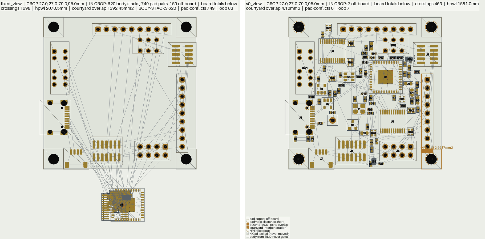
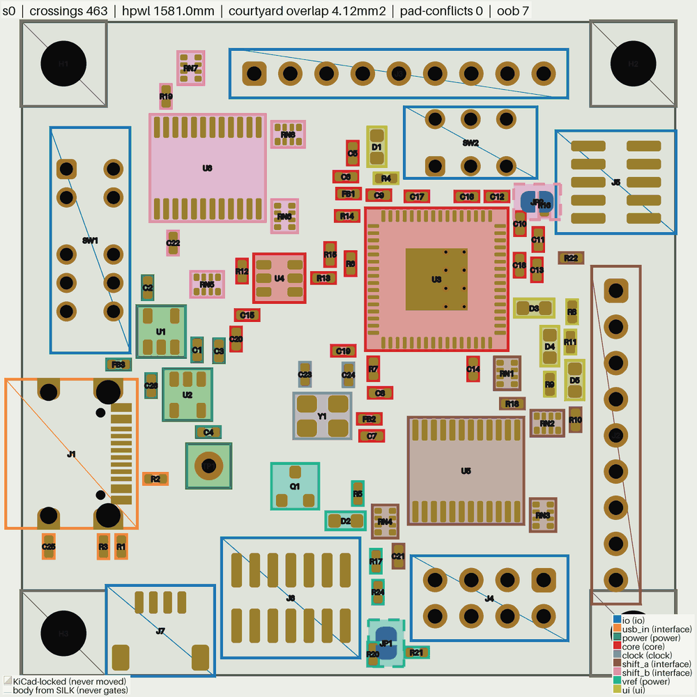
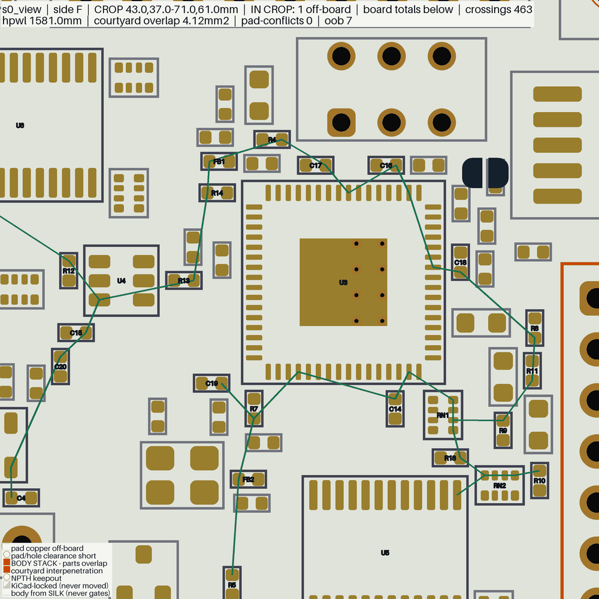
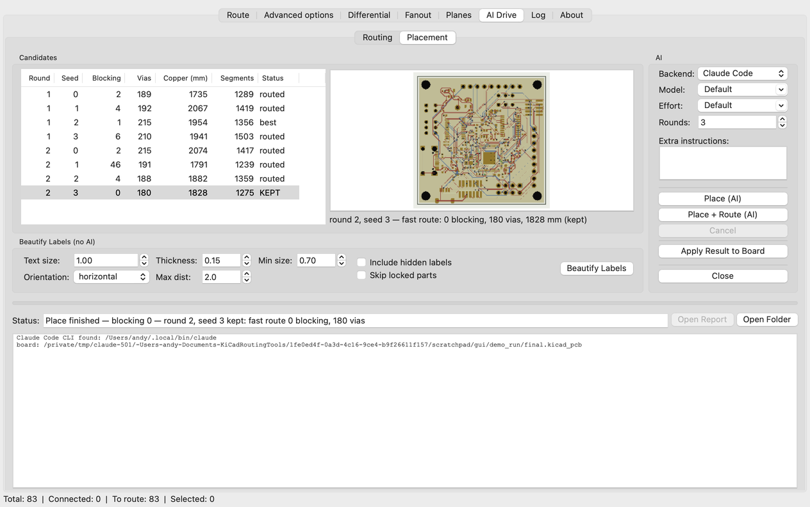

# Placement

Places a KiCad board by function, the way a designer lays one out: the USB
connector with its resistors right behind it, the regulators between the power
entry and the loads, the chip with its decaps on its supply pins and its crystal
on its oscillator pins. You sort the parts into functional groups (a judgement,
usually an agent's); `py_placer/place_simple.py` arranges them by one
objective, annealed from a random start; and a fast route of each seed tells the
placements that route from the ones that do not. Parts the board locks stay
where they are.

The `plan-pcb-placement` skill (`.claude/skills/plan-pcb-placement/`) runs the
whole loop, and the KiCad plugin's **AI Drive › Placement** tab runs the skill.



*`kicad_files/tigard.kicad_pcb` (92 parts, 4 layers), both panels
`render_placement --flat --view 27,27,79,95` (the pile also `--no-labels
--no-legality --no-legend`). Left: the Quick start's
`fixed.kicad_pcb`, every part except the connectors, switches and mounting
holes piled below the board. Right: seed 0 of `place_simple` with the example
groups file.*

- [Quick start](#quick-start)
- [The groups file](#the-groups-file)
- [The objective](#the-objective)
- [Judging seeds by routing](#judging-seeds-by-routing)
- [What the placer reads from the intent](#what-the-placer-reads-from-the-intent)
- [Moving parts by hand: place_pose](#moving-parts-by-hand-place_pose)
- [Checking a placement](#checking-a-placement)
- [The GUI tab](#the-gui-tab)
- [Decap clearance after fanout: place_fanout_clearance](#decap-clearance-after-fanout-place_fanout_clearance)
- [Module map](#module-map)
- [Legality model](#legality-model)

## Quick start

Everything below runs from a fresh clone on `kicad_files/tigard.kicad_pcb`
(an FT2232H USB-to-JTAG/SPI/UART adapter: two LDOs, two level shifters, nine
headers and switches). Outputs go to `wk/tig/`; git ignores `wk/`.

```bash
mkdir -p wk/tig

# 1. Lock what the enclosure decides: the connectors, the switches, the
#    mounting holes. The placer never moves a locked part.
python3 -X utf8 py_placer/place_pose.py kicad_files/tigard.kicad_pcb wk/tig/locked.kicad_pcb \
    lock H1 H2 H3 H4 J1 J2 J3 J4 J5 J6 J7 SW1 SW2

# 2. Pile every other part off the board, for a from-scratch start.
python3 -X utf8 .claude/skills/plan-pcb-placement/scripts/make_unplaced.py \
    wk/tig/locked.kicad_pcb wk/tig/fixed.kicad_pcb --keep-locked

# 3. Emit the floorplan intent: keep-outs, zones, faces and claims.
python3 -X utf8 py_tools/check_floorplan.py wk/tig/fixed.kicad_pcb --emit-intent wk/tig/intent.json

# 4. Check the groups file against the board.
python3 -X utf8 py_tools/check_groups.py wk/tig/fixed.kicad_pcb --groups docs/examples/tigard.groups.json

# 5. Place the default seeds, four at a time: 6 scattered (seeds 0-5) and 6
#    with each group's parts gathered (6-11), then name the 6 to judge.
python3 -X utf8 py_placer/place_simple.py wk/tig/fixed.kicad_pcb 'wk/tig/s{seed}.kicad_pcb' \
    --groups docs/examples/tigard.groups.json --intent wk/tig/intent.json \
    --jobs 4 --json 'wk/tig/s{seed}.json'

# 6. Check a seed, and look at it.
python3 -X utf8 py_tools/check_assembly.py wk/tig/s0.kicad_pcb --baseline wk/tig/fixed.kicad_pcb
python3 -X utf8 py_tools/render_placement.py wk/tig/s0.kicad_pcb \
    --groups docs/examples/tigard.groups.json -o wk/tig/s0.png
```

What to read in the output:

- **`check_groups`** lists the groups, the crystal it found (`crystal Y1 at U3
  pads 2, 3; load caps C23, C24`), the parts that bridge two groups, and any
  `ERROR` (a part in no group or in two, a ref not on the board, a group with
  no part on the board: exit 4) or
  `WARN` (a part with more signal links to another group than to its own, or a
  decap whose chips are all in other groups: a judgement to look at, not a
  mistake by itself).
- **`place_simple`** with an OUT carrying `{seed}` runs one process per seed (`--jobs N`
  limits how many at once; the default is one per seed, at most 4) and prints
  one line per seed: `seed 0: cost 2897.5, 38000 moves in 14.7 s ->
  wk/tig/s0.kicad_pcb`. Each seed's own log goes beside its board
  (`s0.log`): the movable and fixed parts, the groups after folding, one cost
  line per stage of the anneal, the final cost broken down by term, and a
  `JSON_SUMMARY:` line. `--json` writes the full report (`final` costs,
  `moves`, `seed`, `runs`, `reseated`, `repaired` (the last run was mended
  where it stood, below), `illegal`, `unseated` (declared edge parts that
  found no seat on their edge, each with why, also printed as a WARNING), the
  `groups` as placed, `seconds`). A seed is the same placement whether it runs
  alone (`--seed 0`) or in a batch. Exit 0 placed; 4 placed with parts left
  without a legal pose or at a declared pose that is not legal (named); 2
  unreadable input, a part in two groups, a face or pose two declarations
  disagree on, or a part the board locks declared on another face or at
  another pose; with `--seeds`, the worst seed's code.
- **`check_assembly`** says `buildable` or not, with every reason.
- **`render_placement`** writes one PNG per board side (`s0_F.png` and
  `s0_B.png`: tigard's JP1 and JP2 are on the back; a one-sided board gets
  `s0.png`).

The quick start keeps the locked parts on the board (`--keep-locked`). A board
piled whole (no part locked) does not look placed to `check_floorplan`, which
then refuses (exit 3) unless given `--allow-unplaced`.

On tigard each seed anneals its 76 movable parts in about 15 s, and the four
run at once. The same board, inputs and seed always give the same placement.
Seeds differ more than most changes to the inputs, so place several and keep
the one that routes best ([Judging seeds by routing](#judging-seeds-by-routing)).

## The groups file

A JSON file, checked by `py_tools/check_groups.py` and read by
`grouping.load_groups`. The tigard example is
[`docs/examples/tigard.groups.json`](../../docs/examples/tigard.groups.json);
three of its nine groups:

```json
{"schema": 1,
 "board": "kicad_files/tigard.kicad_pcb",
 "groups": [
  {"name": "usb_in", "role": "interface", "anchor": "J1", "near": ["power", "core"],
   "refs": ["J1", "R1", "R2", "R3", "C25"],
   "why": "the USB-C receptacle with its CC pull-downs (R1, R2) and the shield RC (R3, C25)"},
  {"name": "core", "role": "core", "anchor": "U3", "near": ["usb_in", "shift_a", "shift_b"],
   "refs": ["U3", "C9", "C10", "...", "U4", "R12", "R13", "R14", "R15"],
   "why": "the FT2232HQ with its VREG and +3V3 decaps, ... and the 93LC46 EEPROM"},
  {"name": "shift_a", "role": "interface", "anchor": "J2", "near": ["core", "shift_b"],
   "refs": ["J2", "U5", "RN1", "RN2", "RN3", "RN4", "R18", "R22", "R10", "C21"],
   "why": "level shifter U5 with its pull and series networks; anchored on J2, the header it drives most"}
 ]}
```



*`render_placement wk/tig/s0.kicad_pcb --groups docs/examples/tigard.groups.json
--flat --no-ratsnest --no-legality`: each group's parts tinted and outlined in
its colour, keyed bottom right. Locked parts take their group's outline: J1
anchors `usb_in`, J2 anchors `shift_a`. The colours are the file's, so Y1 and
its load caps show `clock`, the group the placer folds into `core`.*

**Per group:**

| key | meaning |
|---|---|
| `name` | unique; what `near` and `apart` refer to |
| `refs` | the parts. Every part the board does not lock is in exactly one group; a locked part may be listed, which ties the group to it |
| `role` | a label for the reader and the legend (`power`, `core`, `interface`, `clock`, `ui`, ...) |
| `anchor` | the part the group is built around. When the anchor itself follows a claim (a crystal), the whole group follows it |
| `near` | groups to sit against: costs the gap between the two groups' nearest courtyards |
| `apart` | groups to keep 3 mm from: costs how far the least gap between the two groups falls short of 3 mm. Once any two members touch that is a flat 3 mm at every nearby pose, and `place_simple` warns that the hint is saturated (`hints_saturated` in its report) |
| `edge` | `N` / `S` / `E` / `W`: costs the group's distance from that board edge |
| `side` | `F` / `B`: every part of the group goes on that face (flipped before the anneal) |
| `why`, `note` | free text; `why` is where the judgement is recorded |
| `templates` | the group's template candidates, `[{"chip", "kind", "why"}]`: a chip whose datasheet layout the skill copies into an intent `templates[]` row ([Datasheet layouts](#datasheet-layouts-templates)). `kind` is `switching stage` (anything switching current through an inductor, transformer, flying or bootstrap cap, or a motor) or `rf front end` (the parts between a radio chip's RF pins and its antenna). The placer does not read it |

**How to group:** by function, never by net count. The power entry and its
conditioning, the core and its decaps, its clock, each interface with its
protection and series parts, the user interface (LEDs with their resistors,
buttons). Where the project has a schematic, start from it (`board_context`'s
`## Schematic`): its sheets are the first cut, and each block drawn together on
a sheet goes into one group. A decoupling cap belongs with the IC whose supply
pin it decouples; a load or RC cap belongs with the part it loads. Do not send the
power group to an edge: say `near` its power entry's group.

**Crystals are claimed for you.** `check_floorplan --emit-intent` finds each
passive crystal at its IC's oscillator pins and the load caps on the crystal's
nets (`crystals.py`) and writes them into the intent as proximity claims
(graded as warnings; `place_simple` derives the same rows itself when an intent
lacks them): each crystal leg within 8.1 mm of its pin and each load
cap within 2.2 mm of the crystal, pad edge to pad edge (three human boards in
four do at least that well). A leg that reaches its pin through a series
resistor (the RP2040's XOUT, an STM32's) is claimed link by link: the crystal
at the resistor, the resistor at the pin. Every claim's subject is then moved into the group of the
part its claims end at: the load caps follow the crystal and the crystal
follows the IC. When the moved part is its group's anchor, the rest of that
group goes with it. In the tigard example Y1, C23 and C24 join `core`, the
emptied `clock` group is dropped, and `near` entries that named it point at
`core`.

## The objective

`place_simple` lowers one cost (`simple.py`) by simulated annealing
(`simple_anneal.py`). Every term, its weight flag and default:

| term | what it costs | flag (default) |
|---|---|---|
| signal wire | the Manhattan spanning tree of each signal net's pads, per mm | 1 (fixed) |
| supply rails | the same tree for a rail (a net reaching more than a quarter of the parts, and more than 6 of them), per mm | `--rail-weight` (0.3) |
| ground | the same tree for ground: a plane, each pad only drops a via | `--ground-weight` (0.02) |
| crossings | each crossing among the signal trees' edges, in mm of wire | `--crossing-weight` (2) |
| claims | each claimed pad's distance to its partner's pad, per mm (intent `proximity[]`, crystals) | `--claim-weight` (1) |
| claim limits | each claimed pad past its claim's `max_mm`, pad edge to the nearest partner pad on its net as `check_floorplan` grades it (a crystal leg past 8.1 mm of its pin, a load cap past 2.2 mm of its crystal), per mm | `--claim-limit-weight` (10) |
| decaps | each decap's distance to the supply-pin site it is matched to, per mm. A decap is a cap from ground to a rail some chip other than a connector (or the board's own contacts, a part whose pads span half the board) has a supply pin on, or between two rails that each carry a supply pin of one chip (a stacked domain), the rule `check_groups` reports by and `check_floorplan` grades by (`BoardView.decaps`); a chip's supply pins include its pins on a rail named as one, or named as one on a net local to it (`BoardView.rail_pins`). A rail's decaps are matched to its pin sites (an IC's supply pins within 1.5 mm of each other) at the least total distance, every site taking one decap before any takes two, so decaps spread over the pins; a decap goes to the sites of the chips in its own group when one is on its rail (an LDO's output cap at the LDO, not at the MCU's VDD pin). A decap none of whose chips is in its group (a load or RC cap the groups file put elsewhere, which `check_groups` WARNs) is left out of this term | `--decap-weight` (2) |
| group contiguity | the spanning tree over a group's courtyards, priced by the gap between neighbours: zero while the group is one contiguous piece, whatever its shape | `--group-weight` (5) |
| `near` / `apart` / `edge` | the groups file's hints (above) | `--near-weight` (2), `--apart-weight` (5), `--edge-weight` (2) |
| front halo | room for a fine-pitch part's fan-out: on each side its pads face, a strip `coef x nets leaving by that side` deep; a same-face part inside it pays the shortfall squared | `--halo-weight` (10), `--halo-coef` (0.25 mm per net) |
| decap limits | the intent's `decaps.max_distance_mm` and `max_pin_distance_mm`, where it grades them at error: each decap's distance to its nearest owner (the chips the decap rule above names), and each supply pin's gap to its nearest cap, per mm past the limit, measured as `check_floorplan` measures them. A pin limit wider than the tether search radius (5 mm), which any cap on the rail meets, is priced only up to the radius past it, so the scattered start does not shape the board around it | `--decap-limit-weight` (10) |
| foreign pads | each tree edge's crossing of another part's pad (through-hole counts twice) | `--pad-weight` (2) |
| congestion | each 0.5 mm cell's routing overflow squared: demand spread over each net's bounding box against the free area per copper layer | `--congestion-weight` (5), `--track-pitch` (0.33 mm) |

**The front halo** applies only to fine-pitch parts: 8 or more connected pads
at a median pitch of 1.0 mm or less (QFN, QFP, BGA, fine-pitch connectors). Its
strip spans the facing pads, a part off the end of a pad row (the chip's corner)
pays nothing, and a small part wired to the chip (4 pads or fewer: a decap at
its pin, a crystal at its oscillator pins) may touch. A decap may touch only on
the side of the supply pin it is matched to; on the chip's other sides it pays
like any other part, so the spare decaps of a rail do not park in a signal
side's fan-out. Everything else packs as tight as legality lets it.



*`render_placement wk/tig/s0.kicad_pcb --side F --view 43,37,71,61
--ratsnest-nets '+3V3'`: tigard's FT2232H (U3) with five +3V3 decaps (C14,
C16-C19) on its supply pins, spread round three sides, and the rail's other
two (C15, C20) by the 93LC46 EEPROM U4, the core group's other IC on +3V3; the
+3V3 tree in green. The other parts keep back from U3's pad rows, leaving the
fan-out room.*

**The anneal.** Every unlocked part starts at a random place on the board,
except an edge connector the intent declares on an edge (`edge_connectors[]`
with an `edge`): that one is held to its edge, its mating face out and flush
with the low end of its overhang band, and its moves only slide it along the
edge -- past a locked part rather than through it -- or, when it has no
mating face (a vertical header, a test pad), turn it. At the end the parts on
one edge are pushed apart along it in their order. A clustered seed (the default
`--clustered` seeds, or any named in `--clustered-seeds`) starts instead with
each group's movable parts gathered
round one random point, in a square of their courtyards' area, so the anneal
arranges whole groups from the first move. Neither start is better on every
board: on boards dominated by one big IC the clustered start routes better
(argus_mainboard about 60 vias a seed fewer), on glasgow_revC and ulx3s the
scattered one does. So the default seeds are six of each, and the judge
chooses. An anchored seed (`--anchored N`, or `--anchored-seeds`;
opt-in, none by default) gathers each group round the point its wiring prefers
instead: a quick least-squares solve pulls each group toward the fixed parts'
pads and the groups it shares signal nets with and toward its `near` and
`edge` hints, and each seed re-weights those pulls at random and jitters the
centres, so seeds still differ. Over 10 boards, 6 scattered + 6 anchored
seeds routed better than the default seeds on covg_patchclamp and bitaxe and
worse on tigard, argus_mainboard and librevna, so it stays opt-in.
Moves shift, turn, swap, dock a part against a partner pad, jump a part to its
wiring target, move an overlapping part to the least-overlap of random poses
over the board, and move, turn or swap whole groups. A chip's own move carries
the caps that hold its decap limits (the cap at a supply pin, a cap the chip is
nearest to) when moving the chip alone would pull them past their limits: each
keeps its offset and turns with the chip. Without that the limits glue a chip
to its caps, and a crystal or an IC that started in the wrong place stays
there. Claims carry the same way: a part's move carries the parts whose claim
on it the move would put further past its limit -- an IC's crystal, a
crystal's load caps and series resistor -- so a crystal stranded beside its
caps comes home with them. A move is kept when it
lowers the cost, or uphill with a probability that falls as the run cools. An
overlap penalty (courtyards, the board's real outline with its cutouts and
notches, the intent's keep-outs and zones, and the board's rule-area keep-out
bands) rises from soft to hard over the run, so parts may pass through each other
early and a group can cross a crowded board. The run is 500 moves per movable
part (`--moves` sets the total) from `--seed`. At the end every part is checked
by the exact legality gate, and a part that fails it moves to the nearest legal
pose. A run that leaves a part with no legal pose anneals again from a fresh
start, up to two more times; the first legal run is kept. A run that got stuck
is a worse arrangement than a fresh one that did not, so the fresh start pays
for itself; but if the last run never comes clean either -- a big part wedged
among its neighbours, which no move of one part frees -- it is mended where it
stands: each part still overlapping is shoved one straight step out of what it
overlaps, the movable parts in its way pushed aside in turn.

## Judging seeds by routing

A placement is judged by routing it: blocking nets first (unrouted, then
broken), then the joins the open nets still need (`joins_needed`: a
missing 17-pad rail is 16, one stranded pad 1, and the rail-less board has
fewer vias because the rail is missing), then vias, copper length and
segment count. The objective's cost,
crossings and hpwl only rank placements nobody has routed yet. A floorplan
error (`check_floorplan --intent`: a decap past its pin limit) ranks ahead
of all of them, since no route clears it: a seed that carries one cannot be
DONE as placed, so every seed that grades clean ranks above it.

Route each seed with the board's own routing chain (the `plan-pcb-routing`
skill writes one), giving `route.py` and every `route_diff.py` step
`--quick 2`: the judging route. It skips the recovery tail, where a poor
placement's routing time goes, and every pass that only polishes copper for
shipping, so it takes about half the time of `--quick` alone and picks seeds
as well. Score it with `py_tools/quick_score.py`, which grades the board's
open nets as `board_score` grades a full route, over the nets without a zone
(level 2 skips the plane finalize that joins a poured net's pads), and adds
`board_score`'s quality counts. Use the same chain for every seed so they
compare.

The skill keeps the seeds in `wk/<run>/`, and the GUI's candidates table
reads the same names:

| file | what it is |
|---|---|
| `s<S>.kicad_pcb`, `s<S>.json` | seed S's placement and its `place_simple` report (`start`: scattered or clustered) |
| `judge.json` | the seeds `place_simple` names for a judging route |
| `s<S>_route/` | the fast route's working files |
| `s<S>_fast.kicad_pcb` | the fast-routed board, copied out of `s<S>_route/` |
| `s<S>_fast.score.json` | its `quick_score` |

and the kept board goes to `wk/<run>/final.kicad_pcb`. `py_placer/judge_seeds.py`
runs the judging route over the seeds `judge.json` names, the same chain on
each, and writes those files (#1327). The chain is a text file, one command
per line, its boards named by placeholder (`{in}` the board the step reads,
`{out}` the one it writes, `{dir}` the seed's route folder, `{run}` the run
folder); every `route.py` and `route_diff.py` step runs at `--quick 2`. For
tigard, `wk/tig/judge_chain.txt`:

```text
python3 -X utf8 py_router/route_planes.py {in} {out} \
    --nets GND +3V3 --plane-layers In1.Cu In2.Cu --clearance-ceiling 0.15
python3 -X utf8 py_router/qfn_fanout.py {in} --component U3 \
    --nets '*' '!GND' '!+3V3' --output {out}
python3 -X utf8 py_placer/place_fanout_clearance.py {in} {out} --clearance 0.1
python3 -X utf8 py_router/route_diff.py {in} {out} \
    --nets /USB_DP /USB_DN --track-width 0.1 --diff-pair-gap 0.1 --clearance-ceiling 0.1 --no-gnd-vias
python3 -X utf8 py_router/route.py {in} {out} \
    --nets '*' --track-width 0.10 --clearance-ceiling 0.15 --via-size 0.5 \
    --via-drill 0.25 --hole-to-hole-clearance 0.25 --board-edge-clearance 0.5 --grid-step 0.05 \
    --layers F.Cu In1.Cu In2.Cu B.Cu --layer-costs 1.0 3.0 3.0 1.0 \
    --power-nets GND +3V3 +5V VTARGET VREG /VBUS +1V8 --json-out {dir}/route.json
```

```bash
python3 -X utf8 py_placer/judge_seeds.py wk/tig/judge.json --chain wk/tig/judge_chain.txt \
    --intent wk/tig/intent.json
```

Each seed's score is `quick_score`'s (`--intent` passed through): `blocking`
(with the floorplan's errors in it, `blocking_by.floorplan`), `joins_needed`
and `quality` (vias, copper_mm, segments). The runner ranks the seeds by
`quick_score.judge_key` (floorplan errors plus the assembly count first, then blocking, then
`joins_needed`, then vias, copper, segments) and names the best; copy its
placement (`wk/tig/s<S>.kicad_pcb`, never the `--quick` board) to
`wk/tig/final.kicad_pcb` with `copy_board.py`; in `full` mode the skill then
routes it with `/plan-pcb-routing`, without `--quick`.

**The skill's seeds.** `place_simple`'s default seeds are `--scattered` seeds
(default 6), then `--clustered` seeds started clustered (default 6, below);
it names the `--judge` legal seeds (default 6) in `judge.json`: those
`check_floorplan --intent` grades without an error first, then by lowest
`final.cost`. The skill fast-routes those and keeps the best.

## What the placer reads from the intent

`check_floorplan --emit-intent` writes a starter intent; a design brief or a
`mechanical.json` beside the board is compiled into it
([docs/floorplan-intent.md](../../docs/floorplan-intent.md),
[docs/design-brief.md](../../docs/design-brief.md)). `place_simple` reads part
of it; `check_floorplan --intent` grades all of it.

| intent key | place_simple | graded by check_floorplan |
|---|---|---|
| `proximity[]` claims | priced: the claim term, and the subject joins its partner's group | yes (`max_mm`) |
| `keepouts[]` | binding: the overlap penalty, and the final legality | yes |
| zones (`blocks[].zone`, exclusive zones) | binding: members held inside, strangers kept out of an exclusive zone | yes |
| declared faces (`blocks[].side`, edge and face claims) | applied before the anneal (parts flipped) | yes |
| `fixed_poses[]` | applied: seated at the declared pose and held | yes |
| `edge_connectors[]` with an `edge` | applied to an unlocked edge part (connector, receptacle, switch, test pad; a cap the emitter declared because it overhangs is not): held to that edge where every edge-connector conjunct holds (band, edge read, pad copper clear of the outline), sliding along it | yes |
| `decaps` limits (`max_distance_mm`, `max_pin_distance_mm`) | priced where graded at error: the decap-limit term | yes |
| `blocks[].rotation`, `rotation_candidates` | not read (`place_fanout_clearance --intent` holds them) | no rule checks a part's angle; the plan check bounds a zone on the declared angles, and `array_conflict` flags a row whose rotation contradicts them |
| `arrays[]` | not read | yes (`array_formation`, `array_conflict`) |
| `keep_away[]` | not read | yes (pad edge to pad edge, WARN unless its severity is raised); `route.py` reads the design brief's `keep_away` itself |
| `replicate[]` | not read (`place_pose replicate --intent` applies it) | yes |
| `templates[]` | applied and priced: each member seated at its template pose round its chip at the start, carried with every move of the chip, its drift priced (`--template-weight`, default 100 per mm); it joins the chip's group and is not priced as a decap | yes (`template`, WARN) |

## Datasheet layouts: templates

A switching regulator's datasheet draws where its support parts go: the
input caps across VIN and ground, the inductor on the switch pin, the boot
cap across BOOT and SW, the feedback divider at FB. The router cannot see
whether a placement follows that drawing, so a buck can route clean and
still work badly. A template holds the drawing: each support part's pose in
the chip's own frame (`templates.py`), declared in the intent's
`templates[]` ([docs/floorplan-intent.md](../../docs/floorplan-intent.md)).

The poses are fitted to the board's own footprints, not copied from the
drawing, because a datasheet packs its parts tighter than a board's
courtyards allow. `py_tools/fit_template.py` takes a sketch -- the members
in the drawing's order, nearest the chip first, each with the pins it serves
and the side of the chip it sits on -- and seats each member in turn as close
to its pins as the courtyards already seated allow, kept the board's
clearance apart (the seat gate's own rule, so a member at its template pose
is legal), at the quarter turn that brings its pads closest:

```bash
python3 -X utf8 py_tools/fit_template.py BOARD --pins U2      # the pins, to match the drawing
python3 -X utf8 py_tools/fit_template.py BOARD --sketch sketch.json --render u2.png \
    --intent intent.json --write-intent intent.json
```

`place_simple` seats each member at its template pose when every start is
laid out, carries the members rigidly with every move of the chip, sends a
member's `jump` back to its pose, and prices each member's mean pad distance
from it. On fusb302_pd_dev (an LMR36006 buck, its datasheet's Figure 57)
the members ended within 0.5 mm of their poses on 142 of 144 member-seeds,
the inductor 0.7 mm from the switch pin on average against 3.7 mm without the
template. On argus (two TPS54226) and bread_dcmotor (an AP63205) the members'
pad-edge gaps to the pins they serve fell from 4-33 mm to 1.7-2.4 mm; on
pocat_comms's two RF front ends (an SX1262 and its RF switch) from 1-5.6 mm
to 0.3-0.5 mm; and on covg_patchclamp's LT3471, a converter its pin names do
not show and which was named while grouping, from 4-15 mm to 1.0 mm. The
routing was no worse on any of the five. On the first four no broken or
unrouted net was gained or lost, and the vias differed by less than the
seed-to-seed spread; on covg_patchclamp 3 of the 6 judged seeds routed with
nothing blocking, against none of 6 without the template. A member may sit
on the far face of a through-hole chip, under its body, so bread_dcmotor's
two LMD18200 H-bridges (through-hole, their bootstrap and supply caps on the
back) take templates too: every member ended at its pose on the six judged
seeds, which routed with nothing blocking in both arms, at 55 vias on
average against 60. On mikoto_nrf52840 the nRF52840's reference layout,
whose RF match sits beside a chip antenna, routed with nothing blocking on 4
of 6 judged seeds against 3 of 6, though on that crowded board the final
legality pass moved 1-2 members a seed up to 7.1 mm off their poses. The
`plan-pcb-placement` skill's §3.5 is how an agent goes from the datasheet to
the sketch.

A template can hold its members exactly and still be wrong, so for a
`switching stage` (the row's `kind`) `fit_template` and `check_floorplan`
also measure each member cap's ground return: the pad-edge gaps from its
ground pad to the chip's ground pins, or an external low-side FET's, through
the other members' ground pads (`templates.ground_returns`). Past 3 mm it is
a NOTE in the fit and a `template_ground_return` warning in the grade. On
fusb302_pd_dev the output caps, fitted with only their VOUT pad named, sat
past the inductor with their ground 10.5 mm from the chip's; named beside the
input caps' ground as Figure 57 draws them, 1.8 mm, and the six judged seeds
routed with nothing blocking, as before.

## Moving parts by hand: place_pose

`py_placer/place_pose.py` applies a pose you chose and grades it, refusing a
request that makes the board worse (exit 4, nothing written):

```bash
python3 -X utf8 py_placer/place_pose.py BOARD OUT set U1 129.9 98.3 --rot 270   # exact pose
python3 -X utf8 py_placer/place_pose.py BOARD OUT set U1 --near 130 98 --rot 270 # nearest legal pose
python3 -X utf8 py_placer/place_pose.py BOARD OUT rotate CON2 180
python3 -X utf8 py_placer/place_pose.py BOARD OUT face U1 W USB1                 # aim a pad row at a part
python3 -X utf8 py_placer/place_pose.py BOARD OUT lock U1 CON1 CON2              # unlock REF undoes it
python3 -X utf8 py_placer/place_pose.py BOARD OUT replicate --from CH1 --to CH2 --to CH3 --anchor J1
```

- `--near X Y` (or `--snap`) takes the nearest legal pose within `--radius`:
  the poses the legality gate admits, nearest the aimed point first, each
  re-graded exactly before it is written.
- Several verbs in one call describe one arrangement, written in one pass.
- `replicate` copies one arranged channel onto its sibling sheet instances,
  matching parts by schematic symbol, and refuses unless the instances are
  wired alike.
- Exit 0 written, 2 a bad request (unknown ref, unreadable board), 3 the board
  has copper (`--allow-routed`), 4 refused. Full contract:
  [docs/utilities.md](../../docs/utilities.md#pose-setter-place_posepy).

## Checking a placement

```bash
python3 -X utf8 py_tools/check_assembly.py placed.kicad_pcb --baseline input.kicad_pcb
python3 -X utf8 py_tools/check_floorplan.py placed.kicad_pcb --intent intent.json
python3 -X utf8 py_tools/render_placement.py placed.kicad_pcb --before input.kicad_pcb -o delta.png
```

- **`check_assembly`**: `buildable` or not. Pad or graphic copper off the
  outline, a pad stack, courtyards overlapping on a part that moved (with
  `--baseline`), a part in a connector's mating keep-out.
- **`check_floorplan --intent`**: every rule of the intent. Read `errors` (0
  to pass). It exits 4 on a violation, and also when the grade is incomplete
  (`NOT FULLY GRADED`: a budget it cannot measure, a rule left unarmed), which
  the emitted starter intent usually is.
- **`render_placement`**: one PNG per side with a caption of the numbers
  (crossings, hpwl, courtyard overlap, pad conflicts, parts off the board) and
  the legality findings drawn on the board. Useful options: `--before` (what
  moved, as ghosts and arrows), `--groups FILE` (colour by group),
  `--view X0,Y0,X1,Y1` (a crop in board mm), `--ratsnest-nets GLOB` (only the
  nets you are chasing), `--side F|B`, `--json-out` (the checklist, including
  `a_off_outline.pad_copper_gating`: the parts whose pads are off the board).
  The render is triage; the routed result is the verdict.

To watch a placement happen, `py_placer/place_movie.py` takes the same
arguments as `place_simple.py`, places the board exactly as it does, and
films the run: the pile gliding onto the board, the anneal as it lowers the
cost, the best placement and the board written. With `--route` it films the
skill's flow too: the seeds fast-routed side by side, the best one picked
and routed in full ([Utilities](../../docs/utilities.md#placement-movie-place_moviepy)).

## The GUI tab

The KiCad plugin's **AI Drive › Placement** tab runs the same skill on the open
board, laid out like the routing tab: the AI column sets the backend (Claude
Code), model, effort and extra instructions, and **Place (AI)** runs
`/plan-pcb-placement place`, **Place + Route (AI)** runs `full`, headless on a
snapshot of the board, into a `krt_placement/` folder beside the board file
(its newest three runs are kept). The left pane is a candidates table, one
row per seed (blocking, vias, copper, segments, and a status: placing,
routing, routed, clean, best, KEPT), filled live from the run folder's seed
files, beside a preview of the selected row's fast-routed board; the
transcript streams below, and **Apply Result to Board** writes the kept
placement back (after Place + Route, its tracks and vias too). **Beautify
Labels** tidies reference designators without AI (the CLI is
`py_placer/beautify_labels.py`).



## Decap clearance after fanout: place_fanout_clearance

A routing step, run once after the last BGA fanout: it nudges the decoupling
caps (and resistors and beads) near a ball field off the fanout's vias and
tracks, a few millimetres at most (with `--intent`, within the intent's decap
limits), so the cap and the escape routing do not collide. On a board with no
BGA it moves nothing and passes the board through, so a chain may carry it
after a QFN fanout, as tigard's does. See
[docs/utilities.md](../../docs/utilities.md#decap-clearance-repair-place_fanout_clearancepy).

## Module map

| file | what it is |
|---|---|
| `../place_simple.py` | The placer CLI: groups, one objective, annealed |
| `../place_movie.py` | `place_simple` with a camera: a movie of the run |
| `../placement_story.py` | The movie's story, shared by `place_movie` and the 3D movie (`movie3d/`): the hooks into `place_simple`, the piles, the fixed parts' flights, the scatter, the anneal's frame schedule and the captions; each movie only draws it |
| `simple.py` | The objective: every term above, priced locally per move (spatial index, cached breakdowns, Rust kernels) |
| `simple_anneal.py` | The simulated annealing: moves, schedule, overlap penalty, the final legality pass |
| `grouping.py` | The groups file: schema, rails, cohesion and decap checks, folding claims into groups (`check_groups.py`) |
| `crystals.py` | Crystal claims: each passive crystal at its IC's oscillator pins (link by link through a series resistor), each load cap at its crystal |
| `quench.py` | `QuenchState`: the parts, their poses and geometry at every quarter turn, the board, the intent's keep-outs and zones, the seat gate (`candidate_valid`) and `wire_metrics` (length, crossings, hpwl) |
| `templates.py` | Datasheet layout templates: the intent rows' validation, a member's pose for its chip's pose, its drift, the fit of a sketch to the board's footprints, the pin table and the render (`py_tools/fit_template.py`) |
| `seeder.py` | The seat predicate `pose_ok`, the wiring target, the fixed-pose checks and the `(locked yes)` stamps |
| `legality.py` | The legality every tool shares: board side, Edge.Cuts containment, pad and drill legality, courtyards, the graders |
| `body.py` | A footprint's body: courtyard, else fab, else silk, else the pad box; and the estimated courtyard of a part that draws none (#1300) |
| `writer.py` | Writes poses and face flips back to the board |
| `parser.py` | Courtyard, fab, silk and lock extraction |
| `../place_pose.py`, `pose_ops.py` | Hand placement: set, rotate, face, lock, unlock, snap |
| `replicate.py` | `place_pose replicate`: one channel copied onto its sibling instances |
| `../pose_score.py` | Builds the placement state; ranks a part's legal poses nearest first |
| `floorplan.py` | The floorplan intent: emit it, grade a board against it |
| `design_brief.py`, `reconcile.py` | The design brief and `mechanical.json`, compiled into the intent |
| `groups.py` | Placement blocks (KiCad groups, sheets) for intent zones and `route.py --group` |
| `schematic.py` | The project's `.kicad_sch` tree, read for grouping: each part's sheet, the drawn blocks with their notes, the designer's layout notes as netlist-checked `proximity` rows (`board_context`'s `## Schematic`) |
| `mating.py`, `connector_geometry.py`, `edge_facing.py` | Which way a connector opens; its drawn envelope against its edge; pad rows facing the outline |
| `edge_seat.py` | An unlocked declared edge connector held to its edge: its turns, its distance, the stretches of the edge it may slide along, the end-of-run push apart |
| `arrays.py` | Declared `arrays[]`: the formation and the pin order, graded |
| `roles.py`, `emc_roles.py`, `part_class.py` | What a part is (regulator, crystal, ...), its EMC legs, its position class |
| `escape.py`, `pair_order.py`, `routability.py` | Escape lanes per face, pin-order inversions, corridors and net affinity for the grade |
| `reachability.py` | Whether a pad can be reached at all (`check_reachability.py`) |
| `fanout_clearance.py` | `place_fanout_clearance`'s engine |
| `labels.py` | Reference-designator placement (`beautify_labels.py`) |
| `lock_advisor.py` | Which parts look position-critical (`board_brief`'s `locks` line); advice only |
| `placement_state.py` | Board-state gates: unplaced, already routed |
| `options.py` | When a board cannot hold its parts: the utilisation numbers (`grow_board`) |
| `pin_rows.py` | `is_through_hole_part` |
| `cli_gates.py` | The CLI arguments the placement tools share |
| `portfolio.py`, `utility.py` | Sibling-file copying, small helpers |
| `reconstruct.py` | Part tiers and mounting-hole pattern fits, for `emit_intent` and `lock_advisor` |
| `../converge.py`, `../board_store.py` | The skill's run ledger and the content-addressed board store beside it |
| `../../py_tools/render_placement.py` | The placement renderer |

## Legality model

One definition of a legal placement, in `legality.py`, used by the placer's
gate, `place_pose` and the graders:

- **Faces.** A part occupies its own face with its full courtyard, and the
  other face only where its drilled pads are (one box per cluster of holes),
  so a back-side cap may sit under a front-side chip but not inside a
  front-side connector's pin field. The anneal's overlap and halo terms
  pair two parts the same way, so it does not push such a cap out from
  under the chip's body.
- **Custom pads.** A custom pad whose copper lies to one side of it (a
  power FET's drain, a printed antenna) is boxed round that copper
  (`legality.pad_copper_box`, from `Pad.copper_box`), not by the parser's
  `size_x`/`size_y`, which centre a box twice that size on the pad.
- **Courtyards and the outline.** The seat gate keeps courtyards on one face
  at least the board's clearance apart, and inside the board's real Edge.Cuts
  outline (cutouts and notches included) by the edge clearance.
  `check_assembly` refuses real courtyard overlap on a part that moved.
- **Pads and holes.** Pad copper keeps its clearance to every other net's
  copper (net classes, `.kicad_dru` layer rules and pad overrides included),
  never stacks on another part's pad, and stays inside the outline; NPTH holes
  keep foreign copper at the board's hole clearance.
- **Containers.** A large outline-only part (an e-paper panel's frame) or a
  pin-frame module (a Teensy) is graded by its holes, not as a body. The
  anneal's overlap prices it the same way: a courtyard over a pin frame's
  drilled holes, on either face, and nothing for the frame's rect.
- **Bodies.** A footprint without a courtyard is graded by its fab drawing,
  else its silk, else its pad box (`body.py`); the fallback is named in the
  output.
- **Estimated courtyards (#1300).** The placer, the seat gate and the
  renderer seat such a part on an ESTIMATED courtyard
  (`body.estimated_courtyards`, `QuenchState(estimate_courtyards=True)`):
  the graded body above, united with the pads, and no more. A library
  courtyard stands a margin off its body, a spacing the board itself never
  declared, so the estimate adds none. It is what `check_assembly` grades,
  so a legal seed keeps those bodies apart; before it, multichannel_mixer's
  radial caps (a 5 mm body on a 4 x 1.5 mm pad box) were packed into each
  other and every seed graded NOT BUILDABLE. It is an input, not a grade: the graders, and
  two declared or locked poses judged against each other
  (`_Part.drawn_rect`), still read what the board draws.

[docs/floorplan-intent.md](../../docs/floorplan-intent.md) has the intent's
rules, and [docs/utilities.md](../../docs/utilities.md) each tool's full
contract.

## TODO

- **Datasheet layouts: the rules.** A template (above) holds where a
  converter's support parts sit. The datasheet's rules behind that layout
  are still unused:
  1. Cost terms from the rules, such as switch-node length and input-loop
     area, which `check_floorplan` would also grade, since routing cannot see
     them. The caps' ground return is graded already (above), not priced.
  2. The router follows the datasheet's routing rules for those parts and the
     area they cover:
     - the input loop short, wide and on one layer, for low inductance;
     - the switch node's copper small;
     - the feedback trace kept away from the switch node;
     - a ground via beside each cap's ground pad, and thermal vias under the
       exposed pad.

     Some rules compile into what the router already reads: a `keep_away`
     rule in the design brief, or per-net widths through `--power-nets` /
     `--power-nets-widths`. Loop inductance and copper area would be new
     router costs, graded on the routed board.
- **Template members through the final legality pass.** On a crowded board
  the last legality pass reseats whatever collides, template members
  included, and moves them off their poses (mikoto_nrf52840: 1-2 members a
  seed, up to 7.1 mm). It should move a member's non-template neighbour
  first, or seat the member at the nearest legal pose within its template's
  reach, and break the template only as a last resort, saying so.
- **Shield cans.** A can is neither a solid body nor free space: parts sit
  under it, inside its fence, and a net reaches them only through the few
  openings the fence leaves (gaps in the wall, or a via to an inner layer).
  The placer should treat a can as a container, decide which parts belong
  inside it, and price every net that crosses its wall by those limited
  crossings, so cross-wall nets stay few and near the openings. Today a locked
  can is solid: on thunderscope, where the human board puts 354 parts under
  four cans and a heatsink, the placer ended with 6 and 16 parts illegal, and
  placed cleanly only with the cans removed.
